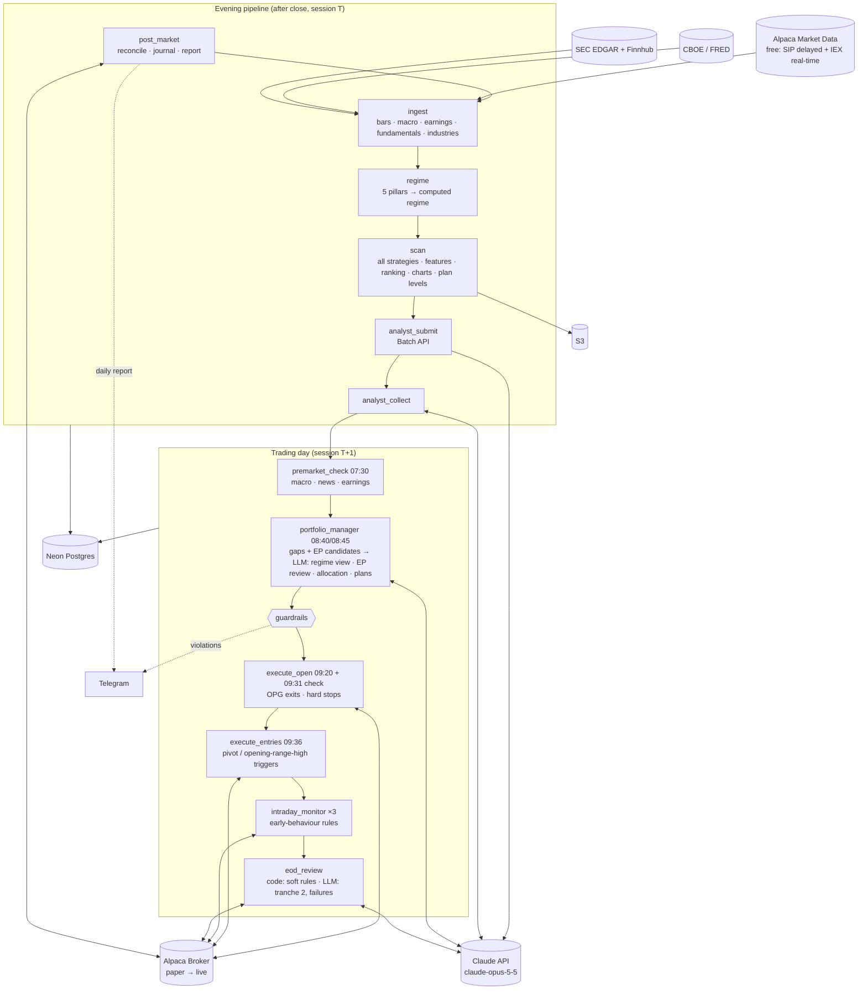

# AuraTrade

An autonomous, event-driven swing-trading system for US equities. It is modelled as closely as possible on the documented methods of successful growth/momentum swing traders: Mark Minervini (**SEPA / VCP**), William O'Neil and IBD (**CAN SLIM**: market direction, bases and sell rules) and Kristjan Kullamägi (**breakouts and episodic pivots**). A **market-regime layer** switches strategy and risk as conditions change. The sources behind each rule are listed in [§18](#18-methodology-sources).

An LLM (Claude) makes the trading and capital-allocation decisions. Python computes the facts the LLM reasons over, carries out each position's exit plan, and enforces hard risk limits the LLM cannot override. The system runs serverless on AWS, on a budget of **under $150/month** (about $40–65/month expected).

> **Status:** design complete, build not started. The step-by-step build plan and progress tracker are in [docs/execution-plan.md](docs/execution-plan.md); the builder's working rules are in [CLAUDE.md](CLAUDE.md).
>
> **Disclaimer:** this is experimental software that will trade real money once live. Nothing here is financial advice. It runs on an Alpaca **paper** account first. Never risk capital you cannot afford to lose.

---

## Contents

1. [Design principles](#1-design-principles)
2. [System architecture](#2-system-architecture)
3. [Daily schedule](#3-daily-schedule)
4. [Market calendar and data integrity](#4-market-calendar-and-data-integrity)
5. [Components](#5-components)
6. [Market regimes and strategies](#6-market-regimes-and-strategies)
7. [Entries, position plans and exits](#7-entries-position-plans-and-exits)
8. [Risk management and guardrails](#8-risk-management-and-guardrails)
9. [LLM design and token budget](#9-llm-design-and-token-budget)
10. [Data model](#10-data-model)
11. [Tech stack](#11-tech-stack)
12. [Infrastructure and cost](#12-infrastructure-and-cost)
13. [Repository layout](#13-repository-layout)
14. [Configuration](#14-configuration)
15. [Validation and go-live criteria](#15-validation-and-go-live-criteria)
16. [Decision log](#16-decision-log)
17. [Known limitations](#17-known-limitations)
18. [Methodology sources](#18-methodology-sources)

---

## 1. Design principles

1. **Trade like the practitioners, not like a model.** Every rule maps to a documented practice of a successful trader (§18) or is a guardrail that keeps automation safe. Defaults that the sources disagree on are chosen by backtest, not by taste.
2. **The LLM decides; code enforces the envelope.** Claude chooses setups, risk and exit plans. Code rejects or clips anything outside hard limits.
3. **Python computes facts; the LLM interprets them.** All indicators, patterns, base counts, share counts and **price levels** are computed in code. The LLM may accept a code-computed pivot or stop, nudge a pivot within a small tolerance, or tighten a stop. It never invents a price level (§8, "Price levels").
4. **Each position follows its entry plan, and changes can only tighten it.** The plan is written at entry and carried out by code. Later LLM decisions may only make it more conservative.
5. **Losses small, winners big.** Tight initial stops, quick exits from breakouts that don't work, partial sales into strength, and letting the remainder run on a trailing stop.
6. **Progressive exposure.** Start small, size up when trades are working, size down when they aren't, in both the market and the account.
7. **The broker is the source of truth; fail closed for entries, fail safe for exits.** Hard stops always rest at the broker. No halt, kill switch or error path ever cancels a protective stop or blocks a plan exit.
8. **Everything is logged.** LLM decisions can't be honestly backtested, so the log is the validation record.
9. **Only spend tokens when a decision is needed.**

---

## 2. System architecture



**Key architectural choices:**

- **One container image, many entrypoints** (one Lambda per job).
- **The Analyst runs in the evening** via the Claude **Batch API**. **Episodic pivots** (overnight earnings or news gaps) can only be seen in the morning, so they are reviewed in the Portfolio Manager's real-time call.
- **All strategy scans run every evening**; the regime decides what gets *funded*.
- **The regime is computed in code**; the LLM's view (only ever more conservative) comes in the morning call.
- **Postgres is the queue** (`signals`).
- **Entries are placed after the opening print (09:36)**, not before the open. Triggers are the pivot or the opening-range high, so a stock that gaps up and then fades isn't bought at the open.

---

## 3. Daily schedule

All times are US/Eastern (EventBridge Scheduler, `America/New_York`). **Every job starts with the market-calendar guard** (§4).

| Time (ET) | Job | Purpose |
|---|---|---|
| **Evening (session T)** | | |
| 16:20 | `post_market` | Reconcile; journal; equity snapshot; risk multiplier (§8); Telegram daily report |
| 17:00 | `ingest` | Gap-fill bars through T; universe and industries; corporate actions; macro; earnings calendar and surprises; rolling fundamentals |
| 17:15 | `regime` | 5 pillars → state machine → **computed regime** |
| 17:30 | `scan` | Trend Template → **all** strategy scans → features (base count, RS line, up/down volume, momentum rank, ADR) → ranking + cap → charts. Simulates the **baseline book** for the day and **scores past Analyst verdicts** (§5.12). Also updates **position-plan levels** and raises **position events** (climax signals, faltering RS, time stops, earnings cushion, corporate actions) |
| 17:45 | `analyst_submit` | Submit Analyst reviews as one Claude batch |
| 19:00, 21:00, 06:00 | `analyst_collect` | Collect results (idempotent). Not done by 06:00 → no new evening-pipeline entries tomorrow, plus an alert |
| **Trading day (session T+1)** | | |
| 07:30 | `premarket_check` | Macro refresh (computed regime may only **downgrade**); overnight news; earnings-date changes |
| 08:40 | `portfolio_manager` (gap step) | IEX pre-market trading starts at 08:00, so gaps are measured here, not at 07:30. Setups gapping > 5% above their pivot are invalid today (EPs excepted: their gap is the signal, §7.1). **Episodic-pivot candidates**: gap ≥ 10% on earnings/news |
| 08:45 | `portfolio_manager` (decision step) | **Only if there's something to decide.** LLM regime view, **EP review**, allocation, exit plans for new entries, tightening of existing plans → guardrails → `signals`. **Hard deadline 09:10:** no valid decision by then → no new entries today (existing plans still run) |
| 09:20 | `execute_open` | Reconcile → OPG exits/trims (stop quantity reduced first, §5.7) → hard-stop replacements |
| 09:31 | `execute_open` (check run) | Reconcile + stop invariant only. Catches an OPG exit that was rejected or didn't fill at the open, so the shares aren't left without a stop until 09:36 |
| 09:36 | `execute_entries` | Reconcile + stop invariant (catches any rejected OPG order) → re-check the actual open vs each pivot → place entry orders with their triggers: pivot, or the **5-minute opening-range high** when the opening range traded above the pivot, and for momentum breakouts and EPs. Skip anything more than 5% above its pivot |
| 10:30, 12:30, 14:00 | `intraday_monitor` | Reconcile fills; volume pace; **early-behaviour rules** (§7); raise hard stops when a milestone was hit intraday (breakeven, round-trip); cancel invalid entries; crisis check |
| 15:40 (12:40 on half days) | `eod_review` | Code: soft-rule exits (trailing MA closes, heavy-volume reversals, climax and cushion actions), decided on the **15:40 decision price** and executed at once (§7.3). LLM, **only if needed**: tranche-2 adds that passed the gate, failed breakouts. **Hard deadline 15:50 (12:50):** no valid LLM decision → no adds, and failed breakouts follow their default (hold) |
| **Other** | | |
| Saturday 10:00 | `weekly_review` | Performance, "your numbers" (average gain/loss, win rate), LLM vs baseline, calibration, **proposed** lessons |
| Every 15 min, 07:00–22:00 on weekdays | `watchdog` | Alert if an expected job heartbeat is missing. Each run also pings an external dead-man's switch (§5.13) |

---

## 4. Market calendar and data integrity

**Calendar guard.** EventBridge fires every weekday, so every job begins with:

```python
session = calendar.session_for(today)          # None if the market is closed
if session is None:
    record_job_run(job, status="SKIPPED_MARKET_CLOSED")   # heartbeat still written
    return
```

- **Calendar authority:** Alpaca's calendar API is primary; `pandas_market_calendars` is the cross-check. **If they disagree, no new entries today** (stops still managed), plus an alert.
- **`market_sessions` table:** date, open/close, `is_early_close`, minutes, data status.
- **Guard policy per job type:**

  | Job type | Runs when |
  |---|---|
  | Morning and intraday jobs | Today is a session |
  | Evening jobs (`post_market` → `analyst_submit`) | Today was a session |
  | `analyst_collect` | Any day it's scheduled (idempotent, collects the latest open batch) |
  | `weekly_review` | Saturdays, regardless of sessions |
  | `watchdog` | Checks only heartbeats that were *expected* given that day's calendar |

**Holidays:** no calls or orders; hard stops are GTC at the broker; entry orders are day orders.

**Gap-fill ingest:** fetch every session since the last stored one.

**Early-close days (13:00):** no new entries or tranche-2 adds; EOD review at 12:40; half-day **volume normalized** (× 390 / session minutes).

**Sessions, not calendar days:** every window (22 / 25 / 252 sessions, earnings windows, hysteresis, time stops, 8-week hold = 40 sessions) is counted in sessions.

**Missing data vs. closed market:**

| Situation | Detected by | Action |
|---|---|---|
| Market closed | Not in `market_sessions` | Expected; nothing fetched |
| Vendor data incomplete | Under 90% of expected symbols | Retry, then `INCOMPLETE` → no new entries next session, plus an alert |
| A single symbol has no bar | Halted, suspended or delisted | Excluded from today's watchlist; never forward-filled |

**Macro staleness:** "latest value on or before" each session; more than 2 sessions stale → volatility pillar scores 0.

**Intraday prices:** current prices and opening ranges from **real-time IEX**; volume from **15-minute-delayed SIP**.

**Long weekends:** the Portfolio Manager receives `sessions_until_next_open` and `is_long_weekend`.

---

## 5. Components

### 5.1 Ingest (`ingest`)

- **Universe:** active, tradable US common stocks (NYSE, NASDAQ, AMEX). Price ≥ $10, 50-day average dollar volume ≥ $10M, ≥ 252 sessions of history. This also screens out the thinly traded stocks IBD found perform poorly (under ~400k shares a day).
  - The price and dollar-volume filters use **raw (unadjusted) prices as they traded that day**. Split-adjusted history would misstate past prices: a $50 stock before a 10:1 split shows as $5.
  - **Point in time:** backtests rebuild the universe for each historical session from the symbols that were listed then, **including later-delisted ones**, as far as the vendor covers them. Coverage is measured in spike 0.3a and its gap is reported in every backtest (§15).
- **Bars:** Alpaca SIP daily bars, `adjustment=split`, plus the raw close (for the universe filter); rolling **2 years** in Postgres, full history (2016 onward) in **Parquet**.
  - **Split-only adjustment, not dividend adjustment:** pivots and stops computed from the bars become broker orders, so they must be in the prices the stock actually traded at. Dividend-adjusted history sits below real prices, and it changes all earlier bars on every ex-date, which gap-fill ingest would never re-fetch. RS and momentum use price returns, as IBD's RS rating does.
- **Corporate actions:** splits, reverse splits, mergers and symbol changes for held symbols and open orders (§5.7).
- **Validation:** coverage ≥ 90%, OHLC sanity, split re-fetch, idempotent upserts.
- **Industries:** SEC SIC codes → about 100 industry groups (Finnhub profile as fallback).
- **Macro:** CBOE VIX/VIX3M (primary), FRED (fallback), FRED credit spread.
- **Earnings:** Finnhub calendar **and surprises** (actual vs estimate), refreshed daily.
  - **History (for backtests):** report dates and timing from SEC EDGAR 8-K filings with Item 2.02 (results of operations). The filing's acceptance time sets the timing: before 09:30 → before the open, after 16:00 → after the close. Finnhub's free history is too short to apply the blackout and cushion rules back to 2016 (spike 0.3e checks both).
- **Fundamentals:** SEC EDGAR company facts → quarterly EPS and revenue growth and acceleration.
- **News:** Alpaca news API, on demand.

### 5.2 Regime classifier (`regime`)

Five pillars, each **+1, 0 or −1**:

| Pillar | +1 | −1 | Source |
|---|---|---|---|
| **Index trend** | **Both** SPY and QQQ: close > 50 SMA > 200 SMA, 50 SMA rising | **Either** closes < 200 SMA with the 50 SMA falling | Bars |
| **Breadth** | > 60% of the universe above its 50 SMA, and new highs − new lows (10-session average) > 0 | < 35% above the 50 SMA, or new lows > new highs (same 10-session average) | Full universe |
| **Volatility** | VIX < 20 and VIX/VIX3M < 0.9 | VIX/VIX3M > 1.0 or VIX > 30 | CBOE / FRED |
| **Distribution** | ≤ 3 distribution days in the last 25 sessions | ≥ 6 | SPY and QQQ counted separately; the **higher** count is used ([IBD](#18-methodology-sources)) |
| **Leadership health** | ≥ 55% of **all** breakouts from the 20-session window are above their trigger 5 sessions later | ≤ 35% | Breakout tracker (§5.12) |

**Leadership health** is how a practitioner notices that "breakouts aren't working" before the indexes show it. Kullamägi trades "fewer or no trades" when setups stop working; Minervini sizes down when he's trading poorly.
- It uses the **ungated** breakout tracker, not the regime-gated baseline book. Otherwise it would stop getting data in exactly the regimes where it's needed, creating a feedback loop.
- It scores 0 with fewer than 10 tracked breakouts in the window.
- **The window is the 20 sessions whose 5-session result is complete:** breakouts triggered from T−24 through T−5. Breakouts from the last 5 sessions have no result yet. Counting them would mix partial results into the live score and look ahead in backtests.

| Total score | Regime |
|---|---|
| +3 to +5 | `CONFIRMED_UPTREND` |
| 0 to +2 | `UNDER_PRESSURE` |
| ≤ −1 | `CORRECTION` |
| CORRECTION, then a follow-through day | `EARLY_UPTREND` |

- **Naming.** IBD's "rally attempt" is the stretch *before* a follow-through day. Here it is tracked as a sub-state inside `CORRECTION` (rally day count, rally low). `EARLY_UPTREND` is the period *after* the FTD, when only starter positions are allowed. Every prompt defines the four labels this way, so the LLM doesn't map them onto IBD's wording.
- **Distribution day** (IBD): an index down ≥ 0.2% on volume higher than the prior session, counted per index (SPY, QQQ). **Both counts reset to zero after a follow-through day.** ETF volume stands in for exchange volume. Sessions with quarterly option expirations or index rebalances inflate it, so distribution days on those sessions are flagged, and the regime backtest decides whether to exclude them.
- **Follow-through day** (IBD): day 4 or later of a rally attempt, **either** index up ≥ 1.25% on volume higher than the prior session.
  - Day 1 is the first up close after that index's correction low.
  - The best FTDs come on days 4–7, so later ones are flagged as weaker.
  - The attempt is cancelled if **either** index undercuts its rally low.
- **Hysteresis:**
  - Downgrades to `CORRECTION` from `CONFIRMED_UPTREND` or `UNDER_PRESSURE` are immediate.
  - `CONFIRMED_UPTREND` → `UNDER_PRESSURE` happens at once on a score ≤ +1, or after 2 consecutive sessions at +2, so that one pillar flickering across a threshold doesn't flip the regime.
  - Upgrades need 3 consecutive sessions, counted only while in the current state. Leaving `EARLY_UPTREND` upward also needs at least 10 sessions in it.
  - `premarket_check` may only downgrade.
- **State transitions** (a new uptrend needs a follow-through day, as in IBD, with one safety fallback):

  | From | To | When |
  |---|---|---|
  | `CONFIRMED_UPTREND` | `UNDER_PRESSURE` | Score ≤ +1 (immediate), or score +2 for 2 consecutive sessions |
  | `CONFIRMED_UPTREND` / `UNDER_PRESSURE` | `CORRECTION` | Score ≤ −1 (immediate) |
  | `UNDER_PRESSURE` | `CONFIRMED_UPTREND` | Score ≥ +3 for 3 sessions |
  | `CORRECTION` | `EARLY_UPTREND` | Follow-through day |
  | `CORRECTION` | `EARLY_UPTREND` (flagged `no_ftd`) | **Fallback:** score ≥ +3 for 10 consecutive sessions without a qualifying FTD. ETF volume can miss a real FTD, and without this the system could sit in cash through a whole recovery |
  | `EARLY_UPTREND` | `CONFIRMED_UPTREND` | Score ≥ +3 for 3 sessions, after at least 10 sessions in `EARLY_UPTREND` |
  | `EARLY_UPTREND` | `CORRECTION` | Either index undercuts its rally low, or the distribution pillar reaches −1 (≥ 6 distribution days since entering `EARLY_UPTREND`, higher index count) |

  **The score doesn't end `EARLY_UPTREND`.** A follow-through day comes near the low, when the index-trend, breadth and volatility pillars are usually still negative, so the score is often ≤ −1 on the FTD itself. An earlier draft sent `EARLY_UPTREND` back to `CORRECTION` on a score ≤ −1. That would have cancelled most FTDs at the next session, and the regime would have flapped on every later +1.25% day. As in IBD, a new uptrend fails on a rally-low undercut or heavy distribution after the FTD.

  **No timeout out of `EARLY_UPTREND`.** A stalled early uptrend keeps its small limits until it confirms or fails. An earlier draft moved it to `UNDER_PRESSURE` after 25 sessions, but that state allows more risk (§6), so stalling would have been rewarded.

  **The 10-session minimum** keeps the starter limits (§6) in force for their full 10 sessions on both paths. Without it, the `no_ftd` path, which enters at a score ≥ +3, would reach `CONFIRMED_UPTREND` within 3 sessions.
- **Crisis override (code):** VIX/VIX3M > 1.0 for ≥ 2 sessions (for as long as it lasts), or SPY −4% in a session (for the rest of that session and the next one) → no new entries.
- **Conservatism ladder** (by the risk each state allows, §6): `CORRECTION` < `EARLY_UPTREND` < `UNDER_PRESSURE` < `CONFIRMED_UPTREND`. "More conservative" always means lower on this ladder.
- **LLM view** in the Portfolio Manager call; **effective regime = the lower of the computed regime and the LLM view.** The LLM may return the computed label or any label below it, except `EARLY_UPTREND`: only the state machine assigns that, because it requires a follow-through day. `premarket_check` downgrades along the same ladder.
- **A morning downgrade doesn't fund unreviewed strategies.** The evening scan sends only the computed regime's fundable strategies to the Analyst. A strategy that becomes fundable only through a morning downgrade (e.g. `LeaderPullback` after `CONFIRMED_UPTREND` → `UNDER_PRESSURE`) has no verdicts, so it isn't funded until the next evening's scan.
- Thresholds are tuned in the regime backtest: tuned on 2016–2022 and checked once, untouched, on 2023–present (§15).

### 5.3 Scanner (`scan`)

**Trend Template** (Minervini). All 8 rules must pass for `VcpBreakout`, `MomentumBreakout` and `LeaderPullback`.
- `EmergingLeader` needs only rules 1, 5, 6, 7 and 8. Right after a correction, the moving-average stack (rules 2–4) often hasn't re-aligned yet, even for the true new leaders.
- `EpisodicPivot` is exempt; its catalyst replaces the trend.

The 8 rules:

1. Price > 150 SMA and > 200 SMA
2. 150 SMA > 200 SMA
3. 200 SMA rising for at least 22 sessions
4. 50 SMA > 150 SMA and > 200 SMA
5. Price > 50 SMA
6. Price ≥ 30% above the 52-week low
7. Price within 25% of the 52-week high
8. RS rating ≥ 70: the percentile of `0.4·R63 + 0.2·R126 + 0.2·R189 + 0.2·R252`

**Strategy scans (all run every evening):**

| Strategy | Detection | Source |
|---|---|---|
| `VcpBreakout` | 2–4 (up to 6) contractions, each shallower than the last (e.g. 25% → 12% → 6%); volume dries up in the final contraction; pivot = the high of the final contraction | Minervini |
| `MomentumBreakout` | Top ~2% of the universe by 1-, 3- or 6-month return; a prior move of 30–100%+ within the last 1–3 months; a 10–40-session consolidation with higher lows and a tightening range, riding the rising 10/20-day MA | Kullamägi |
| `LeaderPullback` | RS ≥ 80; pullback to within 1 ATR of the 10/21 EMA on declining volume; trigger = the prior session's high | Minervini / O'Neil (pullback buys in leaders) |
| `EmergingLeader` | RS ≥ 85; new 52-week high or RS line at a new high; smallest drawdown during the correction | O'Neil (the first leaders out of a correction) |
| `EpisodicPivot` | Detected **in the morning** (§5.5): a gap of ≥ 10% on earnings or news, heavy volume, strong growth and a beat; best if the stock hasn't rallied over the prior 3–6 months | Kullamägi; post-earnings drift (Bernard & Thomas) |

**Features computed for every candidate** (and shown to the Analyst):

| Feature | Definition | Source |
|---|---|---|
| **Base count** | Bases since the stage-2 start. A new base counts only after a ≥ 20% advance; the count **resets** if a base undercuts the prior base's low; a base-on-base counts as one | IBD |
| **RS line** | Price / SPY; at a new high before or at the breakout = strong, declining = weak | IBD |
| **Up/down volume ratio** | 50-session up-day volume ÷ down-day volume; ≥ 1.0 = accumulation | IBD |
| **Momentum rank** | Percentile of 1-, 3- and 6-month returns | Kullamägi |
| **ADR / ATR** | ADR % = the 20-session average of (high ÷ low − 1); ATR = the 14-session average true range. They bound stop width. True range includes gaps, so ATR ≥ ADR on the same stock, and the stop rules (§8) are written with that in mind | Kullamägi |
| **Industry-group RS rank** | Median RS of the group's members | O'Neil (leaders come from leading groups) |
| **Earnings catalyst** | A recent earnings gap-up, growth and acceleration, surprise | Minervini (SEPA catalyst), PEAD |
| **Extension** | % above the 50-day and 200-day | Minervini / IBD |

**Ranking and cap:** a quality score from RS, momentum rank, group rank, RS-line status, up/down ratio ≥ 1.0, tightness (stop width vs ADR), base count (earlier is better) and catalyst. Only strategies **fundable in the current regime** compete for the **top 40** Analyst slots. Stocks more than 25% above their 50-day are excluded as too extended to buy.

**Verdict cache:** re-review only if the ticker is new, its structure changed, or the verdict is more than 3 sessions old. "Structure" is the base or consolidation (for VCP and momentum, the pivot; for pullbacks, the MA being tested). A pullback's daily-moving trigger (the prior session's high) doesn't trigger a re-review.

**Charts:** daily (1 year, ~800×600, 10/21/50/150/200 MAs, volume, pivot, RS line) and weekly (2 years, ~600×400).

**Position-plan levels and events:** for every open position, compute tomorrow's hard stop, soft-rule levels, climax signals, faltering RS, time stops and earnings-cushion actions → `position_plans` / `position_events`.

### 5.4 Trade Analyst (`analyst_submit` / `analyst_collect`, LLM)

- **Batch, no tools.** Each request has compact facts (the features above), two charts, fundamentals, the earnings date and surprise, up to 5 headlines, the regime, and **the Analyst's own previous verdict and note for this ticker** (continuity across days, the way a trader follows a name while its base forms).
- **Output:** `BUY | WATCH | SKIP`, strategy, pivot, stop, conviction 1–5, up to 3 key risks, reasoning (≤ ~80 words), and a ≤ 20-word **watch note** for next time → `setups`.
  - **The levels come from code.** The request carries the scanner's `pivot` and `structural_stop`. The Analyst returns them unchanged or adjusts them inside the "Price levels" guardrail (§8): the pivot within ±3% (with a reason), and the stop only tighter. Out-of-bounds levels are rejected, and the verdict is stored as `WATCH`.
  - For **pivot strategies**, `stop` is the structural initial stop.
  - For **opening-range-high strategies** (momentum), `pivot` is the consolidation high and `stop` is the **invalidation level**: below it the setup is void. The actual initial stop is the low of the day, set at entry (§7.1).
  - `strategy` must equal the strategy of the request. A stock found by two scans gets one request per strategy. A different value is treated like an out-of-bounds level: the verdict is stored as `WATCH`.
- **The previous verdict is context, not a default.** The prompt says to judge from today's facts. The weekly review tracks how often verdicts flip, as a check on anchoring.
- **The shared prefix is cached** across the batch.

### 5.5 Pre-market check (`premarket_check`)

- **07:30:** macro refresh (downgrade-only), overnight news, earnings-date changes.
- **08:40** (first step of `portfolio_manager`, once IEX pre-market quotes exist):
  - pre-market gap vs pivot: above pivot + 5% → invalid today
  - **EP candidates:** stocks that reported after yesterday's close or before today's open, or had major news, gapping ≥ 10%, with charts, the surprise and the latest filed growth numbers. EDGAR lags the earnings release, so the new quarter is represented by the surprise and the headlines.
- Pre-market gaps are estimates (thin IEX pre-market liquidity), so `execute_entries` re-checks against the actual open.

### 5.6 Portfolio Manager (`portfolio_manager`, LLM, real-time)

- **Runs only if** there are fundable setups, EP candidates or position events.
- **Inputs:**
  - account state (equity, buying power, exposure, PDT status, **risk multiplier**, "your numbers")
  - computed regime and pillars
  - fundable setups with flags
  - **EP candidates**
  - **positions with events only** (plus a one-line summary of the rest)
  - sector concentration, long-weekend info, approved lessons
- **Tools:** `get_news`, `get_chart`, `get_fundamentals`, `get_position_history`.
- **Decides:** its regime view (more conservative only); **which EPs to take**; which setups to fund and the risk %; **the exit plan for each entry** (bounded menu, §7); tightening actions.

### 5.7 Execution (`execute_open` / `execute_entries`)

1. **Reconcile.** **Invariant (every job that touches orders):** every position has a broker stop that is **GTC**, covers its **full quantity**, and sits at or above its plan's hard-stop level. Otherwise repair immediately, alert and block entries.
   - OTO child legs may inherit the parent's `day` time-in-force, so after a fill the stop is converted to a standalone GTC stop if needed (verified in spike 0.3b).
   - **Contingency, chosen in advance:** if 0.3b shows that a stop-limit entry can't carry an attached stop leg, entries go in as plain stop-limit orders. A `fill_watcher` job then runs every minute from 09:36 to 16:00 (about 380 cheap Lambda runs a day) and attaches a GTC stop to each new fill. The unprotected window is at most about 2 minutes, and it is logged per fill.
2. **Sell sequencing.** A full-quantity stop reserves all the shares, so the broker would reject any other sell order. Every partial sale, trim or exit therefore:
   1. replaces the stop with the remaining quantity (or cancels it for a full exit)
   2. submits the sell
   3. on rejection or no fill, restores the stop at once

   **Price already through the stop level.** Sometimes the market is at or below the level a stop would go at: when restoring a stop after a failed sell, raising one, or repairing the invariant after a gap down. Then no stop is placed. The shares are sold at once, by the same run, still holding the lock:
   - before the open: an OPG order
   - during the session: a marketable limit order. If it hasn't filled after a short wait (about 30 seconds, configured), the run re-prices it once, then replaces it with a market order. Leaving the retry to "the next order-touching job" could take hours, and after a 15:40 exit the next job runs after the close.
   - a sale still unfilled at the close goes in as an OPG order for the next morning, with an alert

   That is what the stop would have done. 0.3b checks whether Alpaca rejects such a stop or triggers it at once; either way this path doesn't end the run with the shares unprotected and unsold.
3. **09:20 (`execute_open`):** OPG exits and trims (using the sell sequence); hard-stop replacements (only upward, full quantity). A **09:31 check run** reconciles and enforces the invariant, so an OPG exit that was rejected or didn't fill gets its stop back (or is sold, per the rule above) within a minute of the open.
4. **09:36 (`execute_entries`):** compute each entry's trigger and limit (§7.1), size it in code on the **worst fill (the limit price)**, clip by the limits, and submit an **OTO buy-stop-limit** (day) with the stop leg.
5. **Intraday stop raises:** `intraday_monitor` raises hard stops when a milestone (breakeven, round-trip) is reached intraday, never down.
6. **Idempotency:** `idempotency_key` = `client_order_id`.
7. **Single writer.**
   - Every section of code that changes orders holds one account-wide Postgres advisory lock. It is held only while orders are being changed, never during an LLM call, and other jobs wait for it.
   - EventBridge and async Lambda invocations are at-least-once, and the `fill_watcher` (if used) runs alongside other jobs. Without the lock, one job's invariant repair could re-place a full-quantity stop in the middle of another job's sell sequence.
   - The lock is taken on a direct (unpooled) Neon connection, because session-level advisory locks don't work through a transaction-mode pooler. The job releases it in a `finally` block. A Lambda that times out or is frozen may not close its connection at once, so the lock connection also has a server-side idle timeout, set longer than any order section, as a backstop.
   - A job that waits more than 2 minutes alerts. The `fill_watcher` doesn't wait; it skips to its next minute.
8. **Partial fills.**
   - The filled quantity is the position. The stop covers what actually filled, and the invariant always checks actual broker quantities.
   - At the EOD review, the unfilled rest of a partly filled entry is cancelled and its reserved exposure released.
   - Tranche 2 is sized so total risk ≤ plan, given tranche 1's actual fill.
   - When a sell fills only partly, the stop is restored on the remaining shares at once, and the rest of the sale is retried by the next order-touching job (or by an OPG order the next morning).
9. **Adaptive account rules:** if PDT-restricted, entries are limited by the remaining day trades. EP and momentum entries, whose stop is the low of the day, are the most likely to stop out the same day, so they're the first to be withheld when the allowance is low.
   - **Exits are never withheld for PDT.** If the broker rejects a same-day exit under PDT rules, the hard stop stays in place (the invariant), an alert fires, and the exit goes in as an OPG order the next morning.
10. **Corporate actions on held positions** (from ingest's corporate-action feed, checked again by reconciliation):

    | Event | Handling |
    |---|---|
    | Split / reverse split | Before the ex-date open, `execute_open` writes a new plan version with every level and quantity scaled by the ratio (not a loosening), then replaces the broker stop at the scaled level. Some brokers cancel or adjust resting orders on splits; 0.3b checks Alpaca's behaviour |
    | Definitive cash acquisition | Position event + alert; code exits at the next open. The stock now trades on the deal spread, not momentum |
    | Stock-for-stock merger, spin-off, symbol change | Position event + alert; no new entries in the symbol; a `mismatches` row is resolved by hand (`auratrade resolve`) before entries resume |
    | Trading halt (LULD / news) | Alert. The stop rests unchanged and runs when trading resumes |
    | Cash dividend | Under FINRA Rule 5330 a broker may lower resting sell stops by the dividend on the ex-date. The invariant catches a lowered stop and replaces it at the plan level; 0.3b checks Alpaca's behaviour |

### 5.8 Intraday monitor (`intraday_monitor`)

Deterministic. Reconciles fills; computes volume pace (delayed SIP); applies the **early-behaviour rules** (§7); cancels entries invalidated by gaps, earnings, the crisis override or a regime downgrade.

### 5.9 EOD review (`eod_review`)

**Code, always** (IEX real-time price, delayed-SIP volume):
- trailing-MA close exits
- heavy-volume reversal exits
- climax partial sales
- 8-week-hold bookkeeping
- earnings-cushion actions

**LLM, only if needed:**
- **tranche-2 adds** that passed the confirmation gate
- **failed breakouts**: day 1–3 positions back below the pivot on light volume (hold, or exit early)

### 5.10 Post-market and journal (`post_market`)

`trade_journal` (R-multiple, holding sessions, MAE/MFE, tranches, exit reason, regimes, linked decisions, the **sim R**: the trade replayed through `sim/` as decided, with its actual entry decision, plan and risk, and the **default-plan R**: the same trade replayed under its strategy's default plan and risk, §5.12); `account_snapshots` (equity, drawdown, **risk multiplier**); Telegram daily report.

### 5.11 Weekly review (`weekly_review`)

- **"Your numbers"** (Minervini's discipline): win rate, average gain, average loss, gain/loss ratio and expectancy, overall and per strategy and regime. Feeds the guardrail that keeps stops small relative to the average gain (§8).
- Comparison with the baseline (overall, and on the setups where the two books **disagreed**); conviction calibration and the Analyst verdict scorecard (§5.12); Analyst BUY rate and verdict flip rate.
- **Proposed lessons** take effect only after your approval (at most 10 active).
  - Each lesson cites its evidence, with at least 10 supporting trades or 20 scored setups (§5.12), so a couple of unlucky trades can't become a rule.
  - A lesson expires after 60 sessions unless you re-approve it.

### 5.12 Shadow baseline and breakout tracker

**Shadow baseline book** (the benchmark the LLM book is measured against):
- **Same inputs:** the same capped top-40 list, regime gating, sizing, guardrails, entry policies and default exit plans. EPs come from the same morning candidate list (rule: gap ≥ 10%, volume, surprise > 0).
- **Rules instead of the LLM:** it takes setups in **rank order** until the position and exposure limits are full, and makes tranche-2 adds purely on the gate.
- **Simulated each evening** from that day's SIP minute bars for its symbols only (no longer delayed after the close): 09:36 triggers, opening-range highs, low-of-day stops, the EOD gate and soft rules (on the same 15:40 decision price as live). It therefore needs no extra intraday jobs.
- **Like for like.** The LLM book trades on Alpaca paper fills, which are optimistic (§17); the baseline is simulated with slippage. Comparing the two directly would favour the LLM book. So every comparison with the baseline uses the LLM book's decisions replayed through `sim/` (the **sim R**, §5.10), and the paper fills are reported alongside.

**Breakout tracker** (feeds the leadership-health pillar):
- Records **every** trigger from the full, uncapped scan, regardless of regime or caps, and its result 5 sessions later. The leadership-health pillar reads only breakouts whose result is complete (§5.2).
- Because it's ungated, it keeps measuring whether breakouts work even in `CORRECTION`, which is when a recovery has to be spotted.

**Analyst verdict scorecard** (the main evidence for whether the LLM adds value):
- Thirty trades can't separate skill from luck. The Analyst, though, judges about 40 setups a day, so **every verdict** (BUY, WATCH, SKIP) is scored. The simulator plays each setup forward under its strategy's default entry policy and exit plan as if it had been taken, and records whether it triggered and its R after 5, 10 and 20 sessions → `verdict_outcomes`.
- Over a 3-month trial that's thousands of verdicts. Do BUYs beat SKIPs? Does conviction 5 beat conviction 3? Are the stated key risks the ones that materialize?
- **Counting honestly.** Verdicts aren't independent: a ticker is re-reviewed every few sessions while its base forms, and ~40 setups a day share one market. Counting each verdict as a separate observation would make the evidence look far stronger than it is, so:
  - **one unit per setup** (ticker, strategy, code pivot), labelled with the verdict in force when it triggered, or its last verdict if it never did
  - BUY vs SKIP expectancy is compared on **triggered setups**; trigger rates are reported separately
  - a setup counts as triggered only while a verdict is in force (≤ 3 sessions after its latest review, the verdict-cache window). The window is the same for every verdict, so trigger rates aren't biased by how long each verdict keeps a setup watched
  - confidence intervals use a **block bootstrap over sessions** (whole sessions are resampled), and the report shows the number of setups and sessions behind each figure
  - each setup is tagged with its prompt version and the model that answered (§9), so a prompt change or a fallback answer doesn't blend in silently
- **The scorecard starts early.** The evening pipeline runs in `dry_run` from the end of Phase 4 onward (execution plan, task 4.6), so months of scored setups exist before the paper trial starts.
- Portfolio Manager choices are judged the same way on **disagreements with the baseline**: the setups one book took and the other didn't.
- **Plan counterfactual:** every LLM-book trade is also replayed through `sim/` under its strategy's default plan and default risk. The gap between sim R and default-plan R (same fill model) measures whether the Portfolio Manager's exit-plan and sizing choices add value. The scorecard can't see those choices, because it uses default plans.

**One simulator.** The baseline book, the verdict scorecard, the historical backtests and the replay tests all use **one** fill simulator and fake broker (`sim/`), which calls the same pure plan and guardrail functions as live trading. This prevents three subtly different implementations from turning the LLM-vs-baseline comparison into a comparison of code paths.
- **Fill model:** entries are placed at 09:36, as live, so they are simulated on 1-minute bars from 09:36 (including pivot triggers, and the skip when the trigger is already below the market). Buy-stops fill at max(trigger, the minute bar's open) plus slippage scaled by liquidity, capped at the order's limit. Stops fill at min(stop, open), so gaps go through. Soft-rule exits fill at the decision price minus slippage.

### 5.13 Observability and safety

- **Kill switch, halts and flatten:** one meaning everywhere.

  | Control | Blocks | Never touches |
  |---|---|---|
  | Kill switch (`system_flags.trading_enabled = false`) | New entries and tranche-2 adds. `auratrade kill on` cancels resting entry orders at once (under the lock); every job also checks the flag and cancels any that remain | Protective stops, plan exits, stop raises, reconciliation |
  | Daily / weekly loss halt | New entries and adds until the next day / week | Same |
  | Drawdown halt (−15%) | New entries and adds until you re-enable by hand; the multiplier resets to "prove it first" | Same |
  | `auratrade flatten --confirm` (manual only) | Sells every position with the sell sequence | Nothing automatic ever calls it |
- **The kill switch is a database flag, not an environment variable.** Every job reads `system_flags` at start, so flipping it needs no redeploy.
- **Operator commands** (CLI; every "by hand" step in this README has one; Telegram commands come later, Phase 9):

  | Command | Does |
  |---|---|
  | `auratrade kill on` / `off` | Kill switch |
  | `auratrade halt status` / `reset <halt>` | Show or reset the loss and drawdown halts |
  | `auratrade mismatches` / `resolve <id> --note "…"` | List reconciliation and corporate-action mismatches; mark one resolved after fixing it at the broker |
  | `auratrade lessons approve` / `reject <id>` | Lessons (§5.11) |
  | `auratrade flatten --confirm` | Manual flatten (above) |

  `docs/runbook.md` says what to do for each alert type. It is written before the paper trial.
- **Watchdog** heartbeats. AWS can't watch itself: if the scheduler or the account is down, the watchdog is down too. So each watchdog run also pings a free external dead-man's switch (e.g. healthchecks.io), which alerts by email and Telegram when the pings stop.
- **Telegram alerts:** failures, guardrail events, halts, mismatches, refusals, incomplete data, calendar disagreements.
- **Logs:** structlog → CloudWatch; LLM payloads → S3.

---

## 6. Market regimes and strategies

| Regime | Fundable strategies | Base risk / trade | Max exposure | Max positions\* |
|---|---|---|---|---|
| `CONFIRMED_UPTREND` | `VcpBreakout`, `MomentumBreakout`, `EpisodicPivot` | 1.0% | 100% | 6 (8 if equity ≥ $100k) |
| `UNDER_PRESSURE` | `LeaderPullback`, `VcpBreakout` (conviction ≥ 4), `EpisodicPivot` (conviction ≥ 4) | 0.5% | 50% | 4 |
| `EARLY_UPTREND` | `EmergingLeader`, `EpisodicPivot` (starter positions) | 0.25% for the first 10 sessions after the FTD, then 0.5% (always 0.25% if flagged `no_ftd`) | 25% for the first 10 sessions, then 50% (always 25% if `no_ftd`) | 3 |
| `CORRECTION` | None (cash) | — | Existing positions only | — |
| Crisis override | No new entries | — | — | — |
| *Later phase* | `FailedBreakoutShort`, parabolic short | 0.5% | 25% | 2–3 |

\* Minervini holds about 4–8 positions in smaller portfolios. Base risk is multiplied by the **progressive-exposure multiplier** (§8). The conviction bars and the 10-session step in `EARLY_UPTREND` are `risk.yaml` defaults; the baseline backtest reports their effect. The baseline book has no conviction, so for it "conviction ≥ 4" means the top quarter of the ranked list by quality score.

Regime changes never force liquidation. A downgrade of the computed regime tightens existing plans (code, §7.3 "Regime-downgrade tightening") and raises a position event for each one.

**Strategy registry:** each strategy implements `scan()`, `build_llm_context()`, `system_prompt`, `entry_policy`, `exit_policy` and `default_risk`. `config/risk.yaml` maps each regime to its strategies, risk, entry rules and exit-plan menus.

---

## 7. Entries, position plans and exits

### 7.1 Entries

| Strategy | Trigger (from 09:36) | Initial hard stop | Tranches |
|---|---|---|---|
| `VcpBreakout` | Pivot. If the 5-min opening range traded above the pivot, the opening-range high instead; skipped if that high is above pivot × 1.05 (the max chase) | Below the final contraction's low; ≤ 8% below the pivot | 2 |
| `LeaderPullback` | Prior session's high (the opening-range high if the range traded above it, as for VCP) | Below the pullback low / MA; ≤ 1.5 × ATR | 2 |
| `EmergingLeader` | Pivot / new-high level (same opening-range rule) | Structural; ≤ 8% | 2 (starter) |
| `MomentumBreakout` | max(consolidation high, 5-min opening-range high) | Low of the day at 09:36; ≤ 1 × ADR below the trigger | 1 |
| `EpisodicPivot` | 5-min opening-range high on the gap day | Low of the day at 09:36; ≤ 1 × ADR below the trigger | 1 |

**Pivot crossed before 09:36.** Orders go in at 09:36. A stock that opened below its pivot and broke through it in the first five minutes would have a trigger below the market, and the "Price levels" guardrail (§8) would skip it. Those are often the strongest breakouts. So any pivot strategy whose opening range traded above its level uses the opening-range high as its trigger. If the price at 09:36 is already above the opening-range high, the entry is skipped (never a market buy).

**Limit prices (they define the worst fill used for sizing):**
- All strategies: limit = min(trigger × (1 + min(2%, ½ × ADR%)), code pivot × 1.05). For an EP the pivot is its opening-range high, so the cap never binds.
- The 5% max chase is a cap and a skip rule, not the sizing price. An earlier draft set the limit at pivot × 1.05 for every pivot entry. A VCP with a 6% stop was then sized on an 11% width, so a typical fill near the pivot put only about 57% of the planned risk on.

Stop width is measured from the pivot/trigger; risk is sized on the limit, so slippage up to the limit can't exceed the planned risk. A tighter limit misses some fast breakouts; the baseline backtest reports that miss rate.

- Kullamägi enters momentum breakouts and EPs at the opening-range high with the stop at the low of the day, never wider than the ADR. Minervini buys VCPs at the pivot with the stop under the last contraction.
- **Max chase:** no entry more than 5% above a pivot. Minervini doesn't buy stocks more than 25% above their 50-day.
- **An EP's pivot is its gap-day opening-range high.** EPs gap ≥ 10% by definition, so measuring them from a prior level would reject every one. They are exempt from the 08:40 gap invalidation and the 50-day rule. Max chase applies from the opening-range high, which the limit price (above) already enforces.
- Pre-gap ADR is often narrower than a gap day's opening range, so many EP stops will exceed 1 × ADR and be rejected. The baseline backtest reports that rejection rate per strategy.
- **Exposure is reserved for the full planned position** when tranche 1 is placed, so tranche 2 can never be blocked by, or push past, the exposure and position limits.
- **Two-tranche entries** (Minervini's "pilot buy, then add on confirmation"):
  - tranche 1 = 50% at the trigger
  - tranche 2 = 50% at the EOD review on days 1–3, but only if the **confirmation gate** passes: price between the pivot and pivot × 1.05, in the upper half of the day's range, projected volume ≥ 1.4× the 50-day average (IBD looks for ≥ 40–50% above average), RS line at or near a high
  - tranche 2 is re-sized on the actual price so total risk ≤ plan, and the hard stop is replaced to cover the full quantity
  - tranche 2 is added only while the strategy is still fundable in the effective regime, with no crisis override, halt or kill switch active. Otherwise the reservation is released

### 7.2 Early-behaviour rules (first 20 sessions)

| Situation | Action | Why |
|---|---|---|
| Hard stop hit | Out (broker) | Minervini: "When the stock price hits my stop, I'm out — period." |
| **Heavy-volume reversal**: a down day that closes below the pivot on ≥ 1.5× the 50-day average volume, the heaviest down-day volume since the breakout. A **down day** closes below the prior session's close (both on the decision price, §7.3), so an EP's gap day, which closes far above the prior close, never counts | Exit (code, EOD) | The breakout has been rejected by sellers |
| Closes below the pivot on **light** volume | Hold; no tranche 2; LLM may exit early | IBD: nearly half of breakouts that became 50%+ winners dipped to or below the buy point first, so a light-volume dip alone isn't a sell |
| No progress: high < +1R by session 10 | Halve | Leaders tend to work quickly; dead money ties up risk |
| Still no progress: high < +1R by session 20 | Exit | Same reason |

### 7.3 Position plan (written at entry; a bounded menu; defaults start from one trader's set and change only on backtest evidence)

| Component | Menu options | Source |
|---|---|---|
| **Strength partial** | (a) sell ⅓–½ after 3–5 sessions if ≥ +1.5R; (b) sell ¼–½ at +20–25%; (c) sell ⅓–½ at +2–3R; (d) none | (a) Kullamägi, (b) O'Neil, (c) Minervini |
| **Breakeven** | Stop → breakeven after the first partial **or** at +3R, whichever comes first | Minervini |
| **Round-trip rule** (in O'Neil's set; for other strategies, added only if the backtest shows it helps) | Once a gain has reached +10%, the stop is at least breakeven | IBD: don't let a double-digit gain become a loss |
| **8-week hold** (chosen at entry: on/off) | If +20% within 15 sessions of the breakout: suspend profit-target partials and replace the trail with the 50-day for 40 sessions from the breakout; exit only on the hard stop (≥ breakeven), a close below the 50-day, or climax signals | IBD |
| **Trail** | First close below the 10-day / 21 EMA / 50 SMA | Kullamägi (10/20-day), Minervini / O'Neil (50-day) |
| **Climax sale** | ≥ 2 signals → sell ½; ≥ 3 → sell all. Signals: largest daily gain since the move began; exhaustion gap; heaviest-volume up day since the breakout; ≥ 7 up days in 8 or ≥ 8 in 10; ≥ 70% above the 200-day; ≥ 25% gain in ≤ 15 sessions after an extended run | IBD |
| **Late-stage base** | New entries: base count 3 → risk × 0.5; ≥ 4 → not fundable. Held positions: a breakout from a 4th-stage base → sell ½ into strength | O'Neil: about 80% of fourth-stage bases fail |
| **Faltering RS** | RS line drops to a 50-session low → position event (Portfolio Manager review) | IBD |
| **Time stop** | §7.2 | — |
| **Regime-downgrade tightening** (safety rule; tested on vs off) | On a downgrade of the computed regime: to `UNDER_PRESSURE`, the trail tightens one step (50 SMA → 21 EMA → 10-day); to `CORRECTION`, the trail becomes the 10-day and any 8-week hold ends. Tranche-2 adds stop once the strategy is no longer fundable (§7.1) | IBD (market direction comes first) |

**Default exit sets.** The menu mixes rules from three traders, and nobody has traded the full combination. Breakout systems live on a few large winners, and each extra early exit can cut one. So each strategy's default plan starts from **one trader's own exit set**: the trader its entry comes from (the "Source" column in §5.3).

| Set | Strategies | Partial | Breakeven | Trail | Also |
|---|---|---|---|---|---|
| Kullamägi | `MomentumBreakout`, `EpisodicPivot` | (a) ⅓–½ after 3–5 sessions | After the partial | 10-day | — |
| Minervini | `VcpBreakout`, `LeaderPullback` | (c) ⅓–½ at +2–3R | After the partial or at +3R | 50 SMA | — |
| O'Neil | `EmergingLeader` | (b) ¼–½ at +20–25% | — | 50 SMA | Round-trip rule, 8-week hold, climax sales, heavy-volume reversal, late-stage sale |

- Every set also has the hard stop and the **safety rules**: the earnings cushion (§7.4) and regime-downgrade tightening. Each safety rule is tested on vs off, and is kept unless it cuts expectancy by more than noise without reducing max drawdown, on both periods.
- Rules from outside a strategy's set (other partials and trails, the round-trip rule, time stops, climax sales, the 8-week hold, the heavy-volume reversal) are added only if they beat the set by more than noise on both the tuning and the holdout periods (§15).
- The baseline backtest also runs the full combination and a floor (hard stop + trail only), so the cost of stacking early exits is measured directly. Changing one rule at a time can't show it: when several rules catch the same winners, removing any one of them changes little.
- The Portfolio Manager may still choose any menu option per entry. The defaults are what the baseline, the verdict scorecard and the plan counterfactual use.

**Execution split:**
- **Hard stop** at the broker (GTC, full quantity): initial → breakeven → round-trip level.
- **Soft rules** carried out by code at the EOD review.
  - **"Close-based" means the 15:40 decision price** (12:40 on half days): the IEX real-time price at 15:40. Volume conditions use delayed-SIP volume projected to the full day with the pace curve.
  - An exit fires as a marketable limit sell straight away, using the sell sequence. Selling the next morning instead would leave the overnight gap risk.
  - Live trading, the baseline and the verdict scorecard all use the same 15:40 price. Historical backtests use the daily close as a proxy, and on a sample of sessions they report how often the 15:40 and closing decisions differ (§15).

**Tighten-only:** later decisions may raise stops, choose a tighter trail, sell earlier or exit. Any loosening is rejected.
- **Transitions committed at entry are not loosening.** The 8-week hold widening the trail to the 50-day is allowed only because the plan opted into it at entry. Neither the LLM nor anything else can add it later.

**Rule precedence** (when several rules fire on the same day):
- If any applicable rule **closes the whole position**, the highest one in the list below is the recorded exit reason, and nothing else runs.
- Otherwise every applicable **partial sale** runs in list order, each on the shares left after the one before. Together they never exceed the position.
- **Constraints** suppress the rules they name: the 8-week hold suppresses strength partials and the normal trail.

The order:
1. Hard stop
2. Earnings cushion
3. Early-behaviour exits
4. Climax sales
5. Regime-downgrade tightening
6. 8-week-hold constraints
7. Strength partials
8. Trailing-MA exit
9. Time stop

### 7.4 Earnings cushion (open positions)

At the EOD review of the last session before a report. For a **before-open** report, that's the prior session. For an **after-close** report, it's the report day itself. `earnings_events` stores the timing.

| Unrealized gain | Action |
|---|---|
| < 1R | Exit |
| 1R to 3R | Trim to half; stop at least breakeven |
| ≥ 3R | May hold full; stop at least breakeven |

**Unknown next date:** the cushion runs at the EOD review of the session before the estimated ±10-session window starts (last report + 53 sessions, §8), and again on the real timing once the date is announced. Without this, a held position with no known date would carry its full size through the report.

---

## 8. Risk management and guardrails

Guardrails are pure Python functions (`auratrade/guardrails/`) with 100% branch coverage. They run on **every** LLM action. Violations are rejected or clipped, logged to `guardrail_events`, and alerted.

**Progressive-exposure multiplier** (Minervini: smaller when trading poorly, larger when trading well; start with pilot positions):

**Definitions:**
- A trade's result is its **realized R** over all tranches and partials.
- **Win:** R ≥ +0.5. **Loss:** R ≤ −0.5. Anything in between is a **scratch**, which neither counts nor breaks a streak.

Evaluated once a day in `post_market`. **The first matching row wins** (most conservative first):

| # | State | Multiplier |
|---|---|---|
| 1 | Drawdown ≥ 10% from the equity peak (until it recovers below 10%, or 3 wins in this tier) | 0.25 |
| 2 | Drawdown ≥ 5% from the peak (until it recovers below 5%, or 3 wins in this tier) | 0.5 |
| 3 | **Losing streak:** 3 consecutive losses. Ends after 2 consecutive wins or a new equity high | 0.5 |
| 4 | **Prove it first:** at the start, or after a halt is reset. Ends after 2 wins (not necessarily consecutive) | 0.5 |
| 5 | **Unproven regime** (live only): the current effective regime has fewer than 5 closed trades across the paper trial and live trading. A 3-month trial may see only one regime, so the others start small | 0.5 |
| 6 | **Trading well:** equity at a new high in the last 5 sessions, and the last 10 closed trades have positive expectancy (needs at least 10 closed trades) | 1.25 |
| 7 | Normal | 1.0 |

**Leaving a drawdown tier.** A tier ends when the drawdown recovers past its threshold, or after 3 wins (not necessarily consecutive) while in it, whichever comes first. A tier ended by wins applies again only if equity makes a new low after it ended. Until then the next matching row applies (row 2 after row 1, and so on), so size steps back up one tier at a time. Without the win exit, the −15% halt would leave the multiplier at 0.25 until equity regained about 6%: roughly 24R of net gains at quarter size.

Effective risk = regime base risk × multiplier × late-stage factor, **hard cap 1.5%**. For reference, Minervini caps risk at 1.25–2.5% of equity per trade and Kullamägi usually risks 0.25–1%.

| Guardrail | Default | Behaviour |
|---|---|---|
| Max risk per trade | Effective risk, **cap 1.5%** | Clip |
| Max position size | 25% of equity (Minervini ~25%; Kullamägi never > 30% overnight) | Clip |
| Max total exposure / positions | Regime-dependent (§6); a two-tranche entry reserves its **full planned size** | Reject |
| **Max open risk ("heat")** | Σ over positions of max(0, avg entry − hard stop) × shares, plus the full planned risk of pending entries: **≤ 6% of equity**. Positions with stops at breakeven or higher add nothing | Reject |
| **Max per correlated cluster** | 2 positions. A cluster is the same industry group **or** a 60-session daily-return correlation ≥ 0.7 with a held position. SIC groups miss real links (e.g. AI-infrastructure names spread across several SIC codes) | Reject |
| **Price levels** | For levels the LLM proposes: pivot within ±3% of the code-computed pivot; stop at or above the structural stop (tighter only) and at least 0.5 × ATR below the pivot; at order time, the trigger must be above the last price (otherwise skip, never a market buy) | Reject |
| Stop on every entry | Always | Reject |
| Max stop width | VCP / emerging: ≤ 8% below the pivot; pullback: ≤ 1.5 × ATR; momentum / EP: ≤ 1 × ADR | Reject |
| **Keep losses small vs gains** | **Per strategy**, after ≥ 20 closed trades of that strategy: max stop width = **min**(its default rule, ½ × its rolling 20-trade average gain %). If that is below the strategy's **noise floor**, the entry is **rejected**: the stop is never squeezed into normal noise. Noise floor: 1 × ATR for VCP / emerging / pullback; 0.5 × ATR for momentum / EP. Their default width is ≤ 1 × ADR, which is ≤ 1 × ATR, so a 1 × ATR floor would reject every one | Reject |
| Max chase | ≤ 5% above the **code** pivot, so a nudged pivot doesn't extend it (an EP's pivot is its opening-range high, §7.1); never > 25% above the 50-day (EPs exempt) | Reject |
| Base count | 3 → risk × 0.5; ≥ 4 → reject | Clip / Reject |
| Hard stop: GTC, full quantity, ≥ plan level | Invariant check in every order-touching job | Auto-repair + alert |
| Sell sequencing | Stop reduced before any sell; restored on failure, or the shares sold at once if the price is already through the stop level (§5.7) | Enforced in the order layer |
| Single writer | One account-wide advisory lock around every order change (§5.7) | Enforced in the order layer |
| Plans are tighten-only | Including the round-trip rule | Reject |
| Tranche 2 | Only via the gate, ≤ 3 sessions after tranche 1, total risk ≤ plan, not inside an earnings blackout, and only while the strategy is fundable in the effective regime with no crisis override | Reject |
| Earnings blackout (new entries, except EPs) | The **next** report is within 5 sessions. **Unknown next date:** estimate it as the last report + 63 sessions and apply a ±10-session blackout around that estimate; with no report history at all, reject | Reject |
| Earnings cushion | §7.4, including the estimated date when the next date is unknown | Code |
| Early-close days | No new entries or adds | Reject |
| Tradable symbols | Today's setups / approved EPs (entries); open positions (exits) | Reject |
| Order types | Entries always limit-protected | Reject |
| PDT allowance | If restricted: entries limited by remaining day trades. Exits are never withheld (§5.7) | Reject |
| Daily / weekly loss halt | −2% / −5% | No new entries or adds; stops and exits continue (§5.13) |
| Drawdown halt | −15% from peak | No new entries or adds until manually re-enabled; stops and exits continue (§5.13) |
| Crisis override | VIX backwardation for 2+ sessions (while it lasts) or SPY −4% (that session and the next) | No new entries or adds |
| Regime ceiling | LLM view ≤ computed regime on the conservatism ladder (§5.2); the LLM can't assign `EARLY_UPTREND` | Use the lower one |
| Data integrity | `INCOMPLETE` session or calendar disagreement | No new entries |
| LLM failure | Error, timeout, refusal or invalid schema | No action (fail closed) |

---

## 9. LLM design and token budget

| Role | Model | Mode | Effort | Calls / day |
|---|---|---|---|---|
| Trade Analyst | `claude-opus-5-5` | **Batch** (evening), shared prefix cached | `medium` or `high`, chosen by test in Phase 4 | ≤ 40 (fewer with the verdict cache) |
| Portfolio Manager (+ regime view + EP review) | `claude-opus-5-5` | Real-time, with tools | `high` | 0–1 |
| EOD review | `claude-opus-5-5` | Real-time | `high` | 0–1 |
| Weekly review | `claude-opus-5-5` | Real-time | `high` | 1 per week |

**Token-saving measures:**

| Measure | Effect |
|---|---|
| Batch API for the Analyst | −50% on the largest cost |
| Prompt caching inside the batch | Cache reads billed at 5% on Opus 5.5, but hits inside a concurrent batch are **best-effort**, so the estimate below assumes none |
| Verdict cache | Unchanged setups aren't re-reviewed |
| Skip logic | No real-time calls on quiet days |
| No separate regime call | Folded into the Portfolio Manager |
| Event-driven position context | Only positions with events are sent in full |
| Code carries out exit plans | No LLM needed for routine exits |
| Output caps | Reasoning ≤ ~80 words, ≤ 3 risks, watch note ≤ 20 words |
| Compact facts, small charts | Image tokens ≈ w × h / 750 |
| *Optional, not adopted:* two-stage Analyst | Revisit only if costs exceed budget |

**Expected LLM cost: about $35–65/month** (an upper estimate: it assumes no cache hits and a full 40 requests a session). Measured in spike 0.3g, which replaces these assumptions, and tracked daily. The estimate:
- Opus 5.5 costs $4 / $20 per million input / output tokens; the Batch API halves that. **Thinking tokens bill as output**, and they dominate the cost.
- **Analyst:** 40 requests × (about 8k input × $2/M + 2–4k output incl. thinking × $10/M) ≈ $1.45–2.25 per session before the verdict cache → about $30–47/month. The verdict cache lowers this by an amount 0.3g and the first weeks of 4.6 will show.
- **Portfolio Manager** (tool loop, `high`): about $0.3–0.6 on days it runs → about $5–12/month.
- **EOD and weekly:** about $3–5/month. EP reviews add a little during earnings season.

**API usage:**
- structured outputs into Pydantic models
- chart PNGs as image blocks
- `strict: true` tools with `tool_choice: auto`
- check `stop_reason`; a refusal → no action
- every real-time call has a **hard deadline** (Portfolio Manager 09:10, EOD 15:50 / 12:50), enforced by the job, not by the model: a late answer is discarded (fail closed)
- server-side fallbacks enabled. A fallback can answer with a different model, so the answering model (`response.model`) is stored on every `llm_decisions` row. The scorecard and the weekly review report fallback answers separately.
- effort set explicitly per role (Opus 5.5 always thinks; its default effort is `medium`)
- versioned prompts in `prompt_versions`

**Output schemas (abridged):**

```jsonc
// Trade Analyst → setups (pivot / stop: the code levels, or adjusted within the "Price levels" guardrail)
{ "decision": "BUY" | "WATCH" | "SKIP", "strategy": "VCP_BREAKOUT",
  "pivot": 142.50, "pivot_adjust_reason": null, "stop": 134.80, "conviction": 4,
  "key_risks": ["3rd-stage base"], "reasoning": "≤ 80 words", "watch_note": "≤ 20 words" }

// Portfolio Manager → guardrails → signals
{ "regime_view": { "label": "UNDER_PRESSURE", "reasoning": "..." },
  "entries": [{ "setup_id": "…" | null, "ep_symbol": "…" | null, "risk_pct": 1.0,
                "plan": { "thesis": "...", "partial": "KULLAMAGI_3_5D", "trail": "10D",
                          "time_stop": true } }],
  "position_actions": [{ "symbol": "ANET", "action": "TIGHTEN" | "TRIM" | "EXIT",
                         "changes": { "trail": "10D" }, "trim_pct": null, "reasoning": "..." }] }
```

---

## 10. Data model

PostgreSQL on Neon. SQLAlchemy 2.0, Alembic.

| Table | Purpose |
|---|---|
| `tickers` | Universe metadata: int `id`, symbol, exchange, type, SIC, industry group, active, delisted_at |
| `industry_groups` | Group, SIC ranges, daily group RS rank |
| `market_sessions` | Calendar: open/close, early close, minutes, data status |
| `daily_bars` | Split-adjusted OHLCV `(ticker_id, date)` + raw close (for point-in-time filters), rolling 2 years |
| `corporate_actions` | Splits, reverse splits, mergers, symbol changes: ex-date, ratio / terms, handled flag |
| `macro_series` | VIX, VIX3M, credit spread, with `fetched_at` |
| `fundamentals` | Quarterly EPS and revenue, growth and acceleration |
| `earnings_events` | Date, timing, actual vs estimate (surprise), source |
| `bases` | Detected bases per symbol: start/end, depth, contractions, pivot, **stage number** |
| `market_regime` | Per session: 5 pillars, features, computed / LLM / effective regime, crisis flag |
| `daily_watchlist` | Scanner output: strategy, rank and features (JSONB), chart keys |
| `setups` | Analyst verdicts, `valid_until`, **watch note** |
| `ep_candidates` | Morning gap list: gap %, catalyst, surprise, decision |
| `llm_batches`, `prompt_versions`, `llm_decisions` | LLM bookkeeping; each decision stores its prompt version, requested model and answering model |
| `signals` | **The queue**: idempotency_key, action, strategy, trigger type, tranche, prices, risk %, shares, status |
| `guardrail_events` | Rule, proposed vs enforced value |
| `orders`, `positions` | Broker mirror; strategy tag; regime at entry |
| `position_plans` | Versioned, tighten-only plan per position, with current levels and the 8-week-hold state |
| `position_events` | Milestones, climax signals, faltering RS, time stops, cushion, flags |
| `trade_journal` | One row per trade: R-multiple, sim R, default-plan R, MAE/MFE, tranches, exit reason, regimes, links |
| `baseline_signals` | Shadow book trades |
| `breakout_tracker` | Every scan trigger (ungated) and its 5-session result → leadership health |
| `verdict_outcomes` | One row per setup (ticker, strategy, code pivot) with the verdict in force at its trigger, simulated forward under the default plan: triggered?, R at 5 / 10 / 20 sessions (§5.12). Small, kept forever |
| `account_snapshots` | Equity, drawdown, **risk multiplier**, rolling "your numbers" |
| `lessons` | Proposed / approved / retired, with evidence |
| `job_runs`, `system_flags` | Heartbeats; kill switch (`trading_enabled`) and halts |
| `mismatches` | Reconciliation and corporate-action mismatches: detected, details, resolved_at, resolution note. An open row blocks entries in its symbol (or all entries, if account-level) |

**Retention (to stay within the 0.5 GB free tier):** `daily_bars` 2 years; `daily_watchlist`, `breakout_tracker` and `llm_decisions` output 90 days in Postgres, then archived to Parquet in S3. Journal, plans, signals, orders, regime and lessons are kept forever (small). Size is checked in the daily report, with an alert at 70%.

**Backup:** the free tier's restore window is short, and the kept-forever tables are the validation record (principle 8). So `post_market` exports them to S3 every night (Parquet, one file per table per day; S3 lifecycle keeps 90 days of dailies plus month-ends).

---

## 11. Tech stack

| Layer | Choice |
|---|---|
| Language / packaging | Python 3.13, **uv** |
| Quality | ruff, mypy, pytest, hypothesis, recorded HTTP fixtures |
| Data processing | pandas, numpy, pyarrow |
| Charts | mplfinance |
| Calendar | Alpaca calendar API + pandas_market_calendars |
| Market data | **Alpaca free tier**: SIP historical (15-min delay), IEX real-time quotes/bars, news |
| Macro data | CBOE, FRED |
| Fundamentals / earnings / industries | SEC EDGAR, Finnhub free tier |
| Broker | **Alpaca** (`alpaca-py`): paper → live |
| LLM | Anthropic Python SDK, `claude-opus-5-5`, Batch API, prompt caching |
| Validation / config | Pydantic v2, pydantic-settings, YAML |
| Database | **Neon Postgres (free tier)**, SQLAlchemy 2.0, psycopg 3, Alembic |
| HTTP / logging | httpx, tenacity; structlog → CloudWatch |
| Alerts | **Telegram bot** |
| Compute / scheduling | AWS Lambda (container image) + EventBridge Scheduler |
| Secrets / storage | SSM Parameter Store; S3 |
| Infrastructure as code / CI/CD | AWS CDK (Python); GitHub Actions + OIDC |

---

## 12. Infrastructure and cost

- **Region** `us-east-1`. One ECR image; one Lambda per job. Neon over TLS, so no VPC or NAT.
- **Least-privilege IAM** per function; secrets in SSM. Environments: `dev`, `paper`, later `live`.
  - **Each environment has its own Alpaca account and Neon branch.** If two systems share one paper account, each one's reconciliation sees the other's positions as mismatches and "repairs" stops it doesn't own. `dev` (local work and Phase 5 end-to-end tests) and `paper` (the deployed skeleton, then the trial) therefore use separate Alpaca paper accounts.
- **AWS budget alarms** at $10 and $25.
- **Neon free-tier compute:** the watchdog and any `fill_watcher` keep the database awake for much of the day. Compute hours are checked against the free allowance in 1.8. The `fill_watcher` asks the broker for new fills first and opens a database connection only when there is one.

| Item | Monthly estimate |
|---|---|
| Claude API | ~$35–65 (upper estimate, §9) |
| AWS | ~$1–5 |
| Data, database, alerts | $0 (free tiers) |
| **Total** | **~$40–70** (budget: < $150) |

---

## 13. Repository layout

```text
AuraTrade/
├── README.md
├── docs/                         # execution plan, spikes, backtests, incidents, runbook
├── pyproject.toml / uv.lock
├── Dockerfile
├── docker-compose.yml
├── alembic/
├── config/risk.yaml              # regimes, strategies, entry rules, exit menus, guardrails, multiplier
├── src/auratrade/
│   ├── config.py
│   ├── cli.py                    # operator commands (§5.13)
│   ├── calendar/
│   ├── db/
│   ├── data/                     # alpaca_data, macro, edgar, finnhub, news
│   ├── indicators/               # MAs, ATR/ADR, RS + RS line, group RS, U/D volume, momentum rank,
│   │                             # contractions, bases + base count, climax signals, volume pace, breadth
│   ├── regime/
│   ├── strategies/               # vcp_breakout, momentum_breakout, leader_pullback,
│   │                             # emerging_leader, episodic_pivot
│   ├── plans/                    # plans, early-behaviour rules, soft rules, 8-week hold, cushion, events
│   ├── llm/
│   ├── guardrails/
│   ├── execution/                # account, sizing, triggers (pivot / opening-range high), tranches, orders, reconciliation
│   ├── journal/                  # journal, your-numbers, baseline, verdict scorecard, multiplier, reports, lessons
│   ├── sim/                      # the one fill simulator + fake broker: backtests, baseline, scorecard, replay tests
│   ├── storage/
│   ├── notify/
│   └── jobs/
├── backtest/                     # regime, baseline, entry and exit-policy comparisons
├── spikes/
├── infra/
└── tests/
```

---

## 14. Configuration

- **`TRADING_MODE`:** `dry_run` | `paper` | `live` (live needs an explicit flag and separate credentials).
- **Kill switch:** `system_flags.trading_enabled` in the database (§5.13), flipped with `auratrade kill on|off`. It is deliberately not an environment variable, so it works without a redeploy.
- **Models / effort:** `ANALYST_MODEL`, `PM_MODEL`, `*_EFFORT`; `ANALYST_MAX_CANDIDATES=40`.
- **`config/risk.yaml`:** regime thresholds, fundable strategies, entry rules, exit-plan menus and defaults, guardrails, multiplier rules, early-behaviour rules, the cushion table. Its hash is logged with every run.
- **Paper account:** set the Alpaca paper equity to the intended live capital.

---

## 15. Validation and go-live criteria

### Backtest validity (rule backtests: regime, baseline, defaults)

The backtests choose real thresholds and defaults, so they follow rules that keep them from flattering the strategies:
- **Point-in-time universe** including delisted symbols as far as the vendor covers them. Filters use raw prices. Each report states the delisted-coverage gap and which way it biases the result.
- **Costs:** the shared fill model (§5.12): slippage on stop entries, gap-through fills on stops, slippage on soft-rule exits.
- **Holdout:** tune on 2016–2022. Report 2023–present **once**, untouched; if it is re-run after changes, the report says so. The regime holdout is opened only for the final 5-pillar model, not for the earlier 4-pillar run.
- **Warm-up:** the history starts in 2016 and the rules need about 252 sessions of it (RS rating, the 200-day slope, the 52-week range). So trading in the tuning period effectively starts in early 2017, and each report says so.
- **Minimum sample:** a cell (strategy × regime × option) with fewer than 30 trades keeps the **source default** and is not tuned.
- **Burden of proof on change:** a non-default option is adopted only if it beats the source default (for exits, the strategy's single-trader set, §7.3) on both the tuning and the holdout periods, by a margin that matters (expectancy or drawdown), not by noise. "Not noise" means the session-block bootstrap 90% interval for the difference excludes zero on the tuning period, and the holdout difference has the same sign. Otherwise the practitioner's rule stays.
- **Decision-price check:** the backtests use daily closes where live trading uses the 15:40 price. A sample of sessions with minute bars measures how often the two decisions differ.
- **Baseline gate (go / no-go before the LLM layer).** The LLM filters and sizes the capped top-40 pool; it can't be expected to rescue a pool with negative expectancy. So the baseline backtest checks the pool itself: triggered top-40 setups, played under default plans after slippage.
  - **Pass:** the session-block bootstrap 90% interval for expectancy excludes zero on the tuning period, and the holdout point estimate is positive. Backtested expectancy is an upper bound (survivorship, §17), so a barely positive result is already a warning.
  - **Per strategy:** a strategy that fails is removed from the fundable lists in `risk.yaml`, with the reason.
  - **Pool fails as a whole:** the build stops before Phase 4, and the finding goes to the user for a rethink. A failed gate uses up the holdout: anything retuned afterwards has no clean test period, and its report says so.
  - This is not a deterministic-first design. It checks that the LLM is being handed a pool worth filtering.

### Paper trial and go-live

The paper trial runs until **the later of 3 months or 30 completed trades**. 30 trades can't statistically prove an edge, so go-live judges **process quality and relative performance**, and evidence keeps accumulating during small live trading. Most of the statistical weight comes from the **verdict scorecard** (scored setups collected from the end of Phase 4, months before the trial, and counted per setup with session-block confidence intervals, §5.12) and from the **disagreements** between the LLM book and the baseline, not from the 30 trades. The paper account is reset before the trial starts, so skeleton-phase trades don't mix in.

Required before going live:

- **Operations:** every job ran or was correctly skipped; no position was ever without a full-quantity broker stop; zero duplicate orders; zero unresolved mismatches.
- **Guardrails:** none bypassed; every intervention logged and alerted.
- **Relative performance:** the LLM book is **not worse than the shadow baseline** on expectancy and max drawdown, measured on the same fill model: the LLM book's decisions replayed through `sim/` (sim R, §5.12) against the simulated baseline. Paper fills are reported alongside but don't decide this test.
- **"Your numbers":** average loss well below average gain (target gain/loss ≥ 2); no single loss beyond 2R except documented gaps.
- **Analyst value (scorecard):** triggered BUY setups show higher simulated expectancy than triggered SKIP setups on the same strategies and regimes, with a **session-block bootstrap** confidence interval that excludes zero (§5.12). If not, the LLM's filter isn't adding value yet.
- **Portfolio Manager value:** on setups where the LLM book and the baseline disagreed, the LLM's picks are not worse. Its exit-plan and sizing choices are not worse than the default plan (the plan counterfactual: sim R vs default-plan R, §5.12).
- **Regime coverage:** the report lists which regimes the trial traded in. Regimes it never traded in start live at the "unproven regime" multiplier (§8).
- **Operations readiness:** `docs/runbook.md` exists, and the operator commands (§5.13) and the external dead-man's switch have each been exercised once.
- **Calibration:** higher conviction does not perform worse than lower conviction, measured on the scorecard.
- **Human review:** a sample of decisions and reasoning has been read and judged sound.

Go-live starts at the 0.5 multiplier ("prove it first") with reduced capital.

---

## 16. Decision log

| # | Decision | Choice |
|---|---|---|
| 1 | Decision-maker | LLM inside code-enforced guardrails (a deterministic-first approach was rejected) |
| 2 | Regime layer | Score + FTD state machine; LLM view only more conservative |
| 3 | LLM | `claude-opus-5-5` everywhere; Analyst ≤ 40/day via batch |
| 4 | Analyst timing | Evening batch; EPs reviewed in the morning |
| 5 | Budget | < $150/month; expected ~$40–70 (revised in #65 and #78) |
| 6 | Market data | Alpaca free tier (delayed SIP + real-time IEX) |
| 7 | Broker | Alpaca, paper first |
| 8 | Database | Neon free; rolling 2 years of bars + Parquet |
| 9 | Compute | Lambda + EventBridge Scheduler |
| 10 | Queue | Postgres `signals` |
| 11 | Alerts | Telegram |
| 12 | Account rules | Adaptive from the Alpaca account (PDT, margin, shorting) |
| 13 | Early-close days | No new entries or adds |
| 14 | Max chase | 5% above pivot; never > 25% above the 50-day |
| 15 | Universe | Price ≥ $10, 50-day avg dollar volume ≥ $10M |
| 16 | Exits | No fixed take-profit; entry-time plans carried out by code, tighten-only |
| 17 | Shorting | Later phase |
| 18 | Secrets | SSM Parameter Store |
| 19 | Stop width | Per strategy: ≤ 8% below pivot (VCP), ≤ 1.5 ATR (pullback), ≤ 1 ADR (momentum / EP) |
| 20 | Entries | Two tranches for VCP / pullback / emerging; one for momentum / EP |
| 21 | Stops | Hard broker stop + soft close-based rules at the EOD review |
| 22 | Intraday data | IEX real-time for price and opening range; delayed SIP for volume |
| 23 | Earnings | Blackout for new non-EP entries + cushion table for open positions |
| 24 | Risk scaling | Progressive exposure: 0.25 / 0.5 / 1.0 / 1.25, start at 0.5 |
| 25 | Industries | SEC SIC → groups; group RS in ranking; max 2 per group |
| 26 | Regime LLM view | Folded into the Portfolio Manager call; all scans run every evening |
| 27 | Token policy | Skip, event-driven, caps, caching |
| 28 | Lessons | LLM proposes, human approves; max 10 active |
| 29 | Baseline | Same everything except LLM choices (leadership health uses the separate tracker, #46) |
| 30 | Go-live bar | Later of 3 months / 30 trades; process + baseline + numbers |
| 31 | Idle cash | Cash in v1 |
| 32 | New strategies | `MomentumBreakout` and `EpisodicPivot` (Kullamägi), EP backed by post-earnings drift research |
| 33 | Entry timing | Orders placed at 09:36; opening-range-high triggers for gap opens, momentum and EPs |
| 34 | Early behaviour | Heavy-volume reversal → exit; light-volume dip below pivot → hold (IBD evidence); time stops at 10/20 sessions |
| 35 | Exit menu | Kullamägi / O'Neil / Minervini partial options; defaults chosen by backtest per strategy |
| 36 | Breakeven | After the first partial or at +3R; round-trip rule at +10% always on |
| 37 | 8-week hold | IBD rule for +20% within 15 sessions |
| 38 | Climax sales | IBD climax signals; ≥ 2 → sell ½, ≥ 3 → sell all |
| 39 | Base count | IBD counting; 3rd stage → half risk, 4th+ → not fundable |
| 40 | New features | RS line, up/down volume ratio, momentum rank, ADR, extension |
| 41 | Regime | 5th pillar "leadership health" from the ungated breakout tracker (#46); distribution count resets after an FTD |
| 42 | Keep losses small | After 20 trades: initial stop ≤ ½ × rolling average gain (made precise in #59) |
| 43 | Analyst continuity | Previous verdict + watch note included in the next review |
| 44 | Gap timing | Pre-market gap and EP checks at 08:40 (IEX pre-market opens 08:00), re-checked at the open |
| 45 | Order mechanics | Sell sequencing (stop reduced first); stop invariant = GTC + full quantity + plan level, in every order job |
| 46 | Leadership health | Ungated breakout tracker, separate from the gated baseline book |
| 47 | Regime transitions | Explicit table; a new uptrend needs a follow-through day (fallback and debounce added in #55) |
| 48 | Rule precedence | Fixed order; plan transitions committed at entry are not loosening |
| 49 | Baseline mechanics | Same top-40 list; rank-order fill; simulated each evening from minute bars |
| 50 | Retention | 90-day hot window for large tables; archive to Parquet |
| | *Design review, 2026-10-07* | |
| 51 | LLM price levels | Pivot and stop come from code. The LLM may nudge the pivot ±3% (with a reason) or tighten the stop, never invent a level; the trigger must be above the market at order time. *Why:* an LLM-written pivot below the market turns a buy-stop into a market buy, and the max-chase check would measure from the wrong level |
| 52 | Halt semantics | Kill switch and every halt block entries and adds only; stops and plan exits always run; flattening is a manual command. *Why:* "all trading stops" could be built as also stopping exits |
| 53 | Portfolio risk | Open-risk ("heat") cap of 6% of equity; clusters = industry group **or** 60-session correlation ≥ 0.7, max 2 each. *Why:* per-trade limits don't bound a correlated gap-down; SIC groups miss real correlation |
| 54 | Corporate actions | Splits scale plan levels and quantities (a new plan version, not a loosening); cash acquisitions exit at the next open; other events → event + manual resolution |
| 55 | Regime fixes | `RALLY_ATTEMPT` renamed `EARLY_UPTREND` (IBD's "rally attempt" is the pre-FTD sub-state inside CORRECTION); fallback CORRECTION → EARLY_UPTREND after 10 sessions at ≥ +3 without an FTD; the CU → UP downgrade needs ≤ +1 or 2 sessions at +2; distribution counted per index, higher count used; FTD on either index. *Why:* name collision with IBD, the risk of being stuck in cash because ETF volume misses an FTD, and regime flapping |
| 56 | Soft-rule timing | "Close-based" = the 15:40 decision price, exit executed at once; the same price in live trading, the baseline and the scorecard; backtests measure the gap to the true close |
| 57 | LLM deadlines | Portfolio Manager by 09:10, EOD by 15:50 (12:50); late answers discarded (fail closed) |
| 58 | Multiplier definitions | Win ≥ +0.5R, loss ≤ −0.5R, otherwise a scratch; the first matching state wins, most conservative first; drawdown tiers apply while the drawdown lasts |
| 59 | Keep losses small (precise) | Max width = min(default, ½ × rolling average gain); below 1 × ATR → reject instead of squeezing the stop |
| 60 | Unknown earnings date | Estimate = last report + 63 sessions, ±10-session blackout; no history → reject (fail closed) |
| 61 | Backtest validity | Point-in-time universe incl. delisted, raw-price filters, fill and slippage model, 2016–2022 tune / 2023+ holdout, ≥ 30 trades per tuned cell, source default kept unless clearly beaten on both periods |
| 62 | LLM evaluation | Analyst verdict scorecard (every verdict simulated forward) + LLM-vs-baseline on disagreements carry the go-live evidence. *Why:* 30 trades can't separate skill from luck |
| 63 | One simulator | One fill simulator and fake broker (`sim/`) for backtests, baseline, scorecard and replay tests, calling the live plan and guardrail code |
| 64 | Build order | 0.3b (order mechanics) runs first, with a pre-chosen `fill_watcher` fallback; a thin **walking skeleton** (rule-only, paper, deployed) follows the data layer, so integration risk shows up early; strategy build split into core (VCP, momentum, EP) then pullback / emerging |
| 65 | LLM cost estimate | ~$30–50/month: thinking bills as output and cache hits inside a batch are best-effort. Still far under budget; Phase 4 acceptance uses the 0.3g measurement, not a fixed figure |
| | *Design review 2, 2026-10-08* | |
| 66 | Stop-width noise floor | Keep-losses-small floor = 1 × ATR for VCP / emerging / pullback, 0.5 × ATR for momentum / EP; ATR = 14 sessions, ADR = 20 sessions. Amends #59. *Why:* true range ≥ high − low, so ATR ≥ ADR, and a 1 × ATR floor under a ≤ 1 × ADR stop would have rejected every momentum and EP entry |
| 67 | Price through the stop | When the market is already at or below the level a stop would be placed at (restore, raise, repair), sell at once instead of placing a stop; a 09:31 check run catches OPG exits that didn't fill. *Why:* "restore the stop" was undefined after a gap or fast drop, and an unfilled OPG exit had no stop until 09:36 |
| 68 | Single writer | One account-wide Postgres advisory lock (direct connection) around every order change. *Why:* scheduler and Lambda invocations are at-least-once, and the `fill_watcher` runs alongside other jobs; an invariant repair could interleave with a sell sequence |
| 69 | Regime ladder | `CORRECTION` < `EARLY_UPTREND` < `UNDER_PRESSURE` < `CONFIRMED_UPTREND` for every "more conservative" comparison; only the state machine assigns `EARLY_UPTREND`; `EARLY_UPTREND` → `CORRECTION` on score ≤ −1; the 25-session timeout to `UNDER_PRESSURE` removed. Amends #47 / #55. *Why:* the old timeout raised risk on a stalled rally, and "more conservative" wasn't defined between two non-nested states |
| 70 | EP pivot and chase | An EP's pivot is its gap-day opening-range high; EPs are exempt from the 08:40 gap invalidation; a VCP whose opening-range high is above pivot × 1.05 is skipped. *Why:* every EP gaps ≥ 10%, so measuring from a prior level rejected them all, and a trigger above the limit is an invalid order |
| 71 | Split-only bars | `adjustment=split` instead of `all`; historical earnings dates from EDGAR 8-K Item 2.02. *Why:* order levels must be in traded prices, dividend adjustment rewrites history on every ex-date, and Finnhub's free history can't drive 2016+ earnings rules |
| 72 | Partial fills, PDT, dividends | The filled quantity is the position; exits are never withheld for PDT (a PDT-rejected exit keeps its stop and goes OPG next morning); the invariant re-raises stops a broker lowers for a dividend |
| 73 | Scorecard statistics | One unit per setup, labelled with the verdict in force at trigger; BUY vs SKIP on triggered setups; session-block bootstrap; prompt version and answering model tagged; a default-plan counterfactual for every LLM-book trade. Amends #62. *Why:* re-reviews and shared market moves make verdicts far from independent, and the scorecard couldn't see the Portfolio Manager's plan choices |
| 74 | Early LLM evidence | After Phase 4 the evening pipeline stays deployed in `dry_run` (task 4.6, paid, needs approval), so the scorecard runs through Phases 5–7. *Why:* whether the LLM adds value is the core bet; this answers it months sooner |
| 75 | Unproven regime | Live only: a regime with fewer than 5 closed trades (trial + live) runs at the 0.5 multiplier. *Why:* a 3-month trial may see only one regime |
| 76 | Operations | Kill switch is a `system_flags` row with a CLI; operator commands for every "by hand" step; `docs/runbook.md`; an external dead-man's switch; a nightly backup to S3; a separate Alpaca paper account and Neon branch per environment |
| 77 | Build order | Pure guardrails, sizing, triggers and the risk multiplier move to task 3.5b, because the baseline backtest (3.8) compares them on vs off; the regime holdout is opened only in the 3.8 re-run; the skeleton's local run is 3 sessions, then 10 unattended in AWS; a task's branch is merged before the next task starts |
| 78 | Smaller defaults | `UNDER_PRESSURE` VCPs need conviction ≥ 4 (baseline: top quarter by rank); `EARLY_UPTREND` steps from 0.25% / 25% to 0.5% / 50% after 10 sessions (never if `no_ftd`); the rule-precedence wording made unambiguous; tranche 2 respects the earnings blackout; the Analyst can't change the strategy; lessons need ≥ 10 trades or 20 scored setups; the LLM cost estimate corrected to ~$35–65/month (the arithmetic gives $1.45–2.25 per Analyst session) |
| | *Design review 3, 2026-10-08* | |
| 79 | Leaving `EARLY_UPTREND` | `EARLY_UPTREND` → `CORRECTION` only on a rally-low undercut or ≥ 6 distribution days since entering it, not on score ≤ −1; upgrade counters count only sessions in the current state; at least 10 sessions in `EARLY_UPTREND` before `CONFIRMED_UPTREND`. Amends #47, #55, #69. *Why:* the score is usually ≤ −1 on an FTD, so the old rule cancelled most FTDs the next session and made the regime flap; and the `no_ftd` path reached `CONFIRMED_UPTREND` within 3 sessions, skipping the starter limits |
| 80 | Opening-range trigger for pivot strategies | A pivot strategy uses the opening-range high as its trigger whenever the opening range traded above its level, not only when it opened above it. Amends #33, #70. *Why:* a stock that broke its pivot in the first 5 minutes had a trigger below the market at 09:36 and was always skipped, often the strongest breakouts |
| 81 | Limit price and sizing | Limit = min(trigger × (1 + min(2%, ½ × ADR%)), code pivot × 1.05) for every strategy; the 5% max chase is a cap and skip rule, measured from the code pivot. *Why:* sizing every pivot entry on pivot × 1.05 put on only about 50–65% of the planned risk |
| 82 | Leadership-health window | The 20 sessions whose 5-session result is complete (T−24 to T−5). Amends #41 / #46. *Why:* the last 5 sessions' breakouts have no result yet; counting them looks ahead in backtests |
| 83 | Like-for-like baseline comparison | The LLM book is compared with the baseline on its decisions replayed through `sim/` (sim R); paper fills are reported alongside; the plan counterfactual is sim R vs default-plan R. Amends #62 / #73. *Why:* paper fills are optimistic and the baseline is simulated with slippage, which favoured the LLM book |
| 84 | Regime-downgrade tightening | Defined: to `UNDER_PRESSURE` the trail tightens one step; to `CORRECTION` the trail becomes the 10-day and an 8-week hold ends; tranche-2 adds need the strategy to stay fundable, with no crisis override. *Why:* the rule was in the precedence list but never defined |
| 85 | Cushion on an unknown date | For a held position with no known next date, the cushion runs before the estimated ±10-session window. Amends #60. *Why:* the estimate protected new entries but not held positions |
| 86 | Unfilled sells | A sale that must happen (price through the stop) is escalated within the same run: marketable limit, one re-price, then market; still unfilled at the close → OPG next morning. Amends #67. *Why:* "the next order-touching job" could be hours away, or after the close |
| 87 | Heavy-volume reversal | A down day is a close below the prior close; volume is against the 50-day average. *Why:* undefined, and read as "close below the open" it would exit most EPs on their gap day |
| 88 | Leaving drawdown tiers | A drawdown tier also ends after 3 wins in it, stepping up one tier at a time; it re-applies only on a new equity low. Amends #58. *Why:* after the −15% halt, the multiplier stayed at 0.25 until about 24R of net gains |
| 89 | Baseline gate | Go / no-go in task 3.8: triggered top-40 setups under default plans must show positive expectancy after costs (tuning CI excludes zero, holdout positive); a failing strategy is dropped; a failing pool stops the build before Phase 4. *Why:* the LLM filters this pool; if the pool loses money, the filter has to be very good just to break even |
| 90 | Single-trader exit sets | Each strategy's default exits start from one trader's set (Kullamägi: momentum, EP; Minervini: VCP, pullback; O'Neil: emerging leader). Other rules are added only on evidence; the cushion and downgrade tightening are safety rules tested on vs off; the full combination and a floor (stop + trail) are run too. Amends #35, #36, #61. *Why:* nobody traded the combined rule set, and changing one rule at a time against it can't show whether the stacked early exits cut the big winners |
| 91 | Smaller fixes | `auratrade kill on` cancels resting entries at once; the advisory lock is released in `finally`, with a server-side idle timeout as a backstop; the SPY −4% crisis override lasts that session and the next; "no progress by session 20" = high < +1R; the scorecard's trigger window is the same for every verdict; a morning downgrade doesn't fund unreviewed strategies; the evening pipeline from 4.6 replaces the skeleton's `ingest` |

---

## 17. Known limitations

- **LLM decisions can't be backtested** without hindsight bias; forward paper trading is the honest test, and 30 trades is a weak sample.
- **The traders this design follows are outliers.** Their published rules are necessary but not sufficient; their results came with discretion and experience the system only approximates.
- **LLM output is non-deterministic.** Tighten-only plans, logging and guardrails contain it.
- **Paper fills are optimistic.**
- **Survivorship bias:** delisted coverage is limited, so backtests that miss failed and delisted stocks overstate breakout results. Each report quantifies the gap (§15); treat backtested expectancy as an upper bound.
- **Free-tier data limits:** IEX-only opening ranges and pre-market gaps are approximations of the consolidated tape; intraday volume is 15 minutes delayed; history starts in 2016; EP backtests use a gap + volume proxy for "news"; EDGAR fundamentals lag earnings releases; IBD measures distribution and follow-through on index exchange volume, approximated here with SPY/QQQ volume.
- **Gap risk:** stops don't protect against overnight gaps.
- **Regime lag:** trend-based detection reacts after the turn.
- **Breakout strategies** expect roughly a 40–50% win rate; returns depend on a few large winners.
- **Vendor outages** fail closed: no new entries; hard stops stay.

---

## 18. Methodology sources

Primary sources are preferred: the traders' own writing or interviews, IBD's own educational articles (syndicated on Yahoo Finance), and peer-reviewed research. Book-derived numbers taken from summaries are marked † and should be checked against the books.

**Kristjan Kullamägi**
- [My 3 timeless setups that have made me tens of millions](https://qullamaggie.com/my-3-timeless-setups-that-have-made-me-tens-of-millions/) (own blog): breakout and EP criteria, opening-range-high entries, low-of-day stops ≤ ADR, sell ⅓–½ after 3–5 days, breakeven, 10/20-day trail, 0.25–1% risk, 10–20% positions, ≤ 30% overnight per stock, fewer trades in bad markets.

**Mark Minervini**
- *Trade Like a Stock Market Wizard* (2013) and *Think & Trade Like a Champion* (2017): Trend Template, VCP, SEPA, sell rules†, position sizing†.
- [Minervini on progressive exposure and partial positions](https://x.com/markminervini/status/1318562658052984834) (own post).
- [MarketWatch interview (expanded), Michael Sincere](https://michaelsincere.com/articles/my-marketwatch-interview-with-stock-market-wizard-mark-minervini): uptrends only, small single-digit losses, protecting profits.
- † [Shortform summary of *Think & Trade Like a Champion*](https://www.shortform.com/pdf/think-trade-like-a-champion-pdf-mark-minervini): risk 1.25–2.5% per trade, breakeven at ~3× risk, 4–8 positions in smaller accounts.

**William O'Neil / Investor's Business Daily**
- [What factors help determine if a breakout works or fails?](https://finance.yahoo.com/news/factors-help-determine-breakout-works-220900693.html): breakout volume, thin stocks underperform, nearly half of 50%+ winners dipped to or below the buy point.
- [Know a stock's base count](https://finance.yahoo.com/news/know-stocks-count-market-gets-215200480.html) and [Why late-stage base patterns often lead to a timely exit](https://finance.yahoo.com/news/why-stage-patterns-often-lead-215800864.html): base counting rules; late-stage failure rates.
- [Beware of climax-run signals](https://finance.yahoo.com/news/beware-climax-run-signals-long-225300520.html): climax-top signals.
- [Know when to invoke the 8-week hold rule](https://finance.yahoo.com/news/know-invoke-8-week-hold-215800238.html): 20% in 3 weeks → hold 8 weeks; round-trip rule.
- [Use up/down volume ratio to gauge demand](https://finance.yahoo.com/news/down-volume-ratio-gauge-demand-212800062.html): 50-day up/down volume ≥ 1.0.
- [Use the RS line to identify emerging leadership](https://finance.yahoo.com/news/relative-strength-line-identify-emerging-210700981.html): RS line new highs before or at the breakout.
- [Watch for distribution days](https://finance.yahoo.com/news/watch-distribution-days-spot-peaks-220700524.html) and [Follow-through day](https://finance.yahoo.com/news/day-tells-time-buy-stocks-215900253.html): market-timing rules.

**Academic research**
- George & Hwang (2004), "The 52-Week High and Momentum Investing", *Journal of Finance* ([summary](https://www.cxoadvisory.com/1284/technical-trading/the-52-week-high-as-a-momentum-indicator-for-individual-stocks/)): nearness to the 52-week high predicts returns. Supports Trend Template rule 7 and new-high breakouts.
- Bernard & Thomas (1989), "Post-Earnings-Announcement Drift", *Journal of Accounting Research* ([overview](https://en.wikipedia.org/wiki/Post%E2%80%93earnings-announcement_drift)): prices under-react to earnings news. Supports `EpisodicPivot` and the catalyst feature.
