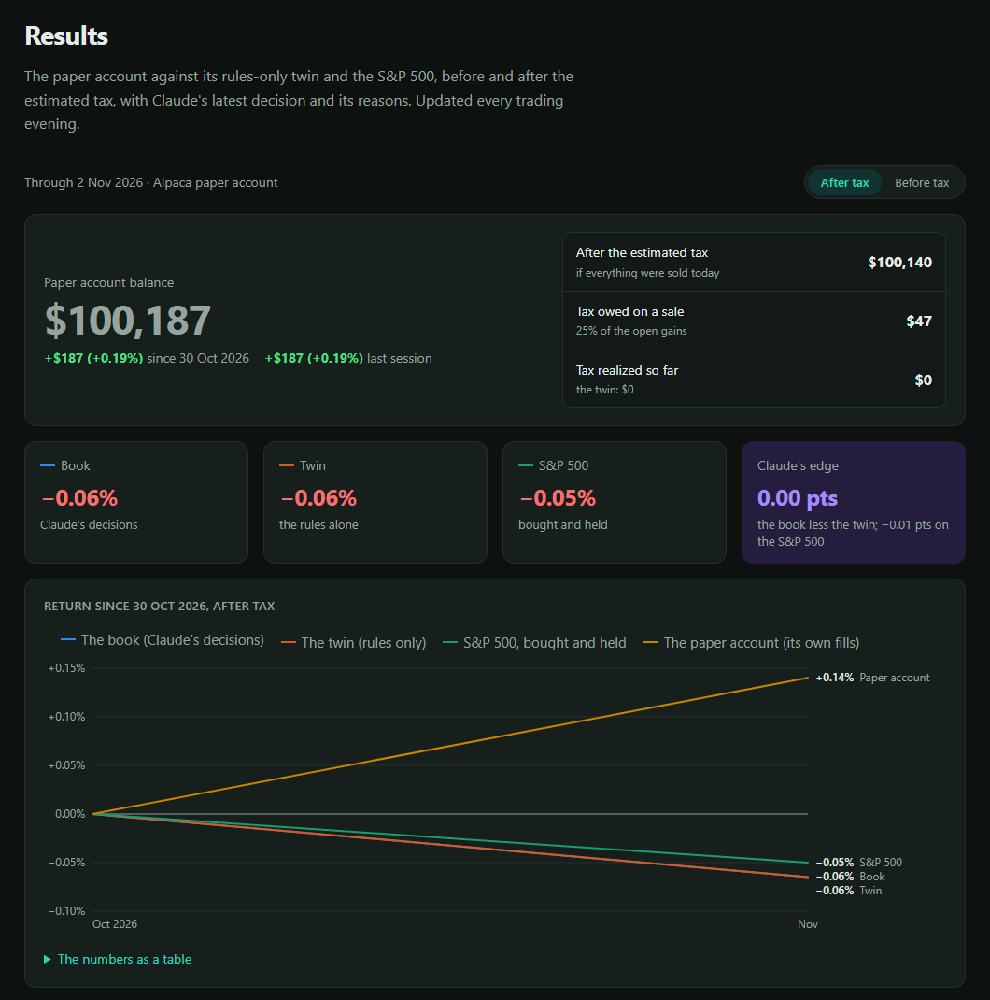
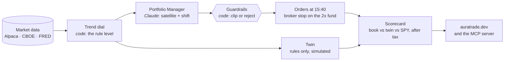

# AuraTrade

[](https://github.com/Dima252/AuraTrade/actions/workflows/ci.yml)
[](https://auratrade.dev)


**An LLM portfolio manager.** AuraTrade manages a $100,000 brokerage account with one goal: beat the S&P 500 over 10 years, after Israeli tax. Code reads the market's trend and sets how much of the S&P 500 to own. Claude makes the judgement calls the rules can't, inside hard limits that code enforces. A rules-only **twin** runs beside it, so Claude's value is measured, not assumed.

It runs unattended on AWS against an Alpaca **paper** account, for a few dollars a month. The results are public at **[auratrade.dev](https://auratrade.dev)**.

[](https://auratrade.dev)

## How it works

Once a month, on the last trading session:

1. **Code sets the rule level.** SPY's total return against its 10-month moving average (with a ±2% buffer) gives the trend. While the trend is up, the book holds 1.3x the S&P 500 (SPY plus SSO, a 2x fund). While it is down, the book holds 0.5x (SPY plus T-bills). High volatility or a 25% drawdown caps the book at 1.0x.
2. **Claude decides the rest.** It allocates a 20% satellite over 13 approved ETFs (small caps, value, international, gold, bonds, managed futures and others). It may also shift the level by ±0.2x. It writes a reason, a measurable expectation and the tax it accepts for each change. Holding is the default, because every sale of a gain realizes 25% tax.
3. **Code enforces the limits.** Guardrails clip or reject anything outside them. The LLM never supplies a price. If the call fails for any reason, the book holds.
4. **The book trades at 15:40 the next session.** Sells go first, then buys, as marketable limits. The leveraged fund always has a stop resting at the broker.
5. **Every evening the system scores itself.** The book is compared with the twin and with SPY bought and held, after the estimated tax.



## Results

**The backtest** tested the rules-only twin once, under a test fixed in advance ([pre-registration](docs/backtests/portfolio-preregistration.md), [report](docs/backtests/portfolio.md)). It ran on daily US market data from 1928 to 2026, with no tuning. It passed:

| 1928–2026 | The twin | The market, bought and held |
|---|---|---|
| CAGR after Israeli tax | **+9.2%** | +8.7% |
| Worst drawdown | **68%** | 85% |
| Ahead after 10 years | **69%** of windows | |

The edge is thin. It comes from the long bear markets and loses in V-shaped crashes. Since the rules were published (2007), it is a tie. That is why the LLM is there: its job is to add to a rule that, on its own, roughly matches the market with shallower bear markets.

**The paper trial** started on 2 November 2026 and runs for 12 months, then on as a showcase. The LLM can't be honestly backtested, since it has read what happened, so it is measured going forward against the twin. The live numbers, every decision and Claude's reasoning are on [auratrade.dev](https://auratrade.dev).

## Code tour

The files worth reading, in order:

| File | What it shows |
|---|---|
| [strategies/core_allocation.py](src/auratrade/strategies/core_allocation.py) | The trend dial: the moving average, the buffer, the volatility cap and the drawdown halt, as pure functions |
| [guardrails/portfolio.py](src/auratrade/guardrails/portfolio.py) | The limits on every LLM decision. Pure, with 100% branch coverage enforced in CI |
| [llm/client.py](src/auratrade/llm/client.py) | The Claude client: structured output, strict tools, prompt caching, a hard deadline. Every failure is named, so the caller always has the hold path |
| [llm/portfolio_manager.py](src/auratrade/llm/portfolio_manager.py) | The Portfolio Manager: its tools, its answer and how a run is recorded |
| [execution/invariant.py](src/auratrade/execution/invariant.py) | The safety invariant: the leveraged fund's stops cover its full quantity, checked from the broker's state alone |
| [execution/orders.py](src/auratrade/execution/orders.py) | The sell sequence: reduce the stop, sell, restore it on failure, under a single-writer lock |
| [sim/portfolio.py](src/auratrade/sim/portfolio.py) | The one simulator, shared by the backtest, the twin and the scorecard, so they can't drift apart |
| [mcp_server/server.py](src/auratrade/mcp_server/server.py) | A strictly read-only MCP server, so Claude can be asked how the book stands and why |

## The stack

Python 3.13 (uv, Pydantic, SQLAlchemy, mypy strict), the Anthropic SDK (`claude-opus-5-5`), Alpaca's market data and paper broker, Neon Postgres, AWS Lambda and EventBridge Scheduler deployed with the CDK, S3 and CloudFront for the site, Telegram for alerts, and GitHub Actions. The [specification](docs/specification.md#11-tech-stack) lists each part and what it is used for.

## Run it

You need [uv](https://docs.astral.sh/uv/) and Docker (for the test database).

```bash
uv sync                                   # dependencies
docker compose up -d                      # local Postgres for the tests
uv run pytest                             # the tests: no network, no paid calls (recorded fixtures)
uv run ruff check . && uv run mypy        # lint and strict type-check
uv run python scripts/preview_site.py     # the site and its dashboard on 127.0.0.1:8000
```

Running the jobs needs API keys in `.env` (see [.env.example](.env.example)). Every job can be run locally for one session, without sending orders, e.g. `uv run python -m auratrade.jobs.allocate --session 2026-10-30 --dry-run`.

## Where to look next

| Document | What it answers |
|---|---|
| [docs/specification.md](docs/specification.md) | **What** the system does: every component, rule and threshold |
| [Decision log](docs/specification.md#16-decision-log) (spec §16) | **Why** each design choice was made, one entry per decision |
| [docs/backtests/](docs/backtests/) | The pre-registered backtest and its scored run |
| [docs/spikes/](docs/spikes/) | What testing the vendors (Alpaca, CBOE, FRED) found, and what the design does about it |
| [docs/runbook.md](docs/runbook.md) | What to do for each alert, and how to deploy |
| [docs/execution-plan.md](docs/execution-plan.md) | What is built and what is left |
| [CLAUDE.md](CLAUDE.md) | The working rules for Claude Code, which built it |

> **Disclaimer:** this is experimental software and a portfolio project. It trades an Alpaca **paper** account only, and no live money is planned. Nothing here is financial or tax advice. The Israeli tax model is a simplification ([spec §17](docs/specification.md#17-known-limitations)).
