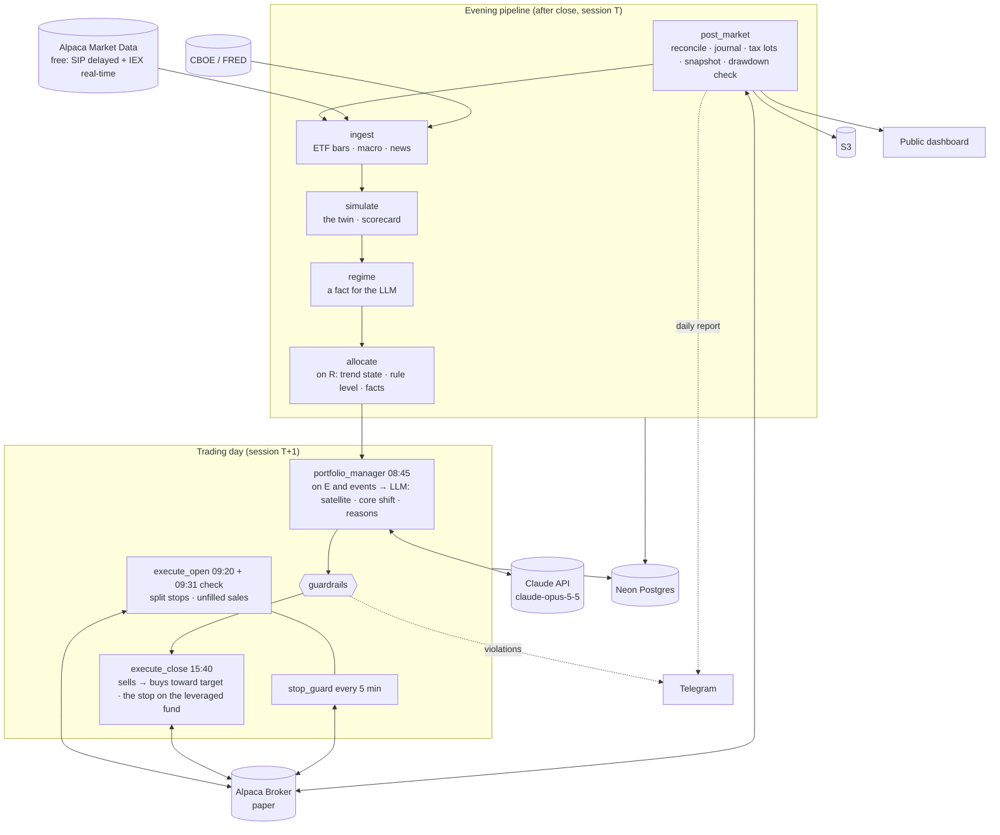

# AuraTrade

An autonomous **portfolio manager** for a US brokerage account. Its goal is to **beat the S&P 500 over 10 years, after Israeli tax**. It holds the US market through ETFs and manages **how much** of it to own rather than which stocks: 1.3x the S&P 500 while the market's trend is up, 0.5x while it is down (the rest in T-bills), on a buffered 10-month moving average checked once a month, with a volatility cap, a drawdown halt and a broker stop on the leveraged fund. Within that, an LLM (Claude) allocates a fifth of the account among approved ETFs and may shift the core by ±0.2x, with a written reason for every change. A rules-only **twin** runs beside it, so the LLM's value is measured, not assumed. The sources behind each rule are listed in [§18](#18-methodology-sources).

Python computes the trend, every target and every price, and enforces hard risk limits the LLM cannot override. The system runs serverless on AWS, on a budget of **under $150/month** (about $3-10/month expected, §12).

> **Strategy change (#153-#156, 2026-10-26/27):** three stock-selection strategies failed their pre-registered tests: the chart-pattern setups (twice) and a momentum book (#152). The system became the portfolio manager this README describes ([docs/strategy-change-portfolio.md](docs/strategy-change-portfolio.md), [docs/portfolio-plan.md](docs/portfolio-plan.md)). The earlier specs are archived in [docs/archive/](docs/archive/) (`README-setup-system.md`, `README-momentum-book.md`). The momentum book's code is deleted (#161); the setup system's code still runs in the walking skeleton and the regime's inputs until task 5.2 removes it.
>
> **Status:** the backtest passed its pre-registered gate ([docs/backtests/portfolio.md](docs/backtests/portfolio.md), #160): after Israeli tax +9.2% a year against +8.7% for the S&P proxy held, 1928-2026, with a shallower worst drawdown; a thin edge, and a tie since the rules were published. Next: the LLM layer. Sections that describe components not built yet are the spec they will be built to. The build plan and progress tracker are in [docs/execution-plan.md](docs/execution-plan.md); the builder's working rules are in [CLAUDE.md](CLAUDE.md).
>
> **Disclaimer:** this is experimental software and a portfolio project. It runs on an Alpaca **paper** account; no live money is planned. Nothing here is financial or tax advice; the Israeli tax model is a simplification (§17).

---

## Contents

1. [Design principles](#1-design-principles)
2. [System architecture](#2-system-architecture)
3. [Daily schedule](#3-daily-schedule)
4. [Market calendar and data integrity](#4-market-calendar-and-data-integrity)
5. [Components](#5-components)
6. [The core allocation (the trend dial)](#6-the-core-allocation-the-trend-dial)
7. [Rebalance, stops and exits](#7-rebalance-stops-and-exits)
8. [Risk management and guardrails](#8-risk-management-and-guardrails)
9. [LLM design and token budget](#9-llm-design-and-token-budget)
10. [Data model](#10-data-model)
11. [Tech stack](#11-tech-stack)
12. [Infrastructure and cost](#12-infrastructure-and-cost)
13. [Repository layout](#13-repository-layout)
14. [Configuration](#14-configuration)
15. [Validation and the paper trial](#15-validation-and-the-paper-trial)
16. [Decision log](#16-decision-log)
17. [Known limitations](#17-known-limitations)
18. [Methodology sources](#18-methodology-sources)

---

## 1. Design principles

1. **Own the market; manage the exposure.** Stock selection failed three honest tests here (#143, #144, #152), as it fails most professionals (SPIVA). The book holds the market and beats it, if at all, through **how much** it owns and **when**: leverage while the trend is up, T-bills while it is down (Faber 2007; Gayed & Bilello 2016; Hurst, Ooi & Pedersen 2017).
2. **The LLM decides; code enforces the envelope.** Claude allocates the satellite and may shift the core within a band. Code rejects or clips anything outside hard limits. Deterministic-first was rejected (#1).
3. **Python computes facts; the LLM interprets them.** The trend, the rule level, every target weight, share count and price come from code. The LLM never supplies a price.
4. **Careful leverage.** A hard ceiling (1.5x), leverage only while the trend is up and volatility is normal, through a leveraged ETF (no margin, so no margin call), a broker stop on it, and a drawdown halt that removes it at once.
5. **Judged after tax, against what an investor would actually get.** The benchmark is SPY bought, held and sold at the end, taxed as an Israeli resident's account is (25% on gains). A strategy that wins only before tax doesn't pass.
6. **Sell rarely.** Every sale can realize a taxed gain. Decisions are monthly, the trend rule has a buffer, the downtrend level is 0.5x rather than 0x, and small drifts aren't traded.
7. **The broker is the source of truth; fail closed for risk, fail safe for exits.** On any uncertainty, exposure is held or reduced, never increased. No halt, kill switch or error path ever cancels a protective stop or blocks a sale toward the target.
8. **Everything is logged, and the LLM is measured.** LLM decisions can't be honestly backtested, so each month's reasoning is journaled and the book is compared with the rules-only twin.
9. **Only spend tokens when a decision is needed:** one decision a month, plus rare events.

---

## 2. System architecture



**Key architectural choices:**

- **One container image, many entrypoints** (one Lambda per job), as built in 1.8 (#133).
- **Monthly decisions, daily protection.** The trend is read on the **ranking session R** (the last session of each month) and the book trades on the **execution session E** (the next full session). Between rebalances only the broker stop, the drawdown halt and reconciliation act.
- **The rule level is known the evening before.** `allocate` computes it on R's close; the Portfolio Manager decides the next morning, in real time; the trades go in at the 15:40 decision price.
- **The twin is computed, not traded.** `simulate` plays the rules-only portfolio forward each evening through `sim/portfolio.py`, the same simulation the backtest uses.
- **Postgres is the queue** (`signals`, `portfolio_targets`).
- **The evening pipeline is chained, not timed.** Each evening job starts only after its predecessor succeeded for the same session (checked in `job_runs`), and on success it invokes the next one. The scheduled times in §3 are fallback starts; a job whose predecessor hasn't succeeded waits up to 30 minutes past its fallback time, then fails closed (no increase of exposure next session) and alerts.
- **Every job fits in Lambda's 15-minute limit;** anything over 10 minutes alerts.
- **Trades go in at 15:40, not at the open.** The close has the day's best liquidity. Sells go first, then buys, each as a marketable limit on the decision price.

---

## 3. Daily schedule

All times are US/Eastern (EventBridge Scheduler, `America/New_York`). **Every job starts with the market-calendar guard** (§4).

| Time (ET) | Job | Purpose |
|---|---|---|
| **Evening (session T)** | | |
| 16:20 | `post_market` | Reconcile; journal; **tax lots** from the day's fills; equity snapshot against SPY and the twin; **the drawdown check** (turns the halt on, §7.3); Telegram daily report; the dashboard's snapshot |
| 17:00 | `ingest` | Bars for the ETF list (§5.1), the macro series, news |
| 17:15 (fallback) | `simulate` | The **twin** for session T (§5.5); the scorecard once a month's results are complete |
| 17:25 (fallback) | `regime` | The regime classifier: a fact for the LLM, no rule reads it |
| 17:35 (fallback) | `allocate` | **On R:** the trend state, the volatility, the halt → **the rule level** and the twin's targets; the Portfolio Manager's facts. Other sessions: nothing, unless an event needs explaining |
| **Trading day (session T+1)** | | |
| 08:45 | `portfolio_manager` | **On E (or its retry) and on events.** LLM: satellite weights, core shift, reasons → guardrails → `portfolio_targets`. **Hard deadline 12:00:** no valid decision by then → hold: no shift, last month's satellite (fail closed, #164) |
| 09:20 | `execute_open` | Reconcile → stops re-placed for splits with an ex-date today (§5.6). No sales before the open (spike 0.3b, #124) |
| 09:31 | `execute_open` (check run) | Reconcile + stop invariant → sales left unfilled at the last close |
| Every 5 min, 09:35–16:00 | `stop_guard` | The leveraged fund's GTC stops cover its full quantity at or above the plan level (§5.6); repairs under the lock |
| 15:40 | `execute_close` | Reconcile + stop invariant. **On E:** sells toward the targets through the sell sequence, then buys (marketable limits at the decision price; the leveraged fund as an OTO with its GTC stop leg), then the stop raise. **The session after the halt turns on:** the leveraged fund is sold into SPY. No trades on half days: E moves to the next full session |
| **Other** | | |
| Every 15 min, 07:00–22:00 on weekdays | `watchdog` | Alert if an expected heartbeat is missing, a run is stuck or a schedule is disabled; each run pings an external dead-man's switch (§5.9) |

One module, `jobs/schedule.py`, holds this schedule; the AWS schedules, the watchdog's expectations and the local stand-in are all built from it (#133). Until task 5.2 replaces them, the walking skeleton's jobs (1.7) stay in the module; on `paper` the kill switch is on (2026-10-27), so they place nothing.
- **Fallbacks.** A chained job's time above is a fallback: its schedule fires every 10 minutes from that time to its deadline (`jobs.chain_wait_minutes`, 30). A run that finds the predecessor not done records `WAITING_PREDECESSOR` and exits; a run at the deadline without one fails closed and alerts (§4).
- **Retries.** A rebalance blocked on E (no decision price, a calendar disagreement) is tried once more on the next session with the same targets (`portfolio.retry_sessions`).

---

## 4. Market calendar and data integrity

**Calendar guard.** EventBridge fires every weekday, so every job begins with:

```python
session = calendar.session_for(today)          # None if the market is closed
if session is None:
    record_job_run(job, status="SKIPPED_MARKET_CLOSED")   # heartbeat still written
    return
```

- **Calendar authority:** Alpaca's calendar API is primary; `pandas_market_calendars` is the cross-check. **If they disagree, no increase of exposure today** (stops and sales toward a lower target still run), plus an alert.
- **`market_sessions` table:** date, open/close, `is_early_close`, minutes, data status, and the cross-check result per session.
- **Sync:** `python -m auratrade.calendar.sync` writes Alpaca's sessions (2016 through the end of next year), re-run daily. It is idempotent, removes a session Alpaca drops, and refuses to drop more than 3 at once. **A date outside the synced range is unknown, not closed:** jobs fail closed and alert.
- **Guard policy per job type:** morning and intraday jobs run when today is a session; evening jobs when today was a session and the predecessor succeeded for it (§2); `watchdog` checks only heartbeats that were *expected* given that day's calendar.

**Holidays:** no calls or orders; the leveraged fund's stop is GTC at the broker; no buy order rests overnight (`post_market` cancels any unfilled one).

**Gap-fill ingest:** fetch every session since the last stored one.

**Early-close days (13:00):** no trades; a rebalance moves to the next full session.

**Sessions, not calendar days:** every window (the 21-session volatility, the drift band, the retry) counts sessions. The monthly rebalance is anchored on the calendar's last session of each month. The backtest's long history has no calendar before 2016; there the sessions are the dates of the market file (pre-registration §3.1).

**Missing data vs. closed market:**

| Situation | Detected by | Action |
|---|---|---|
| Market closed | Not in `market_sessions` | Expected; nothing fetched |
| An ETF on the list has no bar | Halted or delisted | No buy of it; held units are marked at the last close and alerted |
| SPY has no bar, or the macro series are stale | Ingest validation | `INCOMPLETE` → no increase of exposure next session, plus an alert |

**Intraday prices:** the 15:40 decision price is the last IEX trade if ≤ 2 minutes old, else the IEX quote midpoint if fresh, else none (#120). For the ETFs on the list the IEX spread is narrow (the skeleton's wide-spread finding of 2026-10-23 concerned small caps). A sale with no decision price waits for the next session (the stop rests); a buy falls back to the delayed SIP last trade as its reference, with the limit bounding the fill (#144).

---

## 5. Components

### 5.1 Ingest (`ingest`)

- **What it fetches** (from task 5.2): daily bars (Alpaca SIP, `adjustment=split` plus the raw close, as built in 1.5) for **the ETF list**: SPY, SSO, BIL, SGOV, QQQ, the satellite list (§5.4) and the regime's index ETFs; the macro series (VIX, VIX3M from CBOE, FRED series, #117); news for the ETF list on demand.
- **The stock-universe ingest** (2,761 tracked tickers, EDGAR earnings and fundamentals, industries, Finnhub) stays in the code and keeps running in the chain until task 5.2 removes it; its spec is `docs/archive/README-momentum-book.md` §5.1. Dropping it frees most of Neon's 0.5 GB and most of the run time.
- **Validation:** coverage of the ETF list, OHLC sanity, the split re-fetch (a held fund can split: SSO has), idempotent upserts. A missing SPY bar makes the session `INCOMPLETE`.
- **Failure policy:** the calendar re-sync and SPY's bar fail the job (no increase of exposure next session); news and the secondary macro series degrade with an alert.
- **The long history** (backtest only, task 3.18, #157): Kenneth French's daily market and T-bill returns from 1926 (`data/french.py`) and Robert Shiller's monthly S&P dividends (`data/shiller.py`, through the Open Knowledge CSV of his file), stored in the Parquet history (`history/long_history.py`, tables `long_history_market` and `long_history_dividends`); SPY, SSO and BIL total-return bars from 2016 in `portfolio_funds` for the data checks (pre-registration §4). `scripts/backfill.py longhistory` fetches all of it.

### 5.2 Regime classifier (`regime`, a fact)

The five-pillar regime (index trend, breadth, volatility, distribution, leadership health) and its state machine stay as built in 2.3 (#135; full spec in `docs/archive/README-momentum-book.md` §5.2). **No rule reads it.** It is one of the facts the Portfolio Manager sees. The breadth and leadership pillars need the stock universe; once task 5.2 removes it from ingest, those pillars score 0 and the regime is labelled as running on three pillars.

### 5.3 The trend dial (`allocate`, `strategies/core_allocation.py`)

Pure functions, no I/O (§6 has the rules):
- the month-end index values, the 10-month SMA, the buffered trend state and its flips;
- the 21-session realized volatility and the cap;
- the drawdown halt (on, off, peak reset);
- **the rule level** and its holdings (SPY, SSO, BIL), and the twin's target weights.

On R, `allocate` runs them on SPY's adjusted closes (live) and writes the rule level, the state and the facts for the Portfolio Manager. The backtest calls the same functions on the long history.

### 5.4 Portfolio Manager (`portfolio_manager`, LLM, real-time)

- **Runs** at 08:45 on E (or its retry), and on an **event**: the drawdown halt turned on, the leveraged fund's stop filled, a held ETF's corporate action. On events it explains and may only reduce risk.
- **Inputs:**
  - the trend state, the SMA and the distance to each buffer edge, the volatility, the halt, **the rule level and the twin's targets**;
  - account state: equity, cash, holdings and their weights, drawdown, **tax lots** (unrealized gains, the year's realized gains, the loss carried forward), **the tax a full sale of each holding would realize now, and the satellite's tax budget left this year** (#163);
  - the regime and its pillars; macro (VIX, VIX3M, FRED rates and spreads);
  - each satellite ETF's facts: returns over 1, 3, 6 and 12 months, volatility, distance from its 200-session SMA, correlation with SPY;
  - recent headlines (delimited data, §9);
  - **its own past decisions** with their outcomes against the twin, and the scorecard so far.
- **Tools:** `get_news`, `get_chart`, `get_etf_facts`, `get_decision_history`.
- **Decides** (structured output):
  - the **core shift**: −0.2 to +0.2 on the rule level, never above 1.5, and **only downward** while the rule level is DOWN, capped or halted;
  - **the satellite**: weights over the approved list summing to the satellite's share (`portfolio.satellite_share`, 20%), each ≤ 10% of equity (BIL counts);
  - a **written reason** for each change, a one-line expectation for each tilt with the same as a number (`expected_vs_market`: its return less SPY's until the next E; scored later, #167), and the tax it accepted.
- **Holding is the default** (#163, the user's instruction): the prompt says that every trade of a gain realizes 25% tax that holding would defer, so last month's targets stand unless a change clearly beats its tax; "hold the satellite" is an explicit answer; each change states the tax it realizes and why it beats holding. Code backs this with the hold rule and the tax budget (§8).
- **The approved list** (`portfolio.satellite_list`): QQQ (Nasdaq-100), IWM (US small caps), AVUV (US small-cap value), MTUM (momentum), QUAL (quality), VEA (developed ex-US), VWO (emerging markets), GLD (gold), IEF (7-10y Treasuries), TLT (20y+ Treasuries), DBMF (managed futures), BIL (T-bills), SPY (neutral). No leveraged or inverse products. Final (task 4.2: all 13, with SSO, active and tradable on Alpaca on 2026-10-27, #165); changed only by a decision.
- **Can't:** buy outside the list, use leverage in the satellite, lift the ceiling, block a sale toward a lower target or a stop, or name a price.
- **On failure** (error, timeout, refusal, invalid schema, missed deadline): the book **holds** (#164): no shift, so the core takes the rule level, and last month's satellite (the neutral before the first decision). It is exactly the answer `{"core_shift": 0, "satellite": null}`, goes through the same guardrails, realizes no satellite tax and adds no risk; an alert goes out.
- **Built** (task 4.2): `llm/portfolio_manager.py` (the answer, the tools, the run), `llm/portfolio_facts.py` (the facts and their rendering), `llm/portfolio_prompt.py` (the versioned prompt, filled from `risk.yaml`); the jobs that gather the facts come in task 4.3.

### 5.5 The twin and the scorecard

**The twin** (the benchmark the LLM is measured against):
- **The core rule on the whole account:** the rule level of §6 applied to 100% of equity, with no satellite of its own (R1 of the plan). **It is also the book at neutral** (no shift, the satellite in SPY, #163), so everything the LLM does, satellite and core shift, and the tax its changes realize, shows up as the difference.
- **Simulated each evening** by `simulate` through `sim/portfolio.py` on daily bars, at the decision prices the book traded at (or the close, when the book didn't trade), with the same costs and the same tax model.
- **Like for like.** Paper fills are optimistic (§17), so the book's own decisions are also replayed through `sim/portfolio.py` (the **sim return**); comparisons use the sim return, with paper fills reported alongside.
- **In `dry_run`** (until task 5.1 trades the paper account) the sim return *is* the book (#166): both run from the trial's first R, from `portfolio_manager.dry_run_equity` in cash, on the real funds' bars (split-adjusted closes as the price, the distributions from the total-return closes), rewritten whole into `twin_book` (`TWIN`, `SIM`) each evening, and the account the Portfolio Manager sees is the simulated book's. The book's replay trades each holding only if its own target changed or it drifted past the band (§7.1), as the order layer will; the twin, like the backtest, rebalances the whole account when any target changes.

**The scorecard** (the evidence for whether the LLM adds value; `journal/portfolio_scorecard.py`, pure, task 4.4, #167):
- **Each decision is scored over its month:** from its E's close (after its trades) to the next E's; the latest decision's month runs to the last close and is open. **After the estimated tax** means equity less the tax a sale of everything at that close would owe (the year's realized gains and income so far, the unrealized gains, net of the loss carried forward; `TaxBook.tax_if_sold`), so realizing a gain costs nothing at once (the tax was owed either way); its cost is the tax paid at the year's end, which stops compounding.
- **The headline:** the book's after-tax excess over the twin, monthly and cumulative, before and after tax, with **SPY bought and held** at the trial's start beside them (a third simulated book, `SPY` in `twin_book`); a block-bootstrap interval of the monthly excess, annualized, once 24 months are complete (blocks of 3 months, 90%; `portfolio_manager.scorecard` in `risk.yaml`).
- **Each tilt is scored:** the satellite weight of each ETF minus its neutral weight (SPY at 20%, #163), times its total return to the next E, relative to SPY (SPY's own tilt scores 0 against itself); and each core shift times SPY's return over T-bills. **The tax each decision realized** (the book's realized gains on its E, at 25% before the year's offsets) is reported beside them, with the twin's on the same E.
- **Each expectation is scored** once its month is complete: `expected_vs_market` against the ETF's return less SPY's. **The direction** is right on the same sign; an expectation within ±1 point (`flat_band`) says "level with SPY" and is right only if the outcome is level too. **The size** is right when the direction is and the outcome is within 2x of it either way (`size_factor`). A held satellite states nothing, so nothing is scored; answers before prompt `pm-2` have no number.
- **Where it goes:** `simulate` rescores every month each evening into its `portfolio_journal` row (`results`, and the book's trades on its E as `trades`); the Portfolio Manager's facts carry the summary (`scorecard`) and each past decision's after-tax excess (to date while its month is open). In `dry_run` the daily snapshot is `twin_book` (`SIM`, `TWIN`, `SPY`, each with its `tax_owed`); from task 5.3 `account_snapshots` carries the live account beside them.
- Each decision is tagged with its prompt version and the answering model (§9).

### 5.6 Execution and the order layer (`execute_open` / `execute_close` / `stop_guard`)

The order layer built in 1.7 carries over; its full mechanics (OTO legs, partial fills, the sell-at-once path, corporate actions, and the broker behaviours spike 0.3b found) are specified in `docs/archive/README-momentum-book.md` §5.7 and still apply. What it does for the portfolio:

1. **Reconcile.** **Invariant (every job that touches orders):** **every stopped position** (the leveraged fund, §7.2) has resting broker sell stops that are **GTC**, together cover its **full quantity**, and each sits at or above its plan level: one stop, or one OTO leg per buy. A partly filled buy counts as unprotected (#115). Otherwise repair at once, alert, and block increases of exposure. Unleveraged ETFs carry no stop (#155).
   - **`stop_guard`** (every 5 minutes, 09:35–16:00) checks existence, quantity and GTC from the broker alone, and repairs under the lock only when something is missing.
   - Order jobs run with Lambda's async retries (idempotent through `client_order_id`).
2. **Sell sequencing** for a stopped position: reduce the stop (an OTO leg is first swapped for a standalone stop), sell, restore it on failure; if the price is already through the stop level, sell at once (marketable limit, re-priced once, then market). Positions without a stop sell directly.
3. **The rebalance at 15:40 on E:**
   - **Targets → orders.** Each holding's target value (equity × target weight) ÷ the limit price, in **whole shares**, floored for buys; a holding within the drift band of its target (§7.1) isn't traded unless its target changed.
   - **Sells first**, then **buys**, each a **marketable limit** at the decision price ± `execution.marketable_limit_slippage` (0.5%, rounded to the tick against the book). Never a market buy.
   - **The leveraged fund is bought as an OTO** marketable limit with its GTC stop leg at the plan level (§7.2); Alpaca rejects a plain buy in a symbol with a resting sell stop as a "potential wash trade" (spike 0.3b, #114).
   - **The stop raise** for a leveraged fund still held: an atomic replace, never down.
4. **Idempotency:** `idempotency_key` = `client_order_id`.
5. **Single writer.** Every section of code that changes orders holds one account-wide Postgres advisory lock (as built, #131): held only while orders change, never during an LLM call; `stop_guard` doesn't wait for it.
6. **No margin.** Leverage comes only from the leveraged fund. Total cash spent, with pending buys at their limit, stays ≤ equity, so the account never borrows.
7. **Corporate actions on held ETFs:** a split re-places the stop at the scaled level (on the ex-date Alpaca rejects resting stops at 04:00, spike 0.3b); a cash distribution is income for the tax lots (§5.7); a fund closure or merger raises an event, blocks buys of it, and is resolved by hand (`auratrade resolve`).

### 5.7 Post-market, journal and tax (`post_market`)

- **`tax_lots`:** every buy opens a lot (date, units, cost in USD); every sale closes lots **FIFO** and records the realized gain. Distributions and T-bill interest are income. The year's tax is estimated as in the pre-registration §3.8: 25% on realized gains net of the year's losses and the loss carried forward, and 25% on income. On paper no tax is paid; the estimate is what the after-tax comparisons use.
- **`portfolio_journal`:** one row per month: the rule level, the LLM's decision and reasons, the guardrail clips, the trades, the twin, and the month's results (before and after the estimated tax).
- **`account_snapshots`:** equity, drawdown, and SPY and the twin on the same day, each before and after the estimated tax.
- **The drawdown check** at each close (§7.3).
- The Telegram daily report, and the public dashboard's snapshot (§5.8).

### 5.8 The public dashboard

The public site (`AuraTradePublicSite`, #108, #134) becomes the project's showcase: the book against the twin and SPY, before and after the estimated tax; the exposure history (rule level, the LLM's shift, the satellite); **the monthly decision journal** with the LLM's reasoning and the limits it hit; and the backtest's result, stated plainly. It reads one allow-listed file, `data/snapshot.json`, written by `post_market`; it shows no order IDs or account numbers.

### 5.9 Observability and safety

- **Kill switch and halts:** one meaning everywhere.

  | Control | Blocks | Never touches |
  |---|---|---|
  | Kill switch (`system_flags.trading_enabled = false`) | **Increases** of exposure and buys of any fund not already held. `auratrade kill on` cancels resting buy orders at once (under the lock) | Protective stops, sales toward a lower target, the halt's sale, reconciliation |
  | Drawdown halt (−25%, `portfolio.drawdown_halt`, §7.3) | Leverage: the level is at most 1.0x | Same |
  | `auratrade flatten --confirm` (manual only) | Sells every position with the sell sequence | Nothing automatic ever calls it |
- **The kill switch is a database flag, not an environment variable,** read by every job at start. A new database starts with it on.
- **Operator commands:** `auratrade kill on|off|status`, `auratrade mismatches` / `resolve <id> --note "…"`, `auratrade halt status|reset`, `auratrade flatten --confirm`. `docs/runbook.md` says what to do for each alert; it is written before the paper trial.
- **Watchdog** heartbeats and an external dead-man's switch (healthchecks.io), as built in 1.8 (#133).
- **Telegram alerts:** failures, guardrail clips, the halt, a stop fill, mismatches, refusals, incomplete data, calendar disagreements.
- **Logs:** structlog → CloudWatch; LLM payloads → S3.

---

## 6. The core allocation (the trend dial)

The rules (#154), all in `risk.yaml` `portfolio:`; the backtest's exact versions are in `docs/backtests/portfolio-preregistration.md` §3.

| Step | Rule | Source |
|---|---|---|
| **The index** | SPY's total-return (dividend-adjusted) closes; its value on each R is the month-end value. (The backtest uses the CRSP market from Kenneth French's library) | Faber (2007) uses month-end total returns |
| **The trend** | SMA10 = the mean of the last 10 month-end values. The state turns **DOWN** when the value < SMA10 × 0.98 and **UP** when > SMA10 × 1.02; between the edges it stays (`portfolio.buffer`) | Faber (2007); the buffer cuts whipsaws and taxed sales |
| **The level** | UP → **1.3x**; DOWN → **0.5x** (`portfolio.up_level`, `down_level`) | Gayed & Bilello (2016) use 2x and 0x; 1.3x / 0.5x is the careful version (the plan's A4) |
| **The volatility cap** | SPY's 21-session realized volatility × √252 > **25%** on R → at most **1.0x** | Moreira & Muir (2017); Cederburg et al. (2020) for the doubt; a cap, not a target |
| **The drawdown halt** | Equity ≤ 75% of its peak at any close → at most **1.0x** at once (§7.3) | The plan's C2 |
| **The holdings** | Level x > 1: SPY (2 − x) and SSO (x − 1) of equity; x ≤ 1: SPY x and BIL (1 − x). 1.3x = 70% SPY + 30% SSO; 0.5x = 50% SPY + 50% BIL | SSO is 2x daily; no margin |

**The core and the satellite (#163).** The book's **level** is the rule level plus the LLM's shift. The satellite (20%) is the LLM's (§5.4); its **neutral** is SPY at the whole 20%. The core (`1 − portfolio.satellite_share`, 80%) is sized by code so that, with the satellite at its neutral, the book's exposure is the level: core level = (level − 0.2) / 0.8, so 1.375x for 1.3x (70% SPY and 30% SSO of equity, as the twin), 0.375x for 0.5x, 1.0x for 1.0x (no SSO). **With no shift and the satellite at neutral, the book is the twin** (§5.5), the strategy the backtest tested; every satellite fund other than SPY moves the exposure by its own difference from SPY.

**Why these rules and not others:** they come from the sources with no tuning; the alternatives (the 200-day average, 1.5x / 0x, margin, no stop, no volatility cap) are the pre-registered comparisons, reported and never adopted (#156).

---

## 7. Rebalance, stops and exits

### 7.1 The rebalance

| Step | Rule |
|---|---|
| **When** | The rule level is read on R's close; the book trades at **15:40 on E** (the next full session). A half day moves E |
| **Targets** | The core: SPY / SSO / BIL weights for the core level sized from the book's level (rule level + shift, §6) on the core's share; the satellite: the LLM's weights after the hold rule and the tax budget (§8). A rule level of DOWN, the cap or the halt allow only a downward shift |
| **The drift band** | A holding is traded only if its target changed or its weight is more than **5 points** from its target (`portfolio.drift_band`). Fewer, larger trades: less tax and cost |
| **Orders** | Sells first, then buys; whole shares; marketable limits on the decision price; SSO as an OTO with its stop leg (§5.6) |
| **Start** | The paper trial starts from cash on its first E |

### 7.2 The stop (the leveraged fund only)

- **One GTC stop at the broker** covering SSO's full quantity (CLAUDE.md §3.5 as amended, #155), at **70% of SSO's decision price** at its last purchase (`portfolio.stop_fraction` 0.30), rounded down to the tick.
- **Raised on each later E** to 70% of that E's decision price if higher. Never lowered.
- **After it fills,** the proceeds wait in BIL until the next E. The Portfolio Manager runs on the event to explain; it can't buy SSO back.
- **Why only there:** a stop on a broad ETF would sell it on noise and realize taxed gains; the trend rule and the halt are those funds' exits. A 2x fund at −30% means the market fell ~15% within the month: the case the stop exists for.
- **Gaps go through it** (§17).

### 7.3 The drawdown halt

- **On** at any close where equity ≤ 75% of its running peak (`portfolio.drawdown_halt` 0.25). **It acts at once:** at 15:40 on the next session, SSO is sold into SPY (the one trade outside E).
- **While on:** the level is at most 1.0x, and the LLM may only shift down.
- **Off** at the first R where the trend flips DOWN → UP (the peak is reset to the equity then), or where equity is back at its old peak.

### 7.4 Exits and tax

- Every sale is either the rebalance (toward a target), the stop, or the halt. There are no discretionary exits between rebalances.
- **Holding is the default (#163).** Every sale of a gain realizes 25% tax that holding would defer, so the Portfolio Manager is told to hold unless a change clearly beats its tax; it sees each holding's unrealized gain and the tax a full sale would realize now, and states the tax each change accepts.
- **Code enforces it in the satellite** (§8): a weight within 2 points of last month's target keeps it (`portfolio.satellite_min_change`), and the satellite's sales may realize at most 0.2% of equity in tax a year (`portfolio.satellite_tax_budget`), except while the trend is DOWN, capped or halted. The core's sales follow the rules and aren't budgeted; the drift band and the buffer keep them rare.

---

## 8. Risk management and guardrails

Guardrails are pure Python functions (`auratrade/guardrails/portfolio.py`) with 100% branch coverage. They run on **every** LLM decision. Violations are clipped or rejected, logged to `guardrail_events`, and alerted (#155).

| Guardrail | Default | Behaviour |
|---|---|---|
| Exposure to the S&P (the book's level, §6) | 0.3x to 1.5x (`portfolio.min_level`, `max_level`); ≤ 1.0x while capped or halted | Clip |
| The LLM's core shift | ±0.2x (`portfolio.max_shift`); downward only when DOWN, capped or halted | Clip |
| Leveraged products | SSO only, only in the core, only while the level is above 1.0x | Reject |
| Satellite | `portfolio.satellite_share` (20%) of equity; the approved list only; each ETF ≤ 10% (`portfolio.max_etf_weight`), SPY (the neutral) up to 20%; no leveraged or inverse | Reject / clip, the rest to BIL |
| Hold by default (#163) | A satellite weight within 2 points of last month's target keeps it; a new holding under 2 points isn't opened; a full exit is honoured (`portfolio.satellite_min_change`) | Clip |
| Satellite tax budget (#163) | The tax the satellite's sales would realize (25% of their net FIFO gains at the decision prices; a fund without a price counts its whole sale as gain), with the year's earlier satellite tax, ≤ 0.2% of equity (`portfolio.satellite_tax_budget`); not applied while DOWN, capped or halted | Clip: moved back toward last month's targets until it fits |
| **Price levels** | The LLM never supplies a price; limits and the stop come from code | Reject |
| Stop on the leveraged fund | Always: the OTO's GTC leg at the plan level | Reject |
| Hard stop: GTC, full quantity, ≥ plan level | The invariant in every order job and `stop_guard`; a partly filled buy counts as unprotected (§5.6) | Auto-repair + alert |
| Sell sequencing | Stop reduced before a sale of a stopped position; restored on failure (§5.6) | Enforced in the order layer |
| Single writer | One account-wide advisory lock around every order change | Enforced in the order layer |
| No margin | Cash spent, with pending buys at their limit, ≤ equity | Reject |
| Turnover | Trades only on E, the retry, and the halt's session; within the drift band | Reject |
| Kill switch / halt | Block increases of exposure only (§5.9) | No increase |
| Early-close days | No trades | Reject |
| Data integrity | `INCOMPLETE` session or calendar disagreement | No increase of exposure |
| LLM failure | Error, timeout, refusal, invalid schema, missed deadline | Hold: no shift, last month's satellite (fail closed, #164) |

The setup system's guardrails (`guardrails/evaluate.py` and the rest) still serve the walking skeleton and go in task 5.2 (#161).

---

## 9. LLM design and token budget

| Role | Model | Mode | Effort | Calls |
|---|---|---|---|---|
| Portfolio Manager | `claude-opus-5-5` | Real-time, with tools, the shared prefix cached | `high` | 1 per rebalance (12 a year), plus rare events |

**Expected LLM cost: about $0.20-0.40 a decision, under $1 a month** (estimated in task 4.1, #162, from the 0.3g spike's measured call: $0.10 for a 3,400-token context and two turns). Assumed for the portfolio: about 3,000 tokens of system prompt and tools (cached), 10,000 of facts, 2-4 turns of about 2,500 output tokens each (thinking included) at effort `high`, the conversation cached from turn to turn. One decision a month plus a few events a year: **about $3-5 a year**. **Measured on the real prompt** (task 4.2, #165, Anthropic's free token count): 3,200 tokens of cached prefix (the system prompt, the four tools, the answer's schema) and about 8,500 with a full month's facts, below the 13,000 assumed, so **about $0.15-0.30 a decision**. **The first real decision** (task 4.3, a replay of 2026-10-01 on dev, #166) took one turn and no tools and **cost $0.058** (7,341 tokens written to the cache, 1,044 out); one with tool rounds costs more. **Cost alert:** above `llm.cost_alert_usd` ($1.00) for one decision, all its turns; the worst case inside the limits (6 turns at the 16,000-token cap) is about $2.

**API usage:**
- one client (`llm/client.py`) runs a decision to a validated answer or a named failure (`API_ERROR`, `TIMEOUT`, `DEADLINE`, `REFUSAL`, `TRUNCATED`, `INVALID_OUTPUT`, `TOO_MANY_TURNS`, `UNEXPECTED_STOP`); it never raises for an API problem, so every failure takes the twin's path; its limits are `risk.yaml` `llm:`;
- structured outputs into Pydantic models;
- `strict: true` tools with `tool_choice: auto`;
- check `stop_reason`; server-side fallbacks (`fallbacks: "default"`) re-run a declined request on the model Anthropic routes its category to; a refusal that survives them → hold (#164);
- a **hard deadline** (12:00), enforced by the job: a late answer is discarded (fail closed);
- the answering model (`response.model`) stored on every `llm_decisions` row; fallback answers reported separately;
- effort set explicitly (Opus 5.5 always thinks; its default effort is `medium`);
- versioned prompts in `prompt_versions`;
- **untrusted text is data.** Headlines and news bodies come from third parties and could carry instructions. They are passed in clearly delimited data blocks, and the system prompt says to treat them as information, never as instructions. The guardrails bound what a manipulated answer could do.

**Output schema (abridged):**

```jsonc
// Portfolio Manager → guardrails → portfolio_targets
{ "core_shift": -0.1,
  "core_reasoning": "...",
  "satellite": [{ "symbol": "GLD", "weight": 0.05, "expectation": "...", "expected_vs_market": 0.01, "why_not_hold": "..." },
                { "symbol": "SPY", "weight": 0.15, "expectation": "...", "expected_vs_market": 0, "why_not_hold": "..." }],
  // or "satellite": null: hold last month's targets (the default, #163)
  "tax_note": "...",
  "summary": "≤ 120 words for the journal and the dashboard" }
```

No field is a price.

---

## 10. Data model

PostgreSQL on Neon. SQLAlchemy 2.0, Alembic. The tables built so far stay; the portfolio adds:

| Table | Purpose |
|---|---|
| `portfolio_targets` | Per rebalance: the rule level, the state, the LLM's shift and satellite, the enforced targets, the twin's targets |
| `tax_lots` | Open and closed lots per fund: date, units, cost, closed date and proceeds, realized gain; income rows (§5.7) |
| `twin_book` | The twin's simulated holdings, trades and equity per session (§5.5), in `dry_run` the book's own decisions replayed (`SIM`, #166), and SPY bought and held (`SPY`); each with the tax a sale would owe at the close (`tax_owed`, #167) |
| `portfolio_journal` | One row per month: decisions, reasons, clips, trades, results (the scorecard's month, §5.5, §5.7) |

Kept and used: `market_sessions`, `daily_bars` (for the ETF list), `corporate_actions`, `macro_series`, `market_regime`, `llm_batches`, `prompt_versions`, `llm_decisions`, `signals`, `guardrail_events`, `orders`, `positions`, `position_plans` (the leveraged fund's stop level, tighten-only), `account_snapshots`, `job_runs`, `system_flags`, `mismatches`. Kept, no longer written once task 5.2 retires their jobs: the stock-universe and setup-system tables (`tickers`, `industry_groups`, `fundamentals`, `earnings_events`, `bases`, `daily_watchlist`, `breakout_tracker`, `setups`, `ep_candidates`, `verdict_outcomes`, `baseline_signals`, `trade_journal`, `bar_corrections`); their spec is in the archived READMEs.

**Retention:** `daily_bars` 2 years in Postgres, older bars in Parquet (#130). Everything the portfolio adds is small and kept forever: it is the validation record (principle 8). **Backup:** `post_market` exports the kept tables to S3 nightly.

---

## 11. Tech stack

| Layer | Choice |
|---|---|
| Language / packaging | Python 3.13, **uv** |
| Quality | ruff, mypy, pytest, hypothesis, recorded HTTP fixtures |
| Data processing | pandas, numpy, pyarrow |
| Charts | mplfinance (for the LLM's `get_chart`) |
| Calendar | Alpaca calendar API + pandas_market_calendars |
| Market data | **Alpaca free tier**: SIP historical (15-min delay), IEX real-time quotes, news |
| Long history (backtest) | Kenneth French's data library (daily market and T-bill returns from 1926); Robert Shiller's monthly S&P data (dividends) |
| Macro data | CBOE, FRED |
| Broker | **Alpaca** (`alpaca-py`), paper; behind `execution/broker.py` so another broker (e.g. Interactive Brokers) is one adapter |
| LLM | Anthropic Python SDK, `claude-opus-5-5`, prompt caching |
| Validation / config | Pydantic v2, pydantic-settings, YAML |
| Database | **Neon Postgres (free tier)**, SQLAlchemy 2.0, psycopg 3, Alembic |
| HTTP / logging | httpx, tenacity; structlog → CloudWatch |
| Alerts | **Telegram bot** |
| Compute / scheduling | AWS Lambda (container image) + EventBridge Scheduler |
| Secrets / storage | SSM Parameter Store; S3 |
| Infrastructure as code / CI/CD | AWS CDK (Python); GitHub Actions |

---

## 12. Infrastructure and cost

- **Region** `us-east-1`. One ECR image; one Lambda per job. Neon over TLS, so no VPC or NAT.
- **Least-privilege IAM** per function; secrets in SSM. Environments: `dev`, `paper`.
- **The trading stack** (`AuraTradePaper`, `infra/stacks/trading.py`, #133): one x86_64 container image built by `cdk deploy`; one function per job; order jobs get 15 minutes and Lambda's 2 async retries; secrets as SecureStrings under `/auratrade/<env>/`, read once per container; `TRADING_MODE` a deploy-time choice, `dry_run` by default, `live` refused; each evening job may invoke only its successor. The stack deployed in 1.8 runs the setup skeleton's jobs with the kill switch on until task 6.1 redeploys it with the portfolio's jobs.
- **Each environment has its own Alpaca paper account and Neon branch** (`dev`: `.env`; `paper`: `.env.paper`), so reconciliations never fight. **The `paper` account is reset to $100,000** before the trial (task 6.1).
- **AWS budget alarms** at $10 and $25.
- **Public site** (`AuraTradePublicSite`, #108): static files from `web/` in a private S3 bucket behind CloudFront, HTTPS only, strict security headers, no backend. The dashboard (§5.8) reads one allow-listed `data/snapshot.json`.
- **Neon free-tier compute:** the watchdog keeps the database awake for much of the day; `stop_guard` asks the broker first and opens a connection only to repair.

| Item | Monthly estimate |
|---|---|
| Claude API | ~$1–5 (§9) |
| AWS | ~$1–5 |
| Public site domain (optional) | ~$1.50 |
| Data, database, alerts | $0 (free tiers) |
| **Total** | **~$3–10** (budget: < $150) |

---

## 13. Repository layout

```text
AuraTrade/
├── README.md
├── .github/workflows/            # CI: lint → type-check → tests
├── docs/                         # execution plan, the strategy change and plan, spikes, backtests, archive
├── web/                          # public site and dashboard: static HTML/CSS (§5.8)
├── pyproject.toml / uv.lock
├── Dockerfile
├── docker-compose.yml
├── alembic/
├── config/risk.yaml              # portfolio: (the rules), halts, execution, the fill model, ingest;
│                                 # the setup system's sections (until 5.2, #161)
├── src/auratrade/
│   ├── config.py
│   ├── cli.py                    # operator commands (§5.9)
│   ├── calendar/                 # sessions, sync, the R / E rebalance calendar
│   ├── db/
│   ├── data/                     # alpaca_data, macro, news; long-history clients (French, Shiller);
│   │                             # edgar, finnhub, nasdaq (the stock universe's, removed in 5.2)
│   ├── ingest/                   # the evening ingest (slimmed to the ETF list in 5.2)
│   ├── history/                  # the Parquet history: bars since 2016, benchmarks, the long history
│   ├── indicators/               # moving averages, volatility, relative strength (facts)
│   ├── regime/                   # the regime classifier (a fact for the LLM)
│   ├── strategies/               # core_allocation (the trend dial, #154); the setup scans, ranking,
│   │                             # verdict cache, watchlist (the skeleton's and the regime's, until 5.2)
│   ├── tax/                      # israel: FIFO lots, realized gains, offsets, carry-forward, income
│   ├── guardrails/               # portfolio (#155); the setup system's rules (the skeleton's, until 5.2)
│   ├── llm/                      # the Claude client, the Portfolio Manager's schema and prompt (Phase 4)
│   ├── execution/                # broker interface + Alpaca adapter, orders, the stop invariant,
│   │                             # the single-writer lock, reconciliation, signals, sizing
│   ├── journal/                  # portfolio.py (the books, the facts on R), decisions.py (the decision on E
│   │                             # and events, recorded), portfolio_scorecard.py (4.4); the setup system's (until 5.2)
│   ├── sim/                      # the one fill model (fills.py), the fake broker (the order layer's
│   │                             # chaos tests), portfolio.py (3.20), funds.py (the market from the real
│   │                             # funds' bars, 4.3); trade.py, minutes.py (the skeleton's)
│   ├── plans/                    # plan versioning (tighten-only stop levels); the setup system's menus
│   ├── charts.py
│   ├── storage/
│   ├── notify/
│   └── jobs/
├── backtest/                     # portfolio (the pre-registered backtest, 3.21-3.23); the earlier
│                                 # harnesses are deleted (#161), their reports in docs/backtests/archive/
├── scripts/                      # check_keys, backfill, local_session, put_parameters, reset_trading_state, …
├── spikes/                       # the Phase 0 experiments (broker, data, calendar, cost), kept as the record
├── infra/                        # CDK app: public_site, trading (AuraTradePaper)
└── tests/
```

---

## 14. Configuration

- **`ENVIRONMENT`:** `dev` | `paper`; names the Alpaca account and Neon branch a process belongs to, and prefixes its alerts.
- **`TRADING_MODE`:** `dry_run` | `paper` | `live` (the settings refuse `live` outright). A job's `--dry-run` flag forces `dry_run` for that run; nothing can raise the mode.
- **Kill switch:** `system_flags.trading_enabled` in the database (§5.9), flipped with `auratrade kill on|off`. A new database starts with it on.
- **Models / effort:** `PM_MODEL`, `PM_EFFORT`. The earlier systems' `ANALYST_*`, `EOD_*` and `WEEKLY_*` settings are removed in Phase 4.
- **`config/risk.yaml`:** **`llm:`** (the Claude client's limits, its cost alert and the token prices), **`portfolio_manager:`** (the windows of the satellite ETFs' facts, the headlines and the tools' limits, the bars before the trial, the dry-run book's equity, the 12:00 deadline), **`portfolio:`** (the trend dial, the levels, the cap, the halt, the stop, the satellite and its list, the drift band, the LLM's band, the backtest's values), `halts:`, `execution:`, `sim:` (the fill model), `ingest:`, `jobs:`, `regime:`; and the setup system's sections, marked "archived README", until task 5.2 removes them (#161). Its hash is logged with every run and quoted in every backtest report.
- **Paper account:** reset to **$100,000** before the trial (task 6.1). It was $5,000 for the earlier systems (#122).

---

## 15. Validation and the paper trial

### Backtest validity (the portfolio manager)

The full text, fixed before any portfolio code read data, is `docs/backtests/portfolio-preregistration.md` (#156). In short:
- **The rules-only twin is tested**, on **about a century of daily data** (1928 to the latest month of Kenneth French's file): 1929, 1937, 1973-74, 1987, 2000-02, 2008, 2020 and 2022. The LLM isn't backtested: it has read what happened.
- **No tuning.** Every value comes from a source or was fixed before the data was read. **One scored run**, after a blind mechanics check; the report is committed as produced, then read. 2017-2022 informs no choice (#152).
- **One simulation** (`sim/portfolio.py` on `sim/fills.py`): the leveraged fund synthesized from the market (2x daily, less financing and the fee) and checked against the real SSO from 2016; T-bills from the risk-free rate; the `sim:` slippage; dollar units; the Israeli tax model (25% on nominal USD gains, FIFO, offsets and carry-forward, dividends and interest taxed when paid).
- **The benchmark:** the same market, bought once, dividends taxed yearly, sold and taxed at the end: SPY held by an Israeli investor.
- **The gate** (all three): **G1** after-tax CAGR above the benchmark's; **G2** max drawdown no deeper; **G3** after-tax final wealth above the benchmark's in ≥ 60% of the rolling 10-year windows (each an independent run).
- **The near miss:** G2 holds and the after-tax CAGR is at most 1.0 point a year below → the plan continues (the project shows the LLM's reasoning), and the result is stated plainly in this README and on the dashboard. **A clear fail** comes back to the user.
- **Reported beside it:** before-tax results, the period after each rule's publication (2007 on, 2016 on), each decade, the crash table, five comparisons and three diagnostics (trend alone, leverage alone, timing luck), never adopted.
- **The result (#160, `docs/backtests/portfolio.md`): the gate passed.** After tax +9.2% a year against +8.7% (1928-2026), max drawdown 68% against 85%, ahead in 69% of the ten-year windows. The edge is thin (+0.5 point after tax), comes from the long bear markets, loses in V-shaped crashes, and is a tie since the rules were published (2007 on: +9.6% against +9.4%; 2016 on: +11.8% against +12.7%).

The earlier systems' backtest rules and gates are archived (`docs/archive/README-momentum-book.md` §15, `README-setup-system.md` §15).

### The paper trial

- **Runs** on the `paper` account reset to $100,000, from the first E after task 6.1, for 12 months, and on after that as the showcase.
- **Operations:** every rebalance executed or correctly blocked; every job ran or was correctly skipped; the leveraged fund never without a full-quantity broker stop; zero duplicate orders; zero unresolved mismatches; `docs/runbook.md` exists and the operator commands and the dead-man's switch have each been exercised once.
- **Guardrails:** none bypassed; every clip logged and alerted.
- **The LLM's value:** the scorecard (§5.5) reported monthly. After 12 months a pre-registered rule (written before month 12) decides whether the LLM's latitude grows, stays or shrinks (the plan's B4). **It rests on process, not returns (#163):** with a tracking error of 3-5% a year against the twin, 12 months can't tell skill from luck, so the rule judges rule-following, the calibration of the expectations and the tax realized; the returns are reported, not decisive.
- **Live money** is not planned. If it ever is: a separate stack, a live broker adapter, and the user's explicit start (CLAUDE.md §3.1).

---

## 16. Decision log

| # | Decision | Choice |
|---|---|---|
| 1 | Decision-maker | LLM inside code-enforced guardrails (a deterministic-first approach was rejected) |
| 2 | Regime layer | Score + FTD state machine; LLM view only more conservative |
| 3 | LLM | `claude-opus-5-5` everywhere; Analyst ≤ 40/day via batch |
| 4 | Analyst timing | Evening batch; EPs reviewed in the morning |
| 5 | Budget | < $150/month; expected ~$40–70 (revised in #65 and #78) |
| 6 | Market data | Alpaca free tier (delayed SIP + real-time IEX) |
| 7 | Broker | Alpaca, paper first |
| 8 | Database | Neon free; rolling 2 years of bars + Parquet |
| 9 | Compute | Lambda + EventBridge Scheduler |
| 10 | Queue | Postgres `signals` |
| 11 | Alerts | Telegram |
| 12 | Account rules | Adaptive from the Alpaca account (PDT, margin, shorting) |
| 13 | Early-close days | No new entries or adds |
| 14 | Max chase | 5% above pivot; never > 25% above the 50-day |
| 15 | Universe | Price ≥ $10, 50-day avg dollar volume ≥ $10M |
| 16 | Exits | No fixed take-profit; entry-time plans carried out by code, tighten-only |
| 17 | Shorting | Later phase |
| 18 | Secrets | SSM Parameter Store |
| 19 | Stop width | Per strategy: ≤ 8% below pivot (VCP), ≤ 1.5 ATR (pullback), ≤ 1 ADR (momentum / EP) |
| 20 | Entries | Two tranches for VCP / pullback / emerging; one for momentum / EP |
| 21 | Stops | Hard broker stop + soft close-based rules at the EOD review |
| 22 | Intraday data | IEX real-time for price and opening range; delayed SIP for volume |
| 23 | Earnings | Blackout for new non-EP entries + cushion table for open positions |
| 24 | Risk scaling | Progressive exposure: 0.25 / 0.5 / 1.0 / 1.25, start at 0.5 |
| 25 | Industries | SEC SIC → groups; group RS in ranking; max 2 per group |
| 26 | Regime LLM view | Folded into the Portfolio Manager call; all scans run every evening |
| 27 | Token policy | Skip, event-driven, caps, caching |
| 28 | Lessons | LLM proposes, human approves; max 10 active |
| 29 | Baseline | Same everything except LLM choices (leadership health uses the separate tracker, #46) |
| 30 | Go-live bar | Later of 3 months / 30 trades; process + baseline + numbers |
| 31 | Idle cash | Cash in v1 |
| 32 | New strategies | `MomentumBreakout` and `EpisodicPivot` (Kullamägi), EP backed by post-earnings drift research |
| 33 | Entry timing | Orders placed at 09:36; opening-range-high triggers for gap opens, momentum and EPs |
| 34 | Early behaviour | Heavy-volume reversal → exit; light-volume dip below pivot → hold (IBD evidence); time stops at 10/20 sessions |
| 35 | Exit menu | Kullamägi / O'Neil / Minervini partial options; defaults chosen by backtest per strategy |
| 36 | Breakeven | After the first partial or at +3R; round-trip rule at +10% always on |
| 37 | 8-week hold | IBD rule for +20% within 15 sessions |
| 38 | Climax sales | IBD climax signals; ≥ 2 → sell ½, ≥ 3 → sell all |
| 39 | Base count | IBD counting; 3rd stage → half risk, 4th+ → not fundable |
| 40 | New features | RS line, up/down volume ratio, momentum rank, ADR, extension |
| 41 | Regime | 5th pillar "leadership health" from the ungated breakout tracker (#46); distribution count resets after an FTD |
| 42 | Keep losses small | After 20 trades: initial stop ≤ ½ × rolling average gain (made precise in #59) |
| 43 | Analyst continuity | Previous verdict + watch note included in the next review |
| 44 | Gap timing | Pre-market gap and EP checks at 08:40 (IEX pre-market opens 08:00), re-checked at the open |
| 45 | Order mechanics | Sell sequencing (stop reduced first); stop invariant = GTC + full quantity + plan level, in every order job |
| 46 | Leadership health | Ungated breakout tracker, separate from the gated baseline book |
| 47 | Regime transitions | Explicit table; a new uptrend needs a follow-through day (fallback and debounce added in #55) |
| 48 | Rule precedence | Fixed order; plan transitions committed at entry are not loosening |
| 49 | Baseline mechanics | Same top-40 list; rank-order fill; simulated each evening from minute bars |
| 50 | Retention | 90-day hot window for large tables; archive to Parquet |
| | *Design review, 2026-10-07* | |
| 51 | LLM price levels | Pivot and stop come from code. The LLM may nudge the pivot ±3% (with a reason) or tighten the stop, never invent a level; the trigger must be above the market at order time. *Why:* an LLM-written pivot below the market turns a buy-stop into a market buy, and the max-chase check would measure from the wrong level |
| 52 | Halt semantics | Kill switch and every halt block entries and adds only; stops and plan exits always run; flattening is a manual command. *Why:* "all trading stops" could be built as also stopping exits |
| 53 | Portfolio risk | Open-risk ("heat") cap of 6% of equity; clusters = industry group **or** 60-session correlation ≥ 0.7, max 2 each. *Why:* per-trade limits don't bound a correlated gap-down; SIC groups miss real correlation |
| 54 | Corporate actions | Splits scale plan levels and quantities (a new plan version, not a loosening); cash acquisitions exit at the next open; other events → event + manual resolution |
| 55 | Regime fixes | `RALLY_ATTEMPT` renamed `EARLY_UPTREND` (IBD's "rally attempt" is the pre-FTD sub-state inside CORRECTION); fallback CORRECTION → EARLY_UPTREND after 10 sessions at ≥ +3 without an FTD; the CU → UP downgrade needs ≤ +1 or 2 sessions at +2; distribution counted per index, higher count used; FTD on either index. *Why:* name collision with IBD, the risk of being stuck in cash because ETF volume misses an FTD, and regime flapping |
| 56 | Soft-rule timing | "Close-based" = the 15:40 decision price, exit executed at once; the same price in live trading, the baseline and the scorecard; backtests measure the gap to the true close |
| 57 | LLM deadlines | Portfolio Manager by 09:10, EOD by 15:50 (12:50); late answers discarded (fail closed) |
| 58 | Multiplier definitions | Win ≥ +0.5R, loss ≤ −0.5R, otherwise a scratch; the first matching state wins, most conservative first; drawdown tiers apply while the drawdown lasts |
| 59 | Keep losses small (precise) | Max width = min(default, ½ × rolling average gain); below 1 × ATR → reject instead of squeezing the stop |
| 60 | Unknown earnings date | Estimate = last report + 63 sessions, ±10-session blackout; no history → reject (fail closed) |
| 61 | Backtest validity | Point-in-time universe incl. delisted, raw-price filters, fill and slippage model, 2016–2022 tune / 2023+ holdout, ≥ 30 trades per tuned cell, source default kept unless clearly beaten on both periods |
| 62 | LLM evaluation | Analyst verdict scorecard (every verdict simulated forward) + LLM-vs-baseline on disagreements carry the go-live evidence. *Why:* 30 trades can't separate skill from luck |
| 63 | One simulator | One fill simulator and fake broker (`sim/`) for backtests, baseline, scorecard and replay tests, calling the live plan and guardrail code |
| 64 | Build order | 0.3b (order mechanics) runs first, with a pre-chosen `fill_watcher` fallback; a thin **walking skeleton** (rule-only, paper, deployed) follows the data layer, so integration risk shows up early; strategy build split into core (VCP, momentum, EP) then pullback / emerging |
| 65 | LLM cost estimate | ~$30–50/month: thinking bills as output and cache hits inside a batch are best-effort. Still far under budget; Phase 4 acceptance uses the 0.3g measurement, not a fixed figure |
| | *Design review 2, 2026-10-08* | |
| 66 | Stop-width noise floor | Keep-losses-small floor = 1 × ATR for VCP / emerging / pullback, 0.5 × ATR for momentum / EP; ATR = 14 sessions, ADR = 20 sessions. Amends #59. *Why:* true range ≥ high − low, so ATR ≥ ADR, and a 1 × ATR floor under a ≤ 1 × ADR stop would have rejected every momentum and EP entry |
| 67 | Price through the stop | When the market is already at or below the level a stop would be placed at (restore, raise, repair), sell at once instead of placing a stop; a 09:31 check run catches OPG exits that didn't fill. *Why:* "restore the stop" was undefined after a gap or fast drop, and an unfilled OPG exit had no stop until 09:36 |
| 68 | Single writer | One account-wide Postgres advisory lock (direct connection) around every order change. *Why:* scheduler and Lambda invocations are at-least-once, and the `fill_watcher` runs alongside other jobs; an invariant repair could interleave with a sell sequence |
| 69 | Regime ladder | `CORRECTION` < `EARLY_UPTREND` < `UNDER_PRESSURE` < `CONFIRMED_UPTREND` for every "more conservative" comparison; only the state machine assigns `EARLY_UPTREND`; `EARLY_UPTREND` → `CORRECTION` on score ≤ −1; the 25-session timeout to `UNDER_PRESSURE` removed. Amends #47 / #55. *Why:* the old timeout raised risk on a stalled rally, and "more conservative" wasn't defined between two non-nested states |
| 70 | EP pivot and chase | An EP's pivot is its gap-day opening-range high; EPs are exempt from the 08:40 gap invalidation; a VCP whose opening-range high is above pivot × 1.05 is skipped. *Why:* every EP gaps ≥ 10%, so measuring from a prior level rejected them all, and a trigger above the limit is an invalid order |
| 71 | Split-only bars | `adjustment=split` instead of `all`; historical earnings dates from EDGAR 8-K Item 2.02. *Why:* order levels must be in traded prices, dividend adjustment rewrites history on every ex-date, and Finnhub's free history can't drive 2016+ earnings rules |
| 72 | Partial fills, PDT, dividends | The filled quantity is the position; exits are never withheld for PDT (a PDT-rejected exit keeps its stop and goes OPG next morning); the invariant re-raises stops a broker lowers for a dividend |
| 73 | Scorecard statistics | One unit per setup, labelled with the verdict in force at trigger; BUY vs SKIP on triggered setups; session-block bootstrap; prompt version and answering model tagged; a default-plan counterfactual for every LLM-book trade. Amends #62. *Why:* re-reviews and shared market moves make verdicts far from independent, and the scorecard couldn't see the Portfolio Manager's plan choices |
| 74 | Early LLM evidence | After Phase 4 the evening pipeline stays deployed in `dry_run` (task 4.6, paid, needs approval), so the scorecard runs through Phases 5–7. *Why:* whether the LLM adds value is the core bet; this answers it months sooner |
| 75 | Unproven regime | Live only: a regime with fewer than 5 closed trades (trial + live) runs at the 0.5 multiplier. *Why:* a 3-month trial may see only one regime |
| 76 | Operations | Kill switch is a `system_flags` row with a CLI; operator commands for every "by hand" step; `docs/runbook.md`; an external dead-man's switch; a nightly backup to S3; a separate Alpaca paper account and Neon branch per environment |
| 77 | Build order | Pure guardrails, sizing, triggers and the risk multiplier move to task 3.5b, because the baseline backtest (3.8) compares them on vs off; the regime holdout is opened only in the 3.8 re-run; the skeleton's local run is 3 sessions, then 10 unattended in AWS; a task's branch is merged before the next task starts |
| 78 | Smaller defaults | `UNDER_PRESSURE` VCPs need conviction ≥ 4 (baseline: top quarter by rank); `EARLY_UPTREND` steps from 0.25% / 25% to 0.5% / 50% after 10 sessions (never if `no_ftd`); the rule-precedence wording made unambiguous; tranche 2 respects the earnings blackout; the Analyst can't change the strategy; lessons need ≥ 10 trades or 20 scored setups; the LLM cost estimate corrected to ~$35–65/month (the arithmetic gives $1.45–2.25 per Analyst session) |
| | *Design review 3, 2026-10-08* | |
| 79 | Leaving `EARLY_UPTREND` | `EARLY_UPTREND` → `CORRECTION` only on a rally-low undercut or ≥ 6 distribution days since entering it, not on score ≤ −1; upgrade counters count only sessions in the current state; at least 10 sessions in `EARLY_UPTREND` before `CONFIRMED_UPTREND`. Amends #47, #55, #69. *Why:* the score is usually ≤ −1 on an FTD, so the old rule cancelled most FTDs the next session and made the regime flap; and the `no_ftd` path reached `CONFIRMED_UPTREND` within 3 sessions, skipping the starter limits |
| 80 | Opening-range trigger for pivot strategies | A pivot strategy uses the opening-range high as its trigger whenever the opening range traded above its level, not only when it opened above it. Amends #33, #70. *Why:* a stock that broke its pivot in the first 5 minutes had a trigger below the market at 09:36 and was always skipped, often the strongest breakouts |
| 81 | Limit price and sizing | Limit = min(trigger × (1 + min(2%, ½ × ADR%)), code pivot × 1.05) for every strategy; the 5% max chase is a cap and skip rule, measured from the code pivot. *Why:* sizing every pivot entry on pivot × 1.05 put on only about 50–65% of the planned risk |
| 82 | Leadership-health window | The 20 sessions whose 5-session result is complete (T−24 to T−5). Amends #41 / #46. *Why:* the last 5 sessions' breakouts have no result yet; counting them looks ahead in backtests |
| 83 | Like-for-like baseline comparison | The LLM book is compared with the baseline on its decisions replayed through `sim/` (sim R); paper fills are reported alongside; the plan counterfactual is sim R vs default-plan R. Amends #62 / #73. *Why:* paper fills are optimistic and the baseline is simulated with slippage, which favoured the LLM book |
| 84 | Regime-downgrade tightening | Defined: to `UNDER_PRESSURE` the trail tightens one step; to `CORRECTION` the trail becomes the 10-day and an 8-week hold ends; tranche-2 adds need the strategy to stay fundable, with no crisis override. *Why:* the rule was in the precedence list but never defined |
| 85 | Cushion on an unknown date | For a held position with no known next date, the cushion runs before the estimated ±10-session window. Amends #60. *Why:* the estimate protected new entries but not held positions |
| 86 | Unfilled sells | A sale that must happen (price through the stop) is escalated within the same run: marketable limit, one re-price, then market; still unfilled at the close → OPG next morning. Amends #67. *Why:* "the next order-touching job" could be hours away, or after the close |
| 87 | Heavy-volume reversal | A down day is a close below the prior close; volume is against the 50-day average. *Why:* undefined, and read as "close below the open" it would exit most EPs on their gap day |
| 88 | Leaving drawdown tiers | A drawdown tier also ends after 3 wins in it, stepping up one tier at a time; it re-applies only on a new equity low. Amends #58. *Why:* after the −15% halt, the multiplier stayed at 0.25 until about 24R of net gains |
| 89 | Baseline gate | Go / no-go in task 3.8: triggered top-40 setups under default plans must show positive expectancy after costs (tuning CI excludes zero, holdout positive); a failing strategy is dropped; a failing pool stops the build before Phase 4. *Why:* the LLM filters this pool; if the pool loses money, the filter has to be very good just to break even |
| 90 | Single-trader exit sets | Each strategy's default exits start from one trader's set (Kullamägi: momentum, EP; Minervini: VCP, pullback; O'Neil: emerging leader). Other rules are added only on evidence; the cushion and downgrade tightening are safety rules tested on vs off; the full combination and a floor (stop + trail) are run too. Amends #35, #36, #61. *Why:* nobody traded the combined rule set, and changing one rule at a time against it can't show whether the stacked early exits cut the big winners |
| 91 | Smaller fixes | `auratrade kill on` cancels resting entries at once; the advisory lock is released in `finally`, with a server-side idle timeout as a backstop; the SPY −4% crisis override lasts that session and the next; "no progress by session 20" = high < +1R; the scorecard's trigger window is the same for every verdict; a morning downgrade doesn't fund unreviewed strategies; the evening pipeline from 4.6 replaces the skeleton's `ingest` |
| | *Design review 4, 2026-10-08* | |
| 92 | Momentum extension | `MomentumBreakout` (like EPs) is exempt from the 25%-above-50-day rule; its extension is bounded by its scan and its ADR stop; the backtest compares with and without the rule. Amends #14. *Why:* a stock that doubled in 6 weeks and flagged for 3 sits ~27% above its 50-day at the breakout, so the rule removed most of Kullamägi's setups |
| 93 | `EARLY_UPTREND` step-up | After 10 sessions, 0.5% / 50% applies only on sessions with a score ≥ +1; otherwise the starter limits stay. Amends #78. *Why:* the unconditional step doubled risk on a slowly failing FTD, the same "stalling rewarded" flaw #69 removed |
| 94 | Correction and rally lows; two-sided regime check | Correction low = each index's lowest low since entering `CORRECTION` (a new low restarts the count); rally low = that low, or for `no_ftd` the lowest low of the 10 qualifying sessions. The regime backtest also reports time in `CONFIRMED_UPTREND` during known uptrends, false `CORRECTION` spells and pillar score distributions, and compares an immediate vs a 2-session downgrade to `CORRECTION`. Amends #47, #79. *Why:* the rally low was undefined on the `no_ftd` path and for score-entered corrections, and the acceptance criteria only rewarded being defensive |
| 95 | Pullbacks | Confirmation gate defined per strategy (pullbacks: above the tested MA, volume ≥ average, RS line not at a 50-session low); `LeaderPullback` funded in `CONFIRMED_UPTREND`, and in `UNDER_PRESSURE` only at conviction ≥ 4. Amends #20. *Why:* the breakout gate almost never passes on a pullback, and pullbacks were funded only while the market was under distribution |
| 96 | Heat clipping | A new entry's risk is clipped to the heat room left; rejected only if the room is under half its planned risk. Amends #53. *Why:* rejecting outright left heat unused, so the 1.25 multiplier deployed less total risk (5%) than 1.0 (6%) |
| 97 | Fill model | A buy-stop-limit that jumps past its limit is a miss unless the price comes back to the limit; stops fill with slippage; when a bar reaches both the stop and a favourable level, the stop comes first. Amends #63. *Why:* "capped at the limit" filled the fastest breakouts, which are mostly winners, and live trading misses them |
| 98 | Pre-registered statistics | Before the trial: measured R spread, minimum detectable effect and a non-inferiority margin δ (default 0.1R) in `docs/backtests/power.md`. An inconclusive BUY-vs-SKIP result allows go-live at 0.5 only if the point estimate > 0 and the lower bound > −δ; the full envelope waits for a significant result. Amends #62, #73. *Why:* at realistic trigger rates the BUY-vs-SKIP interval may not exclude zero for over a year, and a bar set too high invites relaxing it afterwards |
| 99 | Point in time and feeds | EDGAR facts keyed on the `filed` date; the surprise kept out of the quality score; the simulator takes opening-range highs and the 15:40 price from IEX minute bars, fills and volume from SIP. Amends #61. *Why:* period-end dates look ahead, surprise history doesn't exist for backtests, and live triggers are set from IEX |
| 100 | Holdout and early warning | 2023+ is labelled a confirmation period, and reports show results per year; a spike-grade daily-bar edge check on the tuning period (task 1.6b) runs before the build goes further. Amends #61, #89. *Why:* the holdout filters about 20 comparisons, so it isn't clean, and the baseline gate came after months of building |
| 101 | Evening chaining | Evening jobs are chained on predecessor success (the times are fallbacks) and fail closed after 30 minutes; the baseline, breakout tracker and scorecard move from `scan` to a `simulate` job before `regime`; every job fits in Lambda's 15 minutes. *Why:* clock-timed jobs could read stale data after a slow ingest, and `scan` was overloaded |
| 102 | Stop guard | A `stop_guard` checks stop existence, quantity and GTC every 5 minutes in market hours (broker first, database only to repair); order jobs use Lambda async retries. Amends #45, #68. *Why:* a job dying mid-sequence could leave shares unprotected until the next scheduled order job, up to about 2 hours |
| 103 | Through the trigger at 09:36 | If the last price is above the trigger but at or below the limit, the entry is a limit buy at the limit; above it, skipped. Amends #51, #80. *Why:* stocks that broke their opening-range high in the minute before 09:36, often the strongest, were always skipped |
| 104 | Smaller fixes | Early-behaviour exits run only when in the position's plan (heavy-volume reversal in the O'Neil set; time stops on evidence or by Portfolio Manager choice); the 8% stop cap is measured from the limit price; the EP stop cap is 1.5 × pre-gap ADR (backtest compares 1 ×), amending #19; "prove it first" restarts only after a manual drawdown-halt reset; third-party text is passed to the LLM as delimited data |
| | *Build-order review, 2026-10-08* | |
| 105 | Design freeze | No further paper design reviews. From here, the design changes only on a spike or backtest finding (CLAUDE.md §5) or at the user's request. *Why:* four reviews produced 54 decisions in two days, and the remaining open questions (order mechanics, data coverage, IEX vs SIP, real token cost) can only be answered empirically |
| 106 | Edge check first | The spike-grade edge check moves from task 1.6b to spike 0.3h, right after the market-data spike, on daily bars pulled straight to Parquet (no database or job framework). Amends #100. *Why:* it needs only daily bars, so it can run before the data layer (1.1–1.6) is built; a clearly negative result, even with survivorship inflating it, then saves that work |
| 107 | Live EP path later | The live `EpisodicPivot` path (08:40 EP candidates, the Portfolio Manager's EP review, EP entries) is built in task 5.6, after the core execution loop and before the AWS deploy. The EP backtest proxy, guardrails and plan rules stay where they were. No behaviour changes; the paper trial still trades every strategy. Amends #64. *Why:* EP has the most special cases and a live rule that can't be backtested, so it shouldn't hold up the core loop |
| | *Public site, 2026-10-08 (user request, allowed under #105)* | |
| 108 | Public project site | A static site (`web/`) in a private S3 bucket behind CloudFront with origin access control, in its own CDK stack (§12); no backend. Later data comes from one nightly, allow-listed `data/snapshot.json` written by `post_market` that publishes **closed trades only**, never open positions, stops or IDs. Pages say "paper trading" and "not financial advice". It pulls forward Phase 9's read-only dashboard (tasks 0.5 and 5.7). *Why:* the user wants a public page with a link. A static site costs about nothing and can't touch the trading system, whereas an API on Neon would wake the free-tier database on every visit and put it on the internet. Publishing open positions would reveal stop levels and read like a signal service |
| | *Spike findings, 2026-10-09 (0.3a, 0.3h; allowed under #105)* | |
| 109 | No IEX opening range | Opening-range entries use the IEX 09:30–09:34 high at 09:36 when IEX traded; otherwise the consolidated high from delayed SIP at 09:51 (a second `execute_entries` run), with the same limit rules. The simulator reproduces the rule from IEX minute history. Amends #22, #99. *Why:* spike 0.3a found no IEX trade in the first 5 minutes on 48% of symbol-days for names with $10–94M daily volume (over half the universe), 15% for the next tier and 0% for the top 100. Skipping them would drop about half the momentum and EP entries in those names |
| 110 | Pre-market gap source | The 08:40 gap step reads 15-minute-delayed SIP pre-market trades (to 08:25), not IEX; EP candidates are screened at ≥ 7% and confirmed ≥ 10% at the open. Amends #44. *Why:* by 08:40 only 17 of 80 sampled ≥ 10% gappers had any IEX pre-market print (10 flagged), against 78 with delayed SIP (54 flagged at ≥ 10%, 64 at ≥ 7%, 4 false alarms in 79 near-misses) |
| 111 | Universe and survivorship | ADRs are in the universe; classification = Nasdaq Trader ETF flag → symbol suffix → name rules → SIC 6770; the backtest universe adds ticker-enumeration snapshots to Alpaca's asset list; zero-volume bars are dropped; securities are keyed by asset id / CUSIP, with long trading gaps splitting a ticker. *Why:* Alpaca's asset API has no type flag; its asset list misses ~20% of the liquid 2016–17 universe although the bars exist; it emits zero-volume bars after delistings; tickers are reused. IBD and Minervini trade ADRs |
| 112 | Edge check: continue | The 0.3h result (both simple setups ≈ 0R before costs, −0.08R after 0.2% a side; 34% delisted names in the universe) does not pause the build. The 3.8 baseline gate must clearly beat this naive reference, with liquidity-scaled slippage. *Why:* the result is borderline, not clearly negative, and regime-shaped (VCP +0.25R in 2017, −0.70R in 2022); the design never trades these setups ungated or without ranking and plan exits |
| | *Spike review 0.4, 2026-10-10 to 10-15 (spikes 0.3a–0.3h and the out-of-order build; allowed under #105)* | |
| 113 | OTO entries and stop legs | Entries are OTOs with a **GTC parent**, so the stop leg is GTC from the start; the EOD review cancels unfilled parents. A leg stays until a sale must cut the quantity; then, under the lock, the legs are cancelled and one standalone GTC stop is placed (about 1 s with no stop, covered by `stop_guard`). The invariant counts a position's GTC stops together. The `fill_watcher` contingency isn't built. Amends #64. *Why:* spike 0.3b: a leg takes the parent's time-in-force (a `day` leg expired at 16:00 and left SOFI unprotected), and its time-in-force and quantity can't be changed after the fill (`422`), only its price. Swapping only when needed means a position that never trims never has a gap |
| 114 | Buys in a held symbol | Tranche 2 and adds go in as OTOs with their own GTC stop leg. *Why:* while a sell stop rests, Alpaca rejects a plain buy as a "potential wash trade" and accepts an OTO; cancelling the stop to buy would leave the whole position unprotected while the buy works |
| 115 | Partial entry fills | A partly filled buy counts as unprotected: the next order job or `stop_guard` cancels the rest, keeps the leg if it became an active GTC stop for the filled shares, and otherwise places a standalone stop. Amends #72. *Why:* the leg stays `held` (inactive) while the parent is only partly filled, and the old rule cancelled the rest only at the EOD review, hours later. What cancelling a partly filled parent does to its leg is untested (paper fills partly only at random); the rule works either way |
| 116 | Splits and dividends | On a split's ex-date Alpaca rejects resting stops at 04:00 ET; `execute_open` places a scaled stop at 09:20 (09:31 if refused), every invariant repair checks the corporate-actions feed first, and reconciliation compares quantities scaled by the ratio and alerts. Dividends need nothing new (#72). *Why:* spike 0.3b: paper never applied DXJ's 3:1 split to the position, and an unadjusted position against an unscaled plan stop would read as "price through the stop" and be sold; QDTE's stop wasn't lowered on its ex-date |
| 117 | Evening VIX | CBOE's delayed-quote JSON (accepted if `last_trade_time` ≥ 16:15 on T), then the history file (by its last row's date), then FRED; backtests use the history files filtered to sessions. `premarket_check` uses settled closes only and may only downgrade. The credit spread is LLM context only. *Why:* spike 0.3d: the JSON was final at 16:32 ET and matched the history row, which itself updates only at 18:30–21:30 ET, after `regime`; FRED lags a full session; overnight VIX values can't be backtested; the spread series has only 3 years |
| 118 | Daily-bar volume | The evening ingest re-fetches session T−1's bar. *Why:* spike 0.3a: the volume of bars fetched at 16:58 grew later for 187 of 195 symbols, by up to 62% |
| 119 | Earnings timing | Historical timing = the earlier of the 8-K Item 2.02 acceptance and the first earnings headline; upcoming timing falls back to the company's usual timing over its last 8 reports, else before the open. Amends #71. *Why:* spike 0.3e: Finnhub's free calendar has no past dates and leaves timing blank for 61% of upcoming reports; 8-K timing matched news in 96% of events, and morning releases filed later in the day need the headline |
| 120 | Decision price | The last IEX trade if ≤ 2 minutes old, else the IEX quote midpoint if ≤ 1 minute old with a sane spread, else no price (skip entries; a soft exit waits, the hard stop rests). *Why:* spike 0.3a: outside the 500 most liquid names the last IEX trade is a median 4 minutes old (p90 66 minutes), while IEX quotes stay fresh (median 6 s) |
| 121 | LLM cost | About $17–22/month (Analyst about $0.016 a request); alerts above $1.00 an Analyst batch and $0.50 a real-time call; effort is chosen on quality. Amends #65, #78. *Why:* spike 0.3g: requests are about 4,000 input tokens (the README assumed 8,000), thinking is short, and `high` costs about the same as `medium` |
| 122 | Account size and whole shares | $5,000 for the paper trial and live (confirmed 2026-10-09). Shares are floored; 0 shares → skipped; under 2 → a single tranche. The simulator and backtests size in whole shares at the real account size. *Why:* GTC stops can't be fractional, so high-priced leaders get 0–1 shares at $25–50 risk; on the edge-check trades this skips 1–10% depending on risk, puts on 85–90% of the planned risk, and the skipped trades don't differ in expectancy |
| 123 | No PDT rule | The PDT allowance is removed (§5.6 input, §5.7, §8); entries never use margin instead. Amends #12, #72. *Why:* FINRA's Rule 4210 amendment (effective 2026-06-04) replaced the pattern-day-trader test and the $25,000 minimum with an intraday margin standard; spike 0.3b ran six same-day round trips with none blocked, and the account API has no PDT fields. Live behaviour is confirmed before Phase 8 |
| 124 | No OPG exits | Nothing is sold before the open. Planned morning exits and trims, and sales left unfilled at the last close, run at the 09:31 check run through the sell sequence with a marketable limit. Amends #54, #67, #72, #86. *Why:* spike 0.3b: on a closed market a stop replace stays `pending_replace` and keeps every share reserved, so the OPG sale is rejected (`403`) and the stop can't be restored (`422`); OPG orders are also accepted only from 19:00 to 09:28. Approved by the user on 2026-10-10 |
| 125 | Recorded as built | `days_until_next_open` (calendar days) for long weekends, since in sessions the next open is always 1 away (PR #9); the climax setting `fast_gain_min_move_sessions = 15` is provisional, chosen by 3.8; a new database starts with entries disabled until `auratrade kill off`; tasks 2.1–2.3, 3.1 and 3.5a were built before Phase 1 finished, with approval (PRs #12–15); testing gates in the plan: a real-data smoke run (1.6), a fake broker with automated chaos tests before anything runs unattended (1.7), and CI coverage floors (95% overall, 100% on `guardrails/` from 3.5b) |
| 126 | Base count and bars | The count also resets when a low between two bases undercuts the prior base's low, or a base fails (decline > 50%); the final contraction's high is the pivot only in the upper half of the base's range; a count is reliable only from a real IPO in the history or a reset seen in the data, and an unreliable count is sized like a 3rd base (half risk); ingest filters outlier highs and lows and the count never trusts a single-bar extreme; the listing date is the first public trading date; `bases` rows are kept forever. *Why:* the 2.2 build: a crash that recovered into a higher base kept counting up; NVDA's bad 195.95 tick created a false failed base; CELH's OTC uplisting isn't an IPO; the count carries forward past the 2-year bar window |
| 127 | Regime readings | "50 SMA rising" = above its value 10 sessions earlier; VIX/VIX3M is the latest value from any source, and the crisis override is set (with an alert) when every source is more than 2 sessions stale, accepting that one stale day can count one observation twice; expiration flags = quarterly third Fridays (or the session before a holiday) plus S&P 500 and Nasdaq-100 rebalances, counted by default (2.4 decides); start in `CORRECTION`, at least 252 sessions before the first label needed; one rally attempt across both indexes, each with its own low; `EARLY_UPTREND` counts distribution days since entering it; the label at t governs t+1; a downgrade beats an upgrade and an FTD beats the `no_ftd` fallback; an `EARLY_UPTREND` LLM view fails closed to `CORRECTION` when the computed regime isn't `EARLY_UPTREND`; recomputing a row keeps its stored LLM view. *Why:* the 2.3 build needed each of these defined; details in PR #15 |
| 128 | Plan readings | The exhaustion gap opens ≥ 1% above the prior high; the "10-day" trail is a 10-session SMA; a downgrade to `UNDER_PRESSURE` tightens an active 8-week hold's trail one step (to `CORRECTION` the hold ends); the late-stage sale ranks with the climax sales, fires once and isn't suppressed by a hold; provisional menu values Kullamägi ⅓ at session 3, Minervini ⅓ at +2R, O'Neil ¼ at +20% (3.8 chooses); the 3.5a readings (entry session = session 1; breakeven at +3R and the round-trip rule read the highest high, other rules the decision price; partials fire once; a close below the pivot in the first 20 sessions holds and blocks tranche 2; a stop raised through the price exits as `HARD_STOP`; unknown earnings timing counts as before the open; the cushion with no known date runs at last report + 52; a session's changes fold into one plan version). *Why:* the 3.5a build needed each of these defined; details in PR #14 |
| | *Task 1.5 build, 2026-10-15 (recorded as built and approved by the user; live-checked on a scratch database)* | |
| 129 | Ingest readings | Bars are stored for a tracked set (universe-type tickers passing ½ × the price and dollar-volume filters, plus the index ETFs; a newly passing ticker gets its whole window, one that stops passing is dropped an evening later); a split is detected by the re-fetched overlap bar's close moving > 2%, then the window is re-fetched; an outlier lies beyond the body and the neighbours by more than max(15%, 3 × the 20-session average daily range), keeps the body's edge and is logged in `bar_corrections`; coverage counts tickers that traded at T−1 plus the index ETFs, and a missing index alone is `INCOMPLETE`; T's bars are refused before the close + the SIP delay; the evening VIX quote is final 15 minutes after the session's close (13:15 on half days); EDGAR fund filings (N-CSR, N-PORT) make a closed-end fund named like a stock a fund, and EDGAR's SPAC/fund verdict stands over the name rules; the listing date is the first stored bar inside the window unless EDGAR shows earlier periodic reports; industry groups are SIC prefixes named "SIC nnn", the most specific wins; earnings: a closed-day release counts as before the next open, a tie in the usual timing as before the open; per run ≤ 150 surprise requests and ≤ 200 company-facts downloads, 12 quarters kept; up to 4 concurrent requests per vendor under its rate limit; calendar, universe and bars fail the job, the other steps degrade with an alert; more than 50 securities leaving the asset list in one evening is a vendor glitch (fail closed). *Why:* the 1.5 build needed each defined, and the live run (2,761 tickers, 2 years) showed the flat 15% outlier rule clipping real moves of volatile names (241 corrections; 64 at 3 × range), closed-end funds passing as stocks, and a 17-minute nightly run bound by vendor response times (219 s after the change); details in PR #27 |
| 130 | Backfill readings | The Parquet history keys securities as ingest does and adds two splits of its own: a one-day close move of 4× or ¼× starts a new security, and two securities whose bars are identical on ≥ 90% of their sessions are one renamed company (the active one is kept, then the one with an asset id, then the longer history). CIKs come from SEC's current ticker map, so only securities still trading get EDGAR earnings and fundamentals, and backtests report the gap. Retention merges each session leaving Postgres into the backfill's session file rather than writing its own. The code lives in a new `history/` package beside `ingest/`, sharing its rules (bars, outliers, earnings timing, quarters). *Why:* the 1.6 smoke run over the real history (13,672 securities, 16.3M bars since 2016) found 860 old tickers repeating their successor's bars (PKI/RVTY, TASR/AXON), which double-counted stocks in the universe, and level jumps of up to 4× from reorganizations and unadjusted reverse splits, which broke the base count and RS; SEC's map has no historical tickers; a retention file of its own would have dropped the delisted securities Postgres never held |
| | *Task 1.7 build, 2026-10-21 (approved by the user)* | |
| 131 | Skeleton and order-layer readings | The decision price's "sane spread" (#120) is at most 2% of the quote midpoint (provisional); a marketable sell limit sits 0.5% below the decision price; selling at once waits 30 s per step (limit, one re-price, market); an order call with no answer (5xx, dropped connection) is retried up to 3 times with the same client_order_id, after looking the order up; the order lock alerts after 2 minutes of waiting and fails the job after 8, and Postgres ends an idle lock connection after 10 (`idle_session_timeout`). The walking skeleton's trades carry `source = SKELETON` (strategy label `VCP_BREAKOUT`), left out of "your numbers" and the go-live statistics; the skeleton ignores the regime, writes 10 ranked signals a night and enters the top 3 that size to at least one share, with at most 6 positions. `simulate` and `analyst_submit` are placeholder jobs until 3.7 and 4.4, so the evening chain runs whole. `stop_guard` takes the broker's clock as its calendar guard and is recorded in `job_runs` only when it repairs or fails. A split on a held symbol (from `corporate_actions`) scales the plan, places the stop for the broker's actual quantity and opens a `CORPORATE_ACTION` mismatch. A position with no plan is a mismatch and an alert, and its orders are left alone (code never invents a stop level). The invariant cancels a working sale and stops over-covering a position, under the lock: both mean a job died mid-sequence. `auratrade mismatches` and `resolve` exist from 1.7, since reconciliation opens mismatches that block entries. *Why:* the 1.7 build needed each of these defined; the chaos tests and the live paper runs exercise them; details in PR #30 |
| 132 | 1.7's live acceptance moves to AWS | The rest of 1.7's live acceptance (3 paper sessions and the hand check of a job killed right after reducing a stop) runs on the AWS deploy of task 1.8, against the `paper` Alpaca account and the Neon `paper` branch, instead of on this PC against `dev`. 1.7 is ticked when they pass, and they count toward 1.8's 10 unattended sessions. Until then the local scheduler keeps running on `dev`, with nothing depending on it. *Why:* on 2026-10-21 the PC was on a phone hotspot and couldn't be relied on to stay connected through a session; the automated chaos suite already covers the order paths in CI, and the deployed skeleton is where the long record comes from anyway (approved by the user) |
| 133 | AWS skeleton readings | One schedule module (`jobs/schedule.py`) feeds the AWS schedules, the watchdog and the local stand-in. A chained job's fallback fires every 10 minutes up to its deadline. `eod_review` fires at 12:40 and 15:40 every weekday and runs only within 30 minutes before that session's close. The watchdog reports a heartbeat missing 15 minutes past its slot (a chained job's: past its deadline), a run RUNNING for 20 minutes, and any disabled schedule of its environment (how `stop_guard` is watched); each finding is alerted once per session, and every run pings the dead-man's switch. One container image for all functions; order jobs get 15 minutes and 2 async retries, the rest none; events older than an hour are dropped; the scheduler retries only a failed start. Secrets are SSM SecureStrings read at function start, failing closed when none are found; the trading mode is a deploy-time stack setting (default `dry_run`, `live` refused), never a parameter. Each evening job may invoke only its successor; one private bucket per environment, kept on stack deletion, reachable only by `post_market` and `ingest`. *Why:* the 1.8 build needed each of these defined; a scheduler can't follow the calendar, so the half-day rule moves into the job; `stop_guard` writes no heartbeat to watch (approved by the user 2026-10-22) |
| 134 | Public site: simple now, showcase at 5.7 | The current explainer page (0.5) is deployed in 1.8 as it is, with its build-status strip brought up to date, on the CloudFront address (a domain can be added any time). Task 5.7 becomes a designed showcase site: the LLM-vs-baseline results, the verdict scorecard, closed trades with the Analyst's thesis next to the outcome, the regime timeline, optionally a published hash of each night's snapshot so the history can be checked for edits. The architecture stays as #108: static files and one nightly, allow-listed, one-way snapshot; no API, no backend, no open positions. Before live money (Phase 8) the AWS account is hardened. *Why:* the user wants a site that does the project justice and stays secure when real money is connected; a big design pass now would show empty panels, and a dynamic site would open a path toward the trading data for little gain. (User, 2026-10-22.) |
| 135 | Regime thresholds after the 2.4 backtest | Provisional 4-pillar thresholds until the 3.8 re-run: `CONFIRMED_UPTREND` from +2 (debounce at +1; the `no_ftd` fallback also at +2), `CORRECTION` at ≤ −2, the distribution pillar at −1 from 8 days in 25 sessions (`EARLY_UPTREND` still ends on 6 since entering it). `transitions.correction_sessions` (default 1) lets the backtest compare a 2-session downgrade. The switch limit (≤ ~12 a year) counts the two switches of each failed follow-through day apart. The remaining misses are written down, not tuned away: `CONFIRMED_UPTREND` holds 83% / 49% / 55% of 2017 / 2019 / H2 2020–21 against a pre-registered 60%, and the busiest year has 18 switches besides failed FTDs. *Why:* IBD's published values failed 4 of 5 pre-registered checks on 2016–2022: `CORRECTION` 38% of the time, 7 false `CORRECTION` spells, 82 sessions to `CONFIRMED_UPTREND` after the 2020 low; one pillar at −1 was enough with leadership health absent, and ETF volume put the distribution pillar at −1 on 36% of sessions. The adopted set keeps all three declines early, passes the 2020 recovery and leaves 1 false spell (user's choice of option A, 2026-10-23; `docs/backtests/archive/regime.md`) |
| 136 | Strategy-scan readings (3.2a) | *Approved by the user 2026-10-23.* The scans' own rules (§5.3 "How the scans measure it"), all in `risk.yaml` `strategies:` and provisional until 3.8. **VCP:** contractions from the base's extremes (not 2.2's 3% zigzag, which finds 30-50 swings in a long volatile base), so each is shallower than the last by construction; a base of 15-325 sessions (3-65 weeks); the first contraction 5–35% (the 5% floor was added after the real-data run: acquisition targets pinned at the deal price passed as VCPs with first contractions under 5%, and the rule-only baseline would have bought them), the final ≤ 10%, in the upper half of the base; a high needs 3 sessions after it; volume "dries up" = the final contraction's average ≤ the 50-day average. **Momentum:** "top ~2%" = a percentile ≥ 98 on any of the 1-, 3- and 6-month returns; the move ≥ 30% within the 63 sessions before the consolidation high; "higher lows and a tightening range" compares the consolidation's two halves; "riding" = the close at or above a 10- or 20-day SMA that is above its value 5 sessions earlier. **EP proxy:** the gap session itself (≥ 10% on ≥ 3× the prior 50-session volume); pivot = the gap day's open, structural stop = the prior close; the earnings reaction session and the prior 3- and 6-month moves are facts for the ranking, not filters. Each scan's **structural stop** is the floor for the Analyst's stop (momentum and EP stops are set at 09:36 from the low of the day, never below it). The interface's `system_prompt` holds each setup's definition; 4.2 writes and versions the prompts. Real-data run, 2017-2022: `docs/backtests/archive/scans.md` (0 exceptions; VCP 16, momentum 3, EP 1 setups a median session). Momentum consolidations get no depth cap for now (31% pull back more than 25%); 3.8 reports results by depth |
| 137 | Strategy-scan readings (3.2b) | *The user's choices, 2026-10-23.* **`EmergingLeader`'s "smallest drawdown during the correction":** the stock's largest close-to-close fall from a peak, from 21 sessions before the regime's latest `CORRECTION` spell to its end, is at most 1.5x SPY's over the same sessions (O'Neil: leaders correct about 1.5-2.5x the market); chosen over a cross-sectional rank, which always passes a share of the universe even after a crash. The spell counts for 63 sessions after it ends; a new high (price or RS line) is the highest of 252 sessions; pivot = the 52-week high; structural stop = the **5-session** low (the 10-session low was more than 8% below the pivot on 69% of setups; the 5-session low on 46%). **`LeaderPullback`:** from the highest high of the last 10 sessions, at least 2 sessions and **at least 2 x ATR deep** (without it the scan found 80 a median session, now 45); the low within 1 x ATR(14) of the 10- or 21-day EMA (the shorter is the MA tested); the pullback's volume at or below the 50-day average; trigger = the session's high; structural stop = the lower of the pullback low and the tested EMA. Real-data run: `docs/backtests/archive/scans.md` |
| 138 | Ranking, the cap and the verdict cache (3.3) | *The user's choices, 2026-10-23.* The quality score is the **plain average** of its eight components, each scaled to 0-1 (§5.3 "How the score is built"), with no weights to fit; a component without data scores 0.5. **One slot per ticker**, its best-scoring fundable setup. The fundable strategies **take turns** for the 40 slots (each round, every strategy's best remaining setup, in score order); with one ranking, pullbacks took 81% of them in `CONFIRMED_UPTREND`. The catalyst is the share of: an earnings gap-up ≥ 5% on ≥ 1.5× volume in the last 63 sessions, quarterly EPS growth ≥ 25% (O'Neil's C), accelerating EPS. Tightness (stop width ÷ ADR) is ranked within the session's pool. The verdict cache keys a setup on its pivot to the cent (the tested EMA for a pullback) and re-reviews a verdict older than 3 sessions. Real-data run (`docs/backtests/archive/scans.md`): about 72 eligible for 40 slots in the uptrends; the cache sends 61% of the chosen to the Analyst |
| 139 | Chart readings (3.4) | The weekly chart's averages are the 10- and 40-week SMAs (IBD's weekly lines, the 50- and 200-day equivalents; the README named only the daily ones). A week is one ISO calendar week, dated by its last session. Every average is computed over the whole history passed in, so the 200-day is defined from the chart's first bar. Prices on the left axis and short, unrotated date labels: at 800×600 and 600×400 a right-hand axis and rotated dates were clipped. `mplfinance` (with matplotlib) moves from the spikes group to the main dependencies, so the Lambda image grows; `MPLCONFIGDIR` points at `/tmp` there, the only writable place |
| 140 | Guardrail, sizing and multiplier readings (3.5b) | *Approved by the user 2026-10-23.* **Stop width:** the percentage caps are measured from the limit and the ATR / ADR caps from the trigger (§7.1); "keep losses small" caps the width at ½ × the strategy's average winning gain over its last 20 closed trades, measured from the same reference, and its noise-floor check applies only once the strategy has 20 closed trades; a window with no winner reads as a zero average gain, so the entry is rejected (fail closed). Structural stops are checked when the Portfolio Manager proposes (on the limit with the trigger at the pivot) and again at 09:36 on the real trigger and limit; a momentum / EP low-of-day stop is checked only at 09:36, never sits below the setup's invalidation level, and is rejected, not tightened, when wider than its cap. **Approval at proposal time** (`guardrails.evaluate`): checks run in a fixed order and the first rejection ends them; each approval counts against the heat, exposure, positions and clusters of the next. Exposure is reserved on the planned limit and the proposed stop, within the 25% position cap (a position-size clip keeps the approved risk, so heat counts the full planned risk); the 09:36 size never exceeds the reservation; an entry past the regime's exposure or equity is rejected. An entry in a symbol already held or pending is rejected (adds go through tranche 2). **Clusters:** a new entry is rejected when it is linked (same industry group, or a 60-session return correlation ≥ 0.7) to 2 positions held, pending or approved; a correlation that can't be computed counts as linked. **Earnings blackout:** a known report 0–5 sessions from the entry session; with no known date, 10 sessions either side of last + 63 (after that window, no blackout until a date is known). **Tranche 2** also needs the entry's conviction to clear the effective regime's bar, and every entry block (including a data-integrity failure) stops it. Tranche 1 is ⌊50%⌋ of the planned shares (at least 1). **Multiplier:** within a day the closed trades count first (against the row in force since the day before), then the equity; a tier's wins count only while it is the row in force; a recovery past a tier's threshold resets it, even one ended by wins; a new equity high also clears the losing-streak count; "a new high in the last 5 sessions" includes today; "positive expectancy" is a positive sum of the last 10 trades' R. **Your numbers:** a winner is a trade with a gain above 0. The skeleton keeps its own sizing until Phase 5 replaces it. *Why:* the README states each rule but not these edges; each choice fails closed or follows the README's literal wording |
| 141 | Simulator readings (3.6) | *Approved by the user 2026-10-24.* The fill model of §5.12 in `sim/fills.py`, used by the fake broker (`play`) and by `sim/trade.py`, which plays one approved entry forward through the live 09:36 order check, `new_plan`, `plans.resolve` and the tranche-2 gate and sizing. **Slippage** (`risk.yaml` `sim:`, provisional until 3.8): a fraction of the price by the 50-session average dollar volume: 0.05% from $500M a day, 0.10% from $100M, 0.20% from $25M, 0.30% below (the universe floor is $10M; an unknown volume takes the thinnest tier). The same fraction applies to entry fills, stops and soft-rule exits; fills round to the tick against the trader. **Entries:** an unfilled entry stops working at the decision time, when the EOD review cancels it (§5.7), not at the close; a buy that jumps past its limit fills at the limit only on a later bar, even if the jumping bar itself traded back under it; a limit buy placed past the trigger fills at the next bar's open plus slippage when that is within the limit, else rests the same way; the opening-range entry without IEX prints goes in at 09:51 on SIP's range (#109), and a pivot entry without them keeps the pivot. **Prices:** without a fresh IEX trade (≤ 2 minutes) at 09:36 or the decision time, the last SIP trade stands in for the IEX quote midpoint, which has no history; with neither, the session runs only the hard stop (a soft exit waits, §7.3). **Same-bar order:** a bar that fills the entry can also stop it out; a session runs the hard stop up to the decision time, then the plan's rules, then the hard stop at its new level to the close. Stop-raising milestones apply at the decision time (live, the intraday monitor raises them when reached). **Tranche 2:** a marketable limit buy at the decision price × (1 + `marketable_limit_slippage`), sized on that limit within the planned risk and size, filling at the decision price plus slippage. **R** is the trade's P&L over the dollars put at risk on every buy (shares × (fill − initial stop)); the scorecard's R after 5, 10 and 20 sessions reads the mark at each session's close. Orders fill whole (no partial fills). *Why:* the README fixes the fill model's shape but not these numbers and edges; they all lean against the strategy, so the 3.8 gate is not flattered |
| 142 | Watchlist, baseline, tracker and scorecard readings (3.7) | *Approved by the user 2026-10-24.* **Watchlist:** `scan` writes session T's full, uncapped scan to `daily_watchlist` after the skeleton's signals are committed (a failure fails the run without taking the skeleton's entries away): every setup of every strategy, its score, and `rank` = its place in the capped list of T's computed regime. Inputs are Postgres's 2-year window; RS ratings and momentum ranks are ranked within each session's universe rebuilt from the loaded bars (the same filters as `indicators.universe`); the group RS rank uses T's ratings; the base count stays neutral until the `bases` table is kept current (no task does that yet: open item); the 14-session ATR is stored for the guardrails. **Breakout tracker:** a trigger is a setup of T-1's scan (every strategy, pullbacks included, whatever the regime or cap) whose session-T daily high reaches its code pivot; a gap above it counts; one row per (ticker, strategy, trigger session). The result is the close 5 sessions later above the pivot, rescaled for a split since; a symbol without a bar then is judged on its last close (the trigger close if it has none), so every result completes and the pillar never refuses a window; results catch up after a missed evening, triggers don't. The `regime` job now reads it: leadership health starts scoring once 10 complete breakouts fall in its window (about 5 weeks after the first evening), on the provisional 4-pillar thresholds (#135) until the 3.8 re-run sets them on 5. **Baseline book:** decided in `simulate` at T from T-1's capped list on T-1's computed regime (no LLM view): every listed setup proposed in rank order at its code pivot and structural stop (never tightened: a stop wider than its cap is rejected), the default exit plan and the effective risk; "conviction >= 4" = the top quarter of the list by score, rounded up (the rest 3); no EPs until the morning candidate list (5.6); every proposal is stored, a rejection with its finding. Its own account: $5,000 (`baseline.start_equity`) from its first evening, "prove it first" at the start, its own multiplier replayed over its days, its own strategy records; entry blocks: a half day, the crisis override and its own daily, weekly and drawdown halts (the drawdown halt isn't latched: nobody re-enables a shadow book). Trades are re-played each evening from their entry session (minute bars cached in S3, `sim/minute_bars/feed=<feed>/<session>.parquet`), so a re-run writes the same rows. **Simulator sessions:** the decision time is 20 minutes before the close (15:40, 12:40); the day's full volume stands in for the 15:40 projection (no pace history); a regime downgrade between the two evenings before a session reaches its review (not the entry session's); tranche 2 needs the strategy fundable in that regime, no crisis override and a full day; the earnings cushion runs before a known report or the estimated window; the RS line is close / SPY. **Scorecard:** a unit is (ticker, strategy, structure), the verdict cache's key (the pivot to the cent; a pullback's tested EMA); a verdict is in force on the trading sessions whose previous evening it was still cached (at most 3 sessions old: the 4 sessions after the review), the same for every verdict; an attempt is made only on a session whose previous evening still listed the setup; triggered = the simulated entry filled (a miss or a 09:36 skip is an attempt); each unit is sized on a notional $100,000 at 1% (R doesn't depend on the size; whole shares would distort it) with no strategy record, and followed to 20 sessions or its exit; intervals resample whole trigger sessions (2,000 draws, 90%, nearest rank). **Plan counterfactual:** default-plan R keeps the decided pivot and stop and swaps the exit plan and risk for the defaults. **AWS:** `simulate` 1 GB, 10 minutes, with the bucket; `scan` 15 minutes. Measured on `dev` (10-20, from this PC): the full scan loads 2,741 symbols in 32 s and scans them in 8 s (80 setups); the baseline evening took 11 s. *Why:* the README sets what each piece does but not these edges; each choice fails closed, follows the live code, or keeps the comparison like for like |
| 143 | The EP proxy at 09:36 (3.8 diagnostics) | *Approved by the user 2026-10-24 (option A).* The 3.8 diagnostics (`docs/backtests/archive/baseline-diagnostics.md`) found the EP proxy looked ahead: it admitted a gap on the gap session's full-day volume and ranked it on that session's close, while the pool entered it at 09:36 the same morning. The backtest now trades the proxy's **09:36 view**: the gap at the open and ≥ 25% of the prior 50-session average daily volume traded from the open to the entry (`min_opening_volume_ratio`, SIP minute bars), with the ranking features, price and ATR from the prior close (`EpisodicPivot.morning`, `backtest.pool.confirm_morning_eps`). The after-close view (≥ 3× full-day volume) stays for the evening scan and the breakout tracker, so the regime is unchanged. The threshold was fixed before the run (`docs/backtests/archive/baseline-diagnostics-preregistration.md`). Live EPs stay task 5.6, where 09:36 volume is only IEX's or 15 minutes delayed. *Why:* the only strategy that looked positive (+0.23R) rested on information the entry couldn't have had |
| | *Strategy decision after the failed 3.8 gate, 2026-10-25 (the user's answers)* | |
| 144 | The entry at the close: two pre-registered candidates | *Approved by the user 2026-10-25, with the pre-registration.* **Result (2026-10-25, `docs/backtests/archive/close-entry.md`): nothing passes.** The pool -0.30R (-0.39 to -0.20) over 1,003 trades; EP at the close -0.12R (276 trades) against +0.21R at 09:36; every strategy below its 09:36 reference. By the pre-registered rule: no further runs on 2017-2022, the holdout stays closed, the 09:36 table stays the spec, and the fallback F applies.  **The change:** one new entry mechanism is tested on 2017–2022, once: confirmation at the 15:40 decision price, then an OTO marketable limit (the decision price × 1.005) with its GTC stop leg, one tranche (§7.1 "Candidate"). **Candidate 1:** `EpisodicPivot` bought on the gap session if the gap held (price ≥ the open, upper half of the range, volume ≥ 3 × average), stopped at max(the gap session's low, the prior close), at most 8% below the limit. **Candidate 2:** the four scan strategies bought on the trigger session if their confirmation gate passes (momentum takes the breakout gate), stopped at max(structural, the trigger session's low), under each strategy's cap measured from the limit. **Two comparisons:** the gate's volume condition off; the structural stop (candidate 2 only). **Additions to the gate (§15):** positive in ≥ 4 of 6 tuning years and ≥ 0 without the best year; ≥ 300 closed trades; a 21-session-block interval reported. **A decision-price check:** a 200-attempt minute-bar sample of the gate at 15:40 vs the close; more than 15% disagreement and nothing is adopted. **Fixed in advance:** a strategy with a positive estimate that fails is not funded (scored in `dry_run`; reconsidered after 100 triggered setups on the scorecard). If nothing passes, no more runs on 2017–2022 and the fallback is the LLM-as-filter test (F): a BUY-vs-SKIP bar on the scorecard, pre-registered before 4.6. **Live, for entries only:** without an IEX decision price, the reference falls back to the delayed SIP last trade, the limit bounding the fill; a limit-on-close order is rejected because Alpaca won't attach a stop leg to it (CLAUDE.md §3.5). The ranking's tightness component stays (#138). Option C (VCP filters found after the fact) is dropped. *Why:* 469 trades were stopped on the entry session and stops under 2–3% lost most; the 09:36 entries take the side of the documented daytime reversal (Akbas et al. 2022), and an EP's 09:36 stop sits inside the gap day's noise by construction. The close entry pays the day's move in exchange, so the result is uncertain (the review puts a pass at about 1 in 3). Details: `docs/archive/strategy-review-2026-10-25.md`, `docs/backtests/archive/close-entry-preregistration.md` |
| 145 | The baseline gate moves from "before Phase 4" to "before capital" | Phase 4 (the LLM layer, the evening pipeline and the verdict scorecard in `dry_run`) is built while the close entry is tested, on separate branches. The gate now blocks capital: LLM entries placed with the broker (Phase 5's live entry path) and the paper trial. 4.5 and 4.6 still need the user's OK with a cost estimate (about $20–40 a month once deployed). Verdicts don't depend on the entry policy (BUY/WATCH/SKIP on the evening scan), so the scorecard re-scores them under whichever entry is adopted. *Why:* the forward scorecard is the only out-of-sample evidence on whether the LLM adds value, and it needs a year or more of setups (§15 "The sample problem"); waiting for the gate delayed it while saving only the dry-run token cost (user, 2026-10-25) |
| | *Strategy change, 2026-10-25 (the user)* | |
| 146 | From chart-pattern setups to a momentum book | *Decided by the user 2026-10-25.* The system stops trading the five chart-pattern setups and becomes a relative-strength momentum book: a small number of the strongest US stocks by intermediate-term return, rebalanced on a schedule, each with a protective stop at the broker. **Kept:** the LLM decides within code's list and price levels, code enforces limits (#2); every CLAUDE.md §3 hard rule; $5,000 paper in whole shares; free data tiers; the budget; validation by a pre-registered backtest on 2017-2022 and the 2023+ holdout once (still unopened). **Superseded:** the setup pool as the candidate list, the 09:36 and close entries, the per-trader exit menus, fallback F (#144). The rules, the pre-registration, the README rewrite (§1, §5, §7, §8, §15) and the re-planned Phases 4-7 come from a separate planning step; no task after 3.8 starts before it is approved. *Why:* three tests of the setups were negative (0.3h about 0R before costs; 3.8 -0.11R; the close entry -0.30R); the losses come from the entries, small winners and costs, not from the code or the account size; momentum is the best-documented anomaly, turns over slowly and needs only daily bars. Details: `docs/archive/strategy-change-momentum.md` |
| | *The momentum book, 2026-10-25 (decided under the user's delegation)* | |
| 147 | The momentum book's rules | *Approved 2026-10-25 (the user delegated the open choices: "decide for me; as profitable as you can"; `docs/archive/momentum-plan.md` §10).* **Ranked set:** the point-in-time universe narrowed to the 1,000 with the highest 50-session average raw dollar volume, ≥ 253 bars. **Signal:** 12-1 (close 21 bars back ÷ close 252 bars back − 1). **Book:** 8 equal slots (equity × 100% ÷ 8), whole shares, no resizing. **Rebalance:** ranked on the last session of each month, traded at 15:40 on the next session (half days move it), sells then buys; a buy blocked by a halt or missing price retried once. **Hold zone:** kept while in the top decile (percentile ≥ 90), sold at the rebalance below it or out of the ranked set. **Buys:** only from the first 16 eligible names (not held, a price, ≥ 1 share fits, ≤ 2 per cluster); the LLM picks among them at 1 or ½ slot, the rule book takes them in rank order. **Stop:** GTC at 80% of the entry decision price, raised to 80% of each rebalance's decision price, never lowered; after a stop-out the slot is cash until the next rebalance. **Overlay:** effective regime `CORRECTION` or the crisis override blocks buys, never forces sells. **Earnings:** held and bought through; the LLM may step aside. The setup scans stay as facts for the Book Analyst. The setup system's spec is archived (`docs/archive/README-setup-system.md`). *Why:* each rule's source is in §5.3, §7 and `docs/archive/momentum-plan.md` §2; where the sources disagree the plan chose a primary and pre-registered the alternative (C1-C7, #148) |
| 148 | The book's risk limits, LLM roles and pre-registered backtest | *Approved 2026-10-25, as #147.* **Risk:** the setup system's R-based limits (1.5% a trade, 6% heat, the progressive-exposure multiplier) don't apply to the book: about 2.5% of equity per position to its stop, about 20% for a full book; limits are the slot, 8 positions, 100% exposure, the cluster cap, tighten-only; the drawdown halt is −30% (buys only, manual re-enable; the setups' −15% stays in `halts:` for their code); half slots at the start of the trial and of live trading. **LLM:** a monthly Book Analyst batch over the top 40 and the holdings, a Portfolio Manager on execution and event days (deadline 12:00), a weekly review; about $3-8 a month. **Validation** (`docs/backtests/archive/momentum-preregistration.md`): tuning 2017-2022, the holdout once for the frozen configuration; the gate G1 excess CAGR over SPY > 0, G2 over MTUM ≥ 0, G3 positive in ≥ 3 of 6 years and without the best year, G4 CAGR ÷ max drawdown ≥ SPY's and max drawdown ≤ 45%; seven one-change comparisons judged on tuning only (a 90% block-bootstrap interval wholly in the variant's favour, no deeper drawdown); the holdout never chooses between them. *Why:* a 20% catastrophe stop can't live under a 6% heat cap; a −15% halt would stop a momentum book in most bad years; 6 years can't make a 2-5% edge significant, so the gate uses point estimates and robustness, and the holdout is kept clean for the one test |
| 149 | The re-plan from 3.8 on | Tasks 3.9-3.16 build and run the book's backtest (spec, ranking, guardrails, portfolio simulation, backtest and report, blind check, the one scored run, the holdout on a pass). Phase 4 (the LLM layer, new schemas) starts **after the tuning gate passes**; its rule book and scorecard replace the setup baseline (4.5); the sanity set (4.6) and the dry-run deploy (4.7) need the user's OK with a cost estimate. Phase 5 builds `execute_close` and drops the 09:36 entries, tranches, the intraday monitor and the live EP path. The paper trial runs the later of 6 rebalances or 3 months at half slots. The old Phases 4-7 are archived (`docs/archive/execution-plan-setup-system.md`). *Why:* the backtest decides whether anything else is worth building; monthly decisions mean waiting costs about one month of forward data |
| 150 | Book simulator readings (3.12) | *Taken under the user's delegation (#147), before the blind check, so within the pre-registration's step 2; listed in the 3.13 report.* The pre-registration's §3 leaves these open; each takes the conservative or the live side. **Halts** are measured on the book marked at E's close after the session's stops, before its trades; the week's base is the last close of the previous calendar week. **The retry** runs when E's buys were blocked by a daily or weekly loss halt and nothing else, or when slots stayed empty after a name with no bar on E was passed over; it is the next session, a half day blocks it (counted), and it re-runs the candidates and the rule book with R's ranking and that session's prices. Rule sells and stop raises are E's only. **The drawdown halt** (*the user's choice, 2026-10-26, after the first blind run, which it stopped*): it blocks the E it fires on and that E's retry, then counts as re-enabled at the next E, where the peak restarts from the book's value; live, a re-enable by hand restarts the peak the same way. Built first without a re-enable, the halt held the book in cash from late 2018 and tripped the §7 mean-holdings stop condition. **A rule sell with no bar on E** sells at the holding's next close, and it keeps its slot until then. **Units:** quantities, stops and marks are carried split-adjusted, and a stop is checked on the split-adjusted bar. **A security that ends** exits on the first session it has no bar (with a successor, at min(its last raw close, the successor's first raw open)), at the tier slippage. **Cluster data:** each name's closes on the 61 sessions up to R, a session without a bar carrying the close before it; a name with too short a window counts as linked (#140). **Slippage tier:** the 50-session average dollar volume up to the session before the fill. **Every pick goes through the live buy guardrail** (`guardrails/book.py`) with all blocks in force, so a blocked session buys nothing; the invariants of the pre-registration's §7 raise an error when broken. **Benchmarks:** SPY and MTUM total-return bars sit in their own history table (`benchmarks`, `scripts/backfill.py benchmarks`), apart from the split-only bars. *Why:* the simulator needed each of these defined; none changes a rule, a threshold or the gate |
| 151 | Backtest harness readings (3.13) | *Taken under the user's delegation (#147), before the blind check (pre-registration step 2); listed in the report.* **Config:** comparisons C1, C5 and C7 become `book:` values (`signal`, `earnings_rules`, `cluster_cap`; the primary's values unchanged), so a frozen configuration lives wholly in `risk.yaml`; the blind check's four stop thresholds of §7 sit in `book.backtest`. **C5:** a name is not bought when a known report reacts within `event_report_sessions` (5) sessions after the buy session; a holding is sold at the close of the session before a report reacts if its value is under +10% of its cost. **C6:** `universe_size` 1,000,000. **Successors:** the next piece of the same ticker in the loaded history, as §3.8 reads (gap splits included; a piece starting after the period isn't loaded, so the exit takes the last close). **Blind shares:** price skips = price-fit and no-cash skips over the names the rule book reached (its picks plus every skip); cluster skips over the candidates listed plus the names the cluster rule removed. **References:** the equal-weighted set and the signal check use each ranked name's price relative from E's close to the next E's (the last close before, for a name that stopped trading). **The regime** of the 5-pillar variant is computed once and cached (it reads no book result). **The holdout** refuses to run unless `risk.yaml` hashes to the value 3.16 records. **Noted, not changed:** the adoption statistic is the mean daily return difference, which is arithmetic, so of two curves with the same end the more volatile scores slightly higher; the drawdown conditions temper it. *Why:* the harness needed each of these defined; none changes a rule, a threshold or the gate |
| 152 | The momentum book's scored run (3.15): the gate failed | *Run once 2026-10-26 with the user (`docs/backtests/archive/momentum.md`, committed as produced at b6b8e3e).* **Every gate condition fails** for the adopted configuration (C2 10% stop + C5 earnings rules: -1.9% a year, max drawdown 52.3%) and for the primary (-14.0% a year, max drawdown 75.8%), against SPY +11.0% and MTUM +12.5% (total return). The primary's excess over SPY: 90% interval -43.9% to -1.8% a year. Audited after the commit: the accounting closes and the fills match the raw prices, so no bug. Why: 12-1 had no cross-sectional edge in the ranked set over 2017-2022 (rank correlation 0.014, t = 0.65); raw 12-1 picks the most volatile names (book volatility 33.6%); the monthly-trailing 20% stop was the main exit and lost; the book crashed in rebounds after `CORRECTION`. **By the pre-registration's §9:** the holdout stays closed, no capital, no further variants on 2017-2022; Phase 4 doesn't start on this pass (#149); the options are a passive SPY/MTUM holding or a pause, the user's choice |
| | *The portfolio manager, 2026-10-26/27* | |
| 153 | From stock selection to a portfolio manager | *Decided by the user 2026-10-26* (`docs/strategy-change-portfolio.md`). After three stock-selection strategies failed (#143, #144, #152), AuraTrade becomes a **portfolio manager**: it follows a written strategy, mostly in broad ETFs, changes course a few times a year, and aims to **beat the S&P 500 over 10 years after Israeli tax** (the user is in Israel; the target account is a regular taxable brokerage account with an API). $100,000 is the reference account, on Alpaca **paper**; no live money is planned; the project is the user's flagship, shown at interviews. Leverage is allowed "as long as it's careful". **Kept:** the LLM decides within code's limits (#1); every CLAUDE.md §3 hard rule except §3.5, amended by #155; validation by a pre-registered backtest. The momentum book's spec and plan are archived (`docs/archive/README-momentum-book.md`, `execution-plan-momentum-book.md`); its code stays, unwired. The kill switch on `paper` was turned on 2026-10-27 (the old skeleton places nothing). |
| 154 | The portfolio's rules | *Approved by the user 2026-10-26/27* (every recommendation of `docs/strategy-change-portfolio.md` §4; the readings R1-R13 of `docs/portfolio-plan.md` §3). **Core** (80%): SPY exposure at **1.3x** while a **buffered 10-month SMA** of the total-return index says UP (exit below SMA × 0.98, re-enter above × 1.02), **0.5x** while DOWN, read on the last session of each month and traded at 15:40 on the next; held as SPY + SSO (2x daily) above 1.0x and SPY + BIL below; a **volatility cap** (21-session realized > 25% → ≤ 1.0x); a ±5-point **drift band**. **Satellite** (20%): the LLM's, over 13 approved ETFs (no leveraged or inverse), each ≤ 10%. **The LLM** may shift the core by ±0.2x, never above 1.5x, only downward while DOWN, capped or halted; on any failure the book takes the twin's targets. **The twin** is the core rule on the whole account; the LLM is scored by the book's after-tax excess over it. **Tax** (Israel, estimated on paper): 25% on realized gains in nominal USD, FIFO lots, in-year offsets and unlimited carry-forward, 25% on dividends and interest. |
| 155 | The portfolio's risk limits; CLAUDE.md §3.5 amended | *Approved by the user 2026-10-27* (`docs/portfolio-plan.md` §5). **Limits:** the core level 0.3x-1.5x; leverage only through SSO, only in the core; no margin (cash spent ≤ equity); trades only on E, its retry and the halt's session. **The drawdown halt:** −25% from the peak → at most 1.0x **at once** (SSO sold the next session); off at the next DOWN → UP flip (peak reset) or at a new equity peak. **Stops:** a GTC broker stop on the leveraged fund only, covering its full quantity at 70% of its last rebalance price, raised only; **unleveraged ETFs carry no stop** (a stop on a broad fund sells on noise and realizes taxed gains; the trend rule and the halt are their exits). CLAUDE.md §3.5 now reads "protective stops always rest at the broker on leveraged positions"; the sell sequence, the single-writer lock and "no halt or error path cancels a stop or blocks an exit" stay. **Fail closed** now means: never increase exposure on uncertainty; the kill switch and the halt block increases only. |
| 156 | The portfolio's pre-registration and the re-plan | *Approved by the user 2026-10-27* (`docs/backtests/portfolio-preregistration.md`). The twin is tested on Kenneth French's daily US market and T-bill returns from 1926 (scored 1928 to the file's last month), SSO synthesized (2 × market − (T-bill + 0.50%) − 0.90%) and checked against the real fund from 2016, Shiller's dividends for the tax, against the market bought, held and sold at the end. **No tuning; one scored run** after a blind check. **Gate:** after-tax CAGR above the benchmark's, max drawdown no deeper, and ahead in ≥ 60% of rolling 10-year windows (independent runs). **Near miss** (the user's refinement of D7): drawdown no deeper and after-tax CAGR at most 1.0 point a year behind → the plan continues, the result stated plainly; a clear fail comes back to the user. Five comparisons and three diagnostics are reported, never adopted. **Re-plan:** tasks 3.17-3.23 (spec, long-history data, the pure layer, `sim/portfolio.py`, the harness, the blind check, the scored run), then Phase 4 (the LLM layer), Phase 5 (execution), Phase 6 (the $100,000 paper trial and the dashboard), Phase 7 (optional broker adapter). The 1.7 / 1.8 live checks move into 6.1. |
| 157 | Long-history readings (3.18) | *Taken under the user's delegation, before the blind check (pre-registration step 2); listed in the report.* **Shiller's dividends** are read from the Open Knowledge `s-and-p-500` dataset, which republishes his `ie_data.xls` as CSV (values checked equal to the Yale file's on 2026-10-27; the CSV needs no spreadsheet reader). **The dividends stop in 2023-06** (Shiller's file lags; the French file runs to 2026-08-31): for later months the harness carries the last published dividend yield (D ÷ P) forward. That touches 38 of about 1,180 months and only the tax on dividends, on both sides. **The data checks' funds** (SPY, SSO, BIL with all adjustments, 2016 on) go to their own table, `portfolio_funds`, next to the momentum book's `benchmarks`. First run 2026-10-27: 26,317 sessions (1926-07-01 to 2026-08-31, CRSP release 202608), 1,869 Shiller months, 2,719 sessions per fund. |
| 158 | Pure-layer readings (3.19) | *Taken under the user's delegation, before the blind check; listed in the report.* **Volatility** is the *sample* standard deviation (n − 1) of the last 21 daily returns × √252; fewer returns than that count as capped (fail closed). **The halt's peak** isn't raised while the halt is on (equity is below it anyway), and leaving at a new peak resets it to that equity. **The band** is computed around the rule level: [max(min_level, level − 0.2), min(max_level, level + 0.2)] in a clean up-trend, and the rule level itself as its top otherwise. **The satellite:** a weight that isn't a finite non-negative number, or a fund off the list, is rejected (that part goes to cash); a weight above 10% is clipped; a total above 20% is scaled down pro rata; what is left goes to BIL. **No increase** compares each fund's target with its current weight and moves any rise into BIL (cash may always rise). Weights within 10⁻¹² are equal. `calendar/rebalance.py` takes over R / E from `strategies/momentum_book.py` (re-exported there). CI enforces 100% branch coverage on `core_allocation`, `tax/` and `calendar/rebalance.py` as on `guardrails/`. |
| 159 | Portfolio simulator readings (3.20) | *Taken under the user's delegation, before the blind check; listed in the report.* **Per-year rates** (the fees, the financing spread, the dividend yield, the margin spread) are spread over the sessions of that calendar year in the market file, not a fixed 252: before 1952 the market also traded on Saturdays, and /252 would overcharge those years by about a fifth. The volatility is still annualized with √252, as pre-registered. **Payouts** (the market fund's dividends, the cash fund's interest) accrue each session on the holdings and are paid at each month's last session: income for the tax book, reinvested in the fund that paid them as a new lot (the cost basis rises with it, so a dividend isn't taxed again as a gain). The cash fund's price stays at 100 and its net interest is all income; a negative net (fees above the T-bill rate) lowers its price instead. **Buys** are limited to the cash on hand (the slippage on sales leaves a little uninvested, earning nothing); cash below −$0.01 counts as a loan. **The stop** is checked before the halt at a close, and set from E's price (not the fill). **The tax** is paid at each year's last session by withdrawing lots (cash fund first, then pro rata) without realizing a gain; at the end, payouts still accrued are paid in cash. **Margin interest** (C3) isn't deducted from the tax. Equity marks include payouts accrued but not yet paid. The fill model gains `buy_price` / `sell_price` (slippage before the tick) for the synthetic funds; `TaxBook` gains `withdraw`. |
| 160 | The portfolio's scored run (3.23): the gate passed | *Run once 2026-10-27 with the user (`docs/backtests/portfolio.md`, committed as produced at af2e621).* **G1-G3 pass:** after Israeli tax +9.2% a year against +8.7% for the market bought and held (1928-2026), max drawdown 68% against 85%, ahead in 69% of 1,065 ten-year windows. **The edge is thin and tax-sensitive:** +1.8 points before tax (bootstrap +0.1 to +2.6), +0.5 after; tax costs 2.5 points a year against 1.2. It comes from the long bear markets (1929-32, 1937, 1973-74, 2007-09) and loses in V-shaped crashes (1987, 2020). **After publication it ties:** since 2007 +9.6% against +9.4% (drawdown 37% against 55%), since 2016 +11.8% against +12.7%. The trend alone earned +7.5%, leverage alone +8.4%; the stop and the volatility cap change little; margin is worse; nothing is adopted. The first invocation crashed before writing anything (an absolute float tolerance in `TaxBook`, made relative with a test); no result had been produced. By the pre-registration's §9 the plan continues: Phase 4. |
| 161 | The relics sweep | *Asked for by the user 2026-10-27 ("make sure everything is relevant to this new strategy and there aren't relics from before"); it reopens the rule of #146 and #153 that dropped strategies' code stays, unwired.* **Deleted:** the momentum book's code (`strategies/momentum_book.py`, `guardrails/book.py`, `sim/book.py`, `risk.yaml` `book:` and its models, the book's `EntryBlock`s), every earlier backtest harness (`backtest/` baseline, close entry, comparisons, diagnostics, history scan, momentum, pool, regime and its search), `history/read.py`, `scripts/scan_real_data.py` and `smoke_real_data.py`, the spike-grade edge check (`spikes/edge_check`), with their tests; the rebalance calendar's and `backfill.py`'s tests moved to their own files. **Archived:** the superseded plans (`docs/archive/`), the earlier backtest reports (`docs/backtests/archive/`), the old session handoff. **Kept until task 5.2** (its checklist in the plan): the setup system's code the deployed walking skeleton and the regime classifier still run (the scans, plans, guardrails, journal, the stock-universe ingest); removing it now would break them before their replacements exist. **Rewritten:** the public site's page, for the portfolio manager. Git history keeps everything deleted. |
| 162 | The Claude client's readings (4.1) | *Taken under the user's delegation; the paid calls (the fixture recording, any later run) still need the user's OK with a cost.* **One client, no exceptions:** a decision ends in a validated answer or one of eight named failures; API errors, timeouts, refusals and bad output never raise, so the caller always has the twin's path (CLAUDE.md §3.6). **Fallbacks on** (`fallbacks: "default"`, beta `server-side-fallback-2026-07-01`): a refusal is re-run server-side on the model Anthropic routes its category to; the answering model is recorded on every turn, and a mid-output fallback echoes only the declined hop's text (its thinking and tool calls are dropped and not run). **Caching:** a breakpoint on the system prompt plus the top-level automatic one, so each tool round reads the last. **Tools:** strict, `tool_choice: auto`, arguments validated before running; a tool's error goes back to the model as an error result instead of failing the decision; the last allowed turn (`llm.max_turns`, 6) sends `tool_choice: none`, so the model must answer. **The deadline:** no request starts after it, each attempt's timeout is cut to it, an answer arriving after it is discarded (still costed). **Cost:** each turn priced from its usage, each fallback hop at its own model's price, a model missing from `llm.prices` at the dearest listed; the alert is per decision. **Fixtures:** hand-built in the API's wire format for every path, plus one real call recorded with `scripts/record_claude_fixtures.py --paid` (2026-10-27, $0.017: a tool round and an answer; the conversation cache read 1,049 tokens on turn 2; `usage.iterations` comes without a fallback too, its model null). **The estimate** (README §9): $0.20-0.40 a decision, about $3-5 a year. *Built and approved by the user 2026-10-27 (the estimate and the recording).* |
| 163 | The neutral satellite and the tax rules | *Found in a review of the LLM's role the user asked for; approved by the user 2026-10-27, with an addition (`docs/spikes/llm-neutral-and-tax.md`).* **The finding:** with the core at the rule level on 80% and the satellite's ETFs capped at 10% with no leverage, the book with no change by the LLM was not the twin, the strategy that passed the gate (#160): in an up-trend 1.04-1.25x against 1.3x, about 0.5-1 point a year behind, which the scorecard would have charged to the LLM; in a down-trend the satellite could take the book to about 0.6x against 0.5x; nothing in code limited the tax the LLM's changes realize. **The changes:** the satellite's neutral is SPY at 20% (it may fill the satellite); the book's level is the rule level plus the shift, and the core is sized as (level − 0.2) / 0.8, so the neutral book is the twin (this closes the down-trend gap too, up to an ETF's beta difference from SPY); **hold by default**: a satellite weight within 2 points of last month's target keeps it (`portfolio.satellite_min_change`); **a tax budget**: the satellite's sales may realize at most 0.2% of equity in tax a year (`portfolio.satellite_tax_budget`; FIFO gains at the decision prices, losses offsetting), a decision over it moved back toward last month's targets, not applied while DOWN, capped or halted. **The user's addition:** the Portfolio Manager is told that trading a gain loses money to tax and to prefer holding; it sees each holding's tax-if-sold and the budget left, "hold the satellite" is an explicit answer, and each change says why it beats holding (task 4.2). **The latitude rule (B4)** is pre-registered on process, not returns. The backtest and the twin are unchanged (the simulator never used the book's targets). |
| 164 | Hold when the LLM fails | *Approved by the user 2026-10-27, in task 4.2.* **Replaces "the twin's targets" on failure** (#154, README §5.4, §8, CLAUDE.md §3.6). Since #163 the twin's targets are the neutral book, so taking them on a failure would sell every satellite holding into SPY and realize its tax, and the next month's decision would buy it back: one API timeout could cost more than a year's tax budget. **Now a failure holds:** no shift (the core at the rule level, as the twin's) and last month's satellite, the neutral before the first decision. It is exactly the answer `{"core_shift": 0, "satellite": null}` and goes through the same guardrails, so the kill switch, a halt and an event still block increases. It never adds risk: the satellite was already held, and the level is the rules'. |
| 165 | The Portfolio Manager's readings (4.2) | *Taken under the user's delegation.* **The ETF list is final as written:** all 13 satellite funds and SSO active and tradable on Alpaca (2026-10-27). **The prompt** (`pm-1`) is filled from `risk.yaml`, so the limits it quotes can't drift from the guardrails; its id is the version plus a hash of the text. **The cost, measured** with the free token count: a 3,200-token cached prefix, about 8,500 tokens with a month's facts, so about $0.15-0.30 a decision (README §9). **An event blocks every increase** (its guardrail context is the kill switch's), which is how "on events it may only reduce risk" is enforced. **Facts:** each satellite ETF's returns over 1, 3, 6 and 12 months, its 63-session volatility, its distance from its 200-session average and its 252-session correlation with SPY (`portfolio_manager:` in `risk.yaml`); a missing or non-finite number is shown as unknown, never as 0 or NaN. **Untrusted text:** headlines and news are JSON strings inside `<untrusted_…>` blocks with `<` and `>` escaped, so no headline can close its block. **Tools** serve only the funds on the ETF list. |
| 166 | The jobs in `dry_run` (4.3) | *Taken under the user's delegation.* **The account in `dry_run` is the simulated book:** no orders are sent until task 5.1, so the paper account would never follow the targets; the book's decided targets are replayed through `sim/portfolio.py` (README §5.5's sim return) from the trial's first R (the first R `allocate` runs on) from $100,000, beside the twin, and the Portfolio Manager sees that account. **One simulator, extended without changing the backtest:** `book` (targets per E, satellite funds priced), `sell_at_end=False` (the account at T), `rank_at_end` (R ranked on its own evening), all off in the backtest; the scored run's path is unchanged and its tests pass. **The book's replay trades each holding on its own** (its target changed, or it drifted past the 5-point band, README §7.1): rebalancing the whole account on any change would trade every satellite fund whenever the core moved and void the hold rule (#163); the twin keeps the backtest's rule. An E with no decision (a gap) takes the rules' targets. **The market from the real funds:** split-adjusted closes are the price, the distributions are the total-return closes' excess over them (both free Alpaca calls, 300 sessions before the trial). **The deadline** (12:00 ET) applies on E; a replay of an earlier session has none. **Increases** are allowed only with the kill switch off, R's data COMPLETE and E's calendar cross-checked, in every mode; the setup system's halt flags aren't read. **Events** are run by hand (`--event`) until task 5.x raises them: the book through the last close, the trend from the last R, increases blocked. **`llm_decisions` is kept forever** (README §10) and left out of the 90-session archive, which would also have broken `portfolio_targets`' reference to it. Each decision's satellite tax is recorded; the year's budget sums them. The history's excess over the twin is left empty until the scorecard (4.4). **The first real run** (dev, R 2026-09-30, E 2026-10-01, the user's OK for the call): the trend UP, the rule level 1.3x; the model kept the neutral (SPY 20%, no shift: "recent returns alone are weak evidence, and any tilt opened now would cost tax to undo later"), so the book equalled the twin to the cent ($101,375.65 on 2026-10-21); $0.058. **It also caught a look-ahead in the replay:** the headlines' window ended at the time of the run, so a replay of 2026-10-01 was handed news from 2026-10-27 (it set them aside and said so); the window now ends at E's open at the latest. |
| 167 | The scorecard's readings (4.4) | *Taken under the user's delegation.* **An expectation needs a number to be scored:** README §5.5 checks "right direction, roughly right size", which a free-text line can't be checked against without another model call, so each satellite entry also states `expected_vs_market` (its return less SPY's to the next E, as a fraction); the prompt is `pm-2`. **The rules:** within ±1 point says "level" and is right only if the outcome is level too; otherwise the direction is the sign and the size is within 2x either way; scored only on a complete month, never for SPY itself. **After the estimated tax** is equity less the tax a sale of everything would owe at that close (net of the loss carried forward, the year's income included), the backtest's final-sale measure at every close; so realizing a gain isn't a cost at once, and the deferral's value shows up as the tax paid at each year's end stops compounding. **A month** runs from its E's close (after its trades) to the next E's, so the next E's trading costs close it. **SPY is a third simulated book** (bought at the first E and held, the backtest's benchmark, through the same simulator and tax model), so the three lines are like for like. **The realized tax per decision** is the book's realized gains on its E at 25%, before the year's offsets, with the twin's beside it. **The interval** is a block bootstrap of the monthly after-tax excess (3-month blocks, 10,000 draws, 90%), from 24 complete months. **The journal is rescored whole each evening,** like `twin_book`. All in `risk.yaml` `portfolio_manager.scorecard`. |

---

## 17. Known limitations

- **The edge is thin.** The scored run (#160) passed with +0.5 point a year after Israeli tax over 98 years (+1.8 before tax), and since the rules were published it is a tie. Every exit from stocks realizes taxed gains (2.5 points a year against the benchmark's 1.2).
- **Some years will lag badly.** Sharp V-shaped recoveries (1987, 2020) cost a monthly trend rule 10-20 points against the market in a year.
- **Gap risk:** a 1987-style day (−20%) costs a 1.3x book about 26% before any rule acts, and the leveraged fund's stop fills below its level on a gap.
- **Leveraged-fund decay:** a 2x daily fund loses value in choppy markets (Cheng & Madhavan 2009); the volatility cap limits the exposure to it, not the effect.
- **The long history is a proxy.** The backtest's market is the CRSP value-weighted US market, not the S&P 500, and its 2x fund is synthesized; both are checked against the real funds from 2016 (pre-registration §4.4).
- **The tax model is a simplification:** 25% on nominal USD gains, not Israel's real (inflation-adjusted) gains in shekels; the extra sale to pay the tax isn't modelled; US estate tax on US-domiciled ETFs (a real issue for a non-US investor above $60,000) isn't modelled. Nothing here is tax advice.
- **LLM decisions can't be backtested** without hindsight; the scorecard against the twin is the honest test, and it needs years of monthly decisions to be conclusive.
- **LLM output is non-deterministic.** The guardrails, the twin fallback and the journal contain it.
- **Prompt injection.** News text reaches the LLM as delimited data (§9); the guardrails bound the damage, but a planted headline could still bias a tilt.
- **Paper fills are optimistic,** and paper never applies splits to positions (spike 0.3b); the sim return is the comparison (§5.5).
- **Free-tier data limits:** the decision price comes from IEX (#120); bars before 2016 aren't from Alpaca.
- **Vendor outages** fail closed: no increase of exposure; the stop stays.

---

## 18. Methodology sources

Primary sources are preferred: peer-reviewed research, the authors' own papers, and the data libraries themselves. Book-derived numbers taken from summaries are marked † and should be checked against the books.

**The portfolio manager** (#153-#156)
- Faber (2007), "A Quantitative Approach to Tactical Asset Allocation", *Journal of Wealth Management*: the 10-month moving average, checked monthly.
- Gayed & Bilello (2016), "Leverage for the Long Run", Dow Award paper: leveraged S&P exposure above the 200-day average, T-bills below, 1928-2015 (comparison C1).
- Moskowitz, Ooi & Pedersen (2012), "Time Series Momentum", *Journal of Financial Economics*: an asset's own trend predicts its return.
- Hurst, Ooi & Pedersen (2017), "A Century of Evidence on Trend-Following Investing", *Journal of Portfolio Management*: trend-following across a century, including the crises.
- Moreira & Muir (2017), "Volatility-Managed Portfolios", *Journal of Finance*: less exposure when volatility is high (the volatility cap).
- Cederburg, O'Doherty, Wang & Yan (2020), "On the Performance of Volatility-Managed Portfolios", *Journal of Financial Economics*: the out-of-sample doubt (why it is a cap, not a target).
- Cheng & Madhavan (2009), "The Dynamics of Leveraged and Inverse Exchange-Traded Funds", *Journal of Investment Management*: daily-reset leverage and its decay.
- S&P Dow Jones Indices, SPIVA U.S. Scorecard: most active managers trail their benchmarks over 10-15 years (why stock selection gets only the satellite).
- Kenneth R. French, Data Library: "Fama/French 3 Factors [Daily]" (the market and the T-bill rate from 1926).
- Robert J. Shiller, online data: monthly S&P 500 prices and dividends from 1871.

The sources below were the momentum book's and the setup system's (archived); the regime classifier, now a fact for the LLM, still follows IBD.

**Momentum research and practitioners** (the momentum book, #147)
- Jegadeesh & Titman (1993), "Returns to Buying Winners and Selling Losers: Implications for Stock Market Efficiency", *Journal of Finance*: the 12-month formation, monthly rebalancing; returns around earnings announcements.
- Chan, Jegadeesh & Lakonishok (1996), "Momentum Strategies", *Journal of Finance*: price momentum and earnings momentum.
- Moskowitz & Grinblatt (1999), "Do Industries Explain Momentum?", *Journal of Finance*: industry momentum (the cluster cap's trade-off).
- Hong, Lim & Stein (2000), "Bad News Travels Slowly", *Journal of Finance*: momentum is stronger in small, less-covered firms (comparison C6).
- Lesmond, Schill & Zhou (2004), "The Illusory Nature of Momentum Profits", *Journal of Financial Economics*; Korajczyk & Sadka (2004), "Are Momentum Profits Robust to Trading Costs?", *Journal of Finance*: costs in small, illiquid names (the liquidity cut).
- Novy-Marx (2012), "Is Momentum Really Momentum?", *Journal of Financial Economics*: intermediate-horizon momentum.
- Asness, Moskowitz & Pedersen (2013), "Value and Momentum Everywhere", *Journal of Finance*: momentum across markets and asset classes.
- Israel & Moskowitz (2013), "The Role of Shorting, Firm Size, and Time on Market Anomalies", *Journal of Financial Economics*: momentum doesn't weaken with size.
- Da, Gurun & Warachka (2014), "Frog in the Pan: Continuous Information and Momentum", *Review of Financial Studies*: smooth momentum (a fact for the Analyst).
- Barroso & Santa-Clara (2015), "Momentum Has Its Moments", *Journal of Financial Economics*: volatility and crashes.
- Novy-Marx (2015), "Fundamentally, Momentum Is Fundamental Momentum", NBER working paper: earnings momentum (hold through reports).
- Daniel & Moskowitz (2016), "Momentum Crashes", *Journal of Financial Economics*: crashes in panic states, driven by the losers' leg (the overlay).
- Han, Zhou & Zhu (2016), "Taming Momentum Crashes: A Simple Stop-Loss Strategy", working paper: a 10% stop (comparison C2), cash until the next rebalance.
- McLean & Pontiff (2016), "Does Academic Research Destroy Stock Return Predictability?", *Journal of Finance*: momentum survived publication, smaller.
- Novy-Marx & Velikov (2016), "A Taxonomy of Anomalies and Their Trading Costs", *Review of Financial Studies*: the buy/hold spread (the hold zone).
- Hoffstein, Faber & Braun (2020), "Rebalance Timing Luck: The (Dumb) Luck of Smart Beta": the timing-luck diagnostic.
- Gray & Vogel, *Quantitative Momentum* (2016): the ~1,000-stock universe, 12-1 ranking, equal weights, no stops.
- Clenow, *Stocks on the Move* (2015): an index-trend filter for buys (comparison C4), selling below the top 20%, no stops.
- Antonacci, *Dual Momentum Investing* (2014); Faber (2007), "A Quantitative Approach to Tactical Asset Allocation": trend filters.

The trader sources below were the setup system's (archived); the regime layer still follows IBD.

**Kristjan Kullamägi**
- [My 3 timeless setups that have made me tens of millions](https://qullamaggie.com/my-3-timeless-setups-that-have-made-me-tens-of-millions/) (own blog): breakout and EP criteria, opening-range-high entries, low-of-day stops ≤ ADR, sell ⅓–½ after 3–5 days, breakeven, 10/20-day trail, 0.25–1% risk, 10–20% positions, ≤ 30% overnight per stock, fewer trades in bad markets.

**Mark Minervini**
- *Trade Like a Stock Market Wizard* (2013) and *Think & Trade Like a Champion* (2017): Trend Template, VCP, SEPA, sell rules†, position sizing†.
- [Minervini on progressive exposure and partial positions](https://x.com/markminervini/status/1318562658052984834) (own post).
- [MarketWatch interview (expanded), Michael Sincere](https://michaelsincere.com/articles/my-marketwatch-interview-with-stock-market-wizard-mark-minervini): uptrends only, small single-digit losses, protecting profits.
- † [Shortform summary of *Think & Trade Like a Champion*](https://www.shortform.com/pdf/think-trade-like-a-champion-pdf-mark-minervini): risk 1.25–2.5% per trade, breakeven at ~3× risk, 4–8 positions in smaller accounts.

**William O'Neil / Investor's Business Daily**
- [What factors help determine if a breakout works or fails?](https://finance.yahoo.com/news/factors-help-determine-breakout-works-220900693.html): breakout volume, thin stocks underperform, nearly half of 50%+ winners dipped to or below the buy point.
- [Know a stock's base count](https://finance.yahoo.com/news/know-stocks-count-market-gets-215200480.html) and [Why late-stage base patterns often lead to a timely exit](https://finance.yahoo.com/news/why-stage-patterns-often-lead-215800864.html): base counting rules; late-stage failure rates.
- [Beware of climax-run signals](https://finance.yahoo.com/news/beware-climax-run-signals-long-225300520.html): climax-top signals.
- [Know when to invoke the 8-week hold rule](https://finance.yahoo.com/news/know-invoke-8-week-hold-215800238.html): 20% in 3 weeks → hold 8 weeks; round-trip rule.
- [Use up/down volume ratio to gauge demand](https://finance.yahoo.com/news/down-volume-ratio-gauge-demand-212800062.html): 50-day up/down volume ≥ 1.0.
- [Use the RS line to identify emerging leadership](https://finance.yahoo.com/news/relative-strength-line-identify-emerging-210700981.html): RS line new highs before or at the breakout.
- [Watch for distribution days](https://finance.yahoo.com/news/watch-distribution-days-spot-peaks-220700524.html) and [Follow-through day](https://finance.yahoo.com/news/day-tells-time-buy-stocks-215900253.html): market-timing rules.

**Academic research**
- George & Hwang (2004), "The 52-Week High and Momentum Investing", *Journal of Finance* ([summary](https://www.cxoadvisory.com/1284/technical-trading/the-52-week-high-as-a-momentum-indicator-for-individual-stocks/)): nearness to the 52-week high predicts returns. Supports Trend Template rule 7 and new-high breakouts.
- Bernard & Thomas (1989), "Post-Earnings-Announcement Drift", *Journal of Accounting Research* ([overview](https://en.wikipedia.org/wiki/Post%E2%80%93earnings-announcement_drift)): prices under-react to earnings news. Supports `EpisodicPivot` and the catalyst feature.
