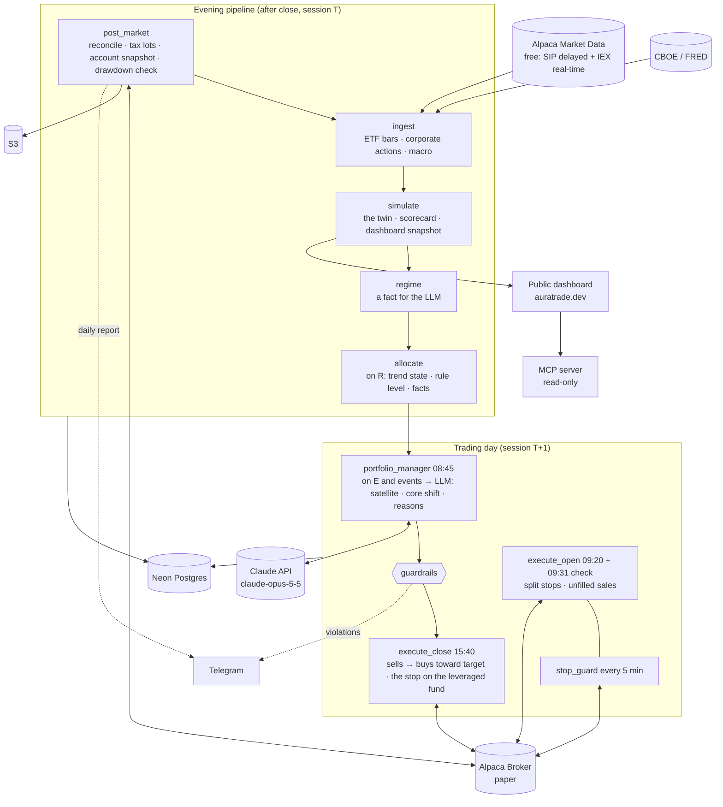

# AuraTrade

An autonomous **portfolio manager** for a US brokerage account. Its goal is to **beat the S&P 500 over 10 years, after Israeli tax**. It holds the US market through ETFs and manages **how much** of it to own rather than which stocks: 1.3x the S&P 500 while the market's trend is up, 0.5x while it is down (the rest in T-bills), on a buffered 10-month moving average checked once a month, with a volatility cap, a drawdown halt and a broker stop on the leveraged fund. Within that, an LLM (Claude) allocates a fifth of the account among approved ETFs and may shift the core by ±0.2x, with a written reason for every change. A rules-only **twin** runs beside it, so the LLM's value is measured, not assumed. The sources behind each rule are listed in [§18](#18-methodology-sources).

Python computes the trend, every target and every price, and enforces hard risk limits the LLM cannot override. The system runs serverless on AWS, on a budget of **under $150/month** (about $3-10/month expected, §12).

> **Status:** the backtest passed its pre-registered gate ([docs/backtests/portfolio.md](docs/backtests/portfolio.md), #8): after Israeli tax +9.2% a year against +8.7% for the market held, 1928-2026, with a shallower worst drawdown; a thin edge, and a tie since the rules were published. The system is deployed on AWS and trading a **$100,000 Alpaca paper account**: the first trend reading was 2026-10-30, the first rebalance 2026-11-02. Its results are public at **[auratrade.dev](https://auratrade.dev)**. What is left to do is in [docs/execution-plan.md](docs/execution-plan.md); the builder's working rules are in [CLAUDE.md](CLAUDE.md).
>
> **Disclaimer:** this is experimental software and a portfolio project. It runs on an Alpaca **paper** account; no live money is planned. Nothing here is financial or tax advice; the Israeli tax model is a simplification (§17).

---

## Contents

1. [Design principles](#1-design-principles)
2. [System architecture](#2-system-architecture)
3. [Daily schedule](#3-daily-schedule)
4. [Market calendar and data integrity](#4-market-calendar-and-data-integrity)
5. [Components](#5-components)
6. [The core allocation (the trend dial)](#6-the-core-allocation-the-trend-dial)
7. [Rebalance, stops and exits](#7-rebalance-stops-and-exits)
8. [Risk management and guardrails](#8-risk-management-and-guardrails)
9. [LLM design and token budget](#9-llm-design-and-token-budget)
10. [Data model](#10-data-model)
11. [Tech stack](#11-tech-stack)
12. [Infrastructure and cost](#12-infrastructure-and-cost)
13. [Repository layout](#13-repository-layout)
14. [Configuration](#14-configuration)
15. [Validation and the paper trial](#15-validation-and-the-paper-trial)
16. [Decision log](#16-decision-log)
17. [Known limitations](#17-known-limitations)
18. [Methodology sources](#18-methodology-sources)

---

## 1. Design principles

1. **Own the market; manage the exposure.** Picking stocks fails most professionals over 10-15 years (SPIVA). The book holds the market and beats it, if at all, through **how much** it owns and **when**: leverage while the trend is up, T-bills while it is down (Faber 2007; Gayed & Bilello 2016; Hurst, Ooi & Pedersen 2017).
2. **The LLM decides; code enforces the envelope.** Claude allocates the satellite and may shift the core within a band. Code rejects or clips anything outside hard limits. A deterministic-first design was rejected (#1).
3. **Python computes facts; the LLM interprets them.** The trend, the rule level, every target weight, share count and price come from code. The LLM never supplies a price.
4. **Careful leverage.** A hard ceiling (1.5x), leverage only while the trend is up and volatility is normal, through a leveraged ETF (no margin, so no margin call), a broker stop on it, and a drawdown halt that removes it at once.
5. **Judged after tax, against what an investor would actually get.** The benchmark is SPY bought, held and sold at the end, taxed as an Israeli resident's account is (25% on gains). A strategy that wins only before tax doesn't pass.
6. **Sell rarely.** Every sale can realize a taxed gain. Decisions are monthly, the trend rule has a buffer, the downtrend level is 0.5x rather than 0x, and small drifts aren't traded.
7. **The broker is the source of truth; fail closed for risk, fail safe for exits.** On any uncertainty, exposure is held or reduced, never increased. No halt, kill switch or error path ever cancels a protective stop or blocks a sale toward the target.
8. **Everything is logged, and the LLM is measured.** LLM decisions can't be honestly backtested, so each month's reasoning is journaled and the book is compared with the rules-only twin.
9. **Only spend tokens when a decision is needed:** one decision a month, plus rare events.

---

## 2. System architecture



**Key architectural choices:**

- **One container image, many entrypoints** (one Lambda per job, #16).
- **Monthly decisions, daily protection.** The trend is read on the **ranking session R** (the last session of each month) and the book trades on the **execution session E** (the next full session). Between rebalances only the broker stop, the drawdown halt and reconciliation act.
- **The rule level is known the evening before.** `allocate` computes it on R's close; the Portfolio Manager decides the next morning, in real time; the trades go in at the 15:40 decision price.
- **The twin is computed, not traded.** `simulate` plays the rules-only portfolio forward each evening through `sim/portfolio.py`, the same simulation the backtest uses (#11).
- **Postgres is the queue** (`portfolio_targets`: the decision on E, then each `execute_close` run on it).
- **The evening pipeline is chained, not timed** (#15). Each evening job starts only after its predecessor succeeded for the same session (checked in `job_runs`), and on success it invokes the next one. The scheduled times in §3 are fallback starts; a job whose predecessor hasn't succeeded waits up to 30 minutes past its fallback time, then fails closed (no increase of exposure next session) and alerts.
- **Every job fits in Lambda's 15-minute limit;** anything over 10 minutes alerts.
- **Trades go in at 15:40, not at the open.** The close has the day's best liquidity. Sells go first, then buys, each as a marketable limit on the decision price.

---

## 3. Daily schedule

All times are US/Eastern (EventBridge Scheduler, `America/New_York`). **Every job starts with the market-calendar guard** (§4).

| Time (ET) | Job | Purpose |
|---|---|---|
| **Evening (session T)** | | |
| 16:20 | `post_market` | Reconcile; **tax lots** rebuilt from the broker's fills and distributions; the account snapshot (holdings, the estimated tax); **the drawdown check** (turns the halt on, §7.3); the nightly backup; Telegram daily report |
| 17:00 | `ingest` | Bars and corporate actions for the ETF list (§5.1), the macro series |
| 17:15 (fallback) | `simulate` | The **twin** for session T (§5.5); the scorecard once a month's results are complete; the dashboard's snapshot (§5.8) |
| 17:25 (fallback) | `regime` | The regime classifier: a fact for the LLM, no rule reads it |
| 17:35 (fallback) | `allocate` | **On R:** the trend state, the volatility, the halt → **the rule level** and the twin's targets; the Portfolio Manager's facts. Other sessions: nothing |
| **Trading day (session T+1)** | | |
| 08:45 | `portfolio_manager` | **On E (or its retry) and on events.** LLM: satellite weights, core shift, reasons → guardrails → `portfolio_targets`. **Hard deadline 12:00:** no valid decision by then → hold: no shift, last month's satellite (fail closed, #6) |
| 09:20 | `execute_open` | Reconcile → stops re-placed for splits with an ex-date today (§5.6). Nothing is sold before the open (#21) |
| 09:31 | `execute_open` (check run) | Reconcile + stop invariant → sales left unfilled at the last close |
| Every 5 min, 09:35–16:00 | `stop_guard` | The leveraged fund's GTC stops cover its full quantity at or above its level (§5.6, #19); repairs under the lock |
| 15:40 | `execute_close` | Reconcile + stop invariant. **On E:** sells toward the targets through the sell sequence, then buys (marketable limits at the decision price; the leveraged fund as an OTO with its GTC stop leg), then the stop raise. **The session after the halt turns on:** the leveraged fund is sold into SPY. **After a stop fill:** the proceeds into BIL. No trades on half days: E moves to the next full session |
| **Other** | | |
| Every 15 min, 07:00–22:00 on weekdays | `watchdog` | Alert if an expected heartbeat is missing, a run is stuck or a schedule is disabled; each run pings an external dead-man's switch (§5.9) |

One module, `jobs/schedule.py`, holds this schedule; the AWS schedules, the watchdog's expectations and the local stand-in (`scripts/local_session.py`) are all built from it (#16).
- **Fallbacks.** A chained job's time above is a fallback: its schedule fires every 10 minutes from that time to its deadline (`jobs.chain_wait_minutes`, 30). A run that finds the predecessor not done records `WAITING_PREDECESSOR` and exits; a run at the deadline without one fails closed and alerts (§4).
- **Retries.** A rebalance that didn't finish on E (no decision price, a blocked buy, a sale or buy that didn't fill) is tried once more at 15:40 on the next session with the same targets (`portfolio.retry_sessions`); each run is recorded on its `portfolio_targets` row, and a finished one isn't run again (#33).

---

## 4. Market calendar and data integrity

**Calendar guard.** EventBridge fires every weekday, so every job begins with:

```python
session = calendar.session_for(today)          # None if the market is closed
if session is None:
    record_job_run(job, status="SKIPPED_MARKET_CLOSED")   # heartbeat still written
    return
```

- **Calendar authority:** Alpaca's calendar API is primary; `pandas_market_calendars` is the cross-check. **If they disagree, no increase of exposure today** (stops and sales toward a lower target still run), plus an alert.
- **`market_sessions` table:** date, open/close, `is_early_close`, minutes, data status, and the cross-check result per session.
- **Sync:** `python -m auratrade.calendar.sync` writes Alpaca's sessions (2016 through the end of next year), re-run daily. It is idempotent, removes a session Alpaca drops, and refuses to drop more than 3 at once. **A date outside the synced range is unknown, not closed:** jobs fail closed and alert.
- **Guard policy per job type:** morning and intraday jobs run when today is a session; evening jobs when today was a session and the predecessor succeeded for it (§2); `watchdog` checks only heartbeats that were *expected* given that day's calendar.

**Holidays:** no calls or orders; the leveraged fund's stop is GTC at the broker; no buy order rests overnight (each run cancels what it left unfilled).

**Gap-fill ingest:** fetch every session since the last stored one.

**Early-close days (13:00):** no trades; a rebalance moves to the next full session.

**Sessions, not calendar days:** every window (the 21-session volatility, the retry) counts sessions. The monthly rebalance is anchored on the calendar's last session of each month. The backtest's long history has no calendar before 2016; there the sessions are the dates of the market file (pre-registration §3.1).

**Missing data vs. closed market:**

| Situation | Detected by | Action |
|---|---|---|
| Market closed | Not in `market_sessions` | Expected; nothing fetched |
| An ETF on the list has no bar | Halted or delisted | No buy of it; held units are marked at the last close and alerted |
| SPY or an index has no bar, or the macro series are stale | Ingest validation | `INCOMPLETE` → no increase of exposure next session, plus an alert |

**Intraday prices:** the 15:40 decision price is the last IEX trade if ≤ 2 minutes old, else the IEX quote midpoint if fresh with a sane spread, else none (#23). A fund with no decision price isn't traded that run: the trade stays owed to the retry (§3), and the leveraged fund's stop keeps resting (§5.6).

---

## 5. Components

### 5.1 Ingest (`ingest`)

- **What it fetches:** daily bars (Alpaca SIP, `adjustment=split` plus the raw close, #25) for **the ETF list** (`ingest.bar_ingest.tracked_symbols`): SPY, SSO, BIL, the satellite list (§5.4) and the regime's index ETFs (SPY, QQQ); their corporate actions; the macro series (VIX and VIX3M from CBOE, then FRED, #26; FRED rates and the credit spread). News is fetched by the Portfolio Manager on demand, not stored. Each fund needs an active `tickers` row; one missing fails the job.
- **Validation:** coverage of the ETF list (a fund missing is fetched once more), OHLC sanity, an outlier filter on highs and lows (`bar_corrections` keeps the vendor's value), the split re-fetch (a held fund can split: SSO has), the previous session's bar re-fetched for its final volume, idempotent upserts. A missing bar for SPY or an index makes the session `INCOMPLETE`; another fund's is alerted (no buy of it, §4).
- **Failure policy:** the calendar re-sync and the bars step fail the job (no increase of exposure next session); the corporate actions, the macro series and retention degrade with an alert.
- **Retention:** bars older than two years move to Parquet in the bucket (`history/store.py`), and the database size is reported each evening with an alert at 70% of Neon's 512 MB.
- **The long history** (backtest only, #9): Kenneth French's daily market and T-bill returns from 1926 (`data/french.py`) and Robert Shiller's monthly S&P dividends (`data/shiller.py`, through the Open Knowledge CSV of his file), stored in the Parquet history (`history/long_history.py`); SPY, SSO and BIL total-return bars from 2016 in `portfolio_funds` for the data checks (pre-registration §4). `scripts/backfill.py longhistory` fetches all of it.

### 5.2 Regime classifier (`regime`, a fact)

**No rule reads it.** It is one of the facts the Portfolio Manager sees: a descriptive label of the market's health in William O'Neil's (IBD) terms, `CORRECTION` / `EARLY_UPTREND` / `UNDER_PRESSURE` / `CONFIRMED_UPTREND` (#27).

- **Three pillars,** each +1, 0 or −1 at the close: **index trend** (SPY and QQQ above a rising 50-session SMA that is above the 200 → +1; either below its 200 with the 50 falling → −1), **volatility** (VIX < 20 and VIX/VIX3M < 0.9 → +1; the ratio > 1.0 or VIX > 30 → −1; stale data scores 0), **distribution** (the higher index count of distribution days in 25 sessions: ≤ 3 → +1, ≥ 8 → −1). The score is their sum.
- **A state machine** turns the score into the label, with hysteresis: `CONFIRMED_UPTREND` from +2, `CORRECTION` at ≤ −2 (at once when the index trend is −1), and a new uptrend needs IBD's **follow-through day** on either index (or 10 sessions at ≥ +2 without one); `EARLY_UPTREND` ends only on an undercut of the rally low or 6 distribution days. The label at session t describes t+1. All thresholds are in `risk.yaml` `regime:`.
- **The crisis override** flags VIX/VIX3M above 1.0 for 2 sessions, SPY −4% in a session (that session and the next), or macro data more than 2 sessions stale (fail closed).
- Each evening it continues the state machine from the last stored row, classifying any sessions a missed evening left out (#34). An empty table is seeded with a replay (`python -m auratrade.jobs.regime --from DATE --session DATE`).

### 5.3 The trend dial (`allocate`, `strategies/core_allocation.py`)

Pure functions, no I/O (§6 has the rules):
- the month-end index values, the 10-month SMA, the buffered trend state and its flips;
- the 21-session realized volatility and the cap;
- the drawdown halt (on, off, peak reset);
- **the rule level** and its holdings (SPY, SSO, BIL), and the twin's target weights.

On R, `allocate` runs them on SPY's adjusted closes (live) and writes the rule level, the state and the facts for the Portfolio Manager. The backtest calls the same functions on the long history.

### 5.4 Portfolio Manager (`portfolio_manager`, LLM, real-time)

- **Runs** at 08:45 on E (or its retry), and on an **event**: the drawdown halt turned on, the leveraged fund's stop filled, a held ETF's corporate action. On events it explains and may only reduce risk. Events are raised by hand (`portfolio_manager --event`); the alerts say when (`docs/runbook.md`).
- **Inputs:**
  - the trend state, the SMA and the distance to each buffer edge, the volatility, the halt, **the rule level and the twin's targets**;
  - account state: equity, cash, holdings and their weights, drawdown, **tax lots** (unrealized gains, the year's realized gains, the loss carried forward), **the tax a full sale of each holding would realize now, and the satellite's tax budget left this year** (#4). In `dry_run` it is the simulated book's (#31); on `paper`, the broker's: R's `account_snapshots` row, the live `tax_lots` and the live halt's peak; without that row, or with its lots not rebuilt, no facts are written, so E holds (#35);
  - the regime and its pillars; macro (VIX, VIX3M, FRED rates and spreads);
  - each satellite ETF's facts: returns over 1, 3, 6 and 12 months, volatility, distance from its 200-session SMA, correlation with SPY;
  - recent headlines (delimited data, §9);
  - **its own past decisions** with their outcomes against the twin, and the scorecard so far.
- **Tools:** `get_news`, `get_chart`, `get_etf_facts`, `get_decision_history`.
- **Decides** (structured output):
  - the **core shift**: −0.2 to +0.2 on the rule level, never above 1.5, and **only downward** while the rule level is DOWN, capped or halted;
  - **the satellite**: weights over the approved list summing to the satellite's share (`portfolio.satellite_share`, 20%), each ≤ 10% of equity (SPY, the neutral, up to 20%);
  - a **written reason** for each change, a one-line expectation for each tilt with the same as a number (`expected_vs_market`: its return less SPY's until the next E; scored later, #32), and the tax it accepted.
- **Holding is the default** (#4): the prompt says that every trade of a gain realizes 25% tax that holding would defer, so last month's targets stand unless a change clearly beats its tax; "hold the satellite" is an explicit answer; each change states the tax it realizes and why it beats holding. Code backs this with the hold rule and the tax budget (§8).
- **The approved list** (`portfolio.satellite_list`): QQQ (Nasdaq-100), IWM (US small caps), AVUV (US small-cap value), MTUM (momentum), QUAL (quality), VEA (developed ex-US), VWO (emerging markets), GLD (gold), IEF (7-10y Treasuries), TLT (20y+ Treasuries), DBMF (managed futures), BIL (T-bills), SPY (neutral). No leveraged or inverse products. Changed only by a decision.
- **Can't:** buy outside the list, use leverage in the satellite, lift the ceiling, block a sale toward a lower target or a stop, or name a price.
- **On failure** (error, timeout, refusal, invalid schema, missed deadline): the book **holds** (#6): no shift, so the core takes the rule level, and last month's satellite (the neutral before the first decision). It is exactly the answer `{"core_shift": 0, "satellite": null}`, goes through the same guardrails, realizes no satellite tax and adds no risk; an alert goes out.
- **Code:** `llm/portfolio_manager.py` (the answer, the tools, the run), `llm/portfolio_facts.py` (the facts and their rendering), `llm/portfolio_prompt.py` (the versioned prompt, filled from `risk.yaml`); `journal/portfolio.py` gathers the facts on R and `journal/decisions.py` records the decision (#30).

### 5.5 The twin and the scorecard

**The twin** (the benchmark the LLM is measured against):
- **The core rule on the whole account:** the rule level of §6 applied to 100% of equity, with no satellite of its own. **It is also the book at neutral** (no shift, the satellite in SPY, #4), so everything the LLM does, satellite and core shift, and the tax its changes realize, shows up as the difference.
- **Simulated each evening** by `simulate` through `sim/portfolio.py` on daily bars, at the decision prices the book traded at (or the close, when the book didn't trade), with the same costs and the same tax model.
- **Like for like.** Paper fills are optimistic (§17), so the book's own decisions are also replayed through `sim/portfolio.py` (the **sim return**); comparisons use the sim return, with paper fills reported alongside.
- **The sim return and the twin** run from the trial's first R, from `portfolio_manager.dry_run_equity` in cash, on the real funds' bars (split-adjusted closes as the price, the distributions from the total-return closes), rewritten whole into `twin_book` (`TWIN`, `SIM`) each evening. In `dry_run`, where no orders are sent, the sim return *is* the book and the Portfolio Manager sees it as the account (#31); on `paper` the account is the broker's (#35). The book's replay trades each holding only if its own target changed or it drifted past the band (§7.1), as the order layer does; the twin, like the backtest, rebalances the whole account when any target changes.

**The scorecard** (the evidence for whether the LLM adds value; `journal/portfolio_scorecard.py`, pure, #32):
- **Each decision is scored over its month:** from its E's close (after its trades) to the next E's; the latest decision's month runs to the last close and is open. **After the estimated tax** means equity less the tax a sale of everything at that close would owe (the year's realized gains and income so far, the unrealized gains, net of the loss carried forward; `TaxBook.tax_if_sold`), so realizing a gain costs nothing at once (the tax was owed either way); its cost is the tax paid at the year's end, which stops compounding.
- **The headline:** the book's after-tax excess over the twin, monthly and cumulative, before and after tax, with **SPY bought and held** at the trial's start beside them (a third simulated book, `SPY` in `twin_book`); a block-bootstrap interval of the monthly excess, annualized, once 24 months are complete (blocks of 3 months, 90%; `portfolio_manager.scorecard` in `risk.yaml`).
- **Each tilt is scored:** the satellite weight of each ETF minus its neutral weight (SPY at 20%, #4), times its total return to the next E, relative to SPY (SPY's own tilt scores 0 against itself); and each core shift times SPY's return over T-bills. **The tax each decision realized** (the book's realized gains on its E, at 25% before the year's offsets) is reported beside them, with the twin's on the same E.
- **Each expectation is scored** once its month is complete: `expected_vs_market` against the ETF's return less SPY's. **The direction** is right on the same sign; an expectation within ±1 point (`flat_band`) says "level with SPY" and is right only if the outcome is level too. **The size** is right when the direction is and the outcome is within 2x of it either way (`size_factor`). A held satellite states nothing, so nothing is scored.
- **Where it goes:** `simulate` rescores every month each evening into its `portfolio_journal` row (`results`, and the book's trades on its E as `trades`); the Portfolio Manager's facts carry the summary (`scorecard`) and each past decision's after-tax excess (to date while its month is open). The daily marks are `twin_book` (`SIM`, `TWIN`, `SPY`, each with its `tax_owed`); `account_snapshots` carries the live account on the same sessions (its `tax_owed` from the live lots). On `paper` each journal row's `results` also carry the account's own month (`paper`: its return from E's close to the next E's, before and after the estimated tax, and its fills on E, #35).
- Each decision is tagged with its prompt version and the answering model (§9).

### 5.6 Execution and the order layer (`execute_open` / `execute_close` / `stop_guard`)

1. **Reconcile.** The broker's positions in the funds are the book; any other position is a mismatch, alerted once, left alone (its stops too), and blocks increases until resolved (`auratrade resolve`). Every order seen is mirrored into `orders`. **Invariant (every job that touches orders, #18):** **every stopped position** (the leveraged fund, §7.2) has resting broker sell stops that are **GTC**, together cover its **full quantity**, and each sits at or above its level (`fund_stops`): one stop, or one OTO leg per buy. A partly filled buy counts as unprotected. Otherwise repair at once, alert, and block increases of exposure. Unleveraged ETFs carry no stop (#5): the invariant and `stop_guard` leave them alone.
   - **`stop_guard`** (every 5 minutes, 09:35–16:00, #19) checks existence, quantity and GTC from the broker alone, and repairs under the lock only when something is missing.
   - Order jobs run with Lambda's async retries (idempotent through `client_order_id`).
2. **Sell sequencing** for a stopped position: reduce the stop (an OTO leg is first swapped for a standalone stop), sell, restore it on failure; if the price is already through the stop level, sell at once (marketable limit, re-priced once, then market, #20). Positions without a stop sell directly.
3. **The rebalance at 15:40 on E** (`execution/portfolio.py`, #33):
   - **Targets → orders.** Each holding's target value (equity × target weight) ÷ the limit price, in **whole shares**, floored for buys; a holding within the drift band of its target (§7.1) isn't traded unless its target changed.
   - **Sells first**, then **buys**, each a **marketable limit** at the decision price ± `execution.marketable_limit_slippage` (0.5%, rounded to the tick against the book). Never a market buy.
   - **The leveraged fund is bought as an OTO** marketable limit with its GTC stop leg at its level (§7.2); Alpaca rejects a plain buy in a symbol with a resting sell stop as a "potential wash trade" (#18).
   - **The stop raise** for a leveraged fund still held: an atomic replace, never down.
   - **Each run decides afresh:** it first cancels what an earlier run left working in the funds, then plans from the broker's holdings and equity. Buys fit the cash the sales left at their limits; what hasn't filled after `execution.buy_wait_seconds` (30 s) is cancelled, and a sale that hasn't filled after `sell_wait_seconds` is cancelled and owed to the retry (§3). A fund without a decision price isn't traded that run.
   - **What may be bought** while increases are blocked (the kill switch, a repaired invariant, incomplete data, a calendar disagreement, an open account-level mismatch): only the cash fund, and only if already held; never the leveraged fund while halted; nothing in a fund with an open mismatch. Sales toward a lower target always go.
4. **Idempotency:** every order carries a `client_order_id` (`execution/ids.py`); an unanswered call is retried with the same id after looking the order up (#24).
5. **Single writer.** Every section of code that changes orders holds one account-wide Postgres advisory lock (#17): held only while orders change, never during an LLM call; `stop_guard` doesn't wait for it.
6. **No margin.** Leverage comes only from the leveraged fund. Total cash spent, with pending buys at their limit, stays ≤ equity, so the account never borrows.
7. **Corporate actions on held ETFs:** a split re-places the stop at the scaled level (on the ex-date Alpaca rejects resting stops at 04:00): the leveraged fund's level in `fund_stops` is divided by the ratio, a mismatch is opened (paper never adjusts the position, #22), and until it is resolved the fund is neither bought nor sold at once; a cash distribution is income for the tax lots (§5.7); a fund closure or merger raises an event, blocks buys of it, and is resolved by hand (`auratrade resolve`).

### 5.7 Post-market, journal and tax (`post_market`)

- **`tax_lots`** (#35): every buy opens a lot (date, units, cost in USD); every sale closes lots **FIFO** and records the realized gain. Distributions and T-bill interest are income. The year's tax is estimated as in the pre-registration §3.8: 25% on realized gains net of the year's losses and the loss carried forward, and 25% on income. On paper no tax is paid; the estimate is what the after-tax comparisons use.
  - Rebuilt whole each evening from the broker's activity record (`tax/live.py`, pure; `journal/tax_lots.py`): each fill in the funds is a lot or closes lots, positive `DIV*`/`INT*` entries are income (a withholding is skipped: the model taxes the gross), fees and deposits aren't taxed. What doesn't add up goes in the daily report and changes no order: a sale beyond the lots (its unknown units at no cost, so the estimate is never low), lots that differ from the broker's positions, another entry in a fund (a split). If the activities can't be read, the lots stay as they were and the snapshot's tax is unknown.
- **`portfolio_journal`:** one row per month: the rule level, the LLM's decision and reasons, the guardrail clips, the trades, the twin, and the month's results (before and after the estimated tax).
- **`account_snapshots`:** equity, drawdown, the funds' holdings and the tax a sale of everything would owe at the close (`tax_owed`), so before and after the estimated tax; SPY and the twin on the same day are `twin_book`'s rows.
- **The drawdown check** at each close (§7.3, `execution/halt.py`): the halt and its running peak are the `halt_drawdown` flag and its details in `system_flags`; on `paper` the close turns it on (alerted), in `dry_run` the check is reported only (the account is the simulated book, whose halt is simulated, #31).
- **The nightly backup** (`journal/backup.py`): the kept-forever tables (§10) to Parquet in S3.
- The Telegram daily report (with the equity after the estimated tax). The public dashboard's snapshot is written by `simulate`, once the day's twin exists (§5.8).

### 5.8 The public dashboard

The public site at **[auratrade.dev](https://auratrade.dev)** (`AuraTradePublicSite`, #28) is the project's showcase: the book against the twin and SPY, before and after the estimated tax; the exposure history (rule level, the LLM's shift, the satellite); **the monthly decision journal** with the LLM's reasoning and the limits it hit; and the backtest's result, stated plainly. It shows no order IDs, account numbers, stop levels or units held.

- **One allow-listed file** (#36): `journal/dashboard.py` builds `data/snapshot.json` field by field, and `simulate` writes it each evening to `public/snapshot.json` in the private bucket and to `data/snapshot.json` in the site's bucket (`SITE_S3_BUCKET`, set by the trading stack on that function only, with a grant to put that one key).
- **The page:** `web/dashboard.js` (on the drawing in `web/chart.js` and `web/chart.css`, which the MCP server's dashboard inlines too, §5.10) reads the snapshot and draws the returns since the trial began (the book, the twin, SPY and, on `paper`, the account; after tax by default, before tax on a toggle; with a table view), the S&P exposure (the rule level against the book's), the current satellite, the scorecard and the journal (newest first: the summary, the satellite with its expectations, the reasoning, the limits hit, the month's result). Before the first snapshot, or without JavaScript, the section says the trial hasn't started.
- `scripts/preview_site.py` serves the site locally under the deployed content-security policy.

### 5.9 Observability and safety

- **Kill switch and halts:** one meaning everywhere (#14).

  | Control | Blocks | Never touches |
  |---|---|---|
  | Kill switch (`system_flags.trading_enabled = false`) | **Increases** of exposure and buys of any fund not already held. `auratrade kill on` cancels resting buy orders at once (under the lock) | Protective stops, sales toward a lower target, the halt's sale, reconciliation |
  | Drawdown halt (−25%, `portfolio.drawdown_halt`, §7.3) | Leverage: the level is at most 1.0x | Same |
  | `auratrade flatten --confirm` (manual only) | Turns the kill switch on, then sells every position: the leveraged fund with the sell sequence (its stop restored if the sale fails), the rest with marketable limits; during market hours only | Nothing automatic ever calls it |
- **The kill switch is a database flag, not an environment variable,** read by every job at start. A new database starts with it on.
- **Operator commands:** `auratrade kill on|off|status`, `auratrade mismatches` / `resolve <id> --note "…"`, `auratrade halt status|reset`, `auratrade flatten --confirm`. `docs/runbook.md` says what to do for each alert.
- **Watchdog** heartbeats and an external dead-man's switch (healthchecks.io) (#16).
- **Telegram alerts:** failures, guardrail clips, the halt, a stop fill, mismatches, refusals, incomplete data, calendar disagreements.
- **Logs:** structlog → CloudWatch. Each LLM decision is stored whole in `llm_decisions` (every turn, the answer or the failure, the model, the cost) and backed up nightly.

### 5.10 The MCP server (`mcp_server/`)

An MCP server lets Claude (Claude Code, Claude Desktop, claude.ai) ask the running system about itself: how the book stands against the twin, why the LLM decided what it did, whether last night's chain ran. **It is strictly read-only (#37):** no tool places or cancels an order, moves a flag, resolves a mismatch or writes anything.

- **Two tool sets.** The *public* tools read only the dashboard's allow-listed snapshot (§5.8), so they show nothing the site doesn't: `performance` (the book, the twin, SPY and the account, before and after the estimated tax), `decisions` (the monthly journal), `exposure` (the levels and the satellite per decision), `scorecard`, and `dashboard` (below). The *operator* tools add the database, the broker and the logs: `status` (the kill switch, the halt and its peak, open mismatches, the next R and E, each job's last run), `jobs` (runs, their errors and details), `logs` (a job's CloudWatch events, warnings and errors by default), `portfolio` (the broker's account, positions and resting stops against the fund's level, the last close's holdings and tax), `trend` (the latest trend reading and the facts `allocate` gathered), `tax` (open lots, realized gains by year, the satellite's tax budget used), `decision` (one decision whole: the facts, the answer, the guardrails' findings, the model and its cost).
- **The dashboard** (#39): `dashboard` is an **MCP App** (the protocol's UI extension, `io.modelcontextprotocol/ui`): hosts that support it (claude.ai, Claude Desktop) draw its result as a page in a sandboxed frame beside the answer. It shows the paper account's balance, its gain since the trial began and over the last session, the tax (the value after the estimated tax, the tax a sale would owe, the tax realized against the twin's), the book, the twin and SPY before and after tax with Claude's edge, the return chart, the exposure (the book's level against the rule level), the satellite and the latest decision. The page is `ui://auratrade/dashboard.html` (`mcp_server/dashboard.html`), with the site's own drawing (`web/chart.js`, `web/chart.css`, shared with §5.8) inlined, so it loads and fetches nothing; it speaks the extension's handshake over `postMessage` by hand (no SDK, no bundler) and follows the host's light or dark theme. The data rides in the result's `structuredContent` (the snapshot's shape, the series thinned past 600 sessions, the last three decisions), which hosts keep out of the model's context; the text content is a short summary, what the model reads and what clients without MCP Apps show. Hosts find the page through the tool's `_meta.ui.resourceUri`.
- **`--public` serves the public set alone** and needs no credentials: no database, broker or AWS keys are read. It is what the remote server serves.
- **Resources:** the README by section (`auratrade://readme/{section}`, e.g. `5.4`), the decision log by entry (`auratrade://decision/{number}`), the runbook and the backtest's report.
- **Prompts:** `monthly_review` (the monthly review, on process: rule-following, the calibration of the expectations, the tax realized; returns reported, not decisive) and `triage_alert` (an alert's runbook row, then the status, the jobs and the logs).
- **Read-only below the code:** every database connection is made read-only (`SET SESSION CHARACTERISTICS AS TRANSACTION READ ONLY`, so Postgres refuses any write); the broker is typed as a reader (the account, positions, open orders), so a write call doesn't type-check; CloudWatch is read with `FilterLogEvents` only; a test fails if the package names a write (an order submit, replace or cancel, an insert, update or delete, an object put, or `SET TRANSACTION READ WRITE`). Every tool carries the read-only hint.
- **No secrets:** results never carry settings or keys, and an expected failure's message is redacted like the logs; an unexpected one reaches the client as the tool's name only. Logs go to stderr: stdout is the protocol.
- **Run locally:** `uv run --env-file .env.paper python -m auratrade.mcp_server` (Claude Code reads `.mcp.json`); the snapshot comes from the site's URL or a file (`--snapshot`).
- **Remote** (#38): the public set at a public Lambda function URL (`McpUrl`, stack `AuraTradeMcp`), for any MCP client: claude.ai's custom connectors, Claude Desktop, Gemini CLI, Claude Code with `--transport http`. No auth, as it serves only what the site shows; three things bound what a stranger can cost and keep it off the trading jobs: **reserved concurrency 1** (one run at a time, so at most 10 requests a second, never the jobs' concurrency), **a circuit breaker** (an alarm at 1,000 calls in an hour runs `mcp_breaker.py`, which sets that concurrency to 0, so every request is throttled, neither run nor billed, and alerts on Telegram; re-armed by hand), and **the snapshot read once a minute** per container. Reserving any concurrency needs the account's Lambda limit above 10; until AWS raises it, `-c mcp_uncapped=true` deploys without the cap (the breaker still bounds the bill) and the URL isn't shared. `remote.py` (the `mcp` target of the Dockerfile) speaks Streamable HTTP in its stateless, JSON-response form: each POST is one exchange, a fresh server per request, POST alone (a GET would hold the function open as a server stream). It reads the snapshot from the site's bucket (`GetObject` on that one key, no listing) and the documents from its image.

---

## 6. The core allocation (the trend dial)

The rules (#3), all in `risk.yaml` `portfolio:`; the backtest's exact versions are in `docs/backtests/portfolio-preregistration.md` §3.

| Step | Rule | Source |
|---|---|---|
| **The index** | SPY's total-return (dividend-adjusted) closes; its value on each R is the month-end value. (The backtest uses the CRSP market from Kenneth French's library) | Faber (2007) uses month-end total returns |
| **The trend** | SMA10 = the mean of the last 10 month-end values. The state turns **DOWN** when the value < SMA10 × 0.98 and **UP** when > SMA10 × 1.02; between the edges it stays (`portfolio.buffer`) | Faber (2007); the buffer cuts whipsaws and taxed sales |
| **The level** | UP → **1.3x**; DOWN → **0.5x** (`portfolio.up_level`, `down_level`) | Gayed & Bilello (2016) use 2x and 0x; 1.3x / 0.5x is the careful version |
| **The volatility cap** | SPY's 21-session realized volatility × √252 > **25%** on R → at most **1.0x** | Moreira & Muir (2017); Cederburg et al. (2020) for the doubt; a cap, not a target |
| **The drawdown halt** | Equity ≤ 75% of its peak at any close → at most **1.0x** at once (§7.3) | A hard floor on the leverage's damage |
| **The holdings** | Level x > 1: SPY (2 − x) and SSO (x − 1) of equity; x ≤ 1: SPY x and BIL (1 − x). 1.3x = 70% SPY + 30% SSO; 0.5x = 50% SPY + 50% BIL | SSO is 2x daily; no margin |

**The core and the satellite (#4).** The book's **level** is the rule level plus the LLM's shift. The satellite (20%) is the LLM's (§5.4); its **neutral** is SPY at the whole 20%. The core (`1 − portfolio.satellite_share`, 80%) is sized by code so that, with the satellite at its neutral, the book's exposure is the level: core level = (level − 0.2) / 0.8, so 1.375x for 1.3x (70% SPY and 30% SSO of equity, as the twin), 0.375x for 0.5x, 1.0x for 1.0x (no SSO). **With no shift and the satellite at neutral, the book is the twin** (§5.5), the strategy the backtest tested; every satellite fund other than SPY moves the exposure by its own difference from SPY.

**Why these rules and not others:** they come from the sources with no tuning; the alternatives (the 200-day average, 1.5x / 0x, margin, no stop, no volatility cap) are the pre-registered comparisons, reported and never adopted (#7).

---

## 7. Rebalance, stops and exits

### 7.1 The rebalance

| Step | Rule |
|---|---|
| **When** | The rule level is read on R's close; the book trades at **15:40 on E** (the next full session). A half day moves E |
| **Targets** | The core: SPY / SSO / BIL weights for the core level sized from the book's level (rule level + shift, §6) on the core's share; the satellite: the LLM's weights after the hold rule and the tax budget (§8). A rule level of DOWN, the cap or the halt allow only a downward shift |
| **The drift band** | A holding is traded only if its target changed or its weight is more than **5 points** from its target (`portfolio.drift_band`). Fewer, larger trades: less tax and cost |
| **Orders** | Sells first, then buys; whole shares; marketable limits on the decision price; SSO as an OTO with its stop leg (§5.6) |
| **Start** | The paper trial starts from cash on its first E |

### 7.2 The stop (the leveraged fund only)

- **One GTC stop at the broker** covering SSO's full quantity (CLAUDE.md §3.5, #5), at **70% of SSO's decision price** at its last purchase (`portfolio.stop_fraction` 0.30), rounded down to the tick.
- **Raised on each later E** to 70% of that E's decision price if higher. Never lowered.
- **After it fills,** `execute_close` alerts once and the proceeds wait in BIL until the next E: it buys BIL with them at the next 15:40 (whole shares at a marketable limit; what earlier runs bought counts against them, so the rebalance's change stays cash). The sale at once when the price is already through the level counts as the stop. A run that blocks increases (the kill switch while BIL isn't held, a repaired invariant, incomplete data) leaves them in cash for the next run (#34). The Portfolio Manager runs on the event to explain; it can't buy SSO back.
- **Why only there:** a stop on a broad ETF would sell it on noise and realize taxed gains; the trend rule and the halt are those funds' exits. A 2x fund at −30% means the market fell ~15% within the month: the case the stop exists for.
- **Gaps go through it** (§17).

### 7.3 The drawdown halt

- **On** at any close where equity ≤ 75% of its running peak (`portfolio.drawdown_halt` 0.25). **It acts at once:** at 15:40 on the next session, SSO is sold into SPY (the one trade outside E).
- **While on:** the level is at most 1.0x, and the LLM may only shift down. An E whose targets still hold SSO (the halt came after R) puts SSO's weight in SPY (#33).
- **Off** at the first R where the trend flips DOWN → UP (the peak is reset to the equity then), or where equity is back at its old peak: `allocate` checks it on `paper` against R's snapshot before it reads the rule level, and without a snapshot the halt stays on (fail closed). `auratrade halt reset` turns it off with the peak at the broker's equity (after a paper account reset).

### 7.4 Exits and tax

- Every sale is either the rebalance (toward a target), the stop, or the halt. There are no discretionary exits between rebalances.
- **Holding is the default (#4).** Every sale of a gain realizes 25% tax that holding would defer, so the Portfolio Manager is told to hold unless a change clearly beats its tax; it sees each holding's unrealized gain and the tax a full sale would realize now, and states the tax each change accepts.
- **Code enforces it in the satellite** (§8): a weight within 2 points of last month's target keeps it (`portfolio.satellite_min_change`), and the satellite's sales may realize at most 0.2% of equity in tax a year (`portfolio.satellite_tax_budget`), except while the trend is DOWN, capped or halted. The core's sales follow the rules and aren't budgeted; the drift band and the buffer keep them rare.

---

## 8. Risk management and guardrails

Guardrails are pure Python functions (`auratrade/guardrails/portfolio.py`) with 100% branch coverage. They run on **every** LLM decision. Violations are clipped or rejected, recorded on the decision's `portfolio_targets` row (`findings`) and in the month's journal (`clips`), and alerted (#5).

| Guardrail | Default | Behaviour |
|---|---|---|
| Exposure to the S&P (the book's level, §6) | 0.3x to 1.5x (`portfolio.min_level`, `max_level`); ≤ 1.0x while capped or halted | Clip |
| The LLM's core shift | ±0.2x (`portfolio.max_shift`); downward only when DOWN, capped or halted | Clip |
| Leveraged products | SSO only, only in the core, only while the level is above 1.0x | Reject |
| Satellite | `portfolio.satellite_share` (20%) of equity; the approved list only; each ETF ≤ 10% (`portfolio.max_etf_weight`), SPY (the neutral) up to 20%; no leveraged or inverse | Reject / clip, the rest to BIL |
| Hold by default (#4) | A satellite weight within 2 points of last month's target keeps it; a new holding under 2 points isn't opened; a full exit is honoured (`portfolio.satellite_min_change`) | Clip |
| Satellite tax budget (#4) | The tax the satellite's sales would realize (25% of their net FIFO gains at the decision prices; a fund without a price counts its whole sale as gain), with the year's earlier satellite tax, ≤ 0.2% of equity (`portfolio.satellite_tax_budget`); not applied while DOWN, capped or halted | Clip: moved back toward last month's targets until it fits |
| **Price levels** | The LLM never supplies a price; limits and the stop come from code | Reject |
| Stop on the leveraged fund | Always: the OTO's GTC leg at its level | Reject |
| Hard stop: GTC, full quantity, ≥ its level | The invariant in every order job and `stop_guard`; a partly filled buy counts as unprotected (§5.6) | Auto-repair + alert |
| Sell sequencing | Stop reduced before a sale of a stopped position; restored on failure (§5.6) | Enforced in the order layer |
| Single writer | One account-wide advisory lock around every order change | Enforced in the order layer |
| No margin | Cash spent, with pending buys at their limit, ≤ equity | Reject |
| Turnover | Trades only on E, the retry, and the halt's session; within the drift band | Reject |
| Kill switch / halt | Block increases of exposure only (§5.9) | No increase |
| Early-close days | No trades | Reject |
| Data integrity | `INCOMPLETE` session or calendar disagreement | No increase of exposure |
| LLM failure | Error, timeout, refusal, invalid schema, missed deadline | Hold: no shift, last month's satellite (fail closed, #6) |

---

## 9. LLM design and token budget

| Role | Model | Mode | Effort | Calls |
|---|---|---|---|---|
| Portfolio Manager | `claude-opus-5-5` | Real-time, with tools, the shared prefix cached | `high` | 1 per rebalance (12 a year), plus rare events |

**Expected LLM cost: about $0.15-0.30 a decision, under $1 a month** (#30). Measured with Anthropic's free token count: a 3,200-token cached prefix (the system prompt, the four tools, the answer's schema) and about 8,500 tokens with a full month's facts. The first real decision (a replay of 2026-10-01 on `dev`) took one turn and no tools and **cost $0.058**; one with tool rounds costs more. One decision a month plus a few events a year: **about $3-5 a year**. **Cost alert:** above `llm.cost_alert_usd` ($1.00) for one decision, all its turns; the worst case inside the limits (6 turns at the 16,000-token cap) is about $2.

**API usage** (#29):
- one client (`llm/client.py`) runs a decision to a validated answer or a named failure (`API_ERROR`, `TIMEOUT`, `DEADLINE`, `REFUSAL`, `TRUNCATED`, `INVALID_OUTPUT`, `TOO_MANY_TURNS`, `UNEXPECTED_STOP`); it never raises for an API problem, so every failure takes the hold path; its limits are `risk.yaml` `llm:`;
- structured outputs into Pydantic models;
- `strict: true` tools with `tool_choice: auto`;
- check `stop_reason`; server-side fallbacks (`fallbacks: "default"`) re-run a declined request on the model Anthropic routes its category to; a refusal that survives them → hold (#6);
- a **hard deadline** (12:00), enforced by the job: a late answer is discarded (fail closed);
- the answering model (`response.model`) stored on every `llm_decisions` row; fallback answers reported separately;
- effort set explicitly (Opus 5.5 always thinks; its default effort is `medium`);
- versioned prompts in `prompt_versions`;
- **untrusted text is data.** Headlines and news bodies come from third parties and could carry instructions. They are passed in clearly delimited data blocks, and the system prompt says to treat them as information, never as instructions. The guardrails bound what a manipulated answer could do.

**Output schema (abridged):**

```jsonc
// Portfolio Manager → guardrails → portfolio_targets
{ "core_shift": -0.1,
  "core_reasoning": "...",
  "satellite": [{ "symbol": "GLD", "weight": 0.05, "expectation": "...", "expected_vs_market": 0.01, "why_not_hold": "..." },
                { "symbol": "SPY", "weight": 0.15, "expectation": "...", "expected_vs_market": 0, "why_not_hold": "..." }],
  // or "satellite": null: hold last month's targets (the default, #4)
  "tax_note": "...",
  "summary": "≤ 120 words for the journal and the dashboard" }
```

No field is a price.

---

## 10. Data model

PostgreSQL on Neon. SQLAlchemy 2.0, Alembic (every schema change is a migration).

| Table | Purpose |
|---|---|
| `portfolio_targets` | Per rebalance: the rule level, the state, the LLM's shift and satellite, the enforced targets, the twin's targets; each `execute_close` run on them (`executions`) and when one finished (`executed_at`) |
| `fund_stops` | The leveraged fund's stop level (§7.2): one row per change (bought from flat, raised, scaled by a split); the latest is in force, never lowered |
| `tax_lots` | Open and closed lots per fund: date, units, cost, closed date and proceeds, realized gain, the order; income rows (§5.7); rebuilt whole each evening from the broker's activities |
| `twin_book` | The twin's simulated holdings, trades and equity per session (§5.5), the book's own decisions replayed (`SIM`), and SPY bought and held (`SPY`); each with the tax a sale would owe at the close (`tax_owed`) |
| `portfolio_journal` | One row per month: decisions, reasons, clips, trades, results (the scorecard's month, §5.5, §5.7) |
| `llm_decisions`, `prompt_versions` | Every LLM decision whole (the turns, the answer or the failure, the model, the cost) and every prompt as sent |
| `orders` | The broker's orders as last seen: purpose (`BUY`, `STOP_LEG`, `STOP`, `EXIT`, `OTHER`), quantities, fills |
| `account_snapshots` | The account at each close: equity, cash, the peak and drawdown, the funds' holdings, `tax_owed` |
| `market_regime` | The regime classifier's row per session: its three pillars, the score, the label and the state carried to the next evening |
| `market_sessions`, `tickers`, `daily_bars`, `bar_corrections`, `corporate_actions`, `macro_series` | The calendar and the market data of the ETF list |
| `job_runs`, `system_flags`, `mismatches` | Each job's runs (the heartbeats and the chain), the kill switch and the halt with its peak, reconciliation's open mismatches |

**Retention:** `daily_bars` 2 years in Postgres, older bars in Parquet. Everything else is small and kept forever: it is the validation record (principle 8). **Backup:** `post_market` exports the kept tables to S3 nightly (`journal/backup.py`).

---

## 11. Tech stack

| Layer | Choice |
|---|---|
| Language / packaging | Python 3.13, **uv** |
| Quality | ruff, mypy (strict), pytest, hypothesis, recorded HTTP fixtures |
| Data processing | pyarrow (Parquet), pandas (charts) |
| Charts | mplfinance (for the LLM's `get_chart`) |
| Calendar | Alpaca calendar API + pandas_market_calendars |
| Market data | **Alpaca free tier**: SIP historical (15-min delay), IEX real-time quotes, news |
| Long history (backtest) | Kenneth French's data library (daily market and T-bill returns from 1926); Robert Shiller's monthly S&P data (dividends) |
| Macro data | CBOE, FRED |
| Broker | **Alpaca** (`alpaca-py`), paper; behind `execution/broker.py` so another broker (e.g. Interactive Brokers) is one adapter |
| LLM | Anthropic Python SDK, `claude-opus-5-5`, prompt caching |
| Validation / config | Pydantic v2, pydantic-settings, YAML |
| Database | **Neon Postgres (free tier)**, SQLAlchemy 2.0, psycopg 3, Alembic |
| HTTP / logging | httpx, tenacity; structlog → CloudWatch |
| Alerts | **Telegram bot** |
| MCP server | The official `mcp` SDK (`MCPServer`), over stdio locally and Streamable HTTP on Lambda (§5.10); its own dependency group, so the jobs' image doesn't carry it |
| Compute / scheduling | AWS Lambda (container image) + EventBridge Scheduler |
| Secrets / storage | SSM Parameter Store; S3 |
| Infrastructure as code / CI | AWS CDK (Python); GitHub Actions |

---

## 12. Infrastructure and cost

- **Region** `us-east-1`. One ECR image; one Lambda per job. Neon over TLS, so no VPC or NAT.
- **Least-privilege IAM** per function; secrets in SSM. Environments: `dev`, `paper`.
- **The trading stack** (`AuraTradePaper`, `infra/stacks/trading.py`, #16): one x86_64 container image built by `cdk deploy`; one function per job; order jobs get 15 minutes and Lambda's 2 async retries; secrets as SecureStrings under `/auratrade/<env>/`, read once per container; `TRADING_MODE` a deploy-time choice, `dry_run` by default, `live` refused; each evening job may invoke only its successor.
- **Each environment has its own Alpaca paper account and Neon branch** (`dev`: `.env`; `paper`: `.env.paper`), so reconciliations never fight. The `paper` account started the trial at $100,000.
- **AWS budget alarms** at $10 and $25.
- **Public site** (`AuraTradePublicSite`, #28): static files from `web/` in a private S3 bucket behind CloudFront, HTTPS only, strict security headers (scripts from the site itself only, nothing inline), no backend, at https://auratrade.dev (and `www`): an ACM certificate and Route 53 records, the domain set in `infra/cdk.json` (registered at Porkbun, delegated to the Route 53 zone). The dashboard (§5.8) reads one allow-listed `data/snapshot.json`, which `simulate` writes each evening and CloudFront serves at most 5 minutes old; the site's deploys never prune `data/`. The trading stack takes the site's bucket for that grant, so the site deploys first.
- **The remote MCP server** (`AuraTradeMcp`, `infra/stacks/mcp.py`, #38): one function behind a public function URL, its breaker and alarm (§5.10).
- **Neon free-tier compute:** the watchdog keeps the database awake for much of the day; `stop_guard` asks the broker first and opens a connection only to repair.

| Item | Monthly estimate |
|---|---|
| Claude API | under $1 (§9) |
| AWS | ~$1–5 |
| Domain and DNS zone | ~$1.60 |
| Data, database, alerts | $0 (free tiers) |
| **Total** | **~$3–10** (budget: < $150) |

---

## 13. Repository layout

```text
AuraTrade/
├── README.md                     # the specification (this file)
├── CLAUDE.md                     # the builder's working rules
├── .github/workflows/            # CI: lint → type-check → tests
├── docs/                         # the plan, the runbook, the backtest's pre-registration and report, spikes
├── web/                          # public site and dashboard: static HTML/CSS, dashboard.js on chart.js/.css (§5.8)
├── pyproject.toml / uv.lock
├── Dockerfile                    # the jobs' image; the `mcp` target adds the MCP server
├── docker-compose.yml            # local Postgres for tests
├── alembic/                      # migrations
├── config/risk.yaml              # every threshold: portfolio (the rules), execution, ingest, regime, llm, …
├── src/auratrade/
│   ├── config.py
│   ├── cli.py                    # operator commands (§5.9)
│   ├── mcp_breaker.py            # switches the remote MCP server off on a flood (§5.10)
│   ├── calendar/                 # sessions, sync, the R / E rebalance calendar
│   ├── db/
│   ├── data/                     # alpaca_data, macro, news; long-history clients (French, Shiller)
│   ├── ingest/                   # the evening ingest for the ETF list
│   ├── history/                  # the Parquet store (archived bars), benchmarks, the long history
│   ├── indicators/               # moving averages, volume, distribution days (the regime's, the charts')
│   ├── regime/                   # the regime classifier (a fact for the LLM)
│   ├── strategies/               # core_allocation (the trend dial)
│   ├── tax/                      # israel: FIFO lots, realized gains, offsets, carry-forward, income;
│   │                             # live: the account's lots from the broker's activities
│   ├── guardrails/               # portfolio
│   ├── llm/                      # the Claude client, the Portfolio Manager's facts, schema and prompt
│   ├── execution/                # broker interface + Alpaca adapter, orders, the stop invariant,
│   │                             # the single-writer lock, reconciliation; rebalance.py (targets →
│   │                             # orders, pure), portfolio.py (the rebalance, the halt's sale, the stop's
│   │                             # proceeds), funds.py (the leveraged fund's level, splits), halt.py
│   ├── journal/                  # portfolio.py (the books, the facts on R), decisions.py (the decision on E
│   │                             # and events, recorded), portfolio_scorecard.py, tax_lots.py,
│   │                             # report, dashboard.py (the public snapshot), backup
│   ├── sim/                      # the fill prices (fills.py), portfolio.py (the one simulator), funds.py
│   │                             # (the market from the real funds' bars), the fake broker (the order tests)
│   ├── mcp_server/               # the read-only MCP server: public and operator tools, docs, prompts;
│   │                             # remote.py on Lambda; app.py + dashboard.html, the MCP App (§5.10)
│   ├── charts.py                 # the Portfolio Manager's get_chart
│   ├── storage/
│   ├── notify/
│   └── jobs/
├── backtest/                     # the pre-registered backtest of the twin (§15)
├── scripts/                      # check_keys, backfill, local_session, put_parameters, preview_site, …
├── infra/                        # CDK app: public_site, trading (AuraTradePaper), mcp (AuraTradeMcp)
└── tests/
```

---

## 14. Configuration

- **`ENVIRONMENT`:** `dev` | `paper`; names the Alpaca account and Neon branch a process belongs to, and prefixes its alerts.
- **`TRADING_MODE`:** `dry_run` | `paper` | `live` (the settings refuse `live` outright). A job's `--dry-run` flag forces `dry_run` for that run; nothing can raise the mode.
- **Kill switch:** `system_flags.trading_enabled` in the database (§5.9), flipped with `auratrade kill on|off`. A new database starts with it on.
- **Models / effort:** `PM_MODEL`, `PM_EFFORT`.
- **`config/risk.yaml`:** **`portfolio:`** (the trend dial, the levels, the cap, the halt, the stop, the satellite and its list, the drift band, the LLM's band, the backtest's values), **`portfolio_manager:`** (the windows of the satellite ETFs' facts, the headlines and the tools' limits, the bars before the trial, the dry-run book's equity, the 12:00 deadline, the scorecard), **`llm:`** (the Claude client's limits, its cost alert and the token prices), `execution:`, `ingest:`, `jobs:`, `regime:`, `charts:`, `data:`, `history:`. Unknown keys are rejected; its hash is logged with every run and quoted in the backtest's report.
- **Paper account:** $100,000 at the trial's start.

---

## 15. Validation and the paper trial

### Backtest validity

The full text, fixed before any code read data, is `docs/backtests/portfolio-preregistration.md` (#7). In short:
- **The rules-only twin is tested**, on **about a century of daily data** (1928 to the latest month of Kenneth French's file): 1929, 1937, 1973-74, 1987, 2000-02, 2008, 2020 and 2022. The LLM isn't backtested: it has read what happened.
- **No tuning.** Every value comes from a source or was fixed before the data was read. **One scored run**, after a blind mechanics check; the report is committed as produced, then read.
- **One simulation** (`sim/portfolio.py` on `sim/fills.py`, #11): the leveraged fund synthesized from the market (2x daily, less financing and the fee) and checked against the real SSO from 2016; T-bills from the risk-free rate; tiered slippage; dollar units; the Israeli tax model (25% on nominal USD gains, FIFO, offsets and carry-forward, dividends and interest taxed when paid).
- **The benchmark:** the same market, bought once, dividends taxed yearly, sold and taxed at the end: SPY held by an Israeli investor.
- **The gate** (all three): **G1** after-tax CAGR above the benchmark's; **G2** max drawdown no deeper; **G3** after-tax final wealth above the benchmark's in ≥ 60% of the rolling 10-year windows (each an independent run).
- **The near miss:** G2 holds and the after-tax CAGR is at most 1.0 point a year below → the plan continues (the project shows the LLM's reasoning), and the result is stated plainly. **A clear fail** comes back to the user.
- **Reported beside it:** before-tax results, the period after each rule's publication (2007 on, 2016 on), each decade, the crash table, five comparisons and three diagnostics (trend alone, leverage alone, timing luck), never adopted.
- **The result (#8, `docs/backtests/portfolio.md`): the gate passed.** After tax +9.2% a year against +8.7% (1928-2026), max drawdown 68% against 85%, ahead in 69% of the ten-year windows. The edge is thin (+0.5 point after tax), comes from the long bear markets, loses in V-shaped crashes, and is a tie since the rules were published (2007 on: +9.6% against +9.4%; 2016 on: +11.8% against +12.7%).

### The paper trial

- **Runs** on the `paper` account from $100,000, from its first E (2026-11-02), for 12 months, and on after that as the showcase.
- **Operations:** every rebalance executed or correctly blocked; every job ran or was correctly skipped; the leveraged fund never without a full-quantity broker stop; zero duplicate orders; zero unresolved mismatches; the operator commands and the dead-man's switch each exercised once.
- **Guardrails:** none bypassed; every clip logged and alerted.
- **The LLM's value:** the scorecard (§5.5) reported monthly. After 12 months a pre-registered rule (written before month 12) decides whether the LLM's latitude grows, stays or shrinks. **It rests on process, not returns (#4):** with a tracking error of 3-5% a year against the twin, 12 months can't tell skill from luck, so the rule judges rule-following, the calibration of the expectations and the tax realized; the returns are reported, not decisive.
- **Live money** is not planned. If it ever is: a separate stack, a live broker adapter, and the user's explicit start (CLAUDE.md §3.1).

---

## 16. Decision log

Each entry is a decision in force: what was chosen and why. The design is frozen (#12): it changes only on a finding from data or at the user's request, and each change is recorded here.

| # | Decision | Choice |
|---|---|---|
| | *Foundations* | |
| 1 | The LLM decides; code enforces the limits | Claude makes the allocation decisions inside guardrails that code enforces and the LLM's output can't bypass. Code computes every fact, target and price; the LLM chooses weights and a shift within bands. A deterministic-first design (rules decide, the LLM comments) was considered and rejected. *Why:* the project's question is whether an LLM adds value to a disciplined strategy; that needs it to decide, and needs the limits to hold whatever it says |
| 2 | A portfolio manager, not a stock picker | The system manages a whole account by a written strategy in broad ETFs and changes course a few times a year. **Goal:** beat the S&P 500 over 10 years, after Israeli tax (the user is in Israel; the target is a regular taxable account with an API). $100,000 on Alpaca **paper**; no live money planned. Leverage is allowed "as long as it's careful". *Why:* most professional stock pickers trail their index over 10-15 years (SPIVA); a book that mostly owns the market can beat it through **how much** it owns and **when**: leverage while the trend is up, T-bills while it is down (Faber 2007; Gayed & Bilello 2016; Hurst, Ooi & Pedersen 2017). Picking gets only the satellite, where its value is measured |
| 3 | The core rules | SPY exposure at **1.3x** while a **buffered 10-month SMA** of the total-return index says UP (DOWN below SMA × 0.98, UP above × 1.02), **0.5x** while DOWN; read on the last session of each month (R), traded at 15:40 on the next full session (E); held as SPY + SSO (2x daily) above 1.0x and SPY + BIL below; a **volatility cap** (21-session realized > 25% → ≤ 1.0x); a 5-point **drift band**; no trades on half days. Live share counts are whole and floored; the backtest trades dollar amounts. *Why:* each rule comes from a source (§6, §18) with no tuning; the buffer, the 0.5x floor and the drift band keep sales, and so taxed gains, rare |
| 4 | The satellite, its neutral and the tax rules | The satellite (20%) is the LLM's, over 13 approved ETFs (no leveraged or inverse), each ≤ 10%; its **neutral is SPY at 20%**. The book's level is the rule level plus the LLM's shift (±0.2x, never above 1.5x, only downward while DOWN, capped or halted), and the core is sized as (level − 0.2) / 0.8, so **the book at neutral is exactly the twin**. **Hold by default:** a satellite weight within 2 points of last month's target keeps it, and the prompt tells the LLM that trading a gain loses money to tax; it sees each holding's tax-if-sold and states why each change beats holding. **A tax budget:** the satellite's sales may realize at most 0.2% of equity in tax a year, not applied while DOWN, capped or halted. The twin, the core rule on the whole account, is the LLM's benchmark; the latitude rule after 12 months judges process, not returns. *Why:* without a neutral equal to the twin, the scorecard would charge the LLM for the core's sizing; without the tax rules nothing in code limited the tax the LLM's changes realize |
| 5 | The risk limits; stops on the leveraged fund only | **Limits:** the book's level 0.3x-1.5x; leverage only through SSO, only in the core; no margin (cash spent ≤ equity); trades only on E, its retry and the halt's session. **The drawdown halt:** −25% from the peak → at most 1.0x **at once** (SSO sold the next session); off at the next DOWN → UP flip (peak reset) or at a new equity peak. **Stops:** a GTC broker stop on the leveraged fund only, covering its full quantity at 70% of its last rebalance price, raised only; unleveraged ETFs carry no stop. **Fail closed** means never increase exposure on uncertainty; the kill switch and the halt block increases only. *Why:* a stop on a broad fund sells on noise and realizes taxed gains, and the trend rule and the halt are those funds' exits; a 2x fund 30% down is the case a stop exists for (CLAUDE.md §3.5) |
| 6 | Hold when the LLM fails | On any failure (error, timeout, refusal, invalid schema, the 12:00 deadline missed) the book holds: no shift (the core at the rule level, as the twin's) and last month's satellite (the neutral before the first decision). It is exactly the answer `{"core_shift": 0, "satellite": null}` and goes through the same guardrails. *Why:* taking the twin's targets would sell every satellite holding into SPY and realize its tax, and the next decision would buy it back: one API timeout could cost more than a year's tax budget. Holding never adds risk |
| | *Validation* | |
| 7 | A pre-registered backtest of the twin | `docs/backtests/portfolio-preregistration.md`, fixed before any code read data. The twin is tested on Kenneth French's daily US market and T-bill returns from 1926 (scored 1928 to the file's last month), SSO synthesized (2 × market − (T-bill + 0.50%) − 0.90%) and checked against the real fund from 2016, Shiller's dividends for the tax, against the market bought, held and sold at the end. **No tuning; one scored run** after a blind mechanics check. **Gate:** after-tax CAGR above the benchmark's, max drawdown no deeper, and ahead in ≥ 60% of rolling 10-year windows (independent runs). **Near miss:** drawdown no deeper and after-tax CAGR at most 1.0 point a year behind → the plan continues, the result stated plainly. Five comparisons and three diagnostics are reported, never adopted. The LLM isn't backtested. *Why:* a century of data covers the bear markets a trend rule is for; one run with the gate set in advance can't be tuned into a pass |
| 8 | The scored run: the gate passed | Run once on 2026-10-27 (`docs/backtests/portfolio.md`, committed as produced). **G1-G3 pass:** after Israeli tax +9.2% a year against +8.7% for the market held (1928-2026), max drawdown 68% against 85%, ahead in 69% of 1,065 ten-year windows. **The edge is thin and tax-sensitive:** +1.8 points before tax, +0.5 after; tax costs 2.5 points a year against 1.2. It comes from the long bear markets (1929-32, 1937, 1973-74, 2007-09) and loses in V-shaped crashes (1987, 2020). **Since publication it ties:** 2007 on +9.6% against +9.4% (drawdown 37% against 55%), 2016 on +11.8% against +12.7%. The trend alone earned +7.5%, leverage alone +8.4%; nothing was adopted. *Why it continues:* the gate is the pre-registered test, and it passed; the result is stated plainly everywhere it is shown |
| 9 | The long history's readings | Shiller's dividends are read from the Open Knowledge dataset that republishes his file as CSV (values checked equal). They stop in 2023-06, so later months carry the last published dividend yield forward (38 of about 1,180 months, the dividend tax only, on both sides). The data checks' funds (SPY, SSO, BIL with all adjustments, 2016 on) live in `portfolio_funds`. *Why:* the backtest needed each of these defined before the blind check; none changes a rule |
| 10 | The pure layer's readings | Volatility is the sample standard deviation (n − 1) of the last 21 daily returns × √252; fewer returns count as capped (fail closed). The halt's peak isn't raised while the halt is on; leaving at a new peak resets it. The LLM's band is [max(min_level, level − 0.2), min(max_level, level + 0.2)] in a clean up-trend, the rule level as its top otherwise. A satellite weight that isn't a finite non-negative number, or a fund off the list, is rejected (that part to cash); one above 10% is clipped; a total above 20% is scaled down pro rata; the rest goes to BIL. "No increase" moves any fund's rise into BIL. CI enforces 100% branch coverage on `guardrails/`, `core_allocation`, `tax/`, `calendar/rebalance.py`, the scorecard and the rebalance's orders. *Why:* each edge fails closed or follows the rule's literal wording |
| 11 | One simulator | Backtests, the twin, the scorecard and the replay tests all go through `sim/portfolio.py` on `sim/fills.py`, which call the live pure functions; there is no second fill model. Per-year rates are spread over the sessions of that year in the market file (before 1952 the market traded on Saturdays); payouts accrue each session and are paid at month-end, reinvested as a new lot; buys are limited to the cash on hand; the stop is checked before the halt at a close and set from E's price; the tax is paid at each year's last session by withdrawing lots without realizing a gain. *Why:* two simulators drift apart, and then the backtest stops describing what trades |
| | *Process and infrastructure* | |
| 12 | Design freeze | No further design reviews on paper. The design changes only on a finding from data (written up in `docs/spikes/`, with options for the user) or at the user's request, and each change lands in this README and this log in the same change. *Why:* reviews on paper had stopped finding what only data could answer |
| 13 | The stack and the budget | Under $150 a month (about $3-10 expected). Alpaca free market data (delayed SIP + real-time IEX) and its paper broker, behind a broker interface; Neon Postgres (free tier) with two years of bars and Parquet for older ones; AWS Lambda + EventBridge Scheduler; SSM Parameter Store for secrets; Telegram for alerts. *Why:* the free tiers cover a monthly decision on a dozen ETFs; serverless costs nothing between jobs |
| 14 | Operations | The kill switch is a `system_flags` row with a CLI, and a new database starts with it on (no increase until `auratrade kill off`). **The kill switch and every halt block increases of exposure only:** stops, sales toward a lower target and reconciliation always run; `kill on` cancels resting buys at once; flattening is a manual command (`auratrade flatten --confirm`), which turns the kill switch on first so nothing buys back. Operator commands exist for every "by hand" step, with `docs/runbook.md`; an external dead-man's switch; a nightly backup to S3; a separate Alpaca paper account and Neon branch per environment. *Why:* "all trading stops" could be built as also stopping exits; a person must be able to act at 3 a.m. from a runbook |
| 15 | The evening chain | Evening jobs are chained on their predecessor's success for the same session (the scheduled times are fallbacks) and fail closed after 30 minutes; every job fits in Lambda's 15 minutes, and over 10 alerts. *Why:* clock-timed jobs could read stale data after a slow ingest |
| 16 | The AWS readings | One schedule module (`jobs/schedule.py`) feeds the AWS schedules, the watchdog and the local stand-in. A chained job's fallback fires every 10 minutes up to its deadline. The watchdog reports a heartbeat missing 15 minutes past its slot (a chained job's: past its deadline), a run RUNNING for 20 minutes, and any disabled schedule of its environment; each finding is alerted once per session, and every run pings the dead-man's switch. One container image for all functions; order jobs get 15 minutes and 2 async retries, the rest none; events older than an hour are dropped. Secrets are SSM SecureStrings read at function start, failing closed when none are found; the trading mode is a deploy-time stack setting (default `dry_run`, `live` refused). Each evening job may invoke only its successor. *Why:* a scheduler can't follow the market calendar, so the calendar guard lives in each job; `stop_guard` writes no heartbeat, so its schedule is what is watched |
| 17 | Single writer | One account-wide Postgres advisory lock (a direct connection) around every order change, released in `finally`, with Postgres ending an idle lock connection after 10 minutes as a backstop. Held only while orders change, never during an LLM call; a job waiting 2 minutes alerts and fails after 8. *Why:* scheduler and Lambda invocations are at-least-once, so two jobs could otherwise interleave a repair with a sell sequence |
| | *The order layer* | |
| 18 | Orders and stops at the broker | The leveraged fund is bought as an **OTO with a GTC parent**, so its stop leg is GTC from the start; one OTO leg per buy. The **invariant**, checked by every order job: a stopped position's GTC sell stops together cover its full quantity, each at or above its level; a partly filled buy counts as unprotected (the rest is cancelled and the filled shares covered). A sale of a stopped position follows the **sell sequence**: the legs are swapped for one standalone GTC stop under the lock, the stop reduced, the sale made, the stop restored on failure. *Why:* the Alpaca spike (`docs/spikes/alpaca-orders.md`): a leg takes its parent's time-in-force (a `day` leg expires at 16:00), its quantity can't change after the fill, and while a sell stop rests Alpaca rejects a plain buy as a "potential wash trade" but accepts an OTO |
| 19 | `stop_guard` | Every 5 minutes in market hours, `stop_guard` checks the stops' existence, quantity and GTC from the broker alone, and opens a database connection and takes the lock only to repair. *Why:* a job dying mid-sequence could otherwise leave shares unprotected until the next order job |
| 20 | Price through the stop | When the price is already at or below the level a stop would be placed at (restore, raise, repair), the position is sold at once instead: a marketable limit, one re-price, then market, within the same run. *Why:* "restore the stop" is undefined after a gap, and a stop placed below the market would sit there while the price falls |
| 21 | Nothing sold before the open | No OPG (opening auction) orders. Sales left unfilled at the last close run at the 09:31 check run through the sell sequence with a marketable limit. *Why:* the spike found that on a closed market a stop replace stays `pending_replace` and reserves every share, so an OPG sale is rejected and the stop can't be restored; OPG orders are also accepted only from 19:00 to 09:28 |
| 22 | Splits on paper | On a split's ex-date Alpaca rejects resting stops at 04:00 ET; `execute_open` places the scaled stop at 09:20 (09:31 if refused), the fund's level is divided by the ratio, and a `CORPORATE_ACTION` mismatch is opened; until it is resolved by hand the fund is neither bought nor sold at once. *Why:* the spike found that paper never applies a split to the position, and an unadjusted position against a scaled level would read as "price through the stop" and be sold |
| 23 | The decision price | At 15:40 (12:40 on half days): the last IEX trade if ≤ 2 minutes old, else the IEX quote midpoint if ≤ 1 minute old with a spread ≤ 2% of the midpoint, else no price (that fund isn't traded that run; the stop rests). *Why:* the data spike (`docs/spikes/alpaca-data.md`) found the last IEX trade often minutes old outside the most liquid names while IEX quotes stay fresh; the close's liquidity is the day's best |
| 24 | The order layer's readings | A marketable sell limit sits 0.5% below the decision price (a buy 0.5% above); selling at once waits 30 s per step (limit, one re-price, market); a buy works 30 s, then the rest is cancelled; an order call with no answer (5xx, a dropped connection) is retried up to 3 times with the same `client_order_id`, after looking the order up. A position outside the funds is a mismatch, left alone with its orders (code never invents a stop level). *Why:* each needed a number; all are in `risk.yaml` `execution:` |
| | *Data* | |
| 25 | Bars | Daily bars with `adjustment=split` plus the raw close (order levels are in traded prices, and dividend adjustment rewrites history on every ex-date); the previous session's bar is re-fetched each evening (its volume grows after 16:58); a split is detected by the re-fetched overlap bar's close moving > 2%, then the window is re-fetched; an outlier high or low beyond the body and the neighbours by more than max(15%, 3 × the 20-session average range) keeps the body's edge and is logged in `bar_corrections`; securities are keyed by Alpaca's asset id (tickers are reused) and zero-volume bars are dropped; T's bars are refused before the close plus the SIP delay; bars older than two years move to Parquet. *Why:* each guards against a vendor behaviour the data spike or the first full ingest found (e.g. a bad 195.95 tick on a $122 stock) |
| 26 | The evening VIX | CBOE's delayed-quote JSON (accepted 15 minutes after the close), then CBOE's history file, then FRED; a series more than 2 sessions stale in every source scores 0 and turns the crisis override on (fail closed). *Why:* the macro spike (`docs/spikes/macro.md`) found the JSON final soon after the close while the history file updates hours later and FRED lags a session |
| | *The regime, the site and the LLM* | |
| 27 | The regime classifier: a fact | IBD's market reading as a descriptive fact for the Portfolio Manager; **no rule reads it** (§5.2). Three pillars with inputs (index trend, volatility, distribution) and a state machine: `CONFIRMED_UPTREND` from +2 (debounced at +1), `CORRECTION` at ≤ −2 (at once when the index trend is −1), a new uptrend needs a follow-through day on either index or 10 sessions at ≥ +2 without one, `EARLY_UPTREND` ends only on a rally-low undercut or 6 distribution days, a downgrade beats an upgrade on the same session; the distribution pillar at −1 from 8 days in 25 sessions. *Why:* IBD's published values failed checks on 2016-2022 ETF data (too much time in `CORRECTION`, slow to see the 2020 recovery; ETF volume overcounts distribution days); these keep the declines early and pass the 2020 recovery |
| 28 | The public site | Static files (`web/`) in a private S3 bucket behind CloudFront with origin access control, in their own CDK stack, at auratrade.dev; no backend, no API. Data comes from one allow-listed `data/snapshot.json` written each evening; it shows no open orders, stop levels, units or ids. Pages say "paper trading" and "not financial advice". *Why:* a static site costs about nothing and can't touch the trading system, whereas an API on Neon would wake the free-tier database on every visit and put it on the internet |
| 29 | The Claude client | One client, no exceptions: a decision ends in a validated answer or one of eight named failures, so the caller always has the hold path. Server-side fallbacks on (a declined request re-run on the model Anthropic routes its category to; the answering model recorded). A cache breakpoint on the system prompt plus the automatic one; strict tools with `tool_choice: auto`, arguments validated before running, a tool's error returned to the model; the last allowed turn (6) forbids tools, so the model must answer. The deadline: no request starts after it, each attempt's timeout is cut to it, a late answer is discarded (still costed). Each turn is priced from its usage; the alert is per decision. Tests use recorded fixtures only. *Why:* CLAUDE.md §3.6: no LLM problem may raise past the decision |
| 30 | The Portfolio Manager's readings | The prompt is filled from `risk.yaml`, so the limits it quotes can't drift from the guardrails; its id is the version plus a hash of the text. An event blocks every increase (its guardrail context is the kill switch's). Each satellite ETF's facts: returns over 1, 3, 6 and 12 months, 63-session volatility, distance from the 200-session average, 252-session correlation with SPY; a missing or non-finite number is shown as unknown. Headlines and news are JSON strings inside `<untrusted_…>` blocks with `<` and `>` escaped, and the headlines' window ends at E's open at the latest. Tools serve only the funds on the list. *Why:* third-party text can carry instructions; a replay must not see news from after its morning |
| | *The jobs* | |
| 31 | The jobs in `dry_run` | In `dry_run` no orders are sent, so the account is the simulated book: the decided targets replayed through `sim/portfolio.py` from the trial's first R from $100,000, beside the twin, and the Portfolio Manager sees that account. The book's replay trades each holding on its own (its target changed or it drifted past the band); the twin keeps the backtest's whole-account rule. The market comes from the real funds' bars (split-adjusted closes as the price, distributions from the total-return closes). Increases are allowed only with the kill switch off, R's data `COMPLETE` and E's calendar cross-checked, in every mode. *Why:* the mode exists to run the whole decision loop without orders; trading every satellite fund whenever the core moved would void the hold rule |
| 32 | The scorecard's readings | Each expectation states a number (`expected_vs_market`, its return less SPY's to the next E): within ±1 point says "level" and is right only if the outcome is level too; otherwise the direction is the sign and the size is within 2x either way; scored only on a complete month, never for SPY itself. After the estimated tax is equity less the tax a sale of everything would owe at that close. A month runs from its E's close to the next E's. SPY is a third simulated book through the same simulator and tax model. The interval is a block bootstrap of the monthly after-tax excess (3-month blocks, 10,000 draws, 90%), from 24 complete months. The journal is rescored whole each evening. *Why:* a free-text expectation can't be checked without another model call; the three lines must be like for like |
| 33 | The rebalance orders' readings | The leveraged fund's level lives in `fund_stops`: append-only, the latest in force, a raise below it ignored, set by a buy from flat or scaled by a split. Each run decides afresh from the broker: it cancels what an earlier run left working, then plans; buys carry random-suffixed ids. A rebalance that didn't finish is tried by its retry at the next session's 15:40 with the same targets, each run recorded on `portfolio_targets`. Unfilled orders are cancelled after the wait, so nothing rests past the run. While increases are blocked the only buys are the cash fund, if already held, and the halt's swap into SPY. The halt's sale sells all of SSO through the sell sequence and buys SPY; on an E whose targets still hold SSO, its weight goes to SPY. A sale at once through the stop level alerts like a stop fill. The stop is raised by every run that trades the rebalance. *Why:* a re-run must be safe whatever the earlier run left, and the retry should trade in the close's liquidity |
| 34 | The daily checks and the schedule | The live halt is the `halt_drawdown` flag with its running peak in the flag's details: `post_market` turns it on at the close from the broker's equity, `allocate` turns it off on R from R's snapshot before reading the rule level; without that snapshot it stays on. `dry_run` keeps the simulated book's halt. A stop fill is alerted once by the next `execute_close`, and its proceeds go into BIL at the next 15:40 (no buy rests overnight). `portfolio_manager` runs at 08:45 every session and calls Claude only on E. The ETF list is derived from the config (the core funds, the satellite list, the regime's indexes). `regime` continues from its last stored row through any missed sessions. Events reach the Portfolio Manager by hand (`--event`), so no unplanned paid call is scheduled. *Why:* each check reads only what the broker or the database has at that hour, and fails closed without it |
| 35 | The live tax lots, the journal and the snapshot | The lots are rebuilt whole each evening from the broker's activity record, not added fill by fill: a replay can't drift from the broker and a missed evening heals itself. Each fill is its own lot; income is the positive `DIV*`/`INT*` entries, the withholding skipped (the model taxes the gross). What doesn't add up is reported, not blocking: a sale beyond the lots counts its unknown units at no cost (never a low estimate). On `paper` the Portfolio Manager sees the broker's account, and without R's snapshot or its lots `allocate` writes nothing and E holds. The journal on `paper` adds the account's month beside the scored sim return. The dashboard's snapshot is written by `simulate`, after the day's twin exists. *Why:* the estimate changes no order, so it may be imperfect but must never understate |
| 36 | The public dashboard | `simulate` publishes the snapshot straight to the site's bucket after its private copy, with a grant on that one key (`PutObject` only, no read or list); a failure of either copy is logged without failing the job. `data/*` has its own CloudFront behaviour with a 5-minute cache. The content-security policy allows the page's one script and nothing inline or third-party; the script builds no markup from the snapshot (text only, checked by a test) and draws its own SVG charts. *Why:* one writer, one key; a library or inline script would weaken the policy for a few charts |
| | *The MCP server* | |
| 37 | The MCP server: strictly read-only | A server for Claude over stdio with operator tools (database, broker, logs) and public tools (the snapshot only). No write of any kind, the kill switch included. Read-only is enforced below the code: a read-only database session, a reader-typed broker, CloudWatch read-only, and a test that fails if the package names a write. *Why:* an AI client exploring the system must not be able to change it, by mistake or by a crafted prompt |
| 38 | The remote MCP server | The public tools at a public Lambda function URL with no auth, in their own stack (`AuraTradeMcp`). What bounds a stranger: reserved concurrency 1 (at most 10 requests a second, never the trading jobs' concurrency; needs the account's Lambda limit raised above 10, and until then it deploys uncapped with its URL unshared), a circuit breaker (1,000 calls in an hour sets the concurrency to 0 and alerts; re-armed by hand), and the snapshot read once a minute per container. Stateless Streamable HTTP, JSON responses, POST only. *Why:* AI clients (claude.ai, Gemini) call a public URL and can't sign requests; everything it serves is on the site already; App Runner or Fargate would cost $5-15 a month idle; behind CloudFront a flood would bill every refused request |
| 39 | The MCP dashboard | A `dashboard` tool that is an MCP App: the site's charts (`web/chart.js`, `web/chart.css`) inlined into one self-contained page, the data in `structuredContent`, a text summary for the model and for clients without MCP Apps, the host's light or dark theme with its own palette. Still #37: read-only, the snapshot only. *Why:* the dashboard belongs where the conversation is; one chart shared with the site, not copied |

---

## 17. Known limitations

- **The edge is thin.** The scored run (#8) passed with +0.5 point a year after Israeli tax over 98 years (+1.8 before tax), and since the rules were published it is a tie. Every exit from stocks realizes taxed gains (2.5 points a year against the benchmark's 1.2).
- **Some years will lag badly.** Sharp V-shaped recoveries (1987, 2020) cost a monthly trend rule 10-20 points against the market in a year.
- **Gap risk:** a 1987-style day (−20%) costs a 1.3x book about 26% before any rule acts, and the leveraged fund's stop fills below its level on a gap.
- **Leveraged-fund decay:** a 2x daily fund loses value in choppy markets (Cheng & Madhavan 2009); the volatility cap limits the exposure to it, not the effect.
- **The long history is a proxy.** The backtest's market is the CRSP value-weighted US market, not the S&P 500, and its 2x fund is synthesized; both are checked against the real funds from 2016 (pre-registration §4.4).
- **The tax model is a simplification:** 25% on nominal USD gains, not Israel's real (inflation-adjusted) gains in shekels; the extra sale to pay the tax isn't modelled; US estate tax on US-domiciled ETFs (a real issue for a non-US investor above $60,000) isn't modelled. Nothing here is tax advice.
- **LLM decisions can't be backtested** without hindsight; the scorecard against the twin is the honest test, and it needs years of monthly decisions to be conclusive.
- **LLM output is non-deterministic.** The guardrails, the hold path and the journal contain it.
- **Prompt injection.** News text reaches the LLM as delimited data (§9); the guardrails bound the damage, but a planted headline could still bias a tilt.
- **Paper fills are optimistic,** and paper never applies splits to positions (#22); the sim return is the comparison (§5.5). Whether paper credits distributions isn't known yet: if it doesn't, the paper account trails the twin by the funds' yield (BIL's is most of its return), and the sim return stays the comparison.
- **Free-tier data limits:** the decision price comes from IEX (#23); bars before 2016 aren't from Alpaca.
- **Vendor outages** fail closed: no increase of exposure; the stop stays.

---

## 18. Methodology sources

Primary sources are preferred: peer-reviewed research, the authors' own papers, and the data libraries themselves.

**The strategy**
- Faber (2007), "A Quantitative Approach to Tactical Asset Allocation", *Journal of Wealth Management*: the 10-month moving average, checked monthly.
- Gayed & Bilello (2016), "Leverage for the Long Run", Dow Award paper: leveraged S&P exposure above the 200-day average, T-bills below, 1928-2015 (comparison C1).
- Moskowitz, Ooi & Pedersen (2012), "Time Series Momentum", *Journal of Financial Economics*: an asset's own trend predicts its return.
- Hurst, Ooi & Pedersen (2017), "A Century of Evidence on Trend-Following Investing", *Journal of Portfolio Management*: trend-following across a century, including the crises.
- Moreira & Muir (2017), "Volatility-Managed Portfolios", *Journal of Finance*: less exposure when volatility is high (the volatility cap).
- Cederburg, O'Doherty, Wang & Yan (2020), "On the Performance of Volatility-Managed Portfolios", *Journal of Financial Economics*: the out-of-sample doubt (why it is a cap, not a target).
- Cheng & Madhavan (2009), "The Dynamics of Leveraged and Inverse Exchange-Traded Funds", *Journal of Investment Management*: daily-reset leverage and its decay.
- Hoffstein, Faber & Braun (2020), "Rebalance Timing Luck: The (Dumb) Luck of Smart Beta": the timing-luck diagnostic.
- S&P Dow Jones Indices, SPIVA U.S. Scorecard: most active managers trail their benchmarks over 10-15 years (why stock selection gets only the satellite).

**The data**
- Kenneth R. French, Data Library: "Fama/French 3 Factors [Daily]" (the market and the T-bill rate from 1926).
- Robert J. Shiller, online data: monthly S&P 500 prices and dividends from 1871.

**The regime classifier** (a fact for the LLM, §5.2)
- William O'Neil / Investor's Business Daily: [Watch for distribution days](https://finance.yahoo.com/news/watch-distribution-days-spot-peaks-220700524.html) and [Follow-through day](https://finance.yahoo.com/news/day-tells-time-buy-stocks-215900253.html): the market-timing rules the classifier follows.
