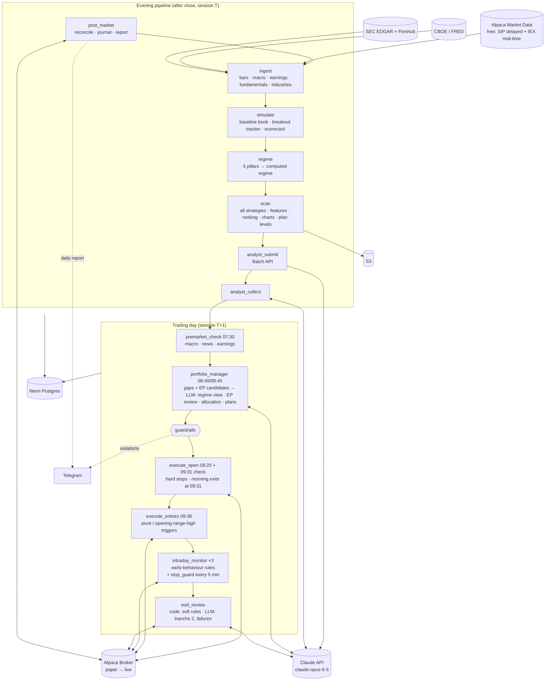

> **Archived 2026-10-25 (task 3.9, decision #147).** The README as it stood at commit 6652c95, describing the chart-pattern setup system (§5.3-§9, §15) that the momentum book replaced (#146). The setup code is still in the repo, unwired; this is its spec. Links are relative to the repository root, not to this folder.

# AuraTrade

An autonomous, event-driven swing-trading system for US equities. It is modelled as closely as possible on the documented methods of successful growth/momentum swing traders: Mark Minervini (**SEPA / VCP**), William O'Neil and IBD (**CAN SLIM**: market direction, bases and sell rules) and Kristjan Kullamägi (**breakouts and episodic pivots**). A **market-regime layer** switches strategy and risk as conditions change. The sources behind each rule are listed in [§18](#18-methodology-sources).

An LLM (Claude) makes the trading and capital-allocation decisions. Python computes the facts the LLM reasons over, carries out each position's exit plan, and enforces hard risk limits the LLM cannot override. The system runs serverless on AWS, on a budget of **under $150/month** (about $20–30/month expected, measured in spike 0.3g).

> **Strategy change (#146, 2026-10-25):** the chart-pattern setups failed three tests, and the user moved the system to a **relative-strength momentum book** ([docs/strategy-change-momentum.md](docs/strategy-change-momentum.md)). The plan and the rewritten sections (§1, §5, §7, §8, §15) come from a separate planning step; until then the sections below describe the system as built, not as it will trade.
>
> **Status:** design complete and frozen (decision #105); the build is in progress. The step-by-step build plan and progress tracker are in [docs/execution-plan.md](docs/execution-plan.md); the builder's working rules are in [CLAUDE.md](CLAUDE.md).
>
> **Disclaimer:** this is experimental software that will trade real money once live. Nothing here is financial advice. It runs on an Alpaca **paper** account first. Never risk capital you cannot afford to lose.

---

## Contents

1. [Design principles](#1-design-principles)
2. [System architecture](#2-system-architecture)
3. [Daily schedule](#3-daily-schedule)
4. [Market calendar and data integrity](#4-market-calendar-and-data-integrity)
5. [Components](#5-components)
6. [Market regimes and strategies](#6-market-regimes-and-strategies)
7. [Entries, position plans and exits](#7-entries-position-plans-and-exits)
8. [Risk management and guardrails](#8-risk-management-and-guardrails)
9. [LLM design and token budget](#9-llm-design-and-token-budget)
10. [Data model](#10-data-model)
11. [Tech stack](#11-tech-stack)
12. [Infrastructure and cost](#12-infrastructure-and-cost)
13. [Repository layout](#13-repository-layout)
14. [Configuration](#14-configuration)
15. [Validation and go-live criteria](#15-validation-and-go-live-criteria)
16. [Decision log](#16-decision-log)
17. [Known limitations](#17-known-limitations)
18. [Methodology sources](#18-methodology-sources)

---

## 1. Design principles

1. **Trade like the practitioners, not like a model.** Every rule maps to a documented practice of a successful trader (§18) or is a guardrail that keeps automation safe. Defaults that the sources disagree on are chosen by backtest, not by taste.
2. **The LLM decides; code enforces the envelope.** Claude chooses setups, risk and exit plans. Code rejects or clips anything outside hard limits.
3. **Python computes facts; the LLM interprets them.** All indicators, patterns, base counts, share counts and **price levels** are computed in code. The LLM may accept a code-computed pivot or stop, nudge a pivot within a small tolerance, or tighten a stop. It never invents a price level (§8, "Price levels").
4. **Each position follows its entry plan, and changes can only tighten it.** The plan is written at entry and carried out by code. Later LLM decisions may only make it more conservative.
5. **Losses small, winners big.** Tight initial stops, quick exits from breakouts that don't work, partial sales into strength, and letting the remainder run on a trailing stop.
6. **Progressive exposure.** Start small, size up when trades are working, size down when they aren't, in both the market and the account.
7. **The broker is the source of truth; fail closed for entries, fail safe for exits.** Hard stops always rest at the broker. No halt, kill switch or error path ever cancels a protective stop or blocks a plan exit.
8. **Everything is logged.** LLM decisions can't be honestly backtested, so the log is the validation record.
9. **Only spend tokens when a decision is needed.**

---

## 2. System architecture



**Key architectural choices:**

- **One container image, many entrypoints** (one Lambda per job).
- **The Analyst runs in the evening** via the Claude **Batch API**. **Episodic pivots** (overnight earnings or news gaps) can only be seen in the morning, so they are reviewed in the Portfolio Manager's real-time call.
- **All strategy scans run every evening**; the regime decides what gets *funded*.
- **The regime is computed in code**; the LLM's view (only ever more conservative) comes in the morning call.
- **Postgres is the queue** (`signals`).
- **The evening pipeline is chained, not timed.** Each evening job starts only after its predecessor succeeded for the same session (checked in `job_runs`), and on success it invokes the next one. The scheduled times in §3 are fallback starts. A job whose predecessor hasn't succeeded waits and retries up to 30 minutes past its fallback time. It then fails closed (no new entries next session) and alerts. A slow `ingest` therefore can't leave `regime` or `scan` reading stale data.
- **Every job fits in Lambda's 15-minute limit.** Each job logs its duration, and anything over 10 minutes raises an alert. That is why the evening simulation runs as its own job (`simulate`) rather than inside `scan`.
- **Entries are placed after the opening print (09:36)**, not before the open. Triggers are the pivot or the opening-range high, so a stock that gaps up and then fades isn't bought at the open.

---

## 3. Daily schedule

All times are US/Eastern (EventBridge Scheduler, `America/New_York`). **Every job starts with the market-calendar guard** (§4).

| Time (ET) | Job | Purpose |
|---|---|---|
| **Evening (session T)** | | |
| 16:20 | `post_market` | Reconcile; journal; equity snapshot; risk multiplier (§8); Telegram daily report |
| 17:00 | `ingest` | Gap-fill bars through T, and re-fetch T−1's bar (its volume grows after the evening, #118); universe and industries; corporate actions; macro (the evening VIX from CBOE's delayed quotes, #117); earnings calendar and surprises; rolling fundamentals |
| 17:15 (fallback) | `simulate` | Simulates session T for the **baseline book** (from T−1's list), records session T's triggers and completed 5-session results in the **breakout tracker**, and **scores past Analyst verdicts** (§5.12). It needs only session T's bars, not tonight's scan, so it runs before `regime` and the leadership-health pillar sees results through T |
| 17:25 (fallback) | `regime` | 5 pillars → state machine → **computed regime** |
| 17:35 (fallback) | `scan` | Trend Template → **all** strategy scans → features (base count, RS line, up/down volume, momentum rank, ADR) → ranking + cap → charts. Also updates **position-plan levels** and raises **position events** (climax signals, faltering RS, time stops, earnings cushion, corporate actions) |
| 17:50 (fallback) | `analyst_submit` | Submit Analyst reviews as one Claude batch |
| 19:00, 21:00, 06:00 | `analyst_collect` | Collect results (idempotent). Not done by 06:00 → no new evening-pipeline entries tomorrow, plus an alert |
| **Trading day (session T+1)** | | |
| 07:30 | `premarket_check` | Macro refresh from settled closes (computed regime may only **downgrade**, #117); overnight news; earnings-date changes |
| 08:40 | `portfolio_manager` (gap step) | Gaps are measured from **15-minute-delayed SIP** pre-market trades (to 08:25); IEX pre-market is too thin (spike 0.3a, #110). Setups gapping > 5% above their pivot are invalid today (EPs excepted: their gap is the signal, §7.1). **Episodic-pivot candidates**: pre-market gap ≥ 7% on earnings/news, confirmed ≥ 10% at the open |
| 08:45 | `portfolio_manager` (decision step) | **Only if there's something to decide.** LLM regime view, **EP review**, allocation, exit plans for new entries, tightening of existing plans → guardrails → `signals`. **Hard deadline 09:10:** no valid decision by then → no new entries today (existing plans still run) |
| 09:20 | `execute_open` | Reconcile → stops re-placed for splits with an ex-date today (§5.7) → hard-stop replacements (upward only). **No sales:** before the open a stop can't be reduced to free shares (spike 0.3b, #124) |
| 09:31 | `execute_open` (check run) | Reconcile + stop invariant → planned morning exits and trims, and sales left unfilled at yesterday's close, through the sell sequence (marketable limit, §5.7) |
| 09:36 | `execute_entries` | Reconcile + stop invariant → re-check the actual open vs each pivot → place entry orders with their triggers: pivot, or the **5-minute opening-range high** when the opening range traded above the pivot, and for momentum breakouts and EPs. Skip anything more than 5% above its pivot. An opening-range entry whose symbol had **no IEX trade in 09:30–09:34** waits for 09:51 (#109) |
| 09:51 | `execute_entries` (delayed-SIP run) | Opening-range entries without an IEX range: trigger = the consolidated 09:30–09:34 high from delayed SIP; same trigger, limit and "already through the trigger" rules (§7.1) |
| 10:30, 12:30, 14:00 | `intraday_monitor` | Reconcile fills; volume pace; **early-behaviour rules** (§7); raise hard stops when a milestone was hit intraday (breakeven, round-trip); cancel invalid entries; crisis check |
| Every 5 min, 09:35–16:00 | `stop_guard` | Invariant-only check (§5.7): every position's GTC stops cover its full quantity, and a partly filled entry counts as unprotected (#115). It asks the broker first and opens a database connection and takes the lock only to repair. This bounds the unprotected time after a job dies mid-sequence, or after a partial fill, to about 5 minutes, not the hours until the next scheduled order job |
| 15:40 (12:40 on half days) | `eod_review` | Code: soft-rule exits (trailing MA closes, heavy-volume reversals, climax and cushion actions), decided on the **15:40 decision price** and executed at once (§7.3). LLM, **only if needed**: tranche-2 adds that passed the gate, failed breakouts. **Hard deadline 15:50 (12:50):** no valid LLM decision → no adds, and failed breakouts follow their default (hold) |
| **Other** | | |
| Saturday 10:00 | `weekly_review` | Performance, "your numbers" (average gain/loss, win rate), LLM vs baseline, calibration, **proposed** lessons |
| Every 15 min, 07:00–22:00 on weekdays | `watchdog` | Alert if an expected job heartbeat is missing, a run is stuck or a schedule is disabled. Each run also pings an external dead-man's switch (§5.13) |

One module, `jobs/schedule.py`, holds this schedule; the AWS schedules, the watchdog's expectations and the local stand-in are all built from it (#133).
- **Fallbacks.** A chained job's time above is a fallback: it normally starts when its predecessor succeeds. Its schedule fires every 10 minutes from that time to its deadline (the time + `jobs.chain_wait_minutes`, 30), so a late predecessor still starts it within 10 minutes. A run that finds the predecessor not done records `WAITING_PREDECESSOR` and exits; a run at the deadline without one fails closed and alerts (§4).
- **Half days.** The scheduler can't follow the calendar, so `eod_review` fires at both 12:40 and 15:40 every weekday and runs only within `jobs.eod_review_window_minutes` (30) before that session's close; the other slot records a skip.

---

## 4. Market calendar and data integrity

**Calendar guard.** EventBridge fires every weekday, so every job begins with:

```python
session = calendar.session_for(today)          # None if the market is closed
if session is None:
    record_job_run(job, status="SKIPPED_MARKET_CLOSED")   # heartbeat still written
    return
```

- **Calendar authority:** Alpaca's calendar API is primary; `pandas_market_calendars` is the cross-check. **If they disagree, no new entries today** (stops still managed), plus an alert.
- **`market_sessions` table:** date, open/close, `is_early_close`, minutes, data status, and the cross-check result per session.
- **Sync:** `python -m auratrade.calendar.sync` writes Alpaca's sessions (2016 through the end of next year), re-run daily. It is idempotent, removes a session Alpaca drops (an unscheduled closure), and refuses to drop more than 3 at once, so a vendor glitch can't empty the calendar. **A date outside the synced range is unknown, not closed:** jobs fail closed and alert instead of skipping as "market closed".
- **Guard policy per job type:**

  | Job type | Runs when |
  |---|---|
  | Morning and intraday jobs | Today is a session |
  | Evening jobs (`post_market` → `analyst_submit`) | Today was a session, and the predecessor job succeeded for it (§2) |
  | `analyst_collect` | Any day it's scheduled (idempotent, collects the latest open batch) |
  | `weekly_review` | Saturdays, regardless of sessions |
  | `watchdog` | Checks only heartbeats that were *expected* given that day's calendar |

**Holidays:** no calls or orders; hard stops are GTC at the broker; no entry order rests overnight (entry parents are GTC for their stop leg's sake, and the EOD review cancels any unfilled one, §5.7).

**Gap-fill ingest:** fetch every session since the last stored one.

**Early-close days (13:00):** no new entries or tranche-2 adds; EOD review at 12:40; half-day **volume normalized** (× 390 / session minutes).

**Sessions, not calendar days:** every window (22 / 25 / 252 sessions, earnings windows, hysteresis, time stops, 8-week hold = 40 sessions) is counted in sessions.

**Missing data vs. closed market:**

| Situation | Detected by | Action |
|---|---|---|
| Market closed | Not in `market_sessions` | Expected; nothing fetched |
| Vendor data incomplete | Under 90% of expected symbols | Retry, then `INCOMPLETE` → no new entries next session, plus an alert |
| A single symbol has no bar | Halted, suspended or delisted | Excluded from today's watchlist; never forward-filled |

**Macro staleness:** "latest value on or before" each session; more than 2 sessions stale → volatility pillar scores 0.

**Intraday prices:** current prices and opening ranges from **real-time IEX**; volume from **15-minute-delayed SIP**. Two exceptions (spike 0.3a): pre-market gaps come from delayed SIP (#110), and when IEX printed nothing in the first 5 minutes, the opening range comes from delayed SIP at 09:51 (#109).

**Long weekends:** the Portfolio Manager receives the calendar days until the next open (`days_until_next_open`: Fri → Mon = 3; counted in sessions the next open is always 1 away) and `is_long_weekend` (more than 3).

---

## 5. Components

### 5.1 Ingest (`ingest`)

- **Universe:** active, tradable US common stocks (NYSE, NASDAQ, AMEX), **ADRs included** (#111). Price ≥ $10, 50-day average dollar volume ≥ $10M, ≥ 252 sessions of history. This also screens out the thinly traded stocks IBD found perform poorly (under ~400k shares a day).
  - The price and dollar-volume filters use **raw (unadjusted) prices as they traded that day**. Split-adjusted history would misstate past prices: a $50 stock before a 10:1 split shows as $5.
  - **Classification** (Alpaca's asset API has no type flag; #111): the Nasdaq Trader symbol directory's ETF flag → symbol suffix (preferreds, units, warrants, rights; single-letter class shares such as `BRK.B` stay) → name rules (funds, notes, SPAC-style names; "Common Stock / Ordinary Shares / Depositary Shares" kept) → EDGAR SIC 6770 (blank checks). EDGAR fund filings (N-CSR, N-PORT) also mark a closed-end fund named like a stock ("… Term Trust … Common Shares") as a fund, and EDGAR's verdict stands over the name rules (#129).
  - **Point in time:** backtests rebuild the universe for each historical session from the symbols that were listed then, **including later-delisted ones**, as far as the vendor covers them. Coverage is measured in spike 0.3a and its gap is reported in every backtest (§15).
    - Alpaca's asset list forgets most delistings before ~2018, but its bars endpoint still serves them. The backfill adds **ticker-enumeration snapshots** (every 1–4 letter ticker that traded in a given week; ~3 minutes each) to the asset list.
    - **Zero-volume bars are dropped:** Alpaca repeats the last close with volume 0 for months after a delisting.
    - History is keyed by ticker, and tickers get reused, so securities are keyed by Alpaca asset id / CUSIP where known, and a ticker with a trading gap of more than 30 sessions is split into separate securities. Such a relisting has an unreliable base count (§5.3).
    - **A one-day close move of 4× (or ¼×) also starts a new security** (#130): it is a bankruptcy reorganization, a reverse split the vendor didn't adjust, or a spin-off far more often than a real move, and the new piece starts without history, the conservative side.
    - **Renamed-ticker duplicates are dropped** (#130): the vendor keeps serving a renamed company's bars under the old ticker until the rename (PKI and RVTY, TASR and AXON). Two securities with identical bars on ≥ 90% of their sessions are one company; the active one is kept (then the one with an asset id, then the longer history). The backfill dropped 860.
    - **EDGAR covers only securities still trading** (#130): SEC's ticker-to-CIK map lists today's tickers, so a delisted security has no CIK, and so no historical earnings dates or fundamentals. Backtests report that gap with the delisted-coverage gap (§15).
  - **Listing date** = the first *public trading* date, not the exchange listing date: an uplisting from OTC (e.g. CELH in 2017) is not an IPO. The base count anchors on it (§5.3, #126). Ingest sets it to the first stored bar when that falls inside the 2-year window, unless EDGAR shows a 10-K, 10-Q, 20-F or 40-F filed before it; then it stays unknown and the count is unreliable (#129).
- **Bars:** Alpaca SIP daily bars, `adjustment=split`, plus the raw close (for the universe filter); rolling **2 years** in Postgres, full history (2016 onward) in **Parquet**.
  - **Tracked set** (#129): bars are stored for universe-type tickers that pass **half** the universe's price and dollar-volume filters, plus the index ETFs. A ticker that starts passing gets its whole 2-year window, so this saves storage (about 140 MB per database for 2,761 tickers) without changing who is in the universe; the filters themselves are applied point in time when the bars are read.
  - **Gap-fill:** each tracked ticker is fetched from its last stored session, which also re-fetches T−1. If that re-fetched bar's split-adjusted close moved by more than 2%, the vendor re-adjusted the history (a split) and the whole window is re-fetched.
  - **Session T−1's bar is re-fetched** each evening: the volume of bars fetched at 16:58 grew later for 187 of 195 symbols, by up to 62% (spike 0.3a, #118).
  - **Outlier filter:** SIP daily bars carry bad ticks that pass a plain OHLC check (NVDA's high of 195.95 on 2024-06-10, true ≈ 122). A high or low far outside both the bar's open–close range and the neighbouring bars is flagged and not used, and the base count never trusts a single-bar extreme (#126). "Far" is more than max(15%, 3 × the stock's 20-session average daily range), so a volatile stock's real intraday spike is kept; the bar keeps its body's edge and the vendor's value goes to `bar_corrections` (#129).
  - **Split-only adjustment, not dividend adjustment:** pivots and stops computed from the bars become broker orders, so they must be in the prices the stock actually traded at. Dividend-adjusted history sits below real prices, and it changes all earlier bars on every ex-date, which gap-fill ingest would never re-fetch. RS and momentum use price returns, as IBD's RS rating does.
- **Corporate actions:** splits, reverse splits, mergers and symbol changes for held symbols and open orders (§5.7).
- **Validation:** coverage ≥ 90%, OHLC sanity, split re-fetch, idempotent upserts. Coverage counts the tracked tickers that traded at T−1 and the index ETFs; a missing index alone makes the session `INCOMPLETE`. Ingest refuses session T's bars before T's close plus the 15-minute SIP delay (#129).
- **Failure policy** (#129): the calendar re-sync, the universe refresh and the bars fail the job, so the evening chain stops (no new entries next session); so does a drop of more than 50 securities from Alpaca's asset list in one evening (a vendor glitch). Corporate actions, macro, company data, earnings, fundamentals and retention degrade: the stored data stays as it was and an alert goes out.
- **Industries:** SEC SIC codes → about 100 industry groups (Finnhub profile as fallback). A code rolls up to its 3- and then 2-digit prefix until its group has 15 tracked members (114 groups on the live data). Groups are named by their prefix ("SIC 367"), so a group keeps its row across the weekly regrouping, and a ticker belongs to the most specific group its code matches (#129).
- **Run time** (#129): the job must fit Lambda's 15 minutes (alert at 10). Requests to Alpaca and EDGAR are bound by the server's response time, so up to 4 run at once per vendor, under its rate limit. A nightly run took 219 s in the live check, most of it Finnhub's 55 requests a minute.
- **Macro** (spike 0.3d, #117):
  - **Evening VIX/VIX3M** come from CBOE's delayed-quote JSON, accepted only if its `last_trade_time` is ≥ 16:15 on session T (it was final at 16:32 ET); on a half day, 15 minutes after its close (#129). A value is never replaced by a lower-ranked source (history file > delayed quote > FRED). CBOE's history files update only at about 18:30–21:30 ET, after the 17:25 `regime` job, and FRED lags at least a full session.
  - **Fallbacks, in order:** the CBOE history file, if its last row's date is T (never its `Last-Modified` header); then FRED (T−1); then the staleness rule (§4). The next evening checks the JSON value against the history row and logs any difference.
  - **Backtests** use the CBOE history files, filtered to `market_sessions` dates (the VIX file has rows on holidays).
  - **Credit spread** (FRED `BAMLH0A0HYM2`, only 3 years of history): stored for the Portfolio Manager's context only; no code rule uses it.
- **Earnings:** Finnhub calendar **and surprises** (actual vs estimate), refreshed daily.
  - **History (for backtests):** report dates from SEC EDGAR 8-K filings with Item 2.02 (results of operations). The timing is the **earlier of the 8-K acceptance and the first earnings headline**: before 09:30 → before the open, after 16:00 → after the close. Many "during the session" 8-Ks are morning releases filed later, and the headline catches them; with no headline (9%), the 8-K alone. Finnhub's free calendar has no past dates (spike 0.3e, #119).
  - **Upcoming timing:** Finnhub leaves before/after-market blank for 61% of upcoming reports. Then the company's usual timing from its last 8 reports applies; with no history, the report counts as before the open (the cushion runs one session earlier). A tie in the usual timing goes to before the open, and a release on a closed day counts as before the next session's open (#129).
  - **Each evening:** the calendar is read day by day 63 sessions ahead, and a moved date replaces the old one only when every day was fetched. Reports of the last 3 sessions get their surprise (at most 150 requests a run) and their EDGAR 8-K event, the history the usual timing reads (#129).
- **Fundamentals:** SEC EDGAR company facts → quarterly EPS and revenue growth and acceleration. Q4 is the 10-K's annual value minus the three quarters; growth is year over year and only from a positive base. A quarter first filed more than 120 days after its period end (a comparative figure in a later report) or before it (a mis-tagged fact) is skipped. Each tracked ticker is refreshed every 20 sessions and after each report, at most 200 company-facts downloads a run; the last 12 quarters stay in Postgres (#129).
  - **Point in time:** every fact is keyed on its **`filed` date** (when the market could see it), never the fiscal period end. Backtests read a quarter only from the session after its filing. The period end is 4–6 weeks earlier, and using it would look ahead.
- **News:** Alpaca news API, on demand.

### 5.2 Regime classifier (`regime`)

Five pillars, each **+1, 0 or −1**:

| Pillar | +1 | −1 | Source |
|---|---|---|---|
| **Index trend** | **Both** SPY and QQQ: close > 50 SMA > 200 SMA, 50 SMA rising (above its value 10 sessions earlier) | **Either** closes < 200 SMA with the 50 SMA falling | Bars |
| **Breadth** | > 60% of the universe above its 50 SMA, and new highs − new lows (10-session average) > 0 | < 35% above the 50 SMA, or new lows > new highs (same 10-session average) | Full universe |
| **Volatility** | VIX < 20 and VIX/VIX3M < 0.9 | VIX/VIX3M > 1.0 or VIX > 30 | CBOE / FRED |
| **Distribution** | ≤ 3 distribution days in the last 25 sessions | ≥ 8 (IBD: 6; #135) | SPY and QQQ counted separately; the **higher** count is used ([IBD](#18-methodology-sources)) |
| **Leadership health** | ≥ 55% of **all** breakouts from the 20-session window are above their trigger 5 sessions later | ≤ 35% | Breakout tracker (§5.12) |

**Leadership health** is how a practitioner notices that "breakouts aren't working" before the indexes show it. Kullamägi trades "fewer or no trades" when setups stop working; Minervini sizes down when he's trading poorly.
- It uses the **ungated** breakout tracker, not the regime-gated baseline book. Otherwise it would stop getting data in exactly the regimes where it's needed, creating a feedback loop.
- It scores 0 with fewer than 10 tracked breakouts in the window.
- **The window is the 20 sessions whose 5-session result is complete:** breakouts triggered from T−24 through T−5. Breakouts from the last 5 sessions have no result yet. Counting them would mix partial results into the live score and look ahead in backtests.

| Total score | Regime |
|---|---|
| +2 to +5 | `CONFIRMED_UPTREND` |
| −1 to +1 | `UNDER_PRESSURE` |
| ≤ −2 | `CORRECTION` |
| CORRECTION, then a follow-through day | `EARLY_UPTREND` |

**These are provisional 4-pillar thresholds** from the regime backtest (2.4, #135; `docs/backtests/regime.md`). IBD's published values (`CONFIRMED_UPTREND` from +3, `CORRECTION` at ≤ −1, distribution −1 from 6 days) sat in `CORRECTION` 38% of 2017–2022 with leadership health absent (it scored 0 there; live, it reads the breakout tracker from task 3.7, #142) and ETF volume overcounting distribution days. All of them are set again on 5 pillars in the 3.8 re-run. Every score below is the configured one: `risk.yaml` holds the values.

- **Naming.** IBD's "rally attempt" is the stretch *before* a follow-through day. Here it is tracked as a sub-state inside `CORRECTION` (rally day count, rally low). `EARLY_UPTREND` is the period *after* the FTD, when only starter positions are allowed. Every prompt defines the four labels this way, so the LLM doesn't map them onto IBD's wording.
- **Distribution day** (IBD): an index down ≥ 0.2% on volume higher than the prior session, counted per index (SPY, QQQ). **Both counts reset to zero after a follow-through day.** ETF volume stands in for exchange volume. Sessions with quarterly option expirations or index rebalances inflate it, so distribution days on those sessions are flagged, and the regime backtest decides whether to exclude them. The flagged sessions are the third Friday of March, June, September and December (the session before, if that's a holiday) and the S&P 500 and Nasdaq-100 rebalance dates; they count by default (#127).
- **Follow-through day** (IBD): day 4 or later of a rally attempt, **either** index up ≥ 1.25% on volume higher than the prior session.
  - **Correction low:** each index's lowest intraday low since the session the regime entered `CORRECTION`. This also covers a `CORRECTION` entered on the score while the index is near its high: the low is then that session's low, and the rally attempt can start right away.
  - Day 1 is the first up close after that index's correction low. A new lower low restarts the count.
  - **Rally low:** the correction low that the current rally attempt started from. The `EARLY_UPTREND` it leads to keeps that rally low.
  - The best FTDs come on days 4–7, so later ones are flagged as weaker.
  - The attempt is cancelled if **either** index undercuts its rally low.
- **Hysteresis:**
  - Downgrades to `CORRECTION` from `CONFIRMED_UPTREND` or `UNDER_PRESSURE` are immediate (`correction_sessions: 1`; the backtest compares 2 sessions, with the index-trend pillar at −1 always immediate).
  - `CONFIRMED_UPTREND` → `UNDER_PRESSURE` happens at once on a score ≤ 0, or after 2 consecutive sessions at +1, so that one pillar flickering across a threshold doesn't flip the regime.
  - Upgrades need 3 consecutive sessions, counted only while in the current state. Leaving `EARLY_UPTREND` upward also needs at least 10 sessions in it.
  - `premarket_check` may only downgrade.
- **State transitions** (a new uptrend needs a follow-through day, as in IBD, with one safety fallback):

  | From | To | When |
  |---|---|---|
  | `CONFIRMED_UPTREND` | `UNDER_PRESSURE` | Score ≤ 0 (immediate), or score +1 for 2 consecutive sessions |
  | `CONFIRMED_UPTREND` / `UNDER_PRESSURE` | `CORRECTION` | Score ≤ −2 (immediate) |
  | `UNDER_PRESSURE` | `CONFIRMED_UPTREND` | Score ≥ +2 for 3 sessions |
  | `CORRECTION` | `EARLY_UPTREND` | Follow-through day |
  | `CORRECTION` | `EARLY_UPTREND` (flagged `no_ftd`) | **Fallback:** score ≥ +2 for 10 consecutive sessions without a qualifying FTD. ETF volume can miss a real FTD, and without this the system could sit in cash through a whole recovery. With no FTD, each index's **rally low** is its lowest intraday low over those 10 sessions |
  | `EARLY_UPTREND` | `CONFIRMED_UPTREND` | Score ≥ +2 for 3 sessions, after at least 10 sessions in `EARLY_UPTREND` |
  | `EARLY_UPTREND` | `CORRECTION` | Either index undercuts its rally low, or ≥ 6 distribution days since entering `EARLY_UPTREND` (higher index count; IBD's count, kept when the pillar's −1 moved to 8, #135) |

  **The score doesn't end `EARLY_UPTREND`.** A follow-through day comes near the low, when the index-trend, breadth and volatility pillars are usually still negative, so the score is often ≤ −1 on the FTD itself. An earlier draft sent `EARLY_UPTREND` back to `CORRECTION` on a score ≤ −1. That would have cancelled most FTDs at the next session, and the regime would have flapped on every later +1.25% day. As in IBD, a new uptrend fails on a rally-low undercut or heavy distribution after the FTD.

  **No timeout out of `EARLY_UPTREND`.** A stalled early uptrend keeps its small limits until it confirms or fails. An earlier draft moved it to `UNDER_PRESSURE` after 25 sessions, but that state allows more risk (§6), so stalling would have been rewarded. For the same reason, the step-up from starter limits after 10 sessions (§6) applies only on sessions with a score ≥ +1.

  **The 10-session minimum** keeps the starter limits (§6) in force for their full 10 sessions on both paths. Without it, the `no_ftd` path, which enters at a score ≥ +2, would reach `CONFIRMED_UPTREND` within 3 sessions.
- **Crisis override (code):** VIX/VIX3M > 1.0 for ≥ 2 sessions (for as long as it lasts), or SPY −4% in a session (for the rest of that session and the next one) → no new entries.
  - VIX/VIX3M is the latest value on or before the session, from any source in the order above (§5.1). The override is also set, with an alert, when every source is more than 2 sessions stale. With one stale day, the 2-session check can read the same observation twice; that is accepted (#127).
- **Starting state:** `CORRECTION` (fail closed). A replay starts at least 252 sessions before the first label it needs.
- **Conservatism ladder** (by the risk each state allows, §6): `CORRECTION` < `EARLY_UPTREND` < `UNDER_PRESSURE` < `CONFIRMED_UPTREND`. "More conservative" always means lower on this ladder.
- **LLM view** in the Portfolio Manager call; **effective regime = the lower of the computed regime and the LLM view.** The LLM may return the computed label or any label below it, except `EARLY_UPTREND`: only the state machine assigns that, because it requires a follow-through day. `premarket_check` downgrades along the same ladder.
- **A morning downgrade doesn't fund unreviewed strategies.** The evening scan sends only the computed regime's fundable strategies to the Analyst. A strategy that becomes fundable only through a morning downgrade has no verdicts, so it isn't funded until the next evening's scan. With the current mapping (§6) this can't happen: `UNDER_PRESSURE`'s strategies are a subset of `CONFIRMED_UPTREND`'s, and `EARLY_UPTREND` is never assigned in the morning. The rule stays for any future mapping.
- Thresholds are tuned in the regime backtest: tuned on 2016–2022 and checked once, untouched, on 2023–present (§15).
- **The regime is judged in both directions.** Turning defensive early in a decline isn't enough. It also has to stay invested in strong uptrends.
  - Several pillars score 0 in many healthy markets (VIX ≥ 20, 4–5 distribution days, under 10 tracked breakouts), so +2 could become the normal bull-market state. The 2.4 backtest found exactly that on 4 pillars, and `CONFIRMED_UPTREND` now starts at +2 (#135).
  - One session at the `CORRECTION` score drops to `CORRECTION`, and getting out needs a follow-through day.
  - So the backtest reports each pillar's score distribution, time in each regime during known uptrends, and every **false `CORRECTION`**: a `CORRECTION` spell lasting more than 15 sessions in which SPY never closes 8% or more below its prior 52-week high.
  - It also compares an immediate downgrade to `CORRECTION` against one that needs 2 sessions at that score (with the index-trend pillar at −1 still immediate).

### 5.3 Scanner (`scan`)

**Trend Template** (Minervini). All 8 rules must pass for `VcpBreakout`, `MomentumBreakout` and `LeaderPullback`.
- `EmergingLeader` needs only rules 1, 5, 6, 7 and 8. Right after a correction, the moving-average stack (rules 2–4) often hasn't re-aligned yet, even for the true new leaders.
- `EpisodicPivot` is exempt; its catalyst replaces the trend.

The 8 rules:

1. Price > 150 SMA and > 200 SMA
2. 150 SMA > 200 SMA
3. 200 SMA rising for at least 22 sessions
4. 50 SMA > 150 SMA and > 200 SMA
5. Price > 50 SMA
6. Price ≥ 30% above the 52-week low
7. Price within 25% of the 52-week high
8. RS rating ≥ 70: the percentile of `0.4·R63 + 0.2·R126 + 0.2·R189 + 0.2·R252`

**Strategy scans (all run every evening):**

| Strategy | Detection | Source |
|---|---|---|
| `VcpBreakout` | 2–4 (up to 6) contractions, each shallower than the last (e.g. 25% → 12% → 6%); volume dries up in the final contraction; pivot = the high of the final contraction | Minervini |
| `MomentumBreakout` | Top ~2% of the universe by 1-, 3- or 6-month return; a prior move of 30–100%+ within the last 1–3 months; a 10–40-session consolidation with higher lows and a tightening range, riding the rising 10/20-day MA | Kullamägi |
| `LeaderPullback` | RS ≥ 80; pullback to within 1 ATR of the 10/21 EMA on declining volume; trigger = the prior session's high | Minervini / O'Neil (pullback buys in leaders) |
| `EmergingLeader` | RS ≥ 85; new 52-week high or RS line at a new high; smallest drawdown during the correction | O'Neil (the first leaders out of a correction) |
| `EpisodicPivot` | Detected **in the morning** (§5.5): a gap of ≥ 10% on earnings or news, heavy volume, strong growth and a beat; best if the stock hasn't rallied over the prior 3–6 months | Kullamägi; post-earnings drift (Bernard & Thomas) |

**How the scans measure it** (`strategies/`, #136; thresholds in `risk.yaml` `strategies:`, provisional until 3.8). Each scan returns the code pivot and the **structural stop**: the support the setup fails below, and the lowest stop the Analyst may give.
- **VCP contractions** come from the base's extremes, not a fixed zigzag. The base starts at the highest high of the last 65 weeks, and must have lasted at least 3. The first contraction runs to the lowest low after that high; each next one runs from the highest high after the previous low to the lowest low after it. So every contraction is shallower than the last by construction, and a pullback that undercuts an earlier low belongs to that earlier contraction. A high needs 3 sessions after it to count. A VCP has 2–6 contractions, the first 5–35% deep (under 5% is a merger-arbitrage flatline, not a base) and the final ≤ 10%, the final one in the upper half of the base, and the final one's average volume no higher than the 50-day average. Pivot = the final contraction's high; structural stop = its low.
- **Momentum:** the consolidation starts at the move's high, the highest of the last 40 sessions, which must also top the 63 sessions before it; the move (≥ 30%) is measured from the lowest low of those 63 sessions. Its second half must have a higher low and a smaller average daily range than its first. The close must be at or above a rising 10- or 20-day SMA (above its value 5 sessions earlier). Pivot = the consolidation high; structural stop = the second half's low.
- **EP backtest proxy:** the gap session itself, in two views (#143). **After the close** (the evening scan, the breakout tracker): open ≥ 10% above the prior close on ≥ 3× the prior 50-session average volume. **At 09:36** (what the backtest trades): the gap at the open, and ≥ 25% of that average volume traded from the open to the entry (SIP minute bars); its ranking features, price and ATR come from the prior close, since nothing later in the gap session is known when the entry goes in. On daily bars the pivot is the gap day's open (the floor of its opening range; the simulator decides the fill) and the structural stop is the prior close (a filled gap has failed). An earnings reaction session and the prior 3- and 6-month moves are reported for the ranking, not filtered on. The proxy can't require a beat.
- **Leader pullback** (#137): the pullback runs from the highest high of the last 10 sessions, has lasted at least 2, and fell at least 2 × ATR to its low (a real pullback, not a routine dip). The session's low is within 1 × ATR(14) of the 10- or 21-day EMA (the shorter one that qualifies is "the MA tested", which the tranche-2 gate checks), and the pullback's average volume is at or below the 50-day average. Trigger = the session's high (tomorrow's "prior session's high"); structural stop = the lower of the pullback's low and the tested EMA.
- **Emerging leader** (#137): the correction is the regime's latest `CORRECTION` spell, for 63 sessions after it ends. "Smallest drawdown" means the stock's largest close-to-close fall from a peak, measured from 21 sessions before the spell to its end, is at most 1.5× SPY's over the same sessions (O'Neil: leaders correct about 1.5–2.5× the market; the user chose this over a cross-sectional rank). The new high is the highest of 252 sessions, for the price or the RS line (close ÷ SPY). Pivot = the 52-week high; structural stop = the 5-session low.
- Momentum and EP stops at order time are the low of the day at 09:36 (§7.1); the structural stop is only the floor below them.

**Features computed for every candidate** (and shown to the Analyst):

| Feature | Definition | Source |
|---|---|---|
| **Base count** | Bases since the stage-2 start. A new base counts only after a ≥ 20% advance; the count **resets** if a base, or any low between two bases, undercuts the prior base's low, or a base fails (a decline deeper than 50%); a base-on-base counts as one. The final contraction's high is the pivot only in the upper half of the base's range, otherwise the base high. The count is **reliable** only when it starts from a real IPO in the history or from a reset seen in the data; an unreliable count is sized like a 3rd base (§8, #126) | IBD |
| **RS line** | Price / SPY; at a new high before or at the breakout = strong, declining = weak | IBD |
| **Up/down volume ratio** | 50-session up-day volume ÷ down-day volume; ≥ 1.0 = accumulation | IBD |
| **Momentum rank** | Percentile of 1-, 3- and 6-month returns | Kullamägi |
| **ADR / ATR** | ADR % = the 20-session average of (high ÷ low − 1); ATR = the 14-session average true range. They bound stop width. True range includes gaps, so ATR ≥ ADR on the same stock, and the stop rules (§8) are written with that in mind | Kullamägi |
| **Industry-group RS rank** | Median RS of the group's members | O'Neil (leaders come from leading groups) |
| **Earnings catalyst** | A recent earnings gap-up, growth and acceleration, surprise. The **surprise is shown to the LLM but kept out of the quality score**. No free source has surprise history back to 2016, so a score that used it couldn't be backtested, and the baseline gate (§15) would test a different pool from the one the Analyst receives | Minervini (SEPA catalyst), PEAD |
| **Extension** | % above the 50-day and 200-day | Minervini / IBD |

**Ranking and cap:** a quality score from RS, momentum rank, group rank, RS-line status, up/down ratio ≥ 1.0, tightness (stop width vs ADR), base count (earlier is better) and catalyst (without the surprise, above). Only strategies **fundable in the current regime** compete for the **top 40** Analyst slots, and they **take turns** for them (#138).
- Stocks more than 25% above their 50-day are excluded as too extended to buy.
- **`MomentumBreakout` and `EpisodicPivot` are exempt.** Take a stock that doubled over about 6 weeks and then flagged for 3: at the breakout it sits about 27% above its lagging 50-day, and faster movers sit 35–45% above. The 50-day rule would remove most of Kullamägi's setups.
- A momentum setup's extension is bounded instead by its own scan, which requires a tight consolidation riding the rising 10/20-day, and by its ≤ 1 × ADR stop. The baseline backtest compares momentum with and without the 50-day rule.
- **How the score is built** (`strategies/ranking.py`, #138): the **plain average** of the eight components, each scaled to 0–1. The user chose equal weights, so there are no weights to fit. RS rating and momentum rank are their percentiles ÷ 100, and so is the group's RS percentile. The RS line scores 1 at a new 52-week high, 0.5 within 5% of it, 0 otherwise. Up/down volume scores 1 at a ratio ≥ 1.0. Tightness is stop width ÷ ADR, ranked within the session's pool (the tightest scores 1). Base count scores 1st 1, 2nd ⅔, 3rd or unreliable ⅓, 4th+ 0. The catalyst is the share of three checks: an earnings gap-up of ≥ 5% on ≥ 1.5× volume in the last 63 sessions, quarterly EPS growth ≥ 25%, and accelerating EPS. A component without data scores 0.5 (neutral). An unknown 50-day extension excludes the setup (fail closed).
- **One slot per ticker** (#138, the user's choice): a stock with setups for several strategies takes its best-scoring fundable one. The others still feed the breakout tracker.
- **Taking turns** (#138, the user's choice): each round, every fundable strategy with setups left gives its best remaining one, in score order, until 40 are chosen. With a single ranking, pullbacks took 81% of the slots in `CONFIRMED_UPTREND` and VCPs 12%; taking turns gives VCP 32% and pullbacks 55%, and every eligible momentum and EP setup gets a slot.

**Verdict cache:** re-review only if the ticker is new, its structure changed, or the verdict is more than 3 sessions old. "Structure" is the base or consolidation (for VCP and momentum, the pivot; for pullbacks, the MA being tested). A pullback's daily-moving trigger (the prior session's high) doesn't trigger a re-review.

**Charts:** daily (1 year, ~800×600, 10/21/50/150/200 MAs, volume, pivot, RS line) and weekly (2 years, ~600×400). Built by `charts.py` with mplfinance (#139): the daily chart has the 10-day SMA, 21-day EMA and 50/150/200-day SMAs, the pivot (red) and structural stop (grey) as dashed lines, volume, and the RS line in its own panel. The weekly chart groups sessions by ISO week and shows the 10- and 40-week SMAs and volume. The PNGs are stored at `charts/<session>/<symbol>-daily|weekly.png`.

**Position-plan levels and events:** for every open position, compute tomorrow's hard stop, soft-rule levels, climax signals, faltering RS, time stops and earnings-cushion actions → `position_plans` / `position_events`.

### 5.4 Trade Analyst (`analyst_submit` / `analyst_collect`, LLM)

- **Batch, no tools.** Each request has compact facts (the features above), two charts, fundamentals, the earnings date and surprise, up to 5 headlines, the regime, and **the Analyst's own previous verdict and note for this ticker** (continuity across days, the way a trader follows a name while its base forms).
- **Output:** `BUY | WATCH | SKIP`, strategy, pivot, stop, conviction 1–5, up to 3 key risks, reasoning (≤ ~80 words), and a ≤ 20-word **watch note** for next time → `setups`.
  - **The levels come from code.** The request carries the scanner's `pivot` and `structural_stop`. The Analyst returns them unchanged or adjusts them inside the "Price levels" guardrail (§8): the pivot within ±3% (with a reason), and the stop only tighter. Out-of-bounds levels are rejected, and the verdict is stored as `WATCH`.
  - For **pivot strategies**, `stop` is the structural initial stop.
  - For **opening-range-high strategies** (momentum), `pivot` is the consolidation high and `stop` is the **invalidation level**: below it the setup is void. The actual initial stop is the low of the day, set at entry (§7.1).
  - `strategy` must equal the strategy of the request. A stock found by two scans gets one request per strategy. A different value is treated like an out-of-bounds level: the verdict is stored as `WATCH`.
- **The previous verdict is context, not a default.** The prompt says to judge from today's facts. The weekly review tracks how often verdicts flip, as a check on anchoring.
- **The shared prefix is cached** across the batch.

### 5.5 Pre-market check (`premarket_check`)

- **07:30:** macro refresh (downgrade-only), overnight news, earnings-date changes.
  - The macro refresh uses settled closes only. If the evening read missed session T's VIX, it fetches T's close (the delayed-quote JSON, then the history file) and re-scores. CBOE's overnight-session VIX values are ignored, because they can't be backtested (#117).
- **08:40** (first step of `portfolio_manager`), from **delayed-SIP pre-market trades up to 08:25** (#110; by 08:40 IEX had a pre-market print for only 17 of 80 sampled ≥ 10% gappers, delayed SIP for 78):
  - pre-market gap vs pivot: above pivot + 5% → invalid today
  - **EP candidates:** stocks that reported after yesterday's close or before today's open, or had major news, with a pre-market gap ≥ 7% (the screen; ≥ 10% is confirmed at the open), with charts, the surprise and the latest filed growth numbers. EDGAR lags the earnings release, so the new quarter is represented by the surprise and the headlines.
- Pre-market gaps are estimates (15 minutes old, thin pre-market liquidity), so `execute_entries` re-checks against the actual open; an EP needs an actual gap ≥ 10%.

### 5.6 Portfolio Manager (`portfolio_manager`, LLM, real-time)

- **Runs only if** there are fundable setups, EP candidates or position events.
- **Inputs:**
  - account state (equity, buying power, exposure, **risk multiplier**, "your numbers")
  - computed regime and pillars
  - fundable setups with flags
  - **EP candidates**
  - **positions with events only** (plus a one-line summary of the rest)
  - sector concentration, long-weekend info, approved lessons
- **Tools:** `get_news`, `get_chart`, `get_fundamentals`, `get_position_history`.
- **Decides:** its regime view (more conservative only); **which EPs to take**; which setups to fund and the risk %; **the exit plan for each entry** (bounded menu, §7); tightening actions.

### 5.7 Execution (`execute_open` / `execute_entries`)

1. **Reconcile.** **Invariant (every job that touches orders):** every position's resting broker sell stops are **GTC**, together cover its **full quantity**, and each sits at or above its plan's hard-stop level. Usually that is one stop; after a two-tranche entry or an add it can be one stop leg per buy (below). Otherwise repair immediately, alert and block entries.
   - **Between scheduled jobs**, the `stop_guard` (every 5 minutes, 09:35–16:00) checks existence, quantity and GTC from the broker alone. It repairs under the lock only when something is missing, using the plan level from the database. A job that dies after reducing a stop and before selling therefore leaves the shares unprotected for minutes, not until the next scheduled order job. `stop_guard` doesn't wait for the lock: while another job holds it, a sell sequence may legitimately be in progress, so it skips to its next run.
   - Order jobs are also invoked with Lambda's async retries on (they are idempotent through `client_order_id`), so a crashed job re-runs, reconciling first, within a few minutes.
   - **OTO stop legs** (spike 0.3b, #113). A leg takes its parent's time-in-force, and after the fill neither its time-in-force nor its quantity can be changed, only its stop price. So every entry parent is **GTC**, which makes the leg GTC from the start; the EOD review cancels any parent still unfilled (`post_market` as a backstop), so no entry rests overnight.
     - A leg stays in place, and stop raises replace its price, until a sale has to cut the quantity. Then, under the lock, the position's legs are cancelled and one standalone GTC stop is placed for the shares that remain: about 1 second with no stop, which `stop_guard` covers. From then on every change is an atomic replace. If the new stop is rejected because the price is already through its level, the shares are sold at once (step 2).
     - Alpaca sets leg `client_order_id`s itself, so reconciliation finds legs through their parent's `legs`, not by our prefix.
   - **The `fill_watcher` contingency isn't needed:** 0.3b showed that a stop-limit entry carries an attached stop leg, so the per-minute job that would have attached stops to plain entries isn't built.
2. **Sell sequencing.** A full-quantity stop reserves all the shares, so the broker would reject any other sell order. Every partial sale, trim or exit therefore:
   1. replaces the stop with the remaining quantity (or cancels it for a full exit); an OTO leg is first swapped for a standalone stop (step 1)
   2. submits the sell
   3. on rejection or no fill, restores the stop at once

   **Price already through the stop level.** Sometimes the market is at or below the level a stop would go at: when restoring a stop after a failed sell, raising one, or repairing the invariant after a gap down. Then no stop is placed. The shares are sold at once, by the same run, still holding the lock:
   - during the session: a marketable limit order. If it hasn't filled after a short wait (about 30 seconds, configured), the run re-prices it once, then replaces it with a market order. Leaving the retry to "the next order-touching job" could take hours, and after a 15:40 exit the next job runs after the close.
   - before the open: nothing is sold; the 09:31 check run sells (a stop couldn't trigger before 09:30 either)
   - a sale still unfilled at the close is retried by the next morning's 09:31 check run, with an alert. No OPG orders are used (#124)

   That is what the stop would have done. Alpaca rejects a sell stop above the market (`422 stop price must be less than current price`, spike 0.3b), so this path is required.
3. **09:20 (`execute_open`):** hard-stop replacements (only upward) and stops for splits (step 10). **No sales before the open:** on a closed market a stop replace stays `pending_replace` and keeps every share reserved, so an OPG sale is rejected and the stop can't be restored (spike 0.3b).
   **09:31 check run:** reconciles and enforces the invariant, then carries out the morning's planned exits and trims (plan rules and Portfolio Manager decisions) and any sale left unfilled at the last close, each through the sell sequence with a marketable limit. The cost is about one minute of exposure to the open, which the resting stop covers (#124).
4. **09:36 (`execute_entries`):** compute each entry's trigger and limit (§7.1), size it in code on the **worst fill (the limit price)**, clip by the limits, and submit an **OTO buy-stop-limit** (GTC parent, step 1) with the stop leg. If the last price is already above the trigger but at or below the limit, the entry goes in as an **OTO limit buy at the limit** instead: the same worst fill it was sized on, never a market buy. Above the limit, it is skipped.
   - **Every buy in a held symbol** (tranche 2, adds) is also an OTO with its own GTC stop leg. While a sell stop rests, Alpaca rejects a plain buy as a "potential wash trade" and accepts an OTO (spike 0.3b, #114). The new shares are protected from their fill, and the existing stop is untouched.
5. **Intraday stop raises:** `intraday_monitor` raises hard stops when a milestone (breakeven, round-trip) is reached intraday, never down.
6. **Idempotency:** `idempotency_key` = `client_order_id`.
7. **Single writer.**
   - Every section of code that changes orders holds one account-wide Postgres advisory lock. It is held only while orders are being changed, never during an LLM call, and other jobs wait for it.
   - EventBridge and async Lambda invocations are at-least-once, and the `stop_guard` runs alongside other jobs. Without the lock, one job's invariant repair could re-place a full-quantity stop in the middle of another job's sell sequence.
   - The lock is taken on a direct (unpooled) Neon connection, because session-level advisory locks don't work through a transaction-mode pooler. The job releases it in a `finally` block. A Lambda that times out or is frozen may not close its connection at once, so the lock connection also has a server-side idle timeout, set longer than any order section, as a backstop.
   - A job that waits more than 2 minutes alerts, and after 8 minutes it fails (so Lambda retries it). The `stop_guard` doesn't wait; it skips to its next run. The backstop idle timeout is 10 minutes; if the lock stays taken for longer, `stop_guard` alerts (#131).
8. **Partial fills.**
   - The filled quantity is the position. The stop covers what actually filled, and the invariant always checks actual broker quantities.
   - **A partly filled buy counts as unprotected.** Its stop leg stays `held` (inactive) until the parent fills completely (spike 0.3b). The next order job or `stop_guard` (within about 5 minutes) cancels the unfilled rest, re-reads the orders, keeps the leg if it has become an active GTC stop for the filled shares, and otherwise places a standalone GTC stop for them (#115). The position is smaller than planned, which only lowers risk, and the rest's reserved exposure is released.
   - Tranche 2 is sized so total risk ≤ plan, given tranche 1's actual fill.
   - When a sell fills only partly, the stop is restored on the remaining shares at once, and the rest of the sale is retried by the next order-touching job (at the latest, the next morning's 09:31 check run).
9. **No margin, no PDT rule.** FINRA's pattern-day-trader rule (4 day trades in 5 sessions, the $25,000 minimum) was replaced by an intraday margin standard from 2026-06-04 (Rule 4210 amendment, SEC Release 34-105226). Spike 0.3b ran six same-day round trips on a $4,875 paper account with none blocked, and the account API has no PDT fields (#123). So entries are never limited by day trades. Instead, entries never use margin: total exposure, with pending entries at their limit price, stays ≤ 100% of equity (§6, §8), so an entry can't create an intraday margin deficit. Alpaca's live-account behaviour is confirmed before Phase 8, because paper may not model intraday margin calls.
10. **Corporate actions on held positions** (from ingest's corporate-action feed, checked again by reconciliation):

    | Event | Handling |
    |---|---|
    | Split / reverse split | On the ex-date Alpaca **rejects resting stops at 04:00 ET** (spike 0.3b). At 09:20, `execute_open` writes a new plan version with every level and quantity scaled by the ratio (not a loosening), then places a new stop at the scaled level for the broker's actual quantity; if the broker refuses it before the open, the 09:31 check run places it. **Every invariant repair checks the corporate-actions feed first,** so a position not yet adjusted, with an unscaled plan level, isn't read as "price through the stop" and sold. **Paper never applies splits to positions** (DXJ stayed 1 share at the old cost until it was closed), so reconciliation compares quantities scaled by the feed's ratio and alerts, instead of failing closed for the rest of the trial (#116) |
    | Definitive cash acquisition | Position event + alert; code exits at the next session's 09:31 check run. The stock now trades on the deal spread, not momentum |
    | Stock-for-stock merger, spin-off, symbol change | Position event + alert; no new entries in the symbol; a `mismatches` row is resolved by hand (`auratrade resolve`) before entries resume |
    | Trading halt (LULD / news) | Alert. The stop rests unchanged and runs when trading resumes |
    | Cash dividend | Under FINRA Rule 5330 a broker may lower resting sell stops by the dividend on the ex-date. Alpaca paper doesn't (QDTE's stop was unchanged on its 2026-10-15 ex-date, spike 0.3b). If a live broker does, the invariant catches the lowered stop and replaces it at the plan level (#72) |

### 5.8 Intraday monitor (`intraday_monitor`)

Deterministic. Reconciles fills; computes volume pace (delayed SIP); applies the **early-behaviour rules** (§7); cancels entries invalidated by gaps, earnings, the crisis override or a regime downgrade.

### 5.9 EOD review (`eod_review`)

**Code, always** (IEX real-time price, delayed-SIP volume):
- trailing-MA close exits
- heavy-volume reversal exits
- climax partial sales
- 8-week-hold bookkeeping
- earnings-cushion actions

**LLM, only if needed:**
- **tranche-2 adds** that passed the confirmation gate
- **failed breakouts**: day 1–3 positions back below the pivot on light volume (hold, or exit early)

### 5.10 Post-market and journal (`post_market`)

`trade_journal` (R-multiple, holding sessions, MAE/MFE, tranches, exit reason, regimes, linked decisions, the **sim R**: the trade replayed through `sim/` as decided, with its actual entry decision, plan and risk, and the **default-plan R**: the same trade replayed under its strategy's default plan and risk, §5.12); `account_snapshots` (equity, drawdown, **risk multiplier**); Telegram daily report.

### 5.11 Weekly review (`weekly_review`)

- **"Your numbers"** (Minervini's discipline): win rate, average gain, average loss, gain/loss ratio and expectancy, overall and per strategy and regime. Feeds the guardrail that keeps stops small relative to the average gain (§8).
- Comparison with the baseline (overall, and on the setups where the two books **disagreed**); conviction calibration and the Analyst verdict scorecard (§5.12); Analyst BUY rate and verdict flip rate.
- **Proposed lessons** take effect only after your approval (at most 10 active).
  - Each lesson cites its evidence, with at least 10 supporting trades or 20 scored setups (§5.12), so a couple of unlucky trades can't become a rule.
  - A lesson expires after 60 sessions unless you re-approve it.

### 5.12 Shadow baseline and breakout tracker

**Shadow baseline book** (the benchmark the LLM book is measured against):
- **Same inputs:** the same capped top-40 list, regime gating, sizing, guardrails, entry policies and default exit plans. EPs come from the same morning candidate list (rule: gap ≥ 10%, volume, surprise > 0).
- **Rules instead of the LLM:** it takes setups in **rank order** until the position and exposure limits are full, and makes tranche-2 adds purely on the gate.
- **Simulated each evening** by the `simulate` job, from that day's minute bars for its symbols only: 09:36 triggers, opening-range highs, low-of-day stops, the EOD gate and soft rules (on the same 15:40 decision price as live). It therefore needs no extra intraday jobs.
- **Same feeds as live.** Live trading sets its levels from **IEX**: the opening-range high, the 09:36 last price and the 15:40 decision price. IEX prints only part of the volume, so its opening-range high is usually below the consolidated one. The simulator therefore takes those levels from **IEX minute bars**, and fills and volume from **SIP minute bars** (orders execute on the consolidated tape). Historical backtests use IEX bars where Alpaca's IEX history exists (from **2020-07-27**, spike 0.3a), and SIP before that, with the report saying so. The 09:51 delayed-SIP opening range (#109) is simulated the same way: where IEX minute bars show no trade in 09:30–09:34, the trigger is the SIP high and the entry starts at 09:51.
- **Like for like.** The LLM book trades on Alpaca paper fills, which are optimistic (§17); the baseline is simulated with slippage. Comparing the two directly would favour the LLM book. So every comparison with the baseline uses the LLM book's decisions replayed through `sim/` (the **sim R**, §5.10), and the paper fills are reported alongside.

**Breakout tracker** (feeds the leadership-health pillar):
- Records **every** trigger from the full, uncapped scan, regardless of regime or caps, and its result 5 sessions later. The leadership-health pillar reads only breakouts whose result is complete (§5.2).
- Because it's ungated, it keeps measuring whether breakouts work even in `CORRECTION`, which is when a recovery has to be spotted.

**Analyst verdict scorecard** (the main evidence for whether the LLM adds value):
- Thirty trades can't separate skill from luck. The Analyst, though, judges about 40 setups a day, so **every verdict** (BUY, WATCH, SKIP) is scored. The simulator plays each setup forward under its strategy's default entry policy and exit plan as if it had been taken, and records whether it triggered and its R after 5, 10 and 20 sessions → `verdict_outcomes`.
- Over a 3-month trial that's thousands of verdicts but far fewer independent **triggered** setups: the comparison runs on triggered setups (below). Do BUYs beat SKIPs? Does conviction 5 beat conviction 3? Are the stated key risks the ones that materialize? How much data the comparison needs is estimated in advance (§15, "Pre-registered statistics").
- **Counting honestly.** Verdicts aren't independent: a ticker is re-reviewed every few sessions while its base forms, and ~40 setups a day share one market. Counting each verdict as a separate observation would make the evidence look far stronger than it is, so:
  - **one unit per setup** (ticker, strategy, code pivot), labelled with the verdict in force when it triggered, or its last verdict if it never did
  - BUY vs SKIP expectancy is compared on **triggered setups**; trigger rates are reported separately
  - a setup counts as triggered only while a verdict is in force (≤ 3 sessions after its latest review, the verdict-cache window). The window is the same for every verdict, so trigger rates aren't biased by how long each verdict keeps a setup watched
  - confidence intervals use a **block bootstrap over sessions** (whole sessions are resampled), and the report shows the number of setups and sessions behind each figure
  - each setup is tagged with its prompt version and the model that answered (§9), so a prompt change or a fallback answer doesn't blend in silently
- **The scorecard starts early.** The evening pipeline runs in `dry_run` from the end of Phase 4 onward (execution plan, task 4.6), so months of scored setups exist before the paper trial starts.
- Portfolio Manager choices are judged the same way on **disagreements with the baseline**: the setups one book took and the other didn't.
- **Plan counterfactual:** every LLM-book trade is also replayed through `sim/` under its strategy's default plan and default risk. The gap between sim R and default-plan R (same fill model) measures whether the Portfolio Manager's exit-plan and sizing choices add value. The scorecard can't see those choices, because it uses default plans.

**One simulator.** The baseline book, the verdict scorecard, the historical backtests and the replay tests all use **one** fill simulator and fake broker (`sim/`), which calls the same pure plan and guardrail functions as live trading. This prevents three subtly different implementations from turning the LLM-vs-baseline comparison into a comparison of code paths.
- **Fill model:** entries are placed at 09:36, as live, so they are simulated on 1-minute bars from 09:36. That includes pivot triggers, the limit buy when the price is already past the trigger but within the limit, and the skip above the limit.
  - **Buy-stop-limits** trigger when a minute bar trades at or above the trigger. The fill is max(trigger, that bar's open) plus slippage scaled by liquidity, **if that is at or below the limit**. Otherwise the order rests as a limit order. It fills at the limit only if a later minute bar trades at or below the limit, and otherwise expires unfilled at the close. A fast breakout that jumps past the limit is therefore a **miss**, as it would be live, not a fill at the limit. Those are often the winners, so filling them would flatter every result.
  - **Stops** fill at min(stop, the bar's open) **minus slippage**, so gaps go through and stop-outs pay the spread.
  - **Soft-rule exits** fill at the decision price minus slippage.
  - **Pessimistic same-bar order.** When a bar without finer data reaches both the hard stop and a favourable level (a partial-sale target, a breakeven or round-trip milestone), the stop is assumed to come first. Daily bars drive most rules after the entry day, so this matters.

### 5.13 Observability and safety

- **Kill switch, halts and flatten:** one meaning everywhere.

  | Control | Blocks | Never touches |
  |---|---|---|
  | Kill switch (`system_flags.trading_enabled = false`) | New entries and tranche-2 adds. `auratrade kill on` cancels resting entry orders at once (under the lock); every job also checks the flag and cancels any that remain | Protective stops, plan exits, stop raises, reconciliation |
  | Daily / weekly loss halt | New entries and adds until the next day / week | Same |
  | Drawdown halt (−15%) | New entries and adds until you re-enable by hand; the multiplier resets to "prove it first" | Same |
  | `auratrade flatten --confirm` (manual only) | Sells every position with the sell sequence | Nothing automatic ever calls it |
- **The kill switch is a database flag, not an environment variable.** Every job reads `system_flags` at start, so flipping it needs no redeploy.
- **Operator commands** (CLI; every "by hand" step in this README has one; Telegram commands come later, Phase 9):

  | Command | Does |
  |---|---|
  | `auratrade kill on` / `off` | Kill switch |
  | `auratrade halt status` / `reset <halt>` | Show or reset the loss and drawdown halts |
  | `auratrade mismatches` / `resolve <id> --note "…"` | List reconciliation and corporate-action mismatches; mark one resolved after fixing it at the broker |
  | `auratrade lessons approve` / `reject <id>` | Lessons (§5.11) |
  | `auratrade flatten --confirm` | Manual flatten (above) |

  `docs/runbook.md` says what to do for each alert type. It is written before the paper trial.
- **Watchdog** heartbeats. AWS can't watch itself: if the scheduler or the account is down, the watchdog is down too. So each watchdog run also pings a free external dead-man's switch (e.g. healthchecks.io), which alerts by email and Telegram when the pings stop. Each run (#133):
  - on a session day, reports a scheduled job with no run `jobs.watchdog_grace_minutes` (15) after its slot (a run started at or after the slot), or, for a chained job, no run for the session by its deadline plus the grace;
  - reports a run still RUNNING after `jobs.stale_running_minutes` (20): its process died;
  - in AWS, reports any schedule of its environment that isn't enabled. That is how `stop_guard` is watched, since it writes no heartbeat unless it acts;
  - alerts each finding once per session, and pings the dead-man's switch whether or not it found anything. A failed ping is only logged; the switch alerts when pings stop.
- **Telegram alerts:** failures, guardrail events, halts, mismatches, refusals, incomplete data, calendar disagreements.
- **Logs:** structlog → CloudWatch; LLM payloads → S3.

---

## 6. Market regimes and strategies

| Regime | Fundable strategies | Base risk / trade | Max exposure | Max positions\* |
|---|---|---|---|---|
| `CONFIRMED_UPTREND` | `VcpBreakout`, `MomentumBreakout`, `EpisodicPivot`, `LeaderPullback` | 1.0% | 100% | 6 (8 if equity ≥ $100k) |
| `UNDER_PRESSURE` | `LeaderPullback` (conviction ≥ 4), `VcpBreakout` (conviction ≥ 4), `EpisodicPivot` (conviction ≥ 4) | 0.5% | 50% | 4 |
| `EARLY_UPTREND` | `EmergingLeader`, `EpisodicPivot` (starter positions) | 0.25% for the first 10 sessions after the FTD; after that, 0.5% on sessions with a score ≥ +1, otherwise 0.25% (always 0.25% if flagged `no_ftd`) | 25% for the first 10 sessions; after that, 50% on sessions with a score ≥ +1, otherwise 25% (always 25% if `no_ftd`) | 3 |
| `CORRECTION` | None (cash) | — | Existing positions only | — |
| Crisis override | No new entries | — | — | — |
| *Later phase* | `FailedBreakoutShort`, parabolic short | 0.5% | 25% | 2–3 |

\* Minervini holds about 4–8 positions in smaller portfolios. Base risk is multiplied by the **progressive-exposure multiplier** (§8). The conviction bars and the 10-session step in `EARLY_UPTREND` are `risk.yaml` defaults; the baseline backtest reports their effect. The baseline book has no conviction, so for it "conviction ≥ 4" means the top quarter of the ranked list by quality score.

- **Pullbacks.** Minervini and O'Neil buy pullbacks in leaders mainly in a healthy market. So `LeaderPullback` is funded in `CONFIRMED_UPTREND`, and in `UNDER_PRESSURE` only at conviction ≥ 4, like the breakouts there. An earlier draft funded it *only* in `UNDER_PRESSURE`, which bought weakness exactly while the market was under distribution.
- **`EARLY_UPTREND` step-up.** The step after 10 sessions is conditional on the score. A follow-through day that fails slowly (no rally-low undercut, distribution building towards 6) would otherwise double its risk and exposure at session 10 while the score sits at −3.

Regime changes never force liquidation. A downgrade of the computed regime tightens existing plans (code, §7.3 "Regime-downgrade tightening") and raises a position event for each one.

**Strategy registry:** each strategy implements `scan()`, `build_llm_context()`, `system_prompt`, `entry_policy`, `exit_policy` and `default_risk`. `config/risk.yaml` maps each regime to its strategies, risk, entry rules and exit-plan menus.

---

## 7. Entries, position plans and exits

### 7.1 Entries

| Strategy | Trigger (from 09:36) | Initial hard stop | Tranches |
|---|---|---|---|
| `VcpBreakout` | Pivot. If the 5-min opening range traded above the pivot, the opening-range high instead; skipped if that high is above pivot × 1.05 (the max chase) | Below the final contraction's low; ≤ 8% below the **limit price** (the worst fill) | 2 |
| `LeaderPullback` | Prior session's high (the opening-range high if the range traded above it, as for VCP) | Below the pullback low / MA; ≤ 1.5 × ATR below the trigger | 2 |
| `EmergingLeader` | Pivot / new-high level (same opening-range rule) | Structural; ≤ 8% below the limit price | 2 (starter) |
| `MomentumBreakout` | max(consolidation high, 5-min opening-range high) | Low of the day at 09:36; ≤ 1 × ADR below the trigger | 1 |
| `EpisodicPivot` | 5-min opening-range high on the gap day | Low of the day at 09:36; ≤ 1.5 × the pre-gap ADR below the trigger | 1 |

**Percentage stop caps are measured from the limit price.** Minervini's 8% is a maximum loss from the purchase price. Measured from the pivot, a VCP chased to pivot × 1.05 could lose about 12.6%. The ATR and ADR caps stay measured from the trigger, as Kullamägi defines them, since the limit adds at most ½ × ADR.

**EP stop cap.** A gap day's opening range is often wider than the pre-gap ADR, so a 1 × ADR cap would reject most EPs and effectively switch the strategy off. Kullamägi's ADR limit is stated for breakouts; for EPs he uses the low of the day. The default cap is therefore 1.5 × the pre-gap ADR, and the baseline backtest compares 1 × and 1.5 × and reports each one's rejection rate.

**Pivot crossed before 09:36.** Orders go in at 09:36. A stock that opened below its pivot and broke through it in the first five minutes would have a trigger below the market, and the "Price levels" guardrail (§8) would skip it. Those are often the strongest breakouts. So any pivot strategy whose opening range traded above its level uses the opening-range high as its trigger.

**No IEX opening range.** IEX prints only ~5% of volume, and in the thinner half of the universe it has no trade at all in 09:30–09:34 on about half the days (spike 0.3a). An opening-range entry for such a symbol isn't skipped: at 09:51 it takes the consolidated 09:30–09:34 high from delayed SIP as its trigger, with the same limit and "already through the trigger" rules (#109). Pivot triggers are unaffected.

**Already through the trigger at 09:36.** The 5-minute range ends at 09:35, so a stock can break its opening-range high in the minute before the order goes in. If the last price is above the trigger but at or below the limit, the entry goes in as a **limit buy at the limit**: the same worst fill it was sized on, never a market buy. Above the limit, it is skipped.

**Limit prices (they define the worst fill used for sizing):**
- All strategies: limit = min(trigger × (1 + min(2%, ½ × ADR%)), code pivot × 1.05). For an EP the pivot is its opening-range high, so the cap never binds.
- The 5% max chase is a cap and a skip rule, not the sizing price. An earlier draft set the limit at pivot × 1.05 for every pivot entry. A VCP with a 6% stop was then sized on an 11% width, so a typical fill near the pivot put only about 57% of the planned risk on.

Stop width is measured from the pivot/trigger; risk is sized on the limit, so slippage up to the limit can't exceed the planned risk. A tighter limit misses some fast breakouts; the baseline backtest reports that miss rate.

- Kullamägi enters momentum breakouts and EPs at the opening-range high with the stop at the low of the day, never wider than the ADR. Minervini buys VCPs at the pivot with the stop under the last contraction.
- **Max chase:** no entry more than 5% above a pivot. Minervini doesn't buy stocks more than 25% above their 50-day.
- **An EP's pivot is its gap-day opening-range high.** EPs gap ≥ 10% by definition, so measuring them from a prior level would reject every one. They are exempt from the 08:40 gap invalidation and the 50-day rule. Max chase applies from the opening-range high, which the limit price (above) already enforces.
- Pre-gap ADR is often narrower than a gap day's opening range, hence the EP stop cap of 1.5 × ADR (above). The baseline backtest reports the stop-width rejection rate per strategy.
- **Exposure is reserved for the full planned position** when tranche 1 is placed, so tranche 2 can never be blocked by, or push past, the exposure and position limits.
- **Two-tranche entries** (Minervini's "pilot buy, then add on confirmation"):
  - tranche 1 = 50% at the trigger
  - tranche 2 = 50% at the EOD review on days 1–3, but only if the strategy's **confirmation gate** passes (below)
  - tranche 2 is re-sized on the actual price so total risk ≤ plan, and goes in as an OTO with its own GTC stop leg, so the two legs together cover the full quantity (§5.7)
  - tranche 2 is added only while the strategy is still fundable in the effective regime, with no crisis override, halt or kill switch active. Otherwise the reservation is released
- **Whole shares** (#122). Share counts are floored, because a GTC stop can't be fractional. An entry sized to 0 shares is skipped, and one sized under 2 shares goes in as a single tranche at the trigger. At $5,000 this skips some high-priced leaders, and the backtests size the same way (§15).
- **Confirmation gate, per strategy** (on the 15:40 decision price; volume projected to the full day):

  | Strategy | Gate | Why |
  |---|---|---|
  | `VcpBreakout`, `EmergingLeader` | Price between the pivot and pivot × 1.05; in the upper half of the day's range; projected volume ≥ 1.4× the 50-day average; RS line at or near a high | IBD looks for breakout volume ≥ 40–50% above average |
  | `LeaderPullback` | Price between the trigger and trigger × 1.05; in the upper half of the day's range; above the MA that was tested (10/21 EMA); projected volume ≥ the 50-day average; RS line not at a 50-session low | A turn off a moving average rarely shows breakout volume or a new RS-line high. With the breakout gate, tranche 2 would almost never fire, and pullbacks would trade at half size |

  The baseline backtest compares one tranche against two per strategy, so a gate that rarely passes shows up there.

- **Candidate: the entry at the close (#144; tested and failed 2026-10-25, not adopted).** The 09:36 entries above failed the baseline gate. The candidate replaces them: on the trigger session, code checks the setup at the **15:40 decision price**, and if it passes, buys with an **OTO marketable limit** (the decision price × 1.005) carrying its GTC stop leg (the tranche-2 order path, §5.7). There is one tranche, and no entries on half days.
  - **Scan strategies:** the strategy's confirmation gate above (momentum takes the breakout gate) on the code level. Hard stop = max(structural stop, the trigger session's low).
  - **EPs:** the gap held (price ≥ the gap open), the upper half of the day's range, and day volume ≥ 3 × the 50-day average. Hard stop = max(the gap session's low, the prior close), at most 8% below the limit.
  - **Caps:** every stop cap is measured from the limit. A stop wider than its cap is rejected.
  - **Live reference price:** without an IEX decision price (#120), an entry (only an entry) falls back to the delayed SIP last trade as its reference. The limit bounds the fill, so a stale reference can miss but never fill worse. Soft exits keep #120.
  - **Status:** it becomes the default only if it passes the gate as pre-registered in `docs/backtests/close-entry-preregistration.md`. Until then, the table above stays the spec for the live path.

### 7.2 Early-behaviour rules (first 20 sessions)

| Situation | Action | In which default plans | Why |
|---|---|---|---|
| Hard stop hit | Out (broker) | All | Minervini: "When the stock price hits my stop, I'm out — period." |
| **Heavy-volume reversal**: a down day that closes below the pivot on ≥ 1.5× the 50-day average volume, the heaviest down-day volume since the breakout. A **down day** closes below the prior session's close (both on the decision price, §7.3), so an EP's gap day, which closes far above the prior close, never counts | Exit (code, EOD) | O'Neil set; other strategies only on backtest evidence (§7.3) | The breakout has been rejected by sellers |
| Closes below the pivot on **light** volume | Hold; no tranche 2; LLM may exit early | All (it only blocks tranche 2) | IBD: nearly half of breakouts that became 50%+ winners dipped to or below the buy point first, so a light-volume dip alone isn't a sell |
| No progress: high < +1R by session 10 | Halve | No default set; only on backtest evidence, or when the Portfolio Manager sets `time_stop` in an entry's plan | Leaders tend to work quickly; dead money ties up risk |
| Still no progress: high < +1R by session 20 | Exit | Same as above | Same reason |

These are the candidate rules for a position's first 20 sessions. Which of them a position actually runs is decided by its plan: its strategy's default set (§7.3) or the Portfolio Manager's menu choice. A rule that isn't in the plan never fires.

### 7.3 Position plan (written at entry; a bounded menu; defaults start from one trader's set and change only on backtest evidence)

| Component | Menu options | Source |
|---|---|---|
| **Strength partial** | (a) sell ⅓–½ after 3–5 sessions if ≥ +1.5R; (b) sell ¼–½ at +20–25%; (c) sell ⅓–½ at +2–3R; (d) none | (a) Kullamägi, (b) O'Neil, (c) Minervini |
| **Breakeven** | Stop → breakeven after the first partial **or** at +3R, whichever comes first | Minervini |
| **Round-trip rule** (in O'Neil's set; for other strategies, added only if the backtest shows it helps) | Once a gain has reached +10%, the stop is at least breakeven | IBD: don't let a double-digit gain become a loss |
| **8-week hold** (chosen at entry: on/off) | If +20% within 15 sessions of the breakout: suspend profit-target partials and replace the trail with the 50-day for 40 sessions from the breakout; exit only on the hard stop (≥ breakeven), a close below the 50-day, or climax signals | IBD |
| **Trail** | First close below the 10-day (a 10-session SMA) / 21 EMA / 50 SMA | Kullamägi (10/20-day), Minervini / O'Neil (50-day) |
| **Climax sale** | ≥ 2 signals → sell ½; ≥ 3 → sell all. Signals: largest daily gain since the move began; exhaustion gap (an open ≥ 1% above the prior session's high); heaviest-volume up day since the breakout; ≥ 7 up days in 8 or ≥ 8 in 10; ≥ 70% above the 200-day; ≥ 25% gain in ≤ 15 sessions after an extended run (15 is provisional; the baseline backtest chooses it) | IBD |
| **Late-stage base** | New entries: base count 3, or an unreliable count (§5.3), → risk × 0.5; ≥ 4 → not fundable. Held positions: a breakout from a 4th-stage base → sell ½ into strength, once; it ranks with the climax sales, and an 8-week hold doesn't suppress it | O'Neil: about 80% of fourth-stage bases fail |
| **Faltering RS** | RS line drops to a 50-session low → position event (Portfolio Manager review) | IBD |
| **Time stop** | §7.2 | — |
| **Regime-downgrade tightening** (safety rule; tested on vs off) | On a downgrade of the computed regime: to `UNDER_PRESSURE`, the trail tightens one step (50 SMA → 21 EMA → 10-day), including an active 8-week hold's trail, and stays tightened after the hold ends; to `CORRECTION`, the trail becomes the 10-day and any 8-week hold ends. Tranche-2 adds stop once the strategy is no longer fundable (§7.1) | IBD (market direction comes first) |

**Default exit sets.** The menu mixes rules from three traders, and nobody has traded the full combination. Breakout systems live on a few large winners, and each extra early exit can cut one. So each strategy's default plan starts from **one trader's own exit set**: the trader its entry comes from (the "Source" column in §5.3).

| Set | Strategies | Partial | Breakeven | Trail | Also |
|---|---|---|---|---|---|
| Kullamägi | `MomentumBreakout`, `EpisodicPivot` | (a) ⅓–½ after 3–5 sessions | After the partial | 10-day | — |
| Minervini | `VcpBreakout`, `LeaderPullback` | (c) ⅓–½ at +2–3R | After the partial or at +3R | 50 SMA | — |
| O'Neil | `EmergingLeader` | (b) ¼–½ at +20–25% | — | 50 SMA | Round-trip rule, 8-week hold, climax sales, heavy-volume reversal, late-stage sale |

- **Provisional menu values** until the baseline backtest (3.8) chooses them: Kullamägi ⅓ at session 3, Minervini ⅓ at +2R, O'Neil ¼ at +20% (#128).
- Every set also has the hard stop and the **safety rules**: the earnings cushion (§7.4) and regime-downgrade tightening. Each safety rule is tested on vs off, and is kept unless it cuts expectancy by more than noise without reducing max drawdown, on both periods.
- Rules from outside a strategy's set (other partials and trails, the round-trip rule, time stops, climax sales, the 8-week hold, the heavy-volume reversal) are added only if they beat the set by more than noise on both the tuning and the holdout periods (§15).
- The baseline backtest also runs the full combination and a floor (hard stop + trail only), so the cost of stacking early exits is measured directly. Changing one rule at a time can't show it: when several rules catch the same winners, removing any one of them changes little.
- The Portfolio Manager may still choose any menu option per entry. The defaults are what the baseline, the verdict scorecard and the plan counterfactual use.

**Execution split:**
- **Hard stop** at the broker (GTC, full quantity): initial → breakeven → round-trip level.
- **Soft rules** carried out by code at the EOD review.
  - **"Close-based" means the 15:40 decision price** (12:40 on half days): the last IEX trade if it is ≤ 2 minutes old; else the IEX quote midpoint if the quote is ≤ 1 minute old with a sane spread; else there is no price. Then entries and adds are skipped, and a soft exit waits for the next session's decision price while the hard stop rests. Outside the 500 most liquid names the last IEX trade is a median 4 minutes old (p90 66 minutes), while IEX quotes stay fresh (spike 0.3a, #120). Volume conditions use delayed-SIP volume projected to the full day with the pace curve.
  - An exit fires as a marketable limit sell straight away, using the sell sequence. Selling the next morning instead would leave the overnight gap risk.
  - Live trading, the baseline and the verdict scorecard all use the same 15:40 price. Historical backtests use the daily close as a proxy, and on a sample of sessions they report how often the 15:40 and closing decisions differ (§15).

**Tighten-only:** later decisions may raise stops, choose a tighter trail, sell earlier or exit. Any loosening is rejected.
- **Transitions committed at entry are not loosening.** The 8-week hold widening the trail to the 50-day is allowed only because the plan opted into it at entry. Neither the LLM nor anything else can add it later.

**Rule precedence** (when several rules fire on the same day; "applicable" means the rule is in the position's plan, plus the safety rules):
- If any applicable rule **closes the whole position**, the highest one in the list below is the recorded exit reason, and nothing else runs.
- Otherwise every applicable **partial sale** runs in list order, each on the shares left after the one before. Together they never exceed the position.
- **Constraints** suppress the rules they name: the 8-week hold suppresses strength partials and the normal trail.

The order:
1. Hard stop
2. Earnings cushion
3. Early-behaviour exits
4. Climax sales and the late-stage sale
5. Regime-downgrade tightening
6. 8-week-hold constraints
7. Strength partials
8. Trailing-MA exit
9. Time stop

### 7.4 Earnings cushion (open positions)

At the EOD review of the last session before a report. For a **before-open** report, that's the prior session. For an **after-close** report, it's the report day itself. `earnings_events` stores the timing; a report during the session or with unknown timing counts as before the open.

| Unrealized gain | Action |
|---|---|
| < 1R | Exit |
| 1R to 3R | Trim to half; stop at least breakeven |
| ≥ 3R | May hold full; stop at least breakeven |

**Unknown next date:** the cushion runs at the EOD review of the session before the estimated ±10-session window starts (the window starts at last report + 53 sessions, §8, so the cushion runs at + 52), and again on the real timing once the date is announced. Without this, a held position with no known date would carry its full size through the report.

---

## 8. Risk management and guardrails

Guardrails are pure Python functions (`auratrade/guardrails/`) with 100% branch coverage. They run on **every** LLM action. Violations are rejected or clipped, logged to `guardrail_events`, and alerted.

**Progressive-exposure multiplier** (Minervini: smaller when trading poorly, larger when trading well; start with pilot positions):

**Definitions:**
- A trade's result is its **realized R** over all tranches and partials.
- **Win:** R ≥ +0.5. **Loss:** R ≤ −0.5. Anything in between is a **scratch**, which neither counts nor breaks a streak.

Evaluated once a day in `post_market`. **The first matching row wins** (most conservative first):

| # | State | Multiplier |
|---|---|---|
| 1 | Drawdown ≥ 10% from the equity peak (until it recovers below 10%, or 3 wins in this tier) | 0.25 |
| 2 | Drawdown ≥ 5% from the peak (until it recovers below 5%, or 3 wins in this tier) | 0.5 |
| 3 | **Losing streak:** 3 consecutive losses. Ends after 2 consecutive wins or a new equity high | 0.5 |
| 4 | **Prove it first:** at the start, or after the drawdown halt is reset by hand. The daily and weekly loss halts reset automatically and don't restart it. Ends after 2 wins (not necessarily consecutive) | 0.5 |
| 5 | **Unproven regime** (live only): the current effective regime has fewer than 5 closed trades across the paper trial and live trading. A 3-month trial may see only one regime, so the others start small | 0.5 |
| 6 | **Trading well:** equity at a new high in the last 5 sessions, and the last 10 closed trades have positive expectancy (needs at least 10 closed trades) | 1.25 |
| 7 | Normal | 1.0 |

**Leaving a drawdown tier.** A tier ends when the drawdown recovers past its threshold, or after 3 wins (not necessarily consecutive) while in it, whichever comes first. A tier ended by wins applies again only if equity makes a new low after it ended. Until then the next matching row applies (row 2 after row 1, and so on), so size steps back up one tier at a time. Without the win exit, the −15% halt would leave the multiplier at 0.25 until equity regained about 6%: roughly 24R of net gains at quarter size.

Effective risk = regime base risk × multiplier × late-stage factor, **hard cap 1.5%**. For reference, Minervini caps risk at 1.25–2.5% of equity per trade and Kullamägi usually risks 0.25–1%.

| Guardrail | Default | Behaviour |
|---|---|---|
| Max risk per trade | Effective risk, **cap 1.5%** | Clip |
| Max position size | 25% of equity (Minervini ~25%; Kullamägi never > 30% overnight) | Clip |
| Whole shares | Floored; 0 shares → skipped; under 2 → a single tranche (§7.1) | Clip / Reject |
| Max total exposure / positions | Regime-dependent (§6); a two-tranche entry reserves its **full planned size** | Reject |
| **Max open risk ("heat")** | Σ over positions of max(0, avg entry − hard stop) × shares, plus the full planned risk of pending entries: **≤ 6% of equity**. Positions with stops at breakeven or higher add nothing. A new entry's risk is **clipped to the room left**, and rejected only if that room is under half of its planned risk. Rejecting outright would make the 1.25 "trading well" multiplier deploy *less* risk than normal: 4 positions × 1.25% = 5%, and a 5th is rejected, where 6 × 1% = 6% fit | Clip / Reject |
| **Max per correlated cluster** | 2 positions. A cluster is the same industry group **or** a 60-session daily-return correlation ≥ 0.7 with a held position. SIC groups miss real links (e.g. AI-infrastructure names spread across several SIC codes) | Reject |
| **Price levels** | For levels the LLM proposes: pivot within ±3% of the code-computed pivot; stop at or above the structural stop (tighter only) and at least 0.5 × ATR below the pivot. At order time, a trigger below the last price becomes a limit buy at the limit if the price is at or below the limit (§7.1), and is skipped above it. Never a market buy; the limit is capped by the **code** pivot × 1.05 | Reject |
| Stop on every entry | Always | Reject |
| Max stop width | VCP / emerging: ≤ 8% below the **limit price** (worst fill); pullback: ≤ 1.5 × ATR below the trigger; momentum: ≤ 1 × ADR below the trigger; EP: ≤ 1.5 × pre-gap ADR below the trigger (§7.1) | Reject |
| **Keep losses small vs gains** | **Per strategy**, after ≥ 20 closed trades of that strategy: max stop width = **min**(its default rule, ½ × its rolling 20-trade average gain %). If that is below the strategy's **noise floor**, the entry is **rejected**: the stop is never squeezed into normal noise. Noise floor: 1 × ATR for VCP / emerging / pullback; 0.5 × ATR for momentum / EP. Their default width is in ADR units (1 × for momentum, 1.5 × for EP), and ADR ≤ ATR, so a 1 × ATR floor would reject most of them | Reject |
| Max chase | ≤ 5% above the **code** pivot, so a nudged pivot doesn't extend it (an EP's pivot is its opening-range high, §7.1); never > 25% above the 50-day (momentum and EPs exempt, §5.3) | Reject |
| Base count | 3, or an unreliable count (§5.3), → risk × 0.5; ≥ 4 → reject | Clip / Reject |
| Hard stop: GTC, covering the full quantity, ≥ plan level | Invariant check in every order-touching job and `stop_guard`; a partly filled buy counts as unprotected (§5.7) | Auto-repair + alert |
| Sell sequencing | Stop reduced before any sell (an OTO leg is first swapped for a standalone stop); restored on failure, or the shares sold at once if the price is already through the stop level (§5.7) | Enforced in the order layer |
| Single writer | One account-wide advisory lock around every order change (§5.7) | Enforced in the order layer |
| Plans are tighten-only | Including the round-trip rule | Reject |
| Tranche 2 | Only via the gate, ≤ 3 sessions after tranche 1, total risk ≤ plan, not inside an earnings blackout, and only while the strategy is fundable in the effective regime with no crisis override | Reject |
| Earnings blackout (new entries, except EPs) | The **next** report is within 5 sessions. **Unknown next date:** estimate it as the last report + 63 sessions and apply a ±10-session blackout around that estimate; with no report history at all, reject | Reject |
| Earnings cushion | §7.4, including the estimated date when the next date is unknown | Code |
| Early-close days | No new entries or adds | Reject |
| Tradable symbols | Today's setups / approved EPs (entries); open positions (exits) | Reject |
| Order types | Entries always limit-protected | Reject |
| No margin | Total exposure, with pending entries at their limit price, ≤ 100% of equity (§5.7) | Reject |
| Daily / weekly loss halt | −2% / −5% | No new entries or adds; stops and exits continue (§5.13) |
| Drawdown halt | −15% from peak | No new entries or adds until manually re-enabled; stops and exits continue (§5.13) |
| Crisis override | VIX backwardation for 2+ sessions (while it lasts) or SPY −4% (that session and the next) | No new entries or adds |
| Regime ceiling | LLM view ≤ computed regime on the conservatism ladder (§5.2); the LLM can't assign `EARLY_UPTREND` | Use the lower one |
| Data integrity | `INCOMPLETE` session or calendar disagreement | No new entries |
| LLM failure | Error, timeout, refusal or invalid schema | No action (fail closed) |

---

## 9. LLM design and token budget

| Role | Model | Mode | Effort | Calls / day |
|---|---|---|---|---|
| Trade Analyst | `claude-opus-5-5` | **Batch** (evening), shared prefix cached | `medium` or `high`, chosen on quality in task 4.5 (both cost the same, spike 0.3g) | ≤ 40 (fewer with the verdict cache) |
| Portfolio Manager (+ regime view + EP review) | `claude-opus-5-5` | Real-time, with tools | `high` | 0–1 |
| EOD review | `claude-opus-5-5` | Real-time | `high` | 0–1 |
| Weekly review | `claude-opus-5-5` | Real-time | `high` | 1 per week |

**Token-saving measures:**

| Measure | Effect |
|---|---|
| Batch API for the Analyst | −50% on the largest cost |
| Prompt caching inside the batch | Cache reads billed at 5% on Opus 5.5, but hits inside a concurrent batch are **best-effort**, so the estimate below assumes none |
| Verdict cache | Unchanged setups aren't re-reviewed |
| Skip logic | No real-time calls on quiet days |
| No separate regime call | Folded into the Portfolio Manager |
| Event-driven position context | Only positions with events are sent in full |
| Code carries out exit plans | No LLM needed for routine exits |
| Output caps | Reasoning ≤ ~80 words, ≤ 3 risks, watch note ≤ 20 words |
| Compact facts, small charts | Image tokens ≈ w × h / 750 |
| *Optional, not adopted:* two-stage Analyst | Revisit only if costs exceed budget |

**Expected LLM cost: about $17–22/month**, measured in spike 0.3g (#121). It is an upper estimate (no verdict cache, a full 40 requests every session), tracked daily and re-measured in 4.6, since real prompts will grow somewhat:
- Opus 5.5 costs $4 / $20 per million input / output tokens; the Batch API halves that. Thinking tokens bill as output.
- **Analyst:** about 4,000 input tokens a request (the two charts included) and 650–850 output tokens including thinking: about $0.016 a request in the batch, so at most about $13/month. Effort barely changes it. Caching inside the batch was roughly cost-neutral (2 of 10 requests read the cache); pre-warming it with one real-time request before submission is tested in Phase 4.
- **Portfolio Manager** (tool loop, `high`): $0.10 measured with 4 tool calls in 39 seconds; allow up to $0.30 on busy mornings → about $2–6/month.
- **EOD and weekly:** about $2–3/month. EP reviews add a little during earnings season.
- **Cost alerts:** above $1.00 for an Analyst batch, and above $0.50 for a real-time call.

**API usage:**
- structured outputs into Pydantic models
- chart PNGs as image blocks
- `strict: true` tools with `tool_choice: auto`
- check `stop_reason`; a refusal → no action
- every real-time call has a **hard deadline** (Portfolio Manager 09:10, EOD 15:50 / 12:50), enforced by the job, not by the model: a late answer is discarded (fail closed)
- server-side fallbacks enabled. A fallback can answer with a different model, so the answering model (`response.model`) is stored on every `llm_decisions` row. The scorecard and the weekly review report fallback answers separately.
- effort set explicitly per role (Opus 5.5 always thinks; its default effort is `medium`)
- versioned prompts in `prompt_versions`
- **untrusted text is data.** Headlines, news bodies (`get_news`) and filing text come from third parties and could carry instructions. They are passed in clearly delimited data blocks, and every system prompt says to treat them as information about the stock, never as instructions. The guardrails bound what a manipulated answer could do (it can only pick among valid setups within the limits), but a planted headline could still bias a choice.

**Output schemas (abridged):**

```jsonc
// Trade Analyst → setups (pivot / stop: the code levels, or adjusted within the "Price levels" guardrail)
{ "decision": "BUY" | "WATCH" | "SKIP", "strategy": "VCP_BREAKOUT",
  "pivot": 142.50, "pivot_adjust_reason": null, "stop": 134.80, "conviction": 4,
  "key_risks": ["3rd-stage base"], "reasoning": "≤ 80 words", "watch_note": "≤ 20 words" }

// Portfolio Manager → guardrails → signals
{ "regime_view": { "label": "UNDER_PRESSURE", "reasoning": "..." },
  "entries": [{ "setup_id": "…" | null, "ep_symbol": "…" | null, "risk_pct": 1.0,
                "plan": { "thesis": "...", "partial": "KULLAMAGI_3_5D", "trail": "10D",
                          "time_stop": true } }],
  "position_actions": [{ "symbol": "ANET", "action": "TIGHTEN" | "TRIM" | "EXIT",
                         "changes": { "trail": "10D" }, "trim_pct": null, "reasoning": "..." }] }
```

---

## 10. Data model

PostgreSQL on Neon. SQLAlchemy 2.0, Alembic.

| Table | Purpose |
|---|---|
| `tickers` | Universe metadata: int `id`, symbol, exchange, type, SIC, industry group, active, delisted_at |
| `industry_groups` | Group, SIC ranges, daily group RS rank |
| `market_sessions` | Calendar: open/close, early close, minutes, data status and coverage, calendar cross-check result |
| `daily_bars` | Split-adjusted OHLCV `(ticker_id, date)` + raw close (for point-in-time filters), rolling 2 years |
| `bar_corrections` | Highs and lows the outlier filter replaced, with the vendor's value (#126, #129) |
| `corporate_actions` | Splits, reverse splits, mergers, symbol changes: ex-date, ratio / terms, handled flag |
| `macro_series` | VIX, VIX3M, credit spread, with `fetched_at` |
| `fundamentals` | Quarterly EPS and revenue, growth and acceleration |
| `earnings_events` | Date, timing (and whether it was inferred), fiscal period, actual vs estimate (surprise), source; EDGAR rows keep the 8-K acceptance and headline times |
| `bases` | Detected bases per symbol: start/end, depth, contractions, pivot, **stage number**, whether the count is reliable |
| `market_regime` | Per session: 5 pillars, features, computed / LLM / effective regime, crisis flag |
| `daily_watchlist` | Scanner output: strategy, rank and features (JSONB), chart keys |
| `setups` | Analyst verdicts, `valid_until`, **watch note** |
| `ep_candidates` | Morning gap list: gap %, catalyst, surprise, decision |
| `llm_batches`, `prompt_versions`, `llm_decisions` | LLM bookkeeping; each decision stores its prompt version, requested model and answering model |
| `signals` | **The queue**: idempotency_key, action, strategy, **source**, trigger type, tranche, prices, risk %, shares, client_order_id, status. `source = SKELETON` marks the walking skeleton's rule-only trades (task 1.7), which "your numbers" and the go-live statistics leave out (#131) |
| `guardrail_events` | Rule, proposed vs enforced value |
| `orders`, `positions` | Broker mirror; strategy tag and source; regime at entry; a sale still owed (`exit_pending`) |
| `position_plans` | Versioned, tighten-only plan per position, with current levels and the 8-week-hold state |
| `position_events` | Milestones, climax signals, faltering RS, time stops, cushion, flags |
| `trade_journal` | One row per trade: R-multiple, sim R, default-plan R, MAE/MFE, tranches, exit reason, regimes, links |
| `baseline_signals` | Shadow book trades |
| `breakout_tracker` | Every scan trigger (ungated) and its 5-session result → leadership health |
| `verdict_outcomes` | One row per setup (ticker, strategy, code pivot) with the verdict in force at its trigger, simulated forward under the default plan: triggered?, R at 5 / 10 / 20 sessions (§5.12). Small, kept forever |
| `account_snapshots` | Equity, drawdown, **risk multiplier**, rolling "your numbers" |
| `lessons` | Proposed / approved / retired, with evidence |
| `job_runs`, `system_flags` | Heartbeats; kill switch (`trading_enabled`) and halts |
| `mismatches` | Reconciliation and corporate-action mismatches: detected, details, resolved_at, resolution note. An open row blocks entries in its symbol (or all entries, if account-level) |

**Retention (to stay within the 0.5 GB free tier):** `daily_bars` 2 years (older bars move to Parquet, one file per session keyed by symbol and Alpaca asset id, since ticker ids differ per database). The session files are the backfill's own (`parquet/daily_bars/year=YYYY/YYYY-MM-DD.parquet`): retention **merges** a leaving session into the backfill's file, so the securities Postgres never held (delisted before the database existed) stay in it (#130); `daily_watchlist`, `breakout_tracker` and `llm_decisions` output 90 days in Postgres, then archived to Parquet in S3. Journal, plans, signals, orders, regime, lessons and `bases` are kept forever (small). The base count carries forward from `bases` rows, so they must outlive the 2-year bar window (#126). Size is checked in the daily report, with an alert at 70%. Two years of bars for the tracked set take about 140 MB per database branch (live check, 2026-10-15), so `dev` and `paper` together use about 55% of the tier.

**Backup:** the free tier's restore window is short, and the kept-forever tables are the validation record (principle 8). So `post_market` exports them to S3 every night (Parquet, one file per table per day; S3 lifecycle keeps 90 days of dailies plus month-ends).

---

## 11. Tech stack

| Layer | Choice |
|---|---|
| Language / packaging | Python 3.13, **uv** |
| Quality | ruff, mypy, pytest, hypothesis, recorded HTTP fixtures |
| Data processing | pandas, numpy, pyarrow |
| Charts | mplfinance |
| Calendar | Alpaca calendar API + pandas_market_calendars |
| Market data | **Alpaca free tier**: SIP historical (15-min delay), IEX real-time quotes/bars, news |
| Macro data | CBOE, FRED |
| Fundamentals / earnings / industries | SEC EDGAR, Finnhub free tier |
| Broker | **Alpaca** (`alpaca-py`): paper → live |
| LLM | Anthropic Python SDK, `claude-opus-5-5`, Batch API, prompt caching |
| Validation / config | Pydantic v2, pydantic-settings, YAML |
| Database | **Neon Postgres (free tier)**, SQLAlchemy 2.0, psycopg 3, Alembic |
| HTTP / logging | httpx, tenacity; structlog → CloudWatch |
| Alerts | **Telegram bot** |
| Compute / scheduling | AWS Lambda (container image) + EventBridge Scheduler |
| Secrets / storage | SSM Parameter Store; S3 |
| Infrastructure as code / CI/CD | AWS CDK (Python); GitHub Actions + OIDC |

---

## 12. Infrastructure and cost

- **Region** `us-east-1`. One ECR image; one Lambda per job. Neon over TLS, so no VPC or NAT.
- **Least-privilege IAM** per function; secrets in SSM. Environments: `dev`, `paper`, later `live`.
- **The trading stack** (`AuraTradePaper`, `infra/stacks/trading.py`, #133):
  - **Image:** one x86_64 container image (the AWS Lambda Python 3.13 base plus the locked dependencies, `Dockerfile`), built by `cdk deploy`; each job's function runs it with its own handler. A `.dockerignore` allow-list keeps `.env` and `var/` out of the build.
  - **Functions:** order jobs (`execute_open`, `execute_entries`, `eod_review`, `post_market`) get 15 minutes and Lambda's 2 async retries (idempotent through `client_order_id`); the other jobs don't retry, since the next slot or fallback covers them. Events older than an hour are dropped. The scheduler retries only a failed start, within 5 minutes. Logs are kept 30 days.
  - **Secrets:** SecureString parameters under `/auratrade/<env>/`, put there by `scripts/put_parameters.py` and read once per container at start (`auratrade.parameters`); none appear in the template. A variable already set wins; an empty path fails the job (fail closed). `TRADING_MODE` is never a parameter: it is a deploy-time choice (`-c trading_mode=paper`), `dry_run` by default, and the stack refuses `live`.
  - **Grants:** each evening job may invoke only its successor; only the watchdog may list schedules; one private, encrypted, TLS-only bucket per environment (kept if the stack is deleted) is reachable only by `post_market` (backups), `ingest` (the retention archive) and `simulate` (its cached minute bars).
  - **Each environment has its own Alpaca account and Neon branch.** If two systems share one paper account, each one's reconciliation sees the other's positions as mismatches and "repairs" stops it doesn't own. `dev` (local work and Phase 5 end-to-end tests) and `paper` (the deployed skeleton, then the trial) therefore use separate Alpaca paper accounts.
  - **Env files:** locally each environment has its own git-ignored file with the same keys and layout as `.env.example`: `.env` for `dev`, `.env.paper` for `paper`. `scripts/check_keys.py --env-file .env.paper` checks one with free calls, and `put_parameters.py` copies `.env.paper` into SSM (an empty shared key falls back to `.env`).
- **AWS budget alarms** at $10 and $25.
- **Public project site** (`AuraTradePublicSite`, decision #108): static files from `web/` in a **private** S3 bucket, served by **CloudFront** with origin access control, so the bucket is readable only through CloudFront. It is HTTPS only, has security headers with a strict content-security policy, and has no backend: nothing on the internet reaches Neon, Alpaca or SSM. The optional custom domain uses an ACM certificate (us-east-1) and Route 53 records for the apex and `www`. Data panels read one allow-listed file, `data/snapshot.json`, written nightly by `post_market` (task 5.7). It publishes closed trades only, never open positions, stops or IDs, and site deploys never prune it.
- **Neon free-tier compute:** the watchdog keeps the database awake for much of the day. Compute hours are checked against the free allowance in 1.8. The `stop_guard` asks the broker first and opens a database connection only when there is something to do.

| Item | Monthly estimate |
|---|---|
| Claude API | ~$17–22 (upper estimate, §9) |
| AWS | ~$1–5 |
| Public site domain (optional) | ~$1.50 (about $13/year for a `.com`, plus $0.50 for the Route 53 zone); CloudFront and S3 stay in the free tier |
| Data, database, alerts | $0 (free tiers) |
| **Total** | **~$20–30** (budget: < $150) |

---

## 13. Repository layout

```text
AuraTrade/
├── README.md
├── .github/workflows/            # CI: lint → type-check → tests (deploy added in 6.2)
├── docs/                         # execution plan, spikes, backtests, incidents, runbook
├── web/                          # public project site: static HTML/CSS (§12)
├── pyproject.toml / uv.lock
├── Dockerfile
├── docker-compose.yml
├── alembic/
├── config/risk.yaml              # regimes, strategies, entry rules, exit menus, guardrails, multiplier
├── src/auratrade/
│   ├── config.py
│   ├── cli.py                    # operator commands (§5.13): kill, mismatches, resolve so far
│   ├── calendar/
│   ├── db/
│   ├── data/                     # alpaca_data, macro, edgar, finnhub, news, nasdaq (symbol directory)
│   ├── ingest/                   # the evening ingest: classify, universe, bars, corporate actions,
│   │                             # macro, companies, earnings, fundamentals, retention
│   ├── history/                  # the Parquet history since 2016 (#130): discover, bars, securities,
│   │                             # build, news, edgar, macro, load (into Postgres), read, store
│   ├── indicators/               # MAs, ATR/ADR, RS + RS line, group RS, U/D volume, momentum rank,
│   │                             # contractions, bases + base count, climax signals, volume pace, breadth
│   ├── regime/
│   ├── charts.py                 # the Analyst's daily and weekly chart PNGs (mplfinance)
│   ├── strategies/               # base (interface), registry, trend_template, vcp_breakout,
│   │                             # momentum_breakout, episodic_pivot, leader_pullback, emerging_leader
│   │                             # ranking, verdict_cache, watchlist (the evening's full scan), store
│   ├── plans/                    # plans, early-behaviour rules, soft rules, 8-week hold, cushion, events
│   ├── llm/
│   ├── guardrails/
│   ├── execution/                # account, sizing, triggers (pivot / opening-range high), tranches, orders, reconciliation;
│   │                             # from 1.7: broker interface + Alpaca adapter, the stop invariant, the order desk
│   │                             # (sell sequence, sell at once), the single-writer lock, signals, the skeleton's rules
│   ├── journal/                  # journal, your-numbers, baseline, verdict scorecard, multiplier, reports, lessons
│   │                             # (3.7: baseline, scorecard, breakout_tracker, replay (sim R, default-plan R),
│   │                             #  records, evening: the `simulate` job's steps)
│   ├── sim/                      # the one fill simulator + fake broker: backtests, baseline, scorecard, replay tests
│   │                             # (fake_broker.py from 1.7: the 0.3b behaviours + fault injection, `play` since 3.6;
│   │                             #  fills.py: the fill model; trade.py: one approved entry played forward;
│   │                             #  sessions.py: a symbol's sessions; minutes.py: the minute-bar cache)
│   ├── storage/
│   ├── notify/
│   └── jobs/
├── backtest/                     # regime, baseline, entry and exit-policy comparisons
├── scripts/                      # one-off operator tools: check_keys.py, backfill.py, smoke_real_data.py,
│                                 # local_session.py (the jobs on their schedule on this PC),
│                                 # put_parameters.py (an environment's secrets into SSM),
│                                 # reset_trading_state.py (clear trading state copied from another branch),
│                                 # scan_real_data.py (every strategy scan over the tuning period)
├── spikes/
├── infra/                        # CDK app: app.py, stacks/ (public_site, trading: AuraTradePaper from 1.8)
└── tests/
```

---

## 14. Configuration

- **`ENVIRONMENT`:** `dev` | `paper`; names the Alpaca account and Neon branch a process belongs to, and prefixes its alerts. Set in each env file (§12) and by the stack in AWS.
- **`TRADING_MODE`:** `dry_run` | `paper` | `live` (live needs an explicit flag and separate credentials, added with the Phase 8 live stack; until then the settings refuse `live` outright). A job's `--dry-run` flag forces `dry_run` for that run; nothing can raise the mode.
- **Kill switch:** `system_flags.trading_enabled` in the database (§5.13), flipped with `auratrade kill on|off`. It is deliberately not an environment variable, so it works without a redeploy. A new database starts with it on (entries disabled; a missing flag row reads the same way), so a fresh environment trades only after someone runs `auratrade kill off`.
- **Models / effort:** `ANALYST_MODEL`, `PM_MODEL`, `EOD_MODEL`, `WEEKLY_MODEL`, `*_EFFORT`; `ANALYST_MAX_CANDIDATES=40`.
- **`config/risk.yaml`:** regime thresholds, fundable strategies, entry rules, exit-plan menus and defaults, guardrails, multiplier rules, early-behaviour rules, the cushion table, the universe filters and the ingest settings. Its hash is logged with every run.
- **Paper account:** set the Alpaca paper equity to the intended live capital ($5,000, #122).

---

## 15. Validation and go-live criteria

### Backtest validity (rule backtests: regime, baseline, defaults)

The backtests choose real thresholds and defaults, so they follow rules that keep them from flattering the strategies:
- **Point-in-time universe** including delisted symbols as far as the vendor covers them. Filters use raw prices. Each report states the delisted-coverage gap and which way it biases the result.
- **Costs:** the shared fill model (§5.12): slippage on stop entries, gap-through fills on stops, slippage on soft-rule exits.
- **Holdout:** tune on 2016–2022. Report 2023–present **once**, untouched; if it is re-run after changes, the report says so. The regime holdout is opened only for the final 5-pillar model, not for the earlier 4-pillar run.
  - **It's a confirmation set, not a clean test.** "Beats on both periods" is applied to about 20 comparisons and to the baseline gate, so 2023+ also acts as a filter, and the adopted configuration's 2023+ numbers are somewhat flattering. Reports label it a confirmation period. The only truly out-of-sample evidence is forward: the 4.6 scorecard and the paper trial.
  - **Per-year results.** 2023–25 was unusually kind to momentum, so every report shows results per calendar year, and no conclusion may rest on a single year.
- **Real account size** (#122): the simulator sizes in whole shares at the real account size ($5,000), so 0-share skips and single tranches under 2 shares appear in the results, as they will live. Re-sizing the 0.3h edge-check trades this way: 1% / 3% / 10% got 0 shares at 1% / 0.5% / 0.25% risk, flooring put on about 85–90% of the planned risk, and the skipped trades' expectancy didn't differ from the rest.
- **Warm-up:** the history starts in 2016 and the rules need about 252 sessions of it (RS rating, the 200-day slope, the 52-week range). So trading in the tuning period effectively starts in early 2017, and each report says so.
- **Minimum sample:** a cell (strategy × regime × option) with fewer than 30 trades keeps the **source default** and is not tuned.
- **Burden of proof on change:** a non-default option is adopted only if it beats the source default (for exits, the strategy's single-trader set, §7.3) on both the tuning and the holdout periods, by a margin that matters (expectancy or drawdown), not by noise. "Not noise" means the session-block bootstrap 90% interval for the difference excludes zero on the tuning period, and the holdout difference has the same sign. Otherwise the practitioner's rule stays.
- **Decision-price check:** the backtests use daily closes where live trading uses the 15:40 price. A sample of sessions with minute bars measures how often the two decisions differ.
- **Point-in-time fundamentals:** EDGAR facts by `filed` date (§5.1); the quality score leaves out the surprise, which has no free history (§5.3). So the backtested top-40 pool is the pool the Analyst gets. The EP proxy can't require a beat historically, and the report notes how that differs from the live EP rule.
- **Early warning (task 0.3h).** Before the data layer is built, a rough, spike-grade check on daily bars, over the tuning period only, looks at whether simple versions of the core setups have any edge. It tunes nothing, and its script is never reused as a fill model. Its universe misses most delisted stocks, so a positive result is only an upper bound; a clearly negative one pauses the build for the user before months go into the rest.
- **Baseline gate (go / no-go before capital, #145).** The LLM filters and sizes the capped top-40 pool; it can't be expected to rescue a pool with negative expectancy. So the baseline backtest checks the pool itself: triggered top-40 setups, played under default plans after slippage.
  - **Pass:** the session-block bootstrap 90% interval for expectancy excludes zero on the tuning period, and the holdout point estimate is positive. Backtested expectancy is an upper bound (survivorship, §17), so a barely positive result is already a warning.
  - **Also required from the close-entry run on (#144):**
    - **Per year:** positive in at least 4 of the 6 tuning years, and still ≥ 0 with the best year left out.
    - **Sample:** at least 300 closed trades per strategy.
    - **Secondary interval:** an interval resampling 21-session blocks is reported beside the primary. It decides nothing.
  - **Per strategy:** a strategy that fails is removed from the fundable lists in `risk.yaml`, with the reason.
  - **What the gate blocks:** capital, meaning LLM entries placed with the broker. That covers Phase 5's live entry path and the paper trial. Phase 4's evening pipeline and the verdict scorecard run in `dry_run` regardless, so the forward evidence starts accumulating (#145).
  - **Pool fails as a whole:** no capital until the user has decided what to do. A failed gate uses up the holdout: anything retuned afterwards has no clean test period, and its report says so.
  - This is not a deterministic-first design. It checks that the LLM is being handed a pool worth filtering.

### Paper trial and go-live

The paper trial runs until **the later of 3 months or 30 completed trades**. 30 trades can't statistically prove an edge, so go-live judges **process quality and relative performance**, and evidence keeps accumulating during small live trading. Most of the statistical weight comes from the **verdict scorecard** (scored setups collected from the end of Phase 4, months before the trial, and counted per setup with session-block confidence intervals, §5.12) and from the **disagreements** between the LLM book and the baseline, not from the 30 trades. The paper account is reset before the trial starts, so skeleton-phase trades don't mix in.

Required before going live:

- **Operations:** every job ran or was correctly skipped; no position was ever without a full-quantity broker stop; zero duplicate orders; zero unresolved mismatches.
- **Guardrails:** none bypassed; every intervention logged and alerted.
- **Relative performance:** the LLM book is **not worse than the shadow baseline** on expectancy and max drawdown, measured on the same fill model: the LLM book's decisions replayed through `sim/` (sim R, §5.12) against the simulated baseline. "Not worse" is a non-inferiority test with the margin set in advance (below). Paper fills are reported alongside but don't decide this test.
- **"Your numbers":** average loss well below average gain (target gain/loss ≥ 2); no single loss beyond 2R except documented gaps.
- **Analyst value (scorecard):** triggered BUY setups show higher simulated expectancy than triggered SKIP setups on the same strategies and regimes, with a **session-block bootstrap** confidence interval that excludes zero (§5.12). If the sample is still too small for that (below), the go-live bar is the inconclusive-result rule instead.
- **Portfolio Manager value:** on setups where the LLM book and the baseline disagreed, the LLM's picks are not worse. Its exit-plan and sizing choices are not worse than the default plan (the plan counterfactual: sim R vs default-plan R, §5.12).
- **Regime coverage:** the report lists which regimes the trial traded in. Regimes it never traded in start live at the "unproven regime" multiplier (§8).
- **Operations readiness:** `docs/runbook.md` exists, and the operator commands (§5.13) and the external dead-man's switch have each been exercised once.
- **Calibration:** higher conviction does not perform worse than lower conviction, measured on the scorecard.
- **Human review:** a sample of decisions and reasoning has been read and judged sound.

Go-live starts at the 0.5 multiplier ("prove it first") with reduced capital.

### Pre-registered statistics

**The sample problem.** Breakout R has a standard deviation of roughly 1.5–2R. Detecting a 0.25R BUY-vs-SKIP edge at 90% confidence needs on the order of 250+ triggered setups *per group*, before allowing for session clustering. At a plausible 10–25 triggered BUYs a month, that can take well over a year. A bar that can't be reached in the trial tends to get relaxed after the fact, so the rules are fixed beforehand.

**Before the paper trial starts** (task 7.0), `docs/backtests/power.md` records, from the 4.6 scorecard data:
- the measured per-setup R standard deviation, the triggered-setup rate per verdict, and the session-clustering design effect
- the **minimum detectable effect** at the trial's expected sample
- the **non-inferiority margin δ** for "not worse" (default 0.1R of expectancy, and a max-drawdown margin), used by the relative-performance and Portfolio Manager criteria

**Inconclusive-result rule.** If at the trial's end the BUY-vs-SKIP interval still includes zero:
- go-live (at the 0.5 multiplier, as always) is allowed only if the BUY − SKIP point estimate is > 0 and the interval's lower bound is > −δ;
- the step to the full envelope (Phase 8) additionally waits until the interval excludes zero on the continuing scorecard.

If the point estimate is ≤ 0, the LLM filter isn't adding value: don't go live, and bring it to the user.

---

## 16. Decision log

| # | Decision | Choice |
|---|---|---|
| 1 | Decision-maker | LLM inside code-enforced guardrails (a deterministic-first approach was rejected) |
| 2 | Regime layer | Score + FTD state machine; LLM view only more conservative |
| 3 | LLM | `claude-opus-5-5` everywhere; Analyst ≤ 40/day via batch |
| 4 | Analyst timing | Evening batch; EPs reviewed in the morning |
| 5 | Budget | < $150/month; expected ~$40–70 (revised in #65 and #78) |
| 6 | Market data | Alpaca free tier (delayed SIP + real-time IEX) |
| 7 | Broker | Alpaca, paper first |
| 8 | Database | Neon free; rolling 2 years of bars + Parquet |
| 9 | Compute | Lambda + EventBridge Scheduler |
| 10 | Queue | Postgres `signals` |
| 11 | Alerts | Telegram |
| 12 | Account rules | Adaptive from the Alpaca account (PDT, margin, shorting) |
| 13 | Early-close days | No new entries or adds |
| 14 | Max chase | 5% above pivot; never > 25% above the 50-day |
| 15 | Universe | Price ≥ $10, 50-day avg dollar volume ≥ $10M |
| 16 | Exits | No fixed take-profit; entry-time plans carried out by code, tighten-only |
| 17 | Shorting | Later phase |
| 18 | Secrets | SSM Parameter Store |
| 19 | Stop width | Per strategy: ≤ 8% below pivot (VCP), ≤ 1.5 ATR (pullback), ≤ 1 ADR (momentum / EP) |
| 20 | Entries | Two tranches for VCP / pullback / emerging; one for momentum / EP |
| 21 | Stops | Hard broker stop + soft close-based rules at the EOD review |
| 22 | Intraday data | IEX real-time for price and opening range; delayed SIP for volume |
| 23 | Earnings | Blackout for new non-EP entries + cushion table for open positions |
| 24 | Risk scaling | Progressive exposure: 0.25 / 0.5 / 1.0 / 1.25, start at 0.5 |
| 25 | Industries | SEC SIC → groups; group RS in ranking; max 2 per group |
| 26 | Regime LLM view | Folded into the Portfolio Manager call; all scans run every evening |
| 27 | Token policy | Skip, event-driven, caps, caching |
| 28 | Lessons | LLM proposes, human approves; max 10 active |
| 29 | Baseline | Same everything except LLM choices (leadership health uses the separate tracker, #46) |
| 30 | Go-live bar | Later of 3 months / 30 trades; process + baseline + numbers |
| 31 | Idle cash | Cash in v1 |
| 32 | New strategies | `MomentumBreakout` and `EpisodicPivot` (Kullamägi), EP backed by post-earnings drift research |
| 33 | Entry timing | Orders placed at 09:36; opening-range-high triggers for gap opens, momentum and EPs |
| 34 | Early behaviour | Heavy-volume reversal → exit; light-volume dip below pivot → hold (IBD evidence); time stops at 10/20 sessions |
| 35 | Exit menu | Kullamägi / O'Neil / Minervini partial options; defaults chosen by backtest per strategy |
| 36 | Breakeven | After the first partial or at +3R; round-trip rule at +10% always on |
| 37 | 8-week hold | IBD rule for +20% within 15 sessions |
| 38 | Climax sales | IBD climax signals; ≥ 2 → sell ½, ≥ 3 → sell all |
| 39 | Base count | IBD counting; 3rd stage → half risk, 4th+ → not fundable |
| 40 | New features | RS line, up/down volume ratio, momentum rank, ADR, extension |
| 41 | Regime | 5th pillar "leadership health" from the ungated breakout tracker (#46); distribution count resets after an FTD |
| 42 | Keep losses small | After 20 trades: initial stop ≤ ½ × rolling average gain (made precise in #59) |
| 43 | Analyst continuity | Previous verdict + watch note included in the next review |
| 44 | Gap timing | Pre-market gap and EP checks at 08:40 (IEX pre-market opens 08:00), re-checked at the open |
| 45 | Order mechanics | Sell sequencing (stop reduced first); stop invariant = GTC + full quantity + plan level, in every order job |
| 46 | Leadership health | Ungated breakout tracker, separate from the gated baseline book |
| 47 | Regime transitions | Explicit table; a new uptrend needs a follow-through day (fallback and debounce added in #55) |
| 48 | Rule precedence | Fixed order; plan transitions committed at entry are not loosening |
| 49 | Baseline mechanics | Same top-40 list; rank-order fill; simulated each evening from minute bars |
| 50 | Retention | 90-day hot window for large tables; archive to Parquet |
| | *Design review, 2026-10-07* | |
| 51 | LLM price levels | Pivot and stop come from code. The LLM may nudge the pivot ±3% (with a reason) or tighten the stop, never invent a level; the trigger must be above the market at order time. *Why:* an LLM-written pivot below the market turns a buy-stop into a market buy, and the max-chase check would measure from the wrong level |
| 52 | Halt semantics | Kill switch and every halt block entries and adds only; stops and plan exits always run; flattening is a manual command. *Why:* "all trading stops" could be built as also stopping exits |
| 53 | Portfolio risk | Open-risk ("heat") cap of 6% of equity; clusters = industry group **or** 60-session correlation ≥ 0.7, max 2 each. *Why:* per-trade limits don't bound a correlated gap-down; SIC groups miss real correlation |
| 54 | Corporate actions | Splits scale plan levels and quantities (a new plan version, not a loosening); cash acquisitions exit at the next open; other events → event + manual resolution |
| 55 | Regime fixes | `RALLY_ATTEMPT` renamed `EARLY_UPTREND` (IBD's "rally attempt" is the pre-FTD sub-state inside CORRECTION); fallback CORRECTION → EARLY_UPTREND after 10 sessions at ≥ +3 without an FTD; the CU → UP downgrade needs ≤ +1 or 2 sessions at +2; distribution counted per index, higher count used; FTD on either index. *Why:* name collision with IBD, the risk of being stuck in cash because ETF volume misses an FTD, and regime flapping |
| 56 | Soft-rule timing | "Close-based" = the 15:40 decision price, exit executed at once; the same price in live trading, the baseline and the scorecard; backtests measure the gap to the true close |
| 57 | LLM deadlines | Portfolio Manager by 09:10, EOD by 15:50 (12:50); late answers discarded (fail closed) |
| 58 | Multiplier definitions | Win ≥ +0.5R, loss ≤ −0.5R, otherwise a scratch; the first matching state wins, most conservative first; drawdown tiers apply while the drawdown lasts |
| 59 | Keep losses small (precise) | Max width = min(default, ½ × rolling average gain); below 1 × ATR → reject instead of squeezing the stop |
| 60 | Unknown earnings date | Estimate = last report + 63 sessions, ±10-session blackout; no history → reject (fail closed) |
| 61 | Backtest validity | Point-in-time universe incl. delisted, raw-price filters, fill and slippage model, 2016–2022 tune / 2023+ holdout, ≥ 30 trades per tuned cell, source default kept unless clearly beaten on both periods |
| 62 | LLM evaluation | Analyst verdict scorecard (every verdict simulated forward) + LLM-vs-baseline on disagreements carry the go-live evidence. *Why:* 30 trades can't separate skill from luck |
| 63 | One simulator | One fill simulator and fake broker (`sim/`) for backtests, baseline, scorecard and replay tests, calling the live plan and guardrail code |
| 64 | Build order | 0.3b (order mechanics) runs first, with a pre-chosen `fill_watcher` fallback; a thin **walking skeleton** (rule-only, paper, deployed) follows the data layer, so integration risk shows up early; strategy build split into core (VCP, momentum, EP) then pullback / emerging |
| 65 | LLM cost estimate | ~$30–50/month: thinking bills as output and cache hits inside a batch are best-effort. Still far under budget; Phase 4 acceptance uses the 0.3g measurement, not a fixed figure |
| | *Design review 2, 2026-10-08* | |
| 66 | Stop-width noise floor | Keep-losses-small floor = 1 × ATR for VCP / emerging / pullback, 0.5 × ATR for momentum / EP; ATR = 14 sessions, ADR = 20 sessions. Amends #59. *Why:* true range ≥ high − low, so ATR ≥ ADR, and a 1 × ATR floor under a ≤ 1 × ADR stop would have rejected every momentum and EP entry |
| 67 | Price through the stop | When the market is already at or below the level a stop would be placed at (restore, raise, repair), sell at once instead of placing a stop; a 09:31 check run catches OPG exits that didn't fill. *Why:* "restore the stop" was undefined after a gap or fast drop, and an unfilled OPG exit had no stop until 09:36 |
| 68 | Single writer | One account-wide Postgres advisory lock (direct connection) around every order change. *Why:* scheduler and Lambda invocations are at-least-once, and the `fill_watcher` runs alongside other jobs; an invariant repair could interleave with a sell sequence |
| 69 | Regime ladder | `CORRECTION` < `EARLY_UPTREND` < `UNDER_PRESSURE` < `CONFIRMED_UPTREND` for every "more conservative" comparison; only the state machine assigns `EARLY_UPTREND`; `EARLY_UPTREND` → `CORRECTION` on score ≤ −1; the 25-session timeout to `UNDER_PRESSURE` removed. Amends #47 / #55. *Why:* the old timeout raised risk on a stalled rally, and "more conservative" wasn't defined between two non-nested states |
| 70 | EP pivot and chase | An EP's pivot is its gap-day opening-range high; EPs are exempt from the 08:40 gap invalidation; a VCP whose opening-range high is above pivot × 1.05 is skipped. *Why:* every EP gaps ≥ 10%, so measuring from a prior level rejected them all, and a trigger above the limit is an invalid order |
| 71 | Split-only bars | `adjustment=split` instead of `all`; historical earnings dates from EDGAR 8-K Item 2.02. *Why:* order levels must be in traded prices, dividend adjustment rewrites history on every ex-date, and Finnhub's free history can't drive 2016+ earnings rules |
| 72 | Partial fills, PDT, dividends | The filled quantity is the position; exits are never withheld for PDT (a PDT-rejected exit keeps its stop and goes OPG next morning); the invariant re-raises stops a broker lowers for a dividend |
| 73 | Scorecard statistics | One unit per setup, labelled with the verdict in force at trigger; BUY vs SKIP on triggered setups; session-block bootstrap; prompt version and answering model tagged; a default-plan counterfactual for every LLM-book trade. Amends #62. *Why:* re-reviews and shared market moves make verdicts far from independent, and the scorecard couldn't see the Portfolio Manager's plan choices |
| 74 | Early LLM evidence | After Phase 4 the evening pipeline stays deployed in `dry_run` (task 4.6, paid, needs approval), so the scorecard runs through Phases 5–7. *Why:* whether the LLM adds value is the core bet; this answers it months sooner |
| 75 | Unproven regime | Live only: a regime with fewer than 5 closed trades (trial + live) runs at the 0.5 multiplier. *Why:* a 3-month trial may see only one regime |
| 76 | Operations | Kill switch is a `system_flags` row with a CLI; operator commands for every "by hand" step; `docs/runbook.md`; an external dead-man's switch; a nightly backup to S3; a separate Alpaca paper account and Neon branch per environment |
| 77 | Build order | Pure guardrails, sizing, triggers and the risk multiplier move to task 3.5b, because the baseline backtest (3.8) compares them on vs off; the regime holdout is opened only in the 3.8 re-run; the skeleton's local run is 3 sessions, then 10 unattended in AWS; a task's branch is merged before the next task starts |
| 78 | Smaller defaults | `UNDER_PRESSURE` VCPs need conviction ≥ 4 (baseline: top quarter by rank); `EARLY_UPTREND` steps from 0.25% / 25% to 0.5% / 50% after 10 sessions (never if `no_ftd`); the rule-precedence wording made unambiguous; tranche 2 respects the earnings blackout; the Analyst can't change the strategy; lessons need ≥ 10 trades or 20 scored setups; the LLM cost estimate corrected to ~$35–65/month (the arithmetic gives $1.45–2.25 per Analyst session) |
| | *Design review 3, 2026-10-08* | |
| 79 | Leaving `EARLY_UPTREND` | `EARLY_UPTREND` → `CORRECTION` only on a rally-low undercut or ≥ 6 distribution days since entering it, not on score ≤ −1; upgrade counters count only sessions in the current state; at least 10 sessions in `EARLY_UPTREND` before `CONFIRMED_UPTREND`. Amends #47, #55, #69. *Why:* the score is usually ≤ −1 on an FTD, so the old rule cancelled most FTDs the next session and made the regime flap; and the `no_ftd` path reached `CONFIRMED_UPTREND` within 3 sessions, skipping the starter limits |
| 80 | Opening-range trigger for pivot strategies | A pivot strategy uses the opening-range high as its trigger whenever the opening range traded above its level, not only when it opened above it. Amends #33, #70. *Why:* a stock that broke its pivot in the first 5 minutes had a trigger below the market at 09:36 and was always skipped, often the strongest breakouts |
| 81 | Limit price and sizing | Limit = min(trigger × (1 + min(2%, ½ × ADR%)), code pivot × 1.05) for every strategy; the 5% max chase is a cap and skip rule, measured from the code pivot. *Why:* sizing every pivot entry on pivot × 1.05 put on only about 50–65% of the planned risk |
| 82 | Leadership-health window | The 20 sessions whose 5-session result is complete (T−24 to T−5). Amends #41 / #46. *Why:* the last 5 sessions' breakouts have no result yet; counting them looks ahead in backtests |
| 83 | Like-for-like baseline comparison | The LLM book is compared with the baseline on its decisions replayed through `sim/` (sim R); paper fills are reported alongside; the plan counterfactual is sim R vs default-plan R. Amends #62 / #73. *Why:* paper fills are optimistic and the baseline is simulated with slippage, which favoured the LLM book |
| 84 | Regime-downgrade tightening | Defined: to `UNDER_PRESSURE` the trail tightens one step; to `CORRECTION` the trail becomes the 10-day and an 8-week hold ends; tranche-2 adds need the strategy to stay fundable, with no crisis override. *Why:* the rule was in the precedence list but never defined |
| 85 | Cushion on an unknown date | For a held position with no known next date, the cushion runs before the estimated ±10-session window. Amends #60. *Why:* the estimate protected new entries but not held positions |
| 86 | Unfilled sells | A sale that must happen (price through the stop) is escalated within the same run: marketable limit, one re-price, then market; still unfilled at the close → OPG next morning. Amends #67. *Why:* "the next order-touching job" could be hours away, or after the close |
| 87 | Heavy-volume reversal | A down day is a close below the prior close; volume is against the 50-day average. *Why:* undefined, and read as "close below the open" it would exit most EPs on their gap day |
| 88 | Leaving drawdown tiers | A drawdown tier also ends after 3 wins in it, stepping up one tier at a time; it re-applies only on a new equity low. Amends #58. *Why:* after the −15% halt, the multiplier stayed at 0.25 until about 24R of net gains |
| 89 | Baseline gate | Go / no-go in task 3.8: triggered top-40 setups under default plans must show positive expectancy after costs (tuning CI excludes zero, holdout positive); a failing strategy is dropped; a failing pool stops the build before Phase 4. *Why:* the LLM filters this pool; if the pool loses money, the filter has to be very good just to break even |
| 90 | Single-trader exit sets | Each strategy's default exits start from one trader's set (Kullamägi: momentum, EP; Minervini: VCP, pullback; O'Neil: emerging leader). Other rules are added only on evidence; the cushion and downgrade tightening are safety rules tested on vs off; the full combination and a floor (stop + trail) are run too. Amends #35, #36, #61. *Why:* nobody traded the combined rule set, and changing one rule at a time against it can't show whether the stacked early exits cut the big winners |
| 91 | Smaller fixes | `auratrade kill on` cancels resting entries at once; the advisory lock is released in `finally`, with a server-side idle timeout as a backstop; the SPY −4% crisis override lasts that session and the next; "no progress by session 20" = high < +1R; the scorecard's trigger window is the same for every verdict; a morning downgrade doesn't fund unreviewed strategies; the evening pipeline from 4.6 replaces the skeleton's `ingest` |
| | *Design review 4, 2026-10-08* | |
| 92 | Momentum extension | `MomentumBreakout` (like EPs) is exempt from the 25%-above-50-day rule; its extension is bounded by its scan and its ADR stop; the backtest compares with and without the rule. Amends #14. *Why:* a stock that doubled in 6 weeks and flagged for 3 sits ~27% above its 50-day at the breakout, so the rule removed most of Kullamägi's setups |
| 93 | `EARLY_UPTREND` step-up | After 10 sessions, 0.5% / 50% applies only on sessions with a score ≥ +1; otherwise the starter limits stay. Amends #78. *Why:* the unconditional step doubled risk on a slowly failing FTD, the same "stalling rewarded" flaw #69 removed |
| 94 | Correction and rally lows; two-sided regime check | Correction low = each index's lowest low since entering `CORRECTION` (a new low restarts the count); rally low = that low, or for `no_ftd` the lowest low of the 10 qualifying sessions. The regime backtest also reports time in `CONFIRMED_UPTREND` during known uptrends, false `CORRECTION` spells and pillar score distributions, and compares an immediate vs a 2-session downgrade to `CORRECTION`. Amends #47, #79. *Why:* the rally low was undefined on the `no_ftd` path and for score-entered corrections, and the acceptance criteria only rewarded being defensive |
| 95 | Pullbacks | Confirmation gate defined per strategy (pullbacks: above the tested MA, volume ≥ average, RS line not at a 50-session low); `LeaderPullback` funded in `CONFIRMED_UPTREND`, and in `UNDER_PRESSURE` only at conviction ≥ 4. Amends #20. *Why:* the breakout gate almost never passes on a pullback, and pullbacks were funded only while the market was under distribution |
| 96 | Heat clipping | A new entry's risk is clipped to the heat room left; rejected only if the room is under half its planned risk. Amends #53. *Why:* rejecting outright left heat unused, so the 1.25 multiplier deployed less total risk (5%) than 1.0 (6%) |
| 97 | Fill model | A buy-stop-limit that jumps past its limit is a miss unless the price comes back to the limit; stops fill with slippage; when a bar reaches both the stop and a favourable level, the stop comes first. Amends #63. *Why:* "capped at the limit" filled the fastest breakouts, which are mostly winners, and live trading misses them |
| 98 | Pre-registered statistics | Before the trial: measured R spread, minimum detectable effect and a non-inferiority margin δ (default 0.1R) in `docs/backtests/power.md`. An inconclusive BUY-vs-SKIP result allows go-live at 0.5 only if the point estimate > 0 and the lower bound > −δ; the full envelope waits for a significant result. Amends #62, #73. *Why:* at realistic trigger rates the BUY-vs-SKIP interval may not exclude zero for over a year, and a bar set too high invites relaxing it afterwards |
| 99 | Point in time and feeds | EDGAR facts keyed on the `filed` date; the surprise kept out of the quality score; the simulator takes opening-range highs and the 15:40 price from IEX minute bars, fills and volume from SIP. Amends #61. *Why:* period-end dates look ahead, surprise history doesn't exist for backtests, and live triggers are set from IEX |
| 100 | Holdout and early warning | 2023+ is labelled a confirmation period, and reports show results per year; a spike-grade daily-bar edge check on the tuning period (task 1.6b) runs before the build goes further. Amends #61, #89. *Why:* the holdout filters about 20 comparisons, so it isn't clean, and the baseline gate came after months of building |
| 101 | Evening chaining | Evening jobs are chained on predecessor success (the times are fallbacks) and fail closed after 30 minutes; the baseline, breakout tracker and scorecard move from `scan` to a `simulate` job before `regime`; every job fits in Lambda's 15 minutes. *Why:* clock-timed jobs could read stale data after a slow ingest, and `scan` was overloaded |
| 102 | Stop guard | A `stop_guard` checks stop existence, quantity and GTC every 5 minutes in market hours (broker first, database only to repair); order jobs use Lambda async retries. Amends #45, #68. *Why:* a job dying mid-sequence could leave shares unprotected until the next scheduled order job, up to about 2 hours |
| 103 | Through the trigger at 09:36 | If the last price is above the trigger but at or below the limit, the entry is a limit buy at the limit; above it, skipped. Amends #51, #80. *Why:* stocks that broke their opening-range high in the minute before 09:36, often the strongest, were always skipped |
| 104 | Smaller fixes | Early-behaviour exits run only when in the position's plan (heavy-volume reversal in the O'Neil set; time stops on evidence or by Portfolio Manager choice); the 8% stop cap is measured from the limit price; the EP stop cap is 1.5 × pre-gap ADR (backtest compares 1 ×), amending #19; "prove it first" restarts only after a manual drawdown-halt reset; third-party text is passed to the LLM as delimited data |
| | *Build-order review, 2026-10-08* | |
| 105 | Design freeze | No further paper design reviews. From here, the design changes only on a spike or backtest finding (CLAUDE.md §5) or at the user's request. *Why:* four reviews produced 54 decisions in two days, and the remaining open questions (order mechanics, data coverage, IEX vs SIP, real token cost) can only be answered empirically |
| 106 | Edge check first | The spike-grade edge check moves from task 1.6b to spike 0.3h, right after the market-data spike, on daily bars pulled straight to Parquet (no database or job framework). Amends #100. *Why:* it needs only daily bars, so it can run before the data layer (1.1–1.6) is built; a clearly negative result, even with survivorship inflating it, then saves that work |
| 107 | Live EP path later | The live `EpisodicPivot` path (08:40 EP candidates, the Portfolio Manager's EP review, EP entries) is built in task 5.6, after the core execution loop and before the AWS deploy. The EP backtest proxy, guardrails and plan rules stay where they were. No behaviour changes; the paper trial still trades every strategy. Amends #64. *Why:* EP has the most special cases and a live rule that can't be backtested, so it shouldn't hold up the core loop |
| | *Public site, 2026-10-08 (user request, allowed under #105)* | |
| 108 | Public project site | A static site (`web/`) in a private S3 bucket behind CloudFront with origin access control, in its own CDK stack (§12); no backend. Later data comes from one nightly, allow-listed `data/snapshot.json` written by `post_market` that publishes **closed trades only**, never open positions, stops or IDs. Pages say "paper trading" and "not financial advice". It pulls forward Phase 9's read-only dashboard (tasks 0.5 and 5.7). *Why:* the user wants a public page with a link. A static site costs about nothing and can't touch the trading system, whereas an API on Neon would wake the free-tier database on every visit and put it on the internet. Publishing open positions would reveal stop levels and read like a signal service |
| | *Spike findings, 2026-10-09 (0.3a, 0.3h; allowed under #105)* | |
| 109 | No IEX opening range | Opening-range entries use the IEX 09:30–09:34 high at 09:36 when IEX traded; otherwise the consolidated high from delayed SIP at 09:51 (a second `execute_entries` run), with the same limit rules. The simulator reproduces the rule from IEX minute history. Amends #22, #99. *Why:* spike 0.3a found no IEX trade in the first 5 minutes on 48% of symbol-days for names with $10–94M daily volume (over half the universe), 15% for the next tier and 0% for the top 100. Skipping them would drop about half the momentum and EP entries in those names |
| 110 | Pre-market gap source | The 08:40 gap step reads 15-minute-delayed SIP pre-market trades (to 08:25), not IEX; EP candidates are screened at ≥ 7% and confirmed ≥ 10% at the open. Amends #44. *Why:* by 08:40 only 17 of 80 sampled ≥ 10% gappers had any IEX pre-market print (10 flagged), against 78 with delayed SIP (54 flagged at ≥ 10%, 64 at ≥ 7%, 4 false alarms in 79 near-misses) |
| 111 | Universe and survivorship | ADRs are in the universe; classification = Nasdaq Trader ETF flag → symbol suffix → name rules → SIC 6770; the backtest universe adds ticker-enumeration snapshots to Alpaca's asset list; zero-volume bars are dropped; securities are keyed by asset id / CUSIP, with long trading gaps splitting a ticker. *Why:* Alpaca's asset API has no type flag; its asset list misses ~20% of the liquid 2016–17 universe although the bars exist; it emits zero-volume bars after delistings; tickers are reused. IBD and Minervini trade ADRs |
| 112 | Edge check: continue | The 0.3h result (both simple setups ≈ 0R before costs, −0.08R after 0.2% a side; 34% delisted names in the universe) does not pause the build. The 3.8 baseline gate must clearly beat this naive reference, with liquidity-scaled slippage. *Why:* the result is borderline, not clearly negative, and regime-shaped (VCP +0.25R in 2017, −0.70R in 2022); the design never trades these setups ungated or without ranking and plan exits |
| | *Spike review 0.4, 2026-10-10 to 10-15 (spikes 0.3a–0.3h and the out-of-order build; allowed under #105)* | |
| 113 | OTO entries and stop legs | Entries are OTOs with a **GTC parent**, so the stop leg is GTC from the start; the EOD review cancels unfilled parents. A leg stays until a sale must cut the quantity; then, under the lock, the legs are cancelled and one standalone GTC stop is placed (about 1 s with no stop, covered by `stop_guard`). The invariant counts a position's GTC stops together. The `fill_watcher` contingency isn't built. Amends #64. *Why:* spike 0.3b: a leg takes the parent's time-in-force (a `day` leg expired at 16:00 and left SOFI unprotected), and its time-in-force and quantity can't be changed after the fill (`422`), only its price. Swapping only when needed means a position that never trims never has a gap |
| 114 | Buys in a held symbol | Tranche 2 and adds go in as OTOs with their own GTC stop leg. *Why:* while a sell stop rests, Alpaca rejects a plain buy as a "potential wash trade" and accepts an OTO; cancelling the stop to buy would leave the whole position unprotected while the buy works |
| 115 | Partial entry fills | A partly filled buy counts as unprotected: the next order job or `stop_guard` cancels the rest, keeps the leg if it became an active GTC stop for the filled shares, and otherwise places a standalone stop. Amends #72. *Why:* the leg stays `held` (inactive) while the parent is only partly filled, and the old rule cancelled the rest only at the EOD review, hours later. What cancelling a partly filled parent does to its leg is untested (paper fills partly only at random); the rule works either way |
| 116 | Splits and dividends | On a split's ex-date Alpaca rejects resting stops at 04:00 ET; `execute_open` places a scaled stop at 09:20 (09:31 if refused), every invariant repair checks the corporate-actions feed first, and reconciliation compares quantities scaled by the ratio and alerts. Dividends need nothing new (#72). *Why:* spike 0.3b: paper never applied DXJ's 3:1 split to the position, and an unadjusted position against an unscaled plan stop would read as "price through the stop" and be sold; QDTE's stop wasn't lowered on its ex-date |
| 117 | Evening VIX | CBOE's delayed-quote JSON (accepted if `last_trade_time` ≥ 16:15 on T), then the history file (by its last row's date), then FRED; backtests use the history files filtered to sessions. `premarket_check` uses settled closes only and may only downgrade. The credit spread is LLM context only. *Why:* spike 0.3d: the JSON was final at 16:32 ET and matched the history row, which itself updates only at 18:30–21:30 ET, after `regime`; FRED lags a full session; overnight VIX values can't be backtested; the spread series has only 3 years |
| 118 | Daily-bar volume | The evening ingest re-fetches session T−1's bar. *Why:* spike 0.3a: the volume of bars fetched at 16:58 grew later for 187 of 195 symbols, by up to 62% |
| 119 | Earnings timing | Historical timing = the earlier of the 8-K Item 2.02 acceptance and the first earnings headline; upcoming timing falls back to the company's usual timing over its last 8 reports, else before the open. Amends #71. *Why:* spike 0.3e: Finnhub's free calendar has no past dates and leaves timing blank for 61% of upcoming reports; 8-K timing matched news in 96% of events, and morning releases filed later in the day need the headline |
| 120 | Decision price | The last IEX trade if ≤ 2 minutes old, else the IEX quote midpoint if ≤ 1 minute old with a sane spread, else no price (skip entries; a soft exit waits, the hard stop rests). *Why:* spike 0.3a: outside the 500 most liquid names the last IEX trade is a median 4 minutes old (p90 66 minutes), while IEX quotes stay fresh (median 6 s) |
| 121 | LLM cost | About $17–22/month (Analyst about $0.016 a request); alerts above $1.00 an Analyst batch and $0.50 a real-time call; effort is chosen on quality. Amends #65, #78. *Why:* spike 0.3g: requests are about 4,000 input tokens (the README assumed 8,000), thinking is short, and `high` costs about the same as `medium` |
| 122 | Account size and whole shares | $5,000 for the paper trial and live (confirmed 2026-10-09). Shares are floored; 0 shares → skipped; under 2 → a single tranche. The simulator and backtests size in whole shares at the real account size. *Why:* GTC stops can't be fractional, so high-priced leaders get 0–1 shares at $25–50 risk; on the edge-check trades this skips 1–10% depending on risk, puts on 85–90% of the planned risk, and the skipped trades don't differ in expectancy |
| 123 | No PDT rule | The PDT allowance is removed (§5.6 input, §5.7, §8); entries never use margin instead. Amends #12, #72. *Why:* FINRA's Rule 4210 amendment (effective 2026-06-04) replaced the pattern-day-trader test and the $25,000 minimum with an intraday margin standard; spike 0.3b ran six same-day round trips with none blocked, and the account API has no PDT fields. Live behaviour is confirmed before Phase 8 |
| 124 | No OPG exits | Nothing is sold before the open. Planned morning exits and trims, and sales left unfilled at the last close, run at the 09:31 check run through the sell sequence with a marketable limit. Amends #54, #67, #72, #86. *Why:* spike 0.3b: on a closed market a stop replace stays `pending_replace` and keeps every share reserved, so the OPG sale is rejected (`403`) and the stop can't be restored (`422`); OPG orders are also accepted only from 19:00 to 09:28. Approved by the user on 2026-10-10 |
| 125 | Recorded as built | `days_until_next_open` (calendar days) for long weekends, since in sessions the next open is always 1 away (PR #9); the climax setting `fast_gain_min_move_sessions = 15` is provisional, chosen by 3.8; a new database starts with entries disabled until `auratrade kill off`; tasks 2.1–2.3, 3.1 and 3.5a were built before Phase 1 finished, with approval (PRs #12–15); testing gates in the plan: a real-data smoke run (1.6), a fake broker with automated chaos tests before anything runs unattended (1.7), and CI coverage floors (95% overall, 100% on `guardrails/` from 3.5b) |
| 126 | Base count and bars | The count also resets when a low between two bases undercuts the prior base's low, or a base fails (decline > 50%); the final contraction's high is the pivot only in the upper half of the base's range; a count is reliable only from a real IPO in the history or a reset seen in the data, and an unreliable count is sized like a 3rd base (half risk); ingest filters outlier highs and lows and the count never trusts a single-bar extreme; the listing date is the first public trading date; `bases` rows are kept forever. *Why:* the 2.2 build: a crash that recovered into a higher base kept counting up; NVDA's bad 195.95 tick created a false failed base; CELH's OTC uplisting isn't an IPO; the count carries forward past the 2-year bar window |
| 127 | Regime readings | "50 SMA rising" = above its value 10 sessions earlier; VIX/VIX3M is the latest value from any source, and the crisis override is set (with an alert) when every source is more than 2 sessions stale, accepting that one stale day can count one observation twice; expiration flags = quarterly third Fridays (or the session before a holiday) plus S&P 500 and Nasdaq-100 rebalances, counted by default (2.4 decides); start in `CORRECTION`, at least 252 sessions before the first label needed; one rally attempt across both indexes, each with its own low; `EARLY_UPTREND` counts distribution days since entering it; the label at t governs t+1; a downgrade beats an upgrade and an FTD beats the `no_ftd` fallback; an `EARLY_UPTREND` LLM view fails closed to `CORRECTION` when the computed regime isn't `EARLY_UPTREND`; recomputing a row keeps its stored LLM view. *Why:* the 2.3 build needed each of these defined; details in PR #15 |
| 128 | Plan readings | The exhaustion gap opens ≥ 1% above the prior high; the "10-day" trail is a 10-session SMA; a downgrade to `UNDER_PRESSURE` tightens an active 8-week hold's trail one step (to `CORRECTION` the hold ends); the late-stage sale ranks with the climax sales, fires once and isn't suppressed by a hold; provisional menu values Kullamägi ⅓ at session 3, Minervini ⅓ at +2R, O'Neil ¼ at +20% (3.8 chooses); the 3.5a readings (entry session = session 1; breakeven at +3R and the round-trip rule read the highest high, other rules the decision price; partials fire once; a close below the pivot in the first 20 sessions holds and blocks tranche 2; a stop raised through the price exits as `HARD_STOP`; unknown earnings timing counts as before the open; the cushion with no known date runs at last report + 52; a session's changes fold into one plan version). *Why:* the 3.5a build needed each of these defined; details in PR #14 |
| | *Task 1.5 build, 2026-10-15 (recorded as built and approved by the user; live-checked on a scratch database)* | |
| 129 | Ingest readings | Bars are stored for a tracked set (universe-type tickers passing ½ × the price and dollar-volume filters, plus the index ETFs; a newly passing ticker gets its whole window, one that stops passing is dropped an evening later); a split is detected by the re-fetched overlap bar's close moving > 2%, then the window is re-fetched; an outlier lies beyond the body and the neighbours by more than max(15%, 3 × the 20-session average daily range), keeps the body's edge and is logged in `bar_corrections`; coverage counts tickers that traded at T−1 plus the index ETFs, and a missing index alone is `INCOMPLETE`; T's bars are refused before the close + the SIP delay; the evening VIX quote is final 15 minutes after the session's close (13:15 on half days); EDGAR fund filings (N-CSR, N-PORT) make a closed-end fund named like a stock a fund, and EDGAR's SPAC/fund verdict stands over the name rules; the listing date is the first stored bar inside the window unless EDGAR shows earlier periodic reports; industry groups are SIC prefixes named "SIC nnn", the most specific wins; earnings: a closed-day release counts as before the next open, a tie in the usual timing as before the open; per run ≤ 150 surprise requests and ≤ 200 company-facts downloads, 12 quarters kept; up to 4 concurrent requests per vendor under its rate limit; calendar, universe and bars fail the job, the other steps degrade with an alert; more than 50 securities leaving the asset list in one evening is a vendor glitch (fail closed). *Why:* the 1.5 build needed each defined, and the live run (2,761 tickers, 2 years) showed the flat 15% outlier rule clipping real moves of volatile names (241 corrections; 64 at 3 × range), closed-end funds passing as stocks, and a 17-minute nightly run bound by vendor response times (219 s after the change); details in PR #27 |
| 130 | Backfill readings | The Parquet history keys securities as ingest does and adds two splits of its own: a one-day close move of 4× or ¼× starts a new security, and two securities whose bars are identical on ≥ 90% of their sessions are one renamed company (the active one is kept, then the one with an asset id, then the longer history). CIKs come from SEC's current ticker map, so only securities still trading get EDGAR earnings and fundamentals, and backtests report the gap. Retention merges each session leaving Postgres into the backfill's session file rather than writing its own. The code lives in a new `history/` package beside `ingest/`, sharing its rules (bars, outliers, earnings timing, quarters). *Why:* the 1.6 smoke run over the real history (13,672 securities, 16.3M bars since 2016) found 860 old tickers repeating their successor's bars (PKI/RVTY, TASR/AXON), which double-counted stocks in the universe, and level jumps of up to 4× from reorganizations and unadjusted reverse splits, which broke the base count and RS; SEC's map has no historical tickers; a retention file of its own would have dropped the delisted securities Postgres never held |
| | *Task 1.7 build, 2026-10-21 (approved by the user)* | |
| 131 | Skeleton and order-layer readings | The decision price's "sane spread" (#120) is at most 2% of the quote midpoint (provisional); a marketable sell limit sits 0.5% below the decision price; selling at once waits 30 s per step (limit, one re-price, market); an order call with no answer (5xx, dropped connection) is retried up to 3 times with the same client_order_id, after looking the order up; the order lock alerts after 2 minutes of waiting and fails the job after 8, and Postgres ends an idle lock connection after 10 (`idle_session_timeout`). The walking skeleton's trades carry `source = SKELETON` (strategy label `VCP_BREAKOUT`), left out of "your numbers" and the go-live statistics; the skeleton ignores the regime, writes 10 ranked signals a night and enters the top 3 that size to at least one share, with at most 6 positions. `simulate` and `analyst_submit` are placeholder jobs until 3.7 and 4.4, so the evening chain runs whole. `stop_guard` takes the broker's clock as its calendar guard and is recorded in `job_runs` only when it repairs or fails. A split on a held symbol (from `corporate_actions`) scales the plan, places the stop for the broker's actual quantity and opens a `CORPORATE_ACTION` mismatch. A position with no plan is a mismatch and an alert, and its orders are left alone (code never invents a stop level). The invariant cancels a working sale and stops over-covering a position, under the lock: both mean a job died mid-sequence. `auratrade mismatches` and `resolve` exist from 1.7, since reconciliation opens mismatches that block entries. *Why:* the 1.7 build needed each of these defined; the chaos tests and the live paper runs exercise them; details in PR #30 |
| 132 | 1.7's live acceptance moves to AWS | The rest of 1.7's live acceptance (3 paper sessions and the hand check of a job killed right after reducing a stop) runs on the AWS deploy of task 1.8, against the `paper` Alpaca account and the Neon `paper` branch, instead of on this PC against `dev`. 1.7 is ticked when they pass, and they count toward 1.8's 10 unattended sessions. Until then the local scheduler keeps running on `dev`, with nothing depending on it. *Why:* on 2026-10-21 the PC was on a phone hotspot and couldn't be relied on to stay connected through a session; the automated chaos suite already covers the order paths in CI, and the deployed skeleton is where the long record comes from anyway (approved by the user) |
| 133 | AWS skeleton readings | One schedule module (`jobs/schedule.py`) feeds the AWS schedules, the watchdog and the local stand-in. A chained job's fallback fires every 10 minutes up to its deadline. `eod_review` fires at 12:40 and 15:40 every weekday and runs only within 30 minutes before that session's close. The watchdog reports a heartbeat missing 15 minutes past its slot (a chained job's: past its deadline), a run RUNNING for 20 minutes, and any disabled schedule of its environment (how `stop_guard` is watched); each finding is alerted once per session, and every run pings the dead-man's switch. One container image for all functions; order jobs get 15 minutes and 2 async retries, the rest none; events older than an hour are dropped; the scheduler retries only a failed start. Secrets are SSM SecureStrings read at function start, failing closed when none are found; the trading mode is a deploy-time stack setting (default `dry_run`, `live` refused), never a parameter. Each evening job may invoke only its successor; one private bucket per environment, kept on stack deletion, reachable only by `post_market` and `ingest`. *Why:* the 1.8 build needed each of these defined; a scheduler can't follow the calendar, so the half-day rule moves into the job; `stop_guard` writes no heartbeat to watch (approved by the user 2026-10-22) |
| 134 | Public site: simple now, showcase at 5.7 | The current explainer page (0.5) is deployed in 1.8 as it is, with its build-status strip brought up to date, on the CloudFront address (a domain can be added any time). Task 5.7 becomes a designed showcase site: the LLM-vs-baseline results, the verdict scorecard, closed trades with the Analyst's thesis next to the outcome, the regime timeline, optionally a published hash of each night's snapshot so the history can be checked for edits. The architecture stays as #108: static files and one nightly, allow-listed, one-way snapshot; no API, no backend, no open positions. Before live money (Phase 8) the AWS account is hardened. *Why:* the user wants a site that does the project justice and stays secure when real money is connected; a big design pass now would show empty panels, and a dynamic site would open a path toward the trading data for little gain. (User, 2026-10-22.) |
| 135 | Regime thresholds after the 2.4 backtest | Provisional 4-pillar thresholds until the 3.8 re-run: `CONFIRMED_UPTREND` from +2 (debounce at +1; the `no_ftd` fallback also at +2), `CORRECTION` at ≤ −2, the distribution pillar at −1 from 8 days in 25 sessions (`EARLY_UPTREND` still ends on 6 since entering it). `transitions.correction_sessions` (default 1) lets the backtest compare a 2-session downgrade. The switch limit (≤ ~12 a year) counts the two switches of each failed follow-through day apart. The remaining misses are written down, not tuned away: `CONFIRMED_UPTREND` holds 83% / 49% / 55% of 2017 / 2019 / H2 2020–21 against a pre-registered 60%, and the busiest year has 18 switches besides failed FTDs. *Why:* IBD's published values failed 4 of 5 pre-registered checks on 2016–2022: `CORRECTION` 38% of the time, 7 false `CORRECTION` spells, 82 sessions to `CONFIRMED_UPTREND` after the 2020 low; one pillar at −1 was enough with leadership health absent, and ETF volume put the distribution pillar at −1 on 36% of sessions. The adopted set keeps all three declines early, passes the 2020 recovery and leaves 1 false spell (user's choice of option A, 2026-10-23; `docs/backtests/regime.md`) |
| 136 | Strategy-scan readings (3.2a) | *Approved by the user 2026-10-23.* The scans' own rules (§5.3 "How the scans measure it"), all in `risk.yaml` `strategies:` and provisional until 3.8. **VCP:** contractions from the base's extremes (not 2.2's 3% zigzag, which finds 30-50 swings in a long volatile base), so each is shallower than the last by construction; a base of 15-325 sessions (3-65 weeks); the first contraction 5–35% (the 5% floor was added after the real-data run: acquisition targets pinned at the deal price passed as VCPs with first contractions under 5%, and the rule-only baseline would have bought them), the final ≤ 10%, in the upper half of the base; a high needs 3 sessions after it; volume "dries up" = the final contraction's average ≤ the 50-day average. **Momentum:** "top ~2%" = a percentile ≥ 98 on any of the 1-, 3- and 6-month returns; the move ≥ 30% within the 63 sessions before the consolidation high; "higher lows and a tightening range" compares the consolidation's two halves; "riding" = the close at or above a 10- or 20-day SMA that is above its value 5 sessions earlier. **EP proxy:** the gap session itself (≥ 10% on ≥ 3× the prior 50-session volume); pivot = the gap day's open, structural stop = the prior close; the earnings reaction session and the prior 3- and 6-month moves are facts for the ranking, not filters. Each scan's **structural stop** is the floor for the Analyst's stop (momentum and EP stops are set at 09:36 from the low of the day, never below it). The interface's `system_prompt` holds each setup's definition; 4.2 writes and versions the prompts. Real-data run, 2017-2022: `docs/backtests/scans.md` (0 exceptions; VCP 16, momentum 3, EP 1 setups a median session). Momentum consolidations get no depth cap for now (31% pull back more than 25%); 3.8 reports results by depth |
| 137 | Strategy-scan readings (3.2b) | *The user's choices, 2026-10-23.* **`EmergingLeader`'s "smallest drawdown during the correction":** the stock's largest close-to-close fall from a peak, from 21 sessions before the regime's latest `CORRECTION` spell to its end, is at most 1.5x SPY's over the same sessions (O'Neil: leaders correct about 1.5-2.5x the market); chosen over a cross-sectional rank, which always passes a share of the universe even after a crash. The spell counts for 63 sessions after it ends; a new high (price or RS line) is the highest of 252 sessions; pivot = the 52-week high; structural stop = the **5-session** low (the 10-session low was more than 8% below the pivot on 69% of setups; the 5-session low on 46%). **`LeaderPullback`:** from the highest high of the last 10 sessions, at least 2 sessions and **at least 2 x ATR deep** (without it the scan found 80 a median session, now 45); the low within 1 x ATR(14) of the 10- or 21-day EMA (the shorter is the MA tested); the pullback's volume at or below the 50-day average; trigger = the session's high; structural stop = the lower of the pullback low and the tested EMA. Real-data run: `docs/backtests/scans.md` |
| 138 | Ranking, the cap and the verdict cache (3.3) | *The user's choices, 2026-10-23.* The quality score is the **plain average** of its eight components, each scaled to 0-1 (§5.3 "How the score is built"), with no weights to fit; a component without data scores 0.5. **One slot per ticker**, its best-scoring fundable setup. The fundable strategies **take turns** for the 40 slots (each round, every strategy's best remaining setup, in score order); with one ranking, pullbacks took 81% of them in `CONFIRMED_UPTREND`. The catalyst is the share of: an earnings gap-up ≥ 5% on ≥ 1.5× volume in the last 63 sessions, quarterly EPS growth ≥ 25% (O'Neil's C), accelerating EPS. Tightness (stop width ÷ ADR) is ranked within the session's pool. The verdict cache keys a setup on its pivot to the cent (the tested EMA for a pullback) and re-reviews a verdict older than 3 sessions. Real-data run (`docs/backtests/scans.md`): about 72 eligible for 40 slots in the uptrends; the cache sends 61% of the chosen to the Analyst |
| 139 | Chart readings (3.4) | The weekly chart's averages are the 10- and 40-week SMAs (IBD's weekly lines, the 50- and 200-day equivalents; the README named only the daily ones). A week is one ISO calendar week, dated by its last session. Every average is computed over the whole history passed in, so the 200-day is defined from the chart's first bar. Prices on the left axis and short, unrotated date labels: at 800×600 and 600×400 a right-hand axis and rotated dates were clipped. `mplfinance` (with matplotlib) moves from the spikes group to the main dependencies, so the Lambda image grows; `MPLCONFIGDIR` points at `/tmp` there, the only writable place |
| 140 | Guardrail, sizing and multiplier readings (3.5b) | *Approved by the user 2026-10-23.* **Stop width:** the percentage caps are measured from the limit and the ATR / ADR caps from the trigger (§7.1); "keep losses small" caps the width at ½ × the strategy's average winning gain over its last 20 closed trades, measured from the same reference, and its noise-floor check applies only once the strategy has 20 closed trades; a window with no winner reads as a zero average gain, so the entry is rejected (fail closed). Structural stops are checked when the Portfolio Manager proposes (on the limit with the trigger at the pivot) and again at 09:36 on the real trigger and limit; a momentum / EP low-of-day stop is checked only at 09:36, never sits below the setup's invalidation level, and is rejected, not tightened, when wider than its cap. **Approval at proposal time** (`guardrails.evaluate`): checks run in a fixed order and the first rejection ends them; each approval counts against the heat, exposure, positions and clusters of the next. Exposure is reserved on the planned limit and the proposed stop, within the 25% position cap (a position-size clip keeps the approved risk, so heat counts the full planned risk); the 09:36 size never exceeds the reservation; an entry past the regime's exposure or equity is rejected. An entry in a symbol already held or pending is rejected (adds go through tranche 2). **Clusters:** a new entry is rejected when it is linked (same industry group, or a 60-session return correlation ≥ 0.7) to 2 positions held, pending or approved; a correlation that can't be computed counts as linked. **Earnings blackout:** a known report 0–5 sessions from the entry session; with no known date, 10 sessions either side of last + 63 (after that window, no blackout until a date is known). **Tranche 2** also needs the entry's conviction to clear the effective regime's bar, and every entry block (including a data-integrity failure) stops it. Tranche 1 is ⌊50%⌋ of the planned shares (at least 1). **Multiplier:** within a day the closed trades count first (against the row in force since the day before), then the equity; a tier's wins count only while it is the row in force; a recovery past a tier's threshold resets it, even one ended by wins; a new equity high also clears the losing-streak count; "a new high in the last 5 sessions" includes today; "positive expectancy" is a positive sum of the last 10 trades' R. **Your numbers:** a winner is a trade with a gain above 0. The skeleton keeps its own sizing until Phase 5 replaces it. *Why:* the README states each rule but not these edges; each choice fails closed or follows the README's literal wording |
| 141 | Simulator readings (3.6) | *Approved by the user 2026-10-24.* The fill model of §5.12 in `sim/fills.py`, used by the fake broker (`play`) and by `sim/trade.py`, which plays one approved entry forward through the live 09:36 order check, `new_plan`, `plans.resolve` and the tranche-2 gate and sizing. **Slippage** (`risk.yaml` `sim:`, provisional until 3.8): a fraction of the price by the 50-session average dollar volume: 0.05% from $500M a day, 0.10% from $100M, 0.20% from $25M, 0.30% below (the universe floor is $10M; an unknown volume takes the thinnest tier). The same fraction applies to entry fills, stops and soft-rule exits; fills round to the tick against the trader. **Entries:** an unfilled entry stops working at the decision time, when the EOD review cancels it (§5.7), not at the close; a buy that jumps past its limit fills at the limit only on a later bar, even if the jumping bar itself traded back under it; a limit buy placed past the trigger fills at the next bar's open plus slippage when that is within the limit, else rests the same way; the opening-range entry without IEX prints goes in at 09:51 on SIP's range (#109), and a pivot entry without them keeps the pivot. **Prices:** without a fresh IEX trade (≤ 2 minutes) at 09:36 or the decision time, the last SIP trade stands in for the IEX quote midpoint, which has no history; with neither, the session runs only the hard stop (a soft exit waits, §7.3). **Same-bar order:** a bar that fills the entry can also stop it out; a session runs the hard stop up to the decision time, then the plan's rules, then the hard stop at its new level to the close. Stop-raising milestones apply at the decision time (live, the intraday monitor raises them when reached). **Tranche 2:** a marketable limit buy at the decision price × (1 + `marketable_limit_slippage`), sized on that limit within the planned risk and size, filling at the decision price plus slippage. **R** is the trade's P&L over the dollars put at risk on every buy (shares × (fill − initial stop)); the scorecard's R after 5, 10 and 20 sessions reads the mark at each session's close. Orders fill whole (no partial fills). *Why:* the README fixes the fill model's shape but not these numbers and edges; they all lean against the strategy, so the 3.8 gate is not flattered |
| 142 | Watchlist, baseline, tracker and scorecard readings (3.7) | *Approved by the user 2026-10-24.* **Watchlist:** `scan` writes session T's full, uncapped scan to `daily_watchlist` after the skeleton's signals are committed (a failure fails the run without taking the skeleton's entries away): every setup of every strategy, its score, and `rank` = its place in the capped list of T's computed regime. Inputs are Postgres's 2-year window; RS ratings and momentum ranks are ranked within each session's universe rebuilt from the loaded bars (the same filters as `indicators.universe`); the group RS rank uses T's ratings; the base count stays neutral until the `bases` table is kept current (no task does that yet: open item); the 14-session ATR is stored for the guardrails. **Breakout tracker:** a trigger is a setup of T-1's scan (every strategy, pullbacks included, whatever the regime or cap) whose session-T daily high reaches its code pivot; a gap above it counts; one row per (ticker, strategy, trigger session). The result is the close 5 sessions later above the pivot, rescaled for a split since; a symbol without a bar then is judged on its last close (the trigger close if it has none), so every result completes and the pillar never refuses a window; results catch up after a missed evening, triggers don't. The `regime` job now reads it: leadership health starts scoring once 10 complete breakouts fall in its window (about 5 weeks after the first evening), on the provisional 4-pillar thresholds (#135) until the 3.8 re-run sets them on 5. **Baseline book:** decided in `simulate` at T from T-1's capped list on T-1's computed regime (no LLM view): every listed setup proposed in rank order at its code pivot and structural stop (never tightened: a stop wider than its cap is rejected), the default exit plan and the effective risk; "conviction >= 4" = the top quarter of the list by score, rounded up (the rest 3); no EPs until the morning candidate list (5.6); every proposal is stored, a rejection with its finding. Its own account: $5,000 (`baseline.start_equity`) from its first evening, "prove it first" at the start, its own multiplier replayed over its days, its own strategy records; entry blocks: a half day, the crisis override and its own daily, weekly and drawdown halts (the drawdown halt isn't latched: nobody re-enables a shadow book). Trades are re-played each evening from their entry session (minute bars cached in S3, `sim/minute_bars/feed=<feed>/<session>.parquet`), so a re-run writes the same rows. **Simulator sessions:** the decision time is 20 minutes before the close (15:40, 12:40); the day's full volume stands in for the 15:40 projection (no pace history); a regime downgrade between the two evenings before a session reaches its review (not the entry session's); tranche 2 needs the strategy fundable in that regime, no crisis override and a full day; the earnings cushion runs before a known report or the estimated window; the RS line is close / SPY. **Scorecard:** a unit is (ticker, strategy, structure), the verdict cache's key (the pivot to the cent; a pullback's tested EMA); a verdict is in force on the trading sessions whose previous evening it was still cached (at most 3 sessions old: the 4 sessions after the review), the same for every verdict; an attempt is made only on a session whose previous evening still listed the setup; triggered = the simulated entry filled (a miss or a 09:36 skip is an attempt); each unit is sized on a notional $100,000 at 1% (R doesn't depend on the size; whole shares would distort it) with no strategy record, and followed to 20 sessions or its exit; intervals resample whole trigger sessions (2,000 draws, 90%, nearest rank). **Plan counterfactual:** default-plan R keeps the decided pivot and stop and swaps the exit plan and risk for the defaults. **AWS:** `simulate` 1 GB, 10 minutes, with the bucket; `scan` 15 minutes. Measured on `dev` (10-20, from this PC): the full scan loads 2,741 symbols in 32 s and scans them in 8 s (80 setups); the baseline evening took 11 s. *Why:* the README sets what each piece does but not these edges; each choice fails closed, follows the live code, or keeps the comparison like for like |
| 143 | The EP proxy at 09:36 (3.8 diagnostics) | *Approved by the user 2026-10-24 (option A).* The 3.8 diagnostics (`docs/backtests/baseline-diagnostics.md`) found the EP proxy looked ahead: it admitted a gap on the gap session's full-day volume and ranked it on that session's close, while the pool entered it at 09:36 the same morning. The backtest now trades the proxy's **09:36 view**: the gap at the open and ≥ 25% of the prior 50-session average daily volume traded from the open to the entry (`min_opening_volume_ratio`, SIP minute bars), with the ranking features, price and ATR from the prior close (`EpisodicPivot.morning`, `backtest.pool.confirm_morning_eps`). The after-close view (≥ 3× full-day volume) stays for the evening scan and the breakout tracker, so the regime is unchanged. The threshold was fixed before the run (`docs/backtests/baseline-diagnostics-preregistration.md`). Live EPs stay task 5.6, where 09:36 volume is only IEX's or 15 minutes delayed. *Why:* the only strategy that looked positive (+0.23R) rested on information the entry couldn't have had |
| | *Strategy decision after the failed 3.8 gate, 2026-10-25 (the user's answers)* | |
| 144 | The entry at the close: two pre-registered candidates | *Approved by the user 2026-10-25, with the pre-registration.* **Result (2026-10-25, `docs/backtests/close-entry.md`): nothing passes.** The pool -0.30R (-0.39 to -0.20) over 1,003 trades; EP at the close -0.12R (276 trades) against +0.21R at 09:36; every strategy below its 09:36 reference. By the pre-registered rule: no further runs on 2017-2022, the holdout stays closed, the 09:36 table stays the spec, and the fallback F applies.  **The change:** one new entry mechanism is tested on 2017–2022, once: confirmation at the 15:40 decision price, then an OTO marketable limit (the decision price × 1.005) with its GTC stop leg, one tranche (§7.1 "Candidate"). **Candidate 1:** `EpisodicPivot` bought on the gap session if the gap held (price ≥ the open, upper half of the range, volume ≥ 3 × average), stopped at max(the gap session's low, the prior close), at most 8% below the limit. **Candidate 2:** the four scan strategies bought on the trigger session if their confirmation gate passes (momentum takes the breakout gate), stopped at max(structural, the trigger session's low), under each strategy's cap measured from the limit. **Two comparisons:** the gate's volume condition off; the structural stop (candidate 2 only). **Additions to the gate (§15):** positive in ≥ 4 of 6 tuning years and ≥ 0 without the best year; ≥ 300 closed trades; a 21-session-block interval reported. **A decision-price check:** a 200-attempt minute-bar sample of the gate at 15:40 vs the close; more than 15% disagreement and nothing is adopted. **Fixed in advance:** a strategy with a positive estimate that fails is not funded (scored in `dry_run`; reconsidered after 100 triggered setups on the scorecard). If nothing passes, no more runs on 2017–2022 and the fallback is the LLM-as-filter test (F): a BUY-vs-SKIP bar on the scorecard, pre-registered before 4.6. **Live, for entries only:** without an IEX decision price, the reference falls back to the delayed SIP last trade, the limit bounding the fill; a limit-on-close order is rejected because Alpaca won't attach a stop leg to it (CLAUDE.md §3.5). The ranking's tightness component stays (#138). Option C (VCP filters found after the fact) is dropped. *Why:* 469 trades were stopped on the entry session and stops under 2–3% lost most; the 09:36 entries take the side of the documented daytime reversal (Akbas et al. 2022), and an EP's 09:36 stop sits inside the gap day's noise by construction. The close entry pays the day's move in exchange, so the result is uncertain (the review puts a pass at about 1 in 3). Details: `docs/strategy-review-2026-10-25.md`, `docs/backtests/close-entry-preregistration.md` |
| 145 | The baseline gate moves from "before Phase 4" to "before capital" | Phase 4 (the LLM layer, the evening pipeline and the verdict scorecard in `dry_run`) is built while the close entry is tested, on separate branches. The gate now blocks capital: LLM entries placed with the broker (Phase 5's live entry path) and the paper trial. 4.5 and 4.6 still need the user's OK with a cost estimate (about $20–40 a month once deployed). Verdicts don't depend on the entry policy (BUY/WATCH/SKIP on the evening scan), so the scorecard re-scores them under whichever entry is adopted. *Why:* the forward scorecard is the only out-of-sample evidence on whether the LLM adds value, and it needs a year or more of setups (§15 "The sample problem"); waiting for the gate delayed it while saving only the dry-run token cost (user, 2026-10-25) |
| | *Strategy change, 2026-10-25 (the user)* | |
| 146 | From chart-pattern setups to a momentum book | *Decided by the user 2026-10-25.* The system stops trading the five chart-pattern setups and becomes a relative-strength momentum book: a small number of the strongest US stocks by intermediate-term return, rebalanced on a schedule, each with a protective stop at the broker. **Kept:** the LLM decides within code's list and price levels, code enforces limits (#2); every CLAUDE.md §3 hard rule; $5,000 paper in whole shares; free data tiers; the budget; validation by a pre-registered backtest on 2017-2022 and the 2023+ holdout once (still unopened). **Superseded:** the setup pool as the candidate list, the 09:36 and close entries, the per-trader exit menus, fallback F (#144). The rules, the pre-registration, the README rewrite (§1, §5, §7, §8, §15) and the re-planned Phases 4-7 come from a separate planning step; no task after 3.8 starts before it is approved. *Why:* three tests of the setups were negative (0.3h about 0R before costs; 3.8 -0.11R; the close entry -0.30R); the losses come from the entries, small winners and costs, not from the code or the account size; momentum is the best-documented anomaly, turns over slowly and needs only daily bars. Details: `docs/strategy-change-momentum.md` |

---

## 17. Known limitations

- **LLM decisions can't be backtested** without hindsight bias; forward paper trading is the honest test, and 30 trades is a weak sample.
- **The traders this design follows are outliers.** Their published rules are necessary but not sufficient; their results came with discretion and experience the system only approximates.
- **LLM output is non-deterministic.** Tighten-only plans, logging and guardrails contain it.
- **Prompt injection.** News and filing text reach the LLM. They are passed as delimited data (§9), and the guardrails bound the damage, but a planted headline could still bias a choice among valid setups.
- **Statistical power.** The BUY-vs-SKIP comparison may need more than a year of triggered setups to reach significance. The rules for an inconclusive result are fixed before the trial (§15).
- **Paper fills are optimistic.** Paper also never applies splits to positions, doesn't lower stops for dividends, and fills partly only at random (spike 0.3b), so those paths are tested on the fake broker (task 1.7), and a split on a held name during the trial needs the reconciliation rule in §5.7.
- **Survivorship bias:** delisted coverage is good but not complete (ticker enumeration misses 5-letter tickers, and ticker reuse can mix securities), so backtests may still miss some failed and delisted stocks and overstate breakout results. Each report quantifies the gap (§15); treat backtested expectancy as an upper bound.
- **Free-tier data limits:** IEX opening ranges sit slightly below the consolidated ones, and some opening-range entries wait until 09:51 for delayed SIP (#109); pre-market gaps are 15 minutes old (#110); intraday volume is 15 minutes delayed; history starts in 2016; EP backtests use a gap + volume proxy for "news"; EDGAR fundamentals lag earnings releases; IBD measures distribution and follow-through on index exchange volume, approximated here with SPY/QQQ volume.
- **Gap risk:** stops don't protect against overnight gaps.
- **Regime lag:** trend-based detection reacts after the turn.
- **Breakout strategies** expect roughly a 40–50% win rate; returns depend on a few large winners.
- **Vendor outages** fail closed: no new entries; hard stops stay.

---

## 18. Methodology sources

Primary sources are preferred: the traders' own writing or interviews, IBD's own educational articles (syndicated on Yahoo Finance), and peer-reviewed research. Book-derived numbers taken from summaries are marked † and should be checked against the books.

**Kristjan Kullamägi**
- [My 3 timeless setups that have made me tens of millions](https://qullamaggie.com/my-3-timeless-setups-that-have-made-me-tens-of-millions/) (own blog): breakout and EP criteria, opening-range-high entries, low-of-day stops ≤ ADR, sell ⅓–½ after 3–5 days, breakeven, 10/20-day trail, 0.25–1% risk, 10–20% positions, ≤ 30% overnight per stock, fewer trades in bad markets.

**Mark Minervini**
- *Trade Like a Stock Market Wizard* (2013) and *Think & Trade Like a Champion* (2017): Trend Template, VCP, SEPA, sell rules†, position sizing†.
- [Minervini on progressive exposure and partial positions](https://x.com/markminervini/status/1318562658052984834) (own post).
- [MarketWatch interview (expanded), Michael Sincere](https://michaelsincere.com/articles/my-marketwatch-interview-with-stock-market-wizard-mark-minervini): uptrends only, small single-digit losses, protecting profits.
- † [Shortform summary of *Think & Trade Like a Champion*](https://www.shortform.com/pdf/think-trade-like-a-champion-pdf-mark-minervini): risk 1.25–2.5% per trade, breakeven at ~3× risk, 4–8 positions in smaller accounts.

**William O'Neil / Investor's Business Daily**
- [What factors help determine if a breakout works or fails?](https://finance.yahoo.com/news/factors-help-determine-breakout-works-220900693.html): breakout volume, thin stocks underperform, nearly half of 50%+ winners dipped to or below the buy point.
- [Know a stock's base count](https://finance.yahoo.com/news/know-stocks-count-market-gets-215200480.html) and [Why late-stage base patterns often lead to a timely exit](https://finance.yahoo.com/news/why-stage-patterns-often-lead-215800864.html): base counting rules; late-stage failure rates.
- [Beware of climax-run signals](https://finance.yahoo.com/news/beware-climax-run-signals-long-225300520.html): climax-top signals.
- [Know when to invoke the 8-week hold rule](https://finance.yahoo.com/news/know-invoke-8-week-hold-215800238.html): 20% in 3 weeks → hold 8 weeks; round-trip rule.
- [Use up/down volume ratio to gauge demand](https://finance.yahoo.com/news/down-volume-ratio-gauge-demand-212800062.html): 50-day up/down volume ≥ 1.0.
- [Use the RS line to identify emerging leadership](https://finance.yahoo.com/news/relative-strength-line-identify-emerging-210700981.html): RS line new highs before or at the breakout.
- [Watch for distribution days](https://finance.yahoo.com/news/watch-distribution-days-spot-peaks-220700524.html) and [Follow-through day](https://finance.yahoo.com/news/day-tells-time-buy-stocks-215900253.html): market-timing rules.

**Academic research**
- George & Hwang (2004), "The 52-Week High and Momentum Investing", *Journal of Finance* ([summary](https://www.cxoadvisory.com/1284/technical-trading/the-52-week-high-as-a-momentum-indicator-for-individual-stocks/)): nearness to the 52-week high predicts returns. Supports Trend Template rule 7 and new-high breakouts.
- Bernard & Thomas (1989), "Post-Earnings-Announcement Drift", *Journal of Accounting Research* ([overview](https://en.wikipedia.org/wiki/Post%E2%80%93earnings-announcement_drift)): prices under-react to earnings news. Supports `EpisodicPivot` and the catalyst feature.
