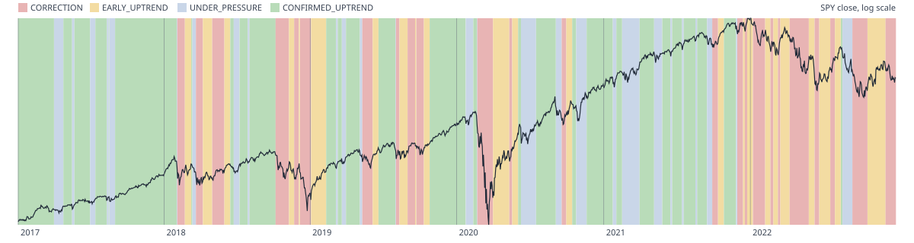

# Regime backtest (task 2.4)

**Run:** 2026-10-23 15:01 UTC with `uv run python backtest/regime.py`, risk.yaml `f143d2f0d009`, 29 s. Generated; only the Reading at the end is written by hand.

## Setup

- **The tuning period only:** sessions 2016-01-04 to 2022-12-30 (1762). Nothing after 2022-12-30 is loaded; the holdout (2023 on) is opened once, for the 5-pillar model, in the 3.8 re-run (README §15).
- **Warm-up:** the machine starts in `CORRECTION` on the second session, as a replay does; 2016 fills the 200-day and 252-session windows, so results are reported from 2017-01-03 (1510 sessions).
- **4 pillars:** leadership health needs the breakout tracker (3.7) and scores 0 throughout, so the score runs from -4 to +4.
- **Universe:** point in time (README §5.1): 3747 securities were in it at some session, 1365 of which no longer trade. Delisted names the vendor doesn't cover are missing; they were more often falling stocks, so breadth reads somewhat stronger than it was.
- **SPY returns** are price returns from split-adjusted closes (no dividends).

**Pre-registered** (set in the script before the first run on real data):
- declines: `CORRECTION` is reached while SPY's drawdown from the peak is under 50% of the decline's full drawdown;
- the 2020 recovery: `EARLY_UPTREND` within 15 sessions of the 2020-03-23 low and `CONFIRMED_UPTREND` within 60;
- at most 12 switches in any year, and at most 1 false `CORRECTION` spell a year on average;
- **`CONFIRMED_UPTREND` covers at least 60%** of each strong uptrend window: 2017 (2017-01-03 to 2017-12-29), 2019 (2019-01-02 to 2019-12-31), H2 2020-2021 (2020-07-01 to 2021-12-31).

## Comparisons

| Variant | CORR | EU | UP | CU | Switches/yr (max) | False CORR | CU in 2017 | CU in 2019 | CU in H2 2020-2021 | CORR in Q4 2018 (SPY) | CORR in Feb-Mar 2020 (SPY) | CORR in 2022 (SPY) | 2020: EU / CU after | Failed EU |
|---|---|---|---|---|---|---|---|---|---|---|---|---|---|---|
| `baseline` | 38% | 25% | 17% | 20% | 16.8 (20) | 7 | 34% | 36% | 17% | 2018-10-05 (-1.9%) | 2020-02-24 (-4.7%) | 2022-01-10 (-2.6%) | 8 / 82 | 16 of 29 |
| `exclude_expirations` | 40% | 26% | 13% | 21% | 17.3 (23) | 8 | 36% | 36% | 21% | 2018-10-05 (-1.9%) | 2020-02-24 (-4.7%) | 2022-01-10 (-2.6%) | 8 / 101 | 17 of 30 |
| `no_ftd_5` | 37% | 26% | 17% | 20% | 17.2 (20) | 7 | 36% | 36% | 17% | 2018-10-05 (-1.9%) | 2020-02-24 (-4.7%) | 2022-01-10 (-2.6%) | 8 / 82 | 17 of 30 |
| `no_ftd_15` | 38% | 26% | 17% | 19% | 16.8 (20) | 7 | 32% | 36% | 17% | 2018-10-05 (-1.9%) | 2020-02-24 (-4.7%) | 2022-01-10 (-2.6%) | 8 / 82 | 16 of 29 |
| `no_ftd_20` | 39% | 26% | 17% | 19% | 16.8 (20) | 7 | 30% | 36% | 17% | 2018-10-05 (-1.9%) | 2020-02-24 (-4.7%) | 2022-01-10 (-2.6%) | 8 / 82 | 16 of 29 |
| `no_eu_minimum` | 38% | 21% | 17% | 24% | 17.5 (21) | 7 | 37% | 37% | 24% | 2018-10-05 (-1.9%) | 2020-02-24 (-4.7%) | 2022-01-19 (-5.4%) | 8 / 80 | 15 of 29 |
| `correction_2` | 36% | 25% | 19% | 20% | 17.2 (20) | 7 | 34% | 36% | 17% | 2018-10-08 (-2.0%) | 2020-02-25 (-7.6%) | 2022-01-10 (-2.6%) | 8 / 82 | 16 of 29 |
| `diag_correction_-2` | 35% | 24% | 22% | 18% | 16.2 (18) | 6 | 34% | 36% | 14% | 2018-10-05 (-1.9%) | 2020-02-24 (-4.7%) | 2022-01-10 (-2.6%) | 8 / 82 | 16 of 27 |
| `diag_distribution_8` | 34% | 25% | 19% | 22% | 17.3 (18) | 7 | 48% | 36% | 19% | 2018-10-05 (-1.9%) | 2020-02-24 (-4.7%) | 2022-01-10 (-2.6%) | 8 / 82 | 16 of 28 |
| `diag_vix_ratio_1.1` | 38% | 25% | 17% | 20% | 17.0 (20) | 7 | 34% | 36% | 17% | 2018-10-05 (-1.9%) | 2020-02-24 (-4.7%) | 2022-01-10 (-2.6%) | 8 / 82 | 16 of 29 |
| `diag_confirmed_+2` | 34% | 23% | 10% | 32% | 18.8 (23) | 7 | 58% | 48% | 36% | 2018-10-05 (-1.9%) | 2020-02-24 (-4.7%) | 2022-01-10 (-2.6%) | 8 / 51 | 15 of 30 |
| `diag_combined` | 22% | 19% | 15% | 44% | 16.8 (21) | 1 | 83% | 49% | 55% | 2018-10-05 (-1.9%) | 2020-02-25 (-7.6%) | 2022-01-10 (-2.6%) | 8 / 51 | 14 of 23 |

| Variant | declines early | 2020 recovery | switches <= 12/yr | CU share >= target | false CORR <= 1/yr |
|---|---|---|---|---|---|
| `baseline` | yes | **no** | **no** | **no** | **no** |
| `exclude_expirations` | yes | **no** | **no** | **no** | **no** |
| `no_ftd_5` | yes | **no** | **no** | **no** | **no** |
| `no_ftd_15` | yes | **no** | **no** | **no** | **no** |
| `no_ftd_20` | yes | **no** | **no** | **no** | **no** |
| `no_eu_minimum` | yes | **no** | **no** | **no** | **no** |
| `correction_2` | yes | **no** | **no** | **no** | **no** |
| `diag_correction_-2` | yes | **no** | **no** | **no** | yes |
| `diag_distribution_8` | yes | **no** | **no** | **no** | **no** |
| `diag_vix_ratio_1.1` | yes | **no** | **no** | **no** | **no** |
| `diag_confirmed_+2` | yes | yes | **no** | **no** | **no** |
| `diag_combined` | yes | yes | **no** | **no** | yes |

Variants:
- `baseline`: risk.yaml as committed (IBD's published rules).
- `exclude_expirations`: distribution days on expiration / rebalance sessions not counted.
- `no_ftd_5`: `no_ftd` fallback after 5 sessions.
- `no_ftd_15`: `no_ftd` fallback after 15 sessions.
- `no_ftd_20`: `no_ftd` fallback after 20 sessions.
- `no_eu_minimum`: no 10-session minimum in `EARLY_UPTREND` (1: the 3-session upgrade bounds it).
- `correction_2`: `CORRECTION` after 2 sessions at <= -1 (index trend at -1 still immediate).
- `diag_correction_-2`: diagnostic: `CORRECTION` at a score <= -2.
- `diag_distribution_8`: diagnostic: the distribution pillar at -1 from 8 days (not 6).
- `diag_vix_ratio_1.1`: diagnostic: the volatility pillar at -1 from VIX/VIX3M > 1.1 (not 1.0).
- `diag_confirmed_+2`: diagnostic: `CONFIRMED_UPTREND` (and the `no_ftd` fallback) from +2 of the 4 pillars.
- `diag_combined`: diagnostic: the three that helped together: `CORRECTION` <= -2, distribution -1 from 8 days, `CONFIRMED_UPTREND` from +2.

## Baseline

### `baseline` in detail

**Sessions per regime and year**, with regime switches:

| Year | CORR | EU | UP | CU | Switches |
|---|---|---|---|---|---|
| 2017 | 124 | 13 | 28 | 86 | 13 |
| 2018 | 105 | 62 | 45 | 39 | 20 |
| 2019 | 58 | 74 | 30 | 90 | 17 |
| 2020 | 65 | 84 | 72 | 32 | 16 |
| 2021 | 93 | 41 | 69 | 49 | 18 |
| 2022 | 135 | 108 | 6 | 2 | 17 |

**Switches by kind:** CORR → EU 29, CU → UP 20, EU → CORR 16, EU → CU 13, UP → CORR 12, UP → CU 9, CU → CORR 2.

**SPY after each label** (price return from the label's close: mean / median / share positive / mean worst close over the horizon):

| Regime | 5 sessions | 20 sessions | 60 sessions |
|---|---|---|---|
| CORR | +0.2% / +0.4% / 59% / -1.5% (n 575) | +1.2% / +1.7% / 68% / -3.2% (n 562) | +4.2% / +4.5% / 81% / -4.6% (n 551) |
| EU | +0.4% / +0.5% / 63% / -1.2% (n 382) | +1.4% / +2.4% / 70% / -2.7% (n 380) | +3.5% / +5.3% / 72% / -4.5% (n 351) |
| UP | +0.0% / +0.6% / 59% / -1.1% (n 250) | -0.6% / +1.3% / 66% / -3.3% (n 250) | +0.3% / +3.0% / 66% / -6.5% (n 250) |
| CU | +0.1% / +0.3% / 63% / -0.7% (n 298) | +0.8% / +1.5% / 65% / -2.0% (n 298) | -0.4% / +1.9% / 60% / -5.9% (n 298) |

**Pillar scores** (share of sessions):

| Pillar | -1 | 0 | +1 |
|---|---|---|---|
| index_trend | 21% | 27% | 52% |
| breadth | 22% | 30% | 47% |
| volatility | 14% | 42% | 44% |
| distribution | 36% | 28% | 36% |
| leadership | 0% | 100% | 0% |

**Total score** (sessions), overall and inside each uptrend window:

| | -4 | -3 | -2 | -1 | +0 | +1 | +2 | +3 | +4 |
|---|---|---|---|---|---|---|---|---|---|
| all | 77 | 89 | 116 | 153 | 160 | 199 | 261 | 269 | 186 |
| 2017 | 0 | 0 | 1 | 6 | 18 | 15 | 60 | 98 | 53 |
| 2019 | 2 | 2 | 11 | 35 | 21 | 31 | 48 | 57 | 45 |
| H2 2020-2021 | 0 | 1 | 11 | 42 | 42 | 66 | 104 | 71 | 43 |

**Uptrend windows** (share of sessions):

| Window | CORR | EU | UP | CU |
|---|---|---|---|---|
| 2017 (2017-01-03 to 2017-12-29) | 49% | 5% | 11% | 34% |
| 2019 (2019-01-02 to 2019-12-31) | 23% | 29% | 12% | 36% |
| H2 2020-2021 (2020-07-01 to 2021-12-31) | 32% | 19% | 32% | 17% |

**Declines** (SPY's drawdown from the peak close at the first such label):

| Decline | Peak → low | First below CU | First CORRECTION | Early |
|---|---|---|---|---|
| Q4 2018 | 2018-09-20 → 2018-12-24 (-20.2%) | 2018-09-20 (+0.0%) | 2018-10-05 (-1.9%) | yes |
| Feb-Mar 2020 | 2020-02-19 → 2020-03-23 (-34.2%) | 2020-02-19 (+0.0%) | 2020-02-24 (-4.7%) | yes |
| 2022 | 2022-01-03 → 2022-10-12 (-25.4%) | 2022-01-03 (+0.0%) | 2022-01-10 (-2.6%) | yes |

**2020 recovery:** the first label above `CORRECTION` came 8 sessions after the 2020-03-23 low (SPY +13.1% from the low), the first `CONFIRMED_UPTREND` after 82 (SPY +45.6%).

**False `CORRECTION` spells** (more than 15 sessions, SPY never 8% below its prior 52-week high):

| From | To | Sessions | Deepest close vs the 52-week high | Then |
|---|---|---|---|---|
| 2017-04-12 | 2017-06-05 | 37 | -3.0% | `EARLY_UPTREND` |
| 2017-06-09 | 2017-10-11 | 87 | -2.1% | `EARLY_UPTREND` |
| 2019-05-07 | 2019-06-06 | 22 | -6.6% | `EARLY_UPTREND` |
| 2019-09-03 | 2019-10-10 | 28 | -4.6% | `EARLY_UPTREND` |
| 2021-01-29 | 2021-03-30 | 42 | -4.1% | `EARLY_UPTREND` |
| 2021-05-11 | 2021-06-03 | 17 | -4.0% | `EARLY_UPTREND` |
| 2021-09-17 | 2021-10-13 | 19 | -5.4% | `EARLY_UPTREND` |

**`EARLY_UPTREND` spells** (SPY over the sessions each one governed):

| From | To | Sessions | `no_ftd` | Then | SPY |
|---|---|---|---|---|---|
| 2017-06-06 | 2017-06-08 | 3 | yes | `CORRECTION` | +0.1% |
| 2017-10-12 | 2017-10-25 | 10 | yes | `CONFIRMED_UPTREND` | +0.3% |
| 2018-02-23 | 2018-03-15 | 15 |  | `CORRECTION` | -0.2% |
| 2018-04-10 | 2018-05-01 | 16 |  | `CORRECTION` | -0.7% |
| 2018-06-01 | 2018-06-14 | 10 |  | `CONFIRMED_UPTREND` | +1.2% |
| 2018-07-06 | 2018-07-19 | 10 |  | `CONFIRMED_UPTREND` | +1.6% |
| 2018-11-07 | 2018-11-19 | 9 |  | `CORRECTION` | -6.0% |
| 2018-12-03 | 2018-12-04 | 2 |  | `CORRECTION` | -3.4% |
| 2019-01-04 | 2019-02-21 | 33 |  | `CONFIRMED_UPTREND` | +10.6% |
| 2019-06-07 | 2019-07-01 | 17 |  | `CONFIRMED_UPTREND` | +3.1% |
| 2019-08-13 | 2019-08-30 | 14 |  | `CORRECTION` | -0.6% |
| 2019-10-11 | 2019-10-24 | 10 |  | `CONFIRMED_UPTREND` | +1.8% |
| 2020-04-02 | 2020-05-12 | 28 |  | `CORRECTION` | +11.7% |
| 2020-05-20 | 2020-06-25 | 26 |  | `CORRECTION` | +1.0% |
| 2020-07-06 | 2020-07-17 | 10 |  | `CONFIRMED_UPTREND` | +2.3% |
| 2020-10-01 | 2020-10-14 | 10 |  | `CONFIRMED_UPTREND` | +3.1% |
| 2020-11-09 | 2020-11-20 | 10 |  | `CONFIRMED_UPTREND` | +0.8% |
| 2021-03-31 | 2021-04-14 | 10 |  | `CONFIRMED_UPTREND` | +4.9% |
| 2021-06-04 | 2021-06-22 | 13 |  | `CONFIRMED_UPTREND` | +0.0% |
| 2021-10-14 | 2021-10-27 | 10 |  | `CONFIRMED_UPTREND` | +3.6% |
| 2021-12-15 | 2021-12-17 | 3 |  | `CORRECTION` | -3.3% |
| 2021-12-27 | 2022-01-07 | 10 |  | `CORRECTION` | -2.5% |
| 2022-02-09 | 2022-02-22 | 9 |  | `CORRECTION` | -7.8% |
| 2022-03-02 | 2022-03-11 | 8 |  | `CORRECTION` | -4.8% |
| 2022-03-18 | 2022-04-08 | 16 |  | `CORRECTION` | -1.0% |
| 2022-05-27 | 2022-06-10 | 10 |  | `CORRECTION` | -9.7% |
| 2022-06-24 | 2022-07-21 | 19 |  | `CORRECTION` | +1.3% |
| 2022-08-03 | 2022-08-16 | 10 |  | `CONFIRMED_UPTREND` | +2.9% |
| 2022-10-21 | 2022-12-05 | 31 |  | `CORRECTION` | +5.2% |

The crisis override was active on 102 of 1510 sessions.

## Reading

Written by hand on 2026-10-23, after the run above. Nothing in risk.yaml has changed; the choice below is the user's.

**The baseline fails 4 of the 5 pre-registered checks.** It turns defensive early in all three declines: `CORRECTION` within 2-5% of each peak, and below `CONFIRMED_UPTREND` on the peak's own session. But it doesn't stay invested in uptrends. `CORRECTION` covers 38% of 2017-2022 and `CONFIRMED_UPTREND` 20%; `CONFIRMED_UPTREND` holds 34% of 2017, 36% of 2019 and 17% of H2 2020-2021 (target 60%); there are 7 false `CORRECTION` spells in 6 years (2017 twice, 2019 twice, 2021 three times); the 2020 recovery reached `EARLY_UPTREND` on the IBD follow-through day (2020-04-02, 8 sessions after the low) but `CONFIRMED_UPTREND` only after 82 sessions; and it switches 17 times a year (max 20). At 60 sessions SPY did *better* after `CORRECTION` labels (+4.2% mean, 81% positive) than after `CONFIRMED_UPTREND` ones (-0.4%, 60%), so on this period the labels mostly sat out rallies. None of the plan's comparisons changes this (expirations excluded, `no_ftd` after 5 / 15 / 20 sessions, no `EARLY_UPTREND` minimum, 2 sessions before `CORRECTION`): each moves a number by a point or two.

**Why: one pillar at -1 is enough for `CORRECTION`, and only a follow-through day ends it.** Of the 14 downgrades to `CORRECTION` from `CONFIRMED_UPTREND` / `UNDER_PRESSURE`, 10 came at a score of exactly -1, and 6 had a single pillar at -1 with the others at 0 (2017-04-12: only VIX/VIX3M briefly above 1.0; 2018-06-27, 2021-05-11, 2021-09-17: only distribution). Three things make that easy:
- **Leadership health is missing** and scores 0 throughout (it needs the breakout tracker, 3.7). The thresholds were set for 5 pillars; on 4, the score is one healthy pillar short, and in strong markets the healthy fifth pillar would have offset many of these -1s.
- **The distribution pillar is at -1 on 36% of sessions** (and +1 on 36%). Six distribution days in 25 sessions, on the higher of the SPY and QQQ counts, is common on ETF volume, which flips up and down against the prior session far more than IBD's exchange volume does. Excluding expiration sessions doesn't help.
- **The index-trend pillar is at 0 whenever either index dips under its 50-day**, so in an ordinary pullback it stops offsetting the others.

**The diagnostics** (added after the run, not pre-registered): `CORRECTION` at <= -2, distribution's -1 from 8 days, and `CONFIRMED_UPTREND` from +2 each help a little alone; together (`diag_combined`) they keep all three declines early, cut the false `CORRECTION` spells to 1, pass the 2020 recovery (`CONFIRMED_UPTREND` after 51 sessions) and raise `CONFIRMED_UPTREND` to 83% / 49% / 55% of the uptrend windows. Still short of 60% in 2019 and H2 2020-2021, and still 17 switches a year.

**The switch target looks out of reach for an FTD machine.** Of the baseline's 101 switches, 45 are the `CORRECTION` → `EARLY_UPTREND` → `CORRECTION` cycle of failed follow-through days (16 of 29 `EARLY_UPTREND` spells failed; 2018 and 2022 had several each) and 29 are `CONFIRMED_UPTREND` ↔ `UNDER_PRESSURE`. The combined diagnostic still has 101. IBD's own market-status calls change several times a year in choppy years, and each failed FTD is two switches. The ≤ 12 a year criterion (plan 2.4) and the FTD requirement (README §5.2, IBD) don't fit together as written.

**Cost of the failed follow-through days:** the 16 failed `EARLY_UPTREND` spells governed SPY moves from -9.7% to +11.7% (median about -1%); the worst were 2022-05-27 (-9.7%), 2022-02-09 (-7.8%) and 2018-11-07 (-6.0%). Under starter limits (§6) that is a small loss, as IBD expects from failed FTDs.

**Limits of this run.** Four pillars; the delisted names the vendor misses make breadth read slightly strong (§17); ~4-5 major episodes, so any threshold change here is a fit to few events. The decision is with the user (CLAUDE.md §5); options are in the 2.4 note in `docs/next-steps.md`.
