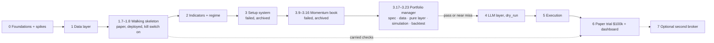

# AuraTrade: Execution Plan

The step-by-step build plan for the system described in the [README](../README.md). Each phase lists its tasks, the files it produces and the **acceptance criteria** that must pass before the next phase starts.

**Size key:** S = a session or two · M = a few sessions · L = a week or more of part-time work.

---

## How to start a build session

1. **Merge the previous task's branch into `main` first.** The tracker box is ticked on that branch, so until it's merged the next session sees the task as still open. If you'd rather not merge yet, say so; the next session then branches from the unmerged branch instead.
2. Open a **new Claude Code chat** in this folder. `CLAUDE.md` loads automatically.
3. Say: **"Continue the build: take the next task from the progress tracker."**
4. Claude names the task, reads the relevant README sections, builds it, verifies it against the acceptance criteria, and ticks the box below.
5. Review the summary, then start a new chat for the next task (or continue if the context is still small).

Tasks marked 👤 need you (accounts, keys, approvals).

## Progress tracker

> **Strategy changed again (#153-#156, 2026-10-26/27).** The system is now a portfolio manager (`docs/strategy-change-portfolio.md`, `docs/portfolio-plan.md`). The momentum book (3.9-3.16) failed its gate (#152); its Phases 4-9 are archived in `docs/archive/execution-plan-momentum-book.md`, and the setup system's in `docs/archive/execution-plan-setup-system.md`. **The portfolio's backtest (3.17-3.23) comes first:** Phase 4 starts after a pass or a near miss. The 1.7 / 1.8 live checks move into 6.1; the kill switch on `paper` is on.

Ticked tasks are the record of what was built at the time: files they name may since have been deleted (#161); git history keeps them.

**Phase 0: Foundations and spikes**
- [x] 0.1 Project tooling (uv, ruff, mypy, pytest, CI, package skeleton)
- [x] 0.2 👤 Accounts and keys + `scripts/check_keys.py` *(all keys verified 2026-10-09; local Postgres via Docker until Neon at 1.2; paper capital $5,000 confirmed)*
- [x] 0.3b Spike: Alpaca orders (paper) — **run first**: it can invalidate the order architecture *(2026-10-15: GO on OTO with adjustments, agenda #1–4 and #11; paper applies neither splits nor dividend stop reductions; see `docs/spikes/alpaca-orders.md`)*
- [x] 0.3a Spike: Alpaca market data *(findings adopted as #109–111; real-time and bar-revision checks done 2026-10-09: two proposals, approved at 0.4 as #6 and #7b)*
- [x] 0.3h 👤 Spike: early edge check (daily bars, tuning period only; a clearly negative result pauses the build) *(≈ 0R before costs, −0.08R after; continue, decision #112)*
- [x] 0.3c Spike: market calendar
- [x] 0.3d Spike: macro data timing *(2026-10-13: ADJUST, evening VIX from CBOE's delayed-quote JSON, final 16:32 ET; approved at 0.4 as #5)*
- [x] 0.3e Spike: fundamentals, earnings, industries *(ADJUST: earnings timing = earlier of 8-K and headline; approved at 0.4 as #7)*
- [x] 0.3f Spike: news
- [x] 0.3g 👤 Spike: Claude batch cost (paid; needs your OK) *(approved 2026-10-09; spent ~$0.26; ~$0.016 per Analyst request, ~$17–22/month; ADJUST for README §9, approved at 0.4 as #8)*
- [x] 0.4 👤 Review spike findings; amend README/decisions *(2026-10-10 to 10-15: decisions #113–128; the agenda is in `docs/spikes/review-agenda.md`)*
- [x] 0.5 Public project site (landing page + S3/CloudFront stack; deployed in 1.8)

**Phase 1: Data layer**
- [x] 1.1 Config and job framework *(runner wired to the `job_runs` store in 1.2 and the calendar in 1.4)*
- [x] 1.2 Database and initial migration *(Neon `dev` branch: you add its URL to `.env` and run `alembic upgrade head`; tests run on Docker Postgres)*
- [x] 1.3 Data clients *(`src/auratrade/data/`: Alpaca bars, IEX quotes, corporate actions, assets and news; CBOE + FRED; EDGAR; Finnhub; the Nasdaq symbol directory. Recorded fixtures, 100% branch coverage, each client checked once live)*
- [x] 1.4 Market calendar *(daily re-sync wired into `ingest` at 1.5; run `python -m auratrade.calendar.sync` once against the Neon `dev` branch)*
- [x] 1.5 Ingest job *(`src/auratrade/ingest/` + `jobs/ingest.py`; live run 2026-10-15 on a scratch database: 2,761 tracked tickers, coverage 100%, industry coverage 99.96%, 140 MB for 2 years of bars, a nightly run 219 s and a no-op when repeated. Build readings recorded as decision #129. Since 1.7 it runs in the `post_market --chain`; `--direct` runs it alone)*
- [x] 1.6 Historical backfill + real-data smoke run of the modules built early *(`src/auratrade/history/` + `scripts/backfill.py`: 13,672 securities and 16.3M bars since 2016, 1.2M headlines, 131,839 EDGAR earnings events; the last 2 years in Neon `dev`, 151 MB. Smoke run in `docs/backtests/archive/smoke.md`: no exceptions or NaN; the 2017 `CORRECTION` miss goes to 2.4. Readings recorded as decision #130)*
- [ ] 1.7 Walking skeleton (rule-only, Alpaca paper, local) + minimal fake broker and automated chaos tests *(built and merged, PR #30; readings are decision #131; the lock check and all 7 automated chaos scenarios pass. Left: the 3 live paper sessions and the stop hand check, which run on AWS within 1.8 (#132))*
- [ ] 1.8 👤 Early AWS deploy of the skeleton *(built and merged, PR #31; `AuraTradePaper` and `AuraTradePublicSite` deployed 2026-10-22; the kill switch on `paper` since 2026-10-27; the acceptance (the 1.7 live checks, the watchdog and dead-man's-switch tests, cost) moved into 6.1)*

**Phase 2: Indicators and regime**
- [x] 2.1 Indicators *(built out of plan order with the user's approval: pure functions, no config dependency)*
- [x] 2.2 Base detection and base count *(built out of plan order with the user's approval)*
- [x] 2.3 Regime classifier *(built out of plan order with the user's approval)*
- [x] 2.4 Regime backtest *(`backtest/regime.py`, report `docs/backtests/archive/regime.md`, targets pre-registered before the first run. IBD's published thresholds failed 4 of 5 checks on 4 pillars (38% in `CORRECTION`, 7 false spells); the provisional thresholds adopted with the user (#135) pass 3: declines early, the 2020 recovery, 1 false spell. Still missed, for the 3.8 re-run: `CONFIRMED_UPTREND` 49% / 55% of 2019 / H2 2020-21 (target 60%) and ~17 switches a year)*

**Phase 3: Scanner, strategies, plans, baseline** (the setup system: built, failed its gate, archived; its code deleted in 5.2, #161, #169)
- [x] 3.1 Trend Template *(built out of plan order with the user's approval)*
- [x] 3.2a Strategy registry + core scans (VCP, momentum, EP proxy) *(`strategies/` base, registry, `vcp_breakout`, `momentum_breakout`, `episodic_pivot`; pure, 100% branch coverage. Real-data run over 2017-2022 in `docs/backtests/archive/scans.md`: 0 exceptions. Readings approved as #136: a 5% floor on a VCP's first contraction (merger-arbitrage flatliners), no momentum depth cap until 3.8)*
- [x] 3.2b Remaining scans (leader pullback, emerging leader) *(`leader_pullback`, `emerging_leader`; `SymbolData` gains RS ratings, SPY's closes and the regime's `CORRECTION` spells. Real-data run with all five scans in `docs/backtests/archive/scans.md`, 0 exceptions. The user's choices are #137: drawdown at most 1.5x SPY's, a pullback at least 2 x ATR deep, the 5-session-low stop)*
- [x] 3.3 Ranking, cap, verdict cache *(`strategies/ranking.py`, `verdict_cache.py`; pure, 100% branch coverage. The user's choices are #138: equal weights, one slot per ticker, the fundable strategies taking turns. Real-data run in `docs/backtests/archive/scans.md`. Not yet used by the evening `scan` job: Phase 4 wires the Analyst)*
- [x] 3.4 Charts *(`charts.py`: daily and weekly PNGs at the README sizes, stored under `charts/<session>/`; checked by eye on real setups (FIVN VCP, TDOC momentum, KURA emerging leader, DDOG EP). Readings #139. The `scan` job doesn't draw them yet: Phase 4 wires the Analyst)*
- [x] 3.5a Position plans engine *(built out of plan order with the user's approval)*
- [x] 3.5b Guardrails, sizing, triggers, risk multiplier (pure; the 3.8 backtest needs them) *(`guardrails/` (`evaluate`, the 09:36 `orders` check and one module per rule family, 100% branch coverage enforced in CI), `execution/triggers.py`, `execution/sizing.py`, `journal/risk_multiplier.py`, `journal/numbers.py`; `risk.yaml` `entries:` and the per-strategy stop widths. Readings #140. Nothing live calls them yet: Phase 5 wires them; the skeleton keeps its own sizing)*
- [x] 3.6 Simulator and fake broker (`sim/`) *(`sim/fills.py` (the fill model), `sim/trade.py` (one approved entry played forward through the live order check, plans and tranche-2 code; R, marks, fills), the fake broker's `play`; `risk.yaml` `sim:` (liquidity-tiered slippage). Pure, 100% branch coverage on the new modules. Readings #141. Nothing calls it yet: 3.7 builds the baseline book and the scorecard on it)*
- [x] 3.7 Watchlist, baseline book, breakout tracker, verdict scorecard *(migration 0007; `scan` writes the full scan to `daily_watchlist` (`strategies/watchlist.py`); `simulate` (`journal/evening.py`) runs the breakout tracker, the baseline book (decided from T-1's list through the guardrails, re-played each evening from minute bars cached in S3) and the scorecard plumbing; `regime` reads the tracker. Checked on real `dev` data inside a rolled-back transaction. Readings #142)*
- [x] 3.8 Baseline backtest (choose defaults) + re-run 2.4 with leadership health *(**closed with the gate failed** (2026-10-25): the 09:36 pool and the close-entry candidates (#144) both fail; by the pre-registered rule the fallback is F: Phase 4 in `dry_run` (#145) with a BUY-vs-SKIP bar pre-registered before 4.6, no capital until it is met. The 5-pillar regime is not frozen and the holdout is unopened. History: the 5-pillar regime run is done (not frozen); **the pool fails the gate** on 2017-2022 and no comparison fixes it; diagnostics found costs, early failures and an EP look-ahead (fixed, #143). The strategy decision is #144: two close-entry candidates, run once (3.8a-e below). The holdout is still closed)*
- [x] 3.8a 👤 Strategy decision: the review's questions answered, fallback F chosen *(2026-10-25; `docs/archive/strategy-review-2026-10-25.md`, `docs/archive/strategy-execution-2026-10-25.md`; decisions #144, #145)*
- [x] 3.8b 👤 Pre-register the close entry (`docs/backtests/archive/close-entry-preregistration.md`), approved and committed before any code reads real data *(approved by the user 2026-10-25)*
- [x] 3.8c Build the close entry: pure layer, simulator entry, pool, report; known-answer tests; the blind mechanics check and the decision-price sample *(2026-10-25, PR #45; `docs/backtests/archive/close-entry-blind.md`: invariants hold, 15:40 vs close 2% disagreement; but only `LEADER_PULLBACK` reaches 300 fills (EP 277, VCP 85, emerging 137, momentum 5): brought to the user before 3.8d, as the pre-registration's step 3 requires)*
- [x] 3.8d The one scored run on 2017-2022 and its pre-registered reading *(2026-10-25, `docs/backtests/archive/close-entry.md`: **nothing passes**; pool -0.30R, EP -0.12R; fallback F)*
- [x] 3.8e (on a pass only) Freeze, open the holdout once, finish 3.8 *(not run: nothing passed; the holdout stays closed)*

**Phase 3 (continued): the momentum book and its backtest** (#147-#149; `docs/archive/momentum-plan.md`; failed #152, its code deleted #161)
- [x] 3.9 👤 Momentum-book spec: README rewrite, decisions #147-#149, `risk.yaml` `book:`, the pre-registration (`docs/backtests/archive/momentum-preregistration.md`) *(2026-10-25; the user delegated the open choices; the setup system's README and Phases 4-7 archived in `docs/archive/`)*
- [x] 3.10 Momentum ranking and rule-book choice (pure) *(`strategies/momentum_book.py`: the ranked set, 12-1 and 52-week-high signals, percentiles and tie-breaks, the hold zone, the rebalance calendar (R/E, half days, timing offsets), slots, limits, stops, the candidates with skip reasons, the rule book's choice; 25 known-answer tests, 100% branch coverage)*
- [x] 3.11 Book guardrails (pure) *(`guardrails/book.py`: the book's halts (−30% drawdown), the overlay (regime / SPY trend / off), buys (blocks, candidates only, no adding, max positions, 1 or ½ slot, clusters, whole shares within cash and the exposure cap), exits never blocked, stop raises (held, rounded down, above the current stop, below the last price); `EntryBlock` gains `CORRECTION` and `INDEX_TREND`; `guardrails/` stays at 100% branch coverage)*
- [x] 3.12 Portfolio simulation (`sim/book.py`) + SPY/MTUM total-return bars *(`sim/book.py`: the book of the pre-registration §3.3-§3.8 on daily bars, every pick through the live buy guardrail, the §7 invariants raised as errors; known-answer books for every case in the acceptance, 100% branch coverage. `history/benchmarks.py` + `scripts/backfill.py benchmarks` with a recorded-fixture test. Readings #150. Not yet run on real data: 3.13 builds the harness, 3.14 is the first run)*
- [x] 3.13 Backtest harness and report (`backtest/momentum.py`) *(`backtest/momentum.py` (the market from the Parquet history and the 5-pillar regime, the configurations, `--blind`, the guarded `--holdout`), `momentum_report.py` (metrics, per-year, bootstrap, gate, adoption, references, blind counts and stop conditions), `momentum_render.py`; C5 and the switches of C1/C7 in `sim/book.py` via `risk.yaml` `book:`. Tested on hand-built series and end to end on a synthetic history; the blind report is tested to hold no performance words. Readings #151)*
- [x] 3.14 Blind mechanics check (counts only) *(2026-10-26, `docs/backtests/archive/momentum-blind.md`. The first run stopped on §7's mean-holdings condition (2.28 < 6): the simulator never re-enabled the 30% drawdown halt. The user chose the peak reset (#150). Re-run: every invariant holds in all 8 configurations and no stop condition fires (mean holdings 6.58; price skips 3.1%, cluster skips 7.5%; every ranked set 1,000 names). 170 of 205 buys exit by the stop)*
- [x] 3.15 👤 The one scored run on 2017-2022 and its reading *(2026-10-26, `docs/backtests/archive/momentum.md`: **the gate fails on every condition**, adopted (C2 + C5) -1.9% a year and primary -14.0%, against SPY +11.0% and MTUM +12.5%. Decision #152; by §9 the holdout stays closed, no capital, no more variants on 2017-2022; the user's choice next: a passive SPY/MTUM holding or a pause)*
- [x] 3.16 (on a pass only) Freeze, open the holdout once *(not run: the gate failed; the holdout stays closed)*

**Phase 3 (continued): the portfolio manager and its backtest** (#153-#156; `docs/portfolio-plan.md`)
- [x] 3.17 👤 Portfolio spec: README rewrite, CLAUDE.md (§3.5 amended), decisions #153-#156, `risk.yaml` `portfolio:`, the approved pre-registration (`docs/backtests/portfolio-preregistration.md`); the momentum book's README and Phases 4-9 archived; kill switch on `paper` *(2026-10-27; the user approved the plan, the pre-registration and the §3.5 wording; `risk.yaml` hash a130ffa45bed; kill switch on `paper` since 2026-10-27)*
- [x] 3.18 Long-history data (Kenneth French daily, Shiller dividends) + SPY/SSO/BIL total-return bars from 2016 *(`data/french.py`, `data/shiller.py`, `history/long_history.py`, `backfill.py longhistory`; recorded fixtures. First run 2026-10-27: 26,317 sessions 1926-07-01 to 2026-08-31 (CRSP 202608), 1,869 Shiller months with dividends to 2023-06, 2,719 sessions each of SPY, SSO, BIL; no return printed. Readings #157)*
- [x] 3.19 The pure layer: the shared rebalance calendar, `strategies/core_allocation.py`, `tax/israel.py`, `guardrails/portfolio.py` *(known-answer tests for every rule and edge; 100% branch coverage on all four, enforced in CI; nothing reads real data. Readings #158)*
- [x] 3.20 Portfolio simulation (`sim/portfolio.py`) *(the synthesized funds, payouts, the drift band, the stop, the halt's sale, margin for C3, the tax book, the final sale; known-answer portfolios for every rule (a flip, the cap, the halt, a stop-out, a margin call, dividends and their tax, tax from cash first and pro rata, a window run) and each invariant; 100% branch coverage. Readings #159)*
- [x] 3.21 Backtest harness and report (`backtest/portfolio.py`) *(`portfolio.py` (the market from the long history, the primary and the benchmark after tax and before, the rolling windows as independent runs, the periods after publication, C1-C5, D-a to D-c, the data checks, `--blind`, the one-shot guard), `portfolio_report.py` (metrics, the gate, the near miss, crashes, decades, the bootstrap, the blind counts and stops), `portfolio_render.py`; tested end to end on a synthetic history; the blind report holds no performance words. The end is the last month-end session in the file; publication dates after it are skipped)*
- [x] 3.22 Blind mechanics check (counts, invariants and the data checks only) *(2026-10-27, `docs/backtests/portfolio-blind.md`: **no stop condition fired**. The market fund against SPY: daily correlation 0.992, annualized gap 0.08%; the 2x fund against SSO: 0.994, 0.02%; the only gap over 7 days is the 1933 bank holiday; 0.89 flips a year; the halt on at 13.5% of the R's (limit 30%); 1,065 rolling windows; every invariant held. The scored run (3.23) needs the user)*
- [x] 3.23 👤 The one scored run and its reading (pass, near miss, or clear fail) *(2026-10-27 with the user, `docs/backtests/portfolio.md`: **PASS** on G1-G3. After tax +9.2% a year against +8.7%, max drawdown 68% against 85%, ahead in 69% of 1,065 ten-year windows; a thin edge (+0.5 after tax), from the long bear markets; a tie since publication. Decision #160; Phase 4 next)*

**Phase 4: LLM layer** (after a 3.23 pass or near miss, #156)
- [x] 4.1 👤 The Claude client (structured outputs, caching, refusals); the cost estimate for your OK *(2026-10-27: `llm/client.py`, `risk.yaml` `llm:`, 100% branch coverage; readings #162. You approved the estimate ($0.20-0.40 a decision, about $3-5 a year) and the recording: one real call, $0.017, replayed in the tests)*
- [x] 4.2 The Portfolio Manager: facts, tools, schema, prompt, the final ETF list, guardrail wiring, the hold fallback *(#164, #165: a failure holds; the list is final; the real prompt measured at ~8,500 tokens, ~$0.15-0.30 a decision)*
- [x] 4.3 `allocate` + `portfolio_manager` + the twin in `simulate`, in `dry_run`; migration (targets, tax lots, twin, journal) *(#166: in `dry_run` the account is the simulated book; first real decision on dev, $0.058; a month replayed in `tests/journal/test_portfolio_month.py`)*
- [x] 4.4 The scorecard (book vs twin vs SPY, before and after the estimated tax) *(#167: `journal/portfolio_scorecard.py` (pure, 100% branch); each month from E to the next E, after the tax a sale would owe; SPY a third simulated book; expectations scored from `expected_vs_market` (prompt `pm-2`); rescored each evening into `portfolio_journal`, the summary in the facts; migration 0009)*

**Phase 5: Execution**
- [x] 5.1 Rebalance orders (targets → whole-share orders, sells first, the drift band; SSO's OTO stop and its raise); the invariant and `stop_guard` for #155; chaos tests on the fake broker *(#168: `execution/rebalance.py` (pure, 100% branch), `execution/portfolio.py` (the rebalance, its retry, the halt's sale), `execution/funds.py` (SSO's level in `fund_stops`, splits); `jobs/execute_close.py`, run by hand until 5.2; migration 0010; the accept's chaos tests in `tests/execution/test_portfolio_chaos.py`)*
- [x] 5.2 The daily checks (the halt turned on and off; the stop's proceeds into BIL), the slimmed ingest (the ETF list, macro, news), the new schedule (with `execute_close`); the earlier systems' slots retired *(#169: `execution/halt.py` (the halt and its peak in `system_flags`: on at `post_market`'s close, off on R in `allocate` on `paper`), `execution/portfolio.stop_proceeds` (into BIL at the next 15:40), `auratrade halt status|reset`; the chain ends with `allocate`, `portfolio_manager` 08:45, `execute_close` 15:40; ingest is the ETF list's bars, corporate actions, macro, retention; the setup system's code, tests, config sections and settings deleted, reconciliation the funds' only, the regime on three pillars; the nightly backup now covers the portfolio's tables. Events still reach the Portfolio Manager by hand)*
- [x] 5.3 Live tax lots from the broker's fills; the journal; the nightly snapshot *(#170: `tax/live.py` (pure, 100% branch) rebuilds `tax_lots` whole each evening in `post_market` from the broker's activities (`Broker.activities`, the paper record recorded as a fixture); `account_snapshots` gains `holdings` and `tax_owed` (migration 0011); on `paper` the Portfolio Manager's account is the broker's (R's snapshot, the live lots, the live halt); the journal's `results.paper` carries the account's month; `journal/dashboard.py`: the allow-listed `public/snapshot.json`, written by `simulate`. Not yet seen on paper: a distribution entry)*

**Phase 6: The paper trial and the showcase**
- [ ] 6.1 👤 `paper` reset to $100,000; deploy the portfolio's stack; kill switch off; the carried 1.7 / 1.8 checks; three monthly rebalances unattended *(pre-deploy check 2026-10-28, #172: the chain and the order jobs run on `dev` on real data; fixed: `regime` after a missed evening, `auratrade flatten`, the dashboard on real data; `docs/runbook.md` has the start checklist. The sweep (#173): the earlier systems' remaining code removed, the stop fill alerted, the docs corrected. **Deployed 2026-10-28** (the runbook's checklist): a new `paper` account at $100,000, the database migrated to 0012 and its old state cleared, the secrets in SSM, both stacks updated, the kill switch off; the 09:20 `execute_open` ran on the new account. Left: the first rebalance (R 2026-10-30, E 2026-11-02), the carried 1.7 / 1.8 checks, three rebalances unattended. The order rehearsal on `dev` wasn't run: E's orders are the first real ones)*
- [ ] 6.2 The public dashboard (book vs twin vs SPY, exposure, the decision journal, the backtest's result) *(built, #171: `simulate` publishes the snapshot to the site's `data/snapshot.json` (a grant on that key alone, `data/*` cached 5 minutes); `web/dashboard.js` draws returns before and after tax, exposure, the satellite, the scorecard and the journal; `scripts/preview_site.py` for a local look; checked by eye on a synthetic snapshot in light, dark and narrow. Left: `cdk deploy AuraTradePublicSite` (you; it goes with 6.1's deploy), then the page checked on the first real snapshot)*
- [ ] 6.3 12 months of paper; the latitude rule (B4) pre-registered before month 12
- [ ] 6.4 👤 An MCP server for the project: read-only, local first, then deployed (#174, README §5.10) *(step 1 built: `src/auratrade/mcp_server/`, 4 public and 7 operator tools, the documents and two prompts, `.mcp.json`; tested through the SDK's in-memory client, Postgres refuses a write through its engine, a source test against writes; checked live over stdio against `paper` 2026-10-28. Step 2 built (#175): `mcp_server/remote.py` on a public Lambda function URL (stack `AuraTradeMcp`, the Dockerfile's `mcp` target), reserved concurrency 1, a circuit breaker (`mcp_breaker.py`) on an hourly invocations alarm; tested through function URL events and run in the image under Lambda's emulator. **Deployed uncapped 2026-10-29** (`cdk deploy AuraTradeMcp -c mcp_uncapped=true`): checked live (initialize, the 4 tools, the documents, the prompt, a GET refused, the alarm wired to the breaker); added to claude.ai as a connector. The tools wait on the first snapshot (Monday 2 Nov's evening). Left: **your choice on the cap** (`docs/next-steps.md`): keep it uncapped, or redeploy without the flag once AWS raises the Lambda limit (a support case since 2026-10-29); the URL not shared until that is settled)*
- [ ] 6.5 👤 The project's presentation: the codebase, the documentation and the dashboard *(requested 2026-10-28; after 6.4)*
- [ ] 6.6 👤 MCP UI: a small dashboard shown inside the AI client (MCP Apps), for the showcase *(planned by the user 2026-10-29; after the first real snapshot)*

**Phase 7: Optional**
- [ ] 7.1 👤 A second broker adapter (e.g. Interactive Brokers), only if real money is ever planned

---

## Ground rules (all phases)

- **Branching:** `main` is always deployable. Every task is a feature branch → PR → CI green → merge.
- **Definition of done:** code + tests + type-checked + lint-clean + docs updated if behaviour changed.
- **No secrets in git.** Use `.env` locally (`.env.example` committed) and SSM Parameter Store in AWS.
- **Every job is runnable locally** with `--session YYYY-MM-DD --dry-run` before it is deployed.
- **Test pyramid:**
  - unit tests on pure logic (indicators, regime, plans, guardrails, sizing), using synthetic data
  - integration tests with **recorded HTTP fixtures** (no live API calls in CI)
  - **a blind run on real data** before any scored backtest: counts, invariants and data checks only (as in 3.22)
  - **automated chaos tests** of the order layer against the fake broker in `sim/` (from 1.7), in CI
  - manual end-to-end runs against Alpaca paper
- **Coverage is enforced in CI:** at least 95% branch coverage overall, and 100% on `guardrails/` (from 3.5b).
- **Decisions** go in the README decision log; spike findings in `docs/spikes/`; backtest reports in `docs/backtests/`.

---

## What I need from you

| Item | When | Notes |
|---|---|---|
| Alpaca **paper** API keys + secrets: **two paper accounts** | Phase 0 | One for `dev` (local work, Phase 5 end-to-end tests), one for `paper` (the deployed skeleton, then the trial). Sharing one would make each system's reconciliation fight the other's positions (README §12). `paper` is reset to $100,000 before the portfolio's trial (6.1) |
| The reference capital | Phase 0; changed 2026-10-26 | **$100,000** for the portfolio manager (#153), on paper only. It was $5,000 for the earlier systems (#122). The FINRA pattern-day-trader rule no longer applies (README #123) |
| Anthropic API key | Phase 0 | **Set a monthly spend limit in the Anthropic Console** (e.g. $40) |
| FRED API key | Phase 0 | Free |
| Finnhub API key | Phase 0 | Free tier |
| Neon account | Phase 0 | Free tier; `dev` and `paper` branches |
| Telegram bot token + your chat ID | Phase 0 | Create the bot with @BotFather |
| External dead-man's-switch check (e.g. healthchecks.io, free) | Phase 1 (task 1.8) | Alerts you if the AWS watchdog itself stops pinging (README §5.13) |
| GitHub remote repository | Phase 0 | Private repo |
| AWS account | Phase 1 (task 1.8) | Root MFA, an admin user (IAM Identity Center, or an IAM user signed in with `aws login`), budget alarms |
| Install AWS CLI + GitHub CLI | Phase 0 / 1.8 | Both installed; AWS CLI profile `auratrade` (us-east-1) |
| Domain name (optional) | Task 1.8 | For the public site (0.5). Buying it through Route 53 (about $13/year for a `.com`) creates the hosted zone the stack needs. Without one, the site lives on its `*.cloudfront.net` address |

---

## Phase 0: Foundations and spikes (M)

**Goal:** a working project skeleton, and every external assumption checked against reality before we build on it.

### 0.1 Project tooling (S)

- `uv init`, Python **3.13** pinned; dependency groups (`dev`, `backtest`).
- ruff, mypy (strict on `src/`), pytest, pytest-cov, hypothesis, pre-commit.
- `.gitignore`, `.env.example`, `docker-compose.yml` (Postgres 16).
- GitHub Actions `ci.yml`: lint → type-check → tests.
- `src/auratrade/` package skeleton matching the README layout.

**Accept:** `uv run pytest` passes; CI is green on the first PR.

### 0.2 Accounts and keys (S, mostly you)

Everything in "What I need from you" except AWS. `scripts/check_keys.py` confirms each key works.

### 0.3 Spikes

Each spike is a script in `spikes/` plus a note in `docs/spikes/<name>.md`, ending with a **go / adjust** decision. Run them in tracker order. **Run 0.3b first:** if its answers are bad, the order architecture changes (README §5.7 has the pre-chosen `fill_watcher` fallback), and that affects later tasks more than any other spike.

| # | Spike | Questions to answer |
|---|---|---|
| a | **Alpaca market data** | Do multi-symbol daily bars with `feed=sip` and `adjustment=split` work on the free plan? How deep is the history and what are the rate limits? Do 1-day bars match regular-session OHLC, or include extended hours? Do **real-time IEX quotes and 1-min bars** work for the EOD price check and the **5-min opening-range high**, and how close is the IEX range to the SIP range (compare on 50 symbols)? Are **pre-market IEX quotes** good enough to detect ≥ 10% gaps for EPs? How long does a 2,500-symbol day take? How do we classify ETFs, SPACs and preferreds? **Survivorship:** how many symbols delisted since 2016 still have full bar history (compare with a known delisting list for a sample year)? Can we get **raw (unadjusted) closes** for point-in-time price filters? Is there a corporate-actions feed (splits, mergers, symbol changes)? **How far back do historical IEX 1-min bars go?** The simulator takes opening-range highs and the 15:40 price from IEX where history exists (README §5.12). |
| b | **Alpaca orders (paper)** | Does OTO with a stop-limit entry (day) and a stop leg work when placed at 09:36 with a trigger above the current price? **What time-in-force does the child stop get**, and can it be made GTC or converted after the fill? **Two-tranche flow:** after tranche 2 fills, can the stop be replaced to cover the full quantity, and what happens to the OTO child leg? Does it need to be cancelled and replaced by a standalone stop? **Share reservation:** confirm a full-quantity stop blocks other sells, and test the sell sequence (reduce stop → sell → restore on failure) for OPG trims, intraday partials and EOD exits. How do OPG exits and marketable-limit adds behave, and what is the OPG submission cutoff? Does `client_order_id` dedupe? How does PDT protection treat stops on < $25k accounts? What fields does the account API return? **What happens to resting GTC stops on a split** (cancelled, adjusted, untouched), and **on a cash-dividend ex-date** (lowered by the dividend, per FINRA Rule 5330)? **Stop above the market:** what does Alpaca do with a sell stop placed at or above the current price (rejected, or triggered at once)? This decides the "price through the stop" path (README §5.7). **Partial fills:** can a stop-limit entry fill partly, and what happens to its child stop leg then? **PDT on exits:** on a < $25k account, does PDT protection reject a same-day exit, or a stop that triggers the same day? **Multiple paper accounts:** confirm the `dev` and `paper` accounts are independent. **Fallback check:** if OTO with a stop-limit entry fails, verify the `fill_watcher` path (plain stop-limit entry, attach a GTC stop within a minute of the fill). **Limit-buy parent:** does OTO also work with a plain limit buy as the parent (the entry when the price is already past the trigger but within the limit, README §7.1)? |
| c | **Calendar** | Alpaca vs `pandas_market_calendars` for 2016–2027: every disagreement, and how early closes are represented. |
| d | **Macro** | When do the CBOE VIX/VIX3M files update (is the value ready by 17:15 ET)? How far does FRED lag? |
| e | **Fundamentals, earnings, industries** | How accurate is Finnhub's earnings calendar for 50 names, and are **earnings surprises** (actual vs estimate) on the free tier? What share of the universe has **no known next date** (that sets how often the estimated-date blackout applies)? **Earnings history for backtests:** how far back do Finnhub's free dates go? Do EDGAR 8-K Item 2.02 filings (acceptance time → before-open / after-close) match the true report dates for 50 names across 2016–2025? How reliable is EPS/revenue extraction from EDGAR company facts? Do **SIC codes from EDGAR submissions** cover the universe, and what mapping to ~100 industry groups should we use? What are the rate limits? |
| f | **News** | Is the Alpaca news API available on the free plan? Payload shape and headline volume. |
| g | **Claude** | A batch of 5 Analyst requests to `claude-opus-5-5`: two charts at the planned sizes, compact facts, structured output, shared-prefix caching. Measure tokens (**thinking included**: it bills as output) and cost per candidate at effort `medium` vs `high`, check the cache hit inside the batch (best-effort for concurrent requests), and measure turnaround → recalibrate the cost model (README §9 assumes ~$35–65/month) and set Phase 4's daily cost limit. Also time one real-time Portfolio Manager-sized call at `high` with tools, to confirm the 09:10 deadline is comfortable. |

### 0.3h Early edge check (S, spike-grade; the result goes to you)

The baseline gate in 3.8 is the formal go / no-go, but it comes after months of building. This is a cheap early warning (README §15), run right after 0.3a so it comes **before** the data layer (1.1–1.6) is built: it needs only daily bars.
- A script in `spikes/edge_check/`. It pulls split-adjusted daily bars straight from Alpaca into local Parquet (git-ignored), with no database or job framework. The universe is the current asset list plus whatever delisted symbols 0.3a found history for, filtered on the raw close where 0.3a found one.
- **2017–2022 only:** the holdout stays closed.
- Simple versions of the core setups:
  - Trend Template + a VCP-lite (a tightening base, pivot = base high)
  - a momentum-lite breakout (top 2% movers, consolidation high)
- Entry on the next session's break of the pivot. Stop at the base low, capped at 8%. Exit on a close below the 50 SMA (VCP) or the 10-day (momentum). A crude fixed slippage.
- It **tunes nothing**, and it is not a fill model: nothing outside `spikes/` may import it or its data (the one-simulator rule, CLAUDE.md §6).
- Report expectancy per year and per setup in `docs/spikes/edge-check.md`, with the delisted coverage it had.

**Read the result asymmetrically.** Missing delisted stocks inflate breakout results, so this is an upper bound. A clearly negative result is strong evidence; a positive one is weak, and the formal tests stay in 3.8.

**Accept:** the note is written. If expectancy is clearly negative for both setups, **stop and bring it to the user** before Phase 1.

**Accept (0.3):** all spike notes written; README decisions confirmed or amended; any blocker has a chosen workaround (especially 0.3b for two-tranche stops).

### 0.5 Public project site (S)

Added at the user's request (decision #108). A public page with a link, explaining the project; data panels follow in 5.7.
- `web/`: a static landing page (plain HTML and CSS, no scripts, no third-party assets), a 404 page and a favicon.
- `infra/stacks/public_site.py`: the `AuraTradePublicSite` CDK stack (README §12): private S3 bucket, CloudFront with origin access control, HTTPS only, security headers with a strict content-security policy, an optional custom domain (ACM certificate + Route 53 records for the apex and `www`), and a deployment that never prunes `data/`.
- Offline tests: the synthesized template (private bucket, TLS-only policy, CloudFront-only read, headers, domain on/off), and the pages fitting the content-security policy and carrying the disclaimer.

**Accept:** `cdk synth` succeeds with and without a domain; tests pass. Deployed in 1.8, once the AWS account exists.

---

## Phase 1: Core library and data layer (L)

**Goal:** clean, validated, calendar-aware data in Postgres and Parquet, refreshed by an idempotent, holiday-safe job.

### 1.1 Config and job framework (M)

- `config.py`: pydantic-settings; `TRADING_MODE`; model IDs and effort; `config/risk.yaml` loaded into a typed model and hashed.
- `jobs/base.py`, a job runner that provides:
  - the calendar guard, **with a policy per job type** (morning/intraday: today is a session; evening: today was a session; `analyst_collect`: any day; `weekly_review`: Saturdays; `watchdog`: only expected heartbeats)
  - `job_runs` heartbeat
  - structlog context
  - exception → Telegram alert
  - `--dry-run` and `--session` overrides
  - a Lambda handler shim and a CLI entrypoint
  - **chaining for the evening pipeline** (README §2): a job runs only after its predecessor succeeded for the same session (per `job_runs`). On success it invokes the next job. Without a successful predecessor, it waits and retries for up to 30 minutes past its fallback time, then fails closed and alerts.
  - duration logging, with an alert over 10 minutes (Lambda's limit is 15)
- `notify/telegram.py`; `storage/` (local folder and S3 implementations).

### 1.2 Database (M)

- Initial Alembic migration: `tickers` (with SIC and industry group), `industry_groups`, `market_sessions`, `daily_bars` (int `ticker_id`, compact types, plus the raw close), `corporate_actions`, `macro_series`, `fundamentals`, `earnings_events`, `job_runs`, `system_flags` (incl. the `trading_enabled` kill switch), `mismatches`.
- Neon `dev` branch connected; tests run on Docker Postgres.

### 1.3 Data clients (M)

- `alpaca_data` (bars, IEX quotes, assets, news), `macro` (CBOE delayed-quote JSON and history files + FRED, README §5.1 / #117), `edgar` (company facts, submissions/SIC, 8-K Item 2.02 filings), `finnhub` (earnings, profile fallback).
- httpx + tenacity, client-side rate limiting, typed responses, recorded fixtures.

### 1.4 Market calendar (M)

- Sync `market_sessions` from Alpaca, cross-check with the library, flag disagreements.
- Helpers: `session_for`, `previous_session`, `sessions_between`, `n_sessions_back`, `is_early_close`, `session_minutes`, `days_until_next_open`.

### 1.5 Ingest job (L)

- Universe refresh with filters, applied to **raw** prices. Store each security's **first public trading date** as its listing date (an OTC uplisting isn't an IPO; README §5.1, #126).
- Gap-fill bars, and **re-fetch session T−1's bar** (late volume, #118).
- Corporate actions for the universe → `corporate_actions`. Alpaca's feed filters on **`process_date`**, not the ex-date (a dividend going ex on 10-15 has process date 10-16), and lists announced splits ahead with a process date on or a day before the ex-date (checked 2026-10-15). So query a window padded by a few days and filter on `CorporateAction.effective_date`; looking a few sessions ahead lets the evening before a split's ex-date see it.
- **Validation:**
  - coverage ≥ 90%, otherwise `INCOMPLETE`
  - OHLC sanity
  - the **outlier filter** for bad highs and lows in SIP daily bars (README §5.1, #126; e.g. NVDA 195.95 on 2024-06-10)
  - split detection → re-fetch
  - half-day flag
- **Retention:** prune bars beyond 2 years; archive 90-day-old `daily_watchlist`, `breakout_tracker` and `llm_decisions` output rows to Parquet; report DB size daily, with an alert at 70% of the free tier.
- Macro: the evening VIX/VIX3M from CBOE's delayed-quote JSON (`last_trade_time` ≥ 16:15 on T), then the history file by its last row's date, then FRED (README §5.1, #117); the credit spread as LLM context only.
- Earnings calendar; upcoming timing from the company's 8-K habit when Finnhub leaves it blank (#119).
- `calendar.sync`: batch the inserts (row by row it takes about 8 minutes from the PC to Neon).
- Fundamentals: rolling refresh within free limits, plus a refresh after each report.
- **Industry classification:** SIC → industry group; refreshed weekly.

### 1.6 Historical backfill and real-data smoke run (M)

`scripts/backfill.py`: 2016 → today, **including delisted symbols** the vendor covers, with a point-in-time membership table so backtests can rebuild each session's universe. Split-adjusted bars plus the raw close. **Historical earnings dates and timing** from EDGAR 8-K Item 2.02 filings, timed by the earlier of the 8-K acceptance and the first earnings headline (#119), so the backtests can apply the blackout and cushion rules. **Fundamentals keyed on the EDGAR `filed` date**, never the period end (README §5.1). Parquet partitioned by year; the last 2 years loaded into Postgres.

**Accept (1.1–1.6):**
- Running `ingest` twice is a no-op the second time.
- Tests pass for: a weekend, a Monday holiday, Good Friday, the day after Thanksgiving, a vendor short-count (→ `INCOMPLETE`), a split, and a calendar disagreement.
- Industry coverage ≥ 95% of the universe.
- Postgres size is under the free-tier limit with headroom.
- **Real-data smoke run** (`scripts/smoke_real_data.py`, re-runnable). The modules built ahead of the data layer (2.1 indicators, 2.2 bases, 2.3 regime, 3.1 Trend Template, 3.5a plans on a few sample trades) have only seen synthetic bars and ten fixture tickers. They now run together over the whole backfilled history and point-in-time universe, and write `docs/backtests/archive/smoke.md`:
  - no exceptions; no NaN or infinite values where the inputs were complete
  - one regime row per session, plausible on known stretches (the Feb–Mar 2020 crash, the 2022 bear market). A clear miss goes to 2.4; nothing is tuned here
  - Trend Template pass counts and base-count distributions per session, with outliers listed and explained (bad ticks like B13 must be caught by ingest's outlier filter, not reach the base count)
  - any mismatch between what the modules expect and what ingest stores (columns, raw vs adjusted prices, listing dates) is fixed before 1.7

### 1.7 Walking skeleton (L)

One thin pass through the **whole daily loop**, built from the real modules in minimal form, so the riskiest integration (orders, stops, timing, the job runner) runs on real sessions months before the full system exists. Phase 5 **extends** this code; it isn't throwaway.
- **Scan-lite:** Trend Template rules 1–5 and 8 on the ingested data; pivot = 20-session high; structural stop = the 10-session low, capped at 8%.
- **Rule-only pick:** the top 3 by RS. No LLM.
- **Sizing:** on the worst fill, at a fixed 0.25% risk.
- **Order-layer core:**
  - OTO entry at 09:36 with a **GTC parent** (its stop leg is then GTC); unfilled parents cancelled at the EOD review (README §5.7, #113)
  - the leg-to-standalone swap (cancel the legs, place one GTC stop) before the first sale that cuts the quantity
  - every buy in a held symbol as an OTO with its own leg (#114)
  - reconcile + **stop invariant** in every order-touching job, plus the 09:31 check run
  - the **`stop_guard`** (every 5 minutes in market hours): broker-only check of stop existence, quantity and GTC; it takes the lock and opens the database only to repair, and skips while the lock is held (README §5.7)
  - order jobs safe under Lambda's async retries (idempotent through `client_order_id`)
  - the **single-writer lock** (account-wide advisory lock on a direct connection, released in `finally`, with a server-side idle timeout as a backstop, README §5.7)
  - the **price-through-the-stop** path: sell at once instead of placing a stop above the market, escalating within the run (marketable limit → one re-price → market)
  - partial-fill handling: the filled quantity is the position, and a partly filled buy counts as unprotected (cancel the rest, keep an active leg or place a standalone stop, #115)
  - kill switch (entries only) as the `system_flags` row, with `auratrade kill on|off`; `kill on` cancels resting entry orders at once
- **Fake broker (minimal):** `sim/` gets an in-memory broker implementing the order layer's broker interface (orders, OTO legs, replace, cancel, positions, fills set by the test), with the 0.3b behaviours (README #113–116, #124: legs take the parent's time-in-force and have a fixed quantity; a held leg while the parent is partly filled; the wash-trade rejection of a plain buy; a sell stop above the market rejected; a replace on a closed market left `pending_replace`; stops rejected on a split's ex-date and no split applied to the position) and **fault injection** (a 500 on submit, a deleted stop, a dropped connection, a process killed between two calls). It has no fill model yet: 3.6 extends **this same module**, so there is still only one simulator (README §5.12, decision #63). The order code is tested against it before it ever runs unattended in 1.8.
- **Exits:** the hard stop, plus a single soft rule (close below the 21 EMA at the 15:40 decision price) using the **sell sequence**.
- **`post_market`:** a journal row, the Telegram daily report, and the nightly backup export to storage.
- `TRADING_MODE` stays `dry_run` by default; paper orders need the explicit `paper` flag.
- Runs against the **`dev`** Alpaca paper account.

**Accept:** 3 sessions run locally against Alpaca paper (by hand at the right times is fine), with *(moved to the AWS deploy in 1.8, on the `paper` account, decision #132)*:
- no position ever without a full-quantity GTC stop
- no duplicate orders
- every job correctly run or skipped on the calendar
- a forced concurrent run of an order job waits on the lock instead of interleaving
- a job killed right after reducing a stop is repaired by `stop_guard` within one run (≤ 5 minutes)

**Accept (automated, in CI, against the fake broker and the test Postgres):** each of these ends with **no duplicate orders and no position without a full-quantity GTC stop**:
- a job killed right after it reduced or cancelled a stop, before the sell (the next `stop_guard` run restores it)
- the same order job run twice in a row (a Lambda retry): idempotent through `client_order_id`
- two order jobs at the same time: the second waits on the lock
- an API 500 on submit, and a dropped connection after the broker accepted the order
- a stop deleted at the broker
- the price already through the stop level: sell at once, escalating marketable limit → re-price → market
- a partly filled entry: the filled quantity is protected by the next `stop_guard` run

Phase 5 extends this suite to the full chaos list (5.5); these cases keep running there.

The long unattended record comes from 1.8 rather than from running this machine by hand for weeks.

### 1.8 Early AWS deploy of the skeleton (M, with you)

What was 6.1, plus the core of the CDK stack, moved forward so deployment problems surface early:
- **Account:** root MFA, an admin user, AWS CLI profile `auratrade`, budget alarms at $10 / $25, `cdk bootstrap`.
- **Minimal stack:** ECR image, one Lambda per skeleton job (order jobs with async retries on), EventBridge Scheduler (`America/New_York`), the `stop_guard` schedule, SSM parameters, the `watchdog` with its external dead-man's-switch ping, and a Neon `paper` branch.
- Runs against the **`paper`** Alpaca account, never the `dev` one.
- Deploy the public site stack from 0.5 (`AuraTradePublicSite`), on the custom domain if one was bought.

**Accept:**
- 1.7's live checks (#132): 3 sessions meeting 1.7's criteria, and a job killed right after reducing a stop repaired by `stop_guard` within one run, on the `paper` account. They count toward the 10 below; 1.7 is ticked when they pass.
- 10 unattended sessions on Alpaca paper.
- The watchdog fires when a job is disabled on purpose. The external dead-man's switch alerts when the watchdog is disabled on purpose.
- AWS cost under $5/month. Neon compute hours are within the free allowance, projected to the full schedule (README §12).
- The skeleton keeps running through Phases 2–5, so the operational record builds up while the rest is built.

---

## Phase 2: Indicators and regime (M)

**Goal:** a backtested regime classifier writing one row per session.

### 2.1 Indicators (L)

- SMA, EMA, ATR (14 sessions), **ADR %** (20 sessions), on split-adjusted bars
- 52-week high/low, measured in sessions
- RS rating, **RS line** (price / SPY: new-high, near-high and 50-session-low states)
- **momentum rank** (1-, 3- and 6-month return percentiles)
- **industry-group RS rank**
- **up/down volume ratio** (50 sessions)
- **extension** above the 50-day and 200-day
- distribution days (count **resets after a follow-through day**) and follow-through-day detection (day 4+, flagged weaker after day 7)
- breadth
- half-day volume normalization
- intraday volume pace curve
- **earnings-gap catalyst detection**
- **climax signals:**
  - largest daily gain since the move began
  - exhaustion gap
  - heaviest-volume up day
  - 7-of-8 / 8-of-10 up days
  - ≥ 70% above the 200-day
  - ≥ 25% gain in ≤ 15 sessions

Every function is unit-tested on hand-built series with known answers.

### 2.2 Base detection and base count (M)

- `indicators/bases.py`:
  - detect consolidations (start, end, depth, contractions, pivot)
  - **IBD base counting:** a new base counts only after a ≥ 20% advance; the count resets when a base undercuts the prior base's intraday low; a base-on-base counts as one
- `bases` migration.
- Tested on hand-built price paths and spot-checked on 10 well-known historical leaders.

### 2.3 Regime classifier (M)

- Pillars, with SPY/QQQ combined as **both for +1, either for −1**. Distribution days counted per index, the higher count used; an FTD on either index; quarterly-expiration and index-rebalance sessions flagged.
- The **leadership-health** pillar reads the **ungated breakout tracker** (task 3.7), over the 20 sessions whose 5-session result is complete (T−24 to T−5). It scores 0 with fewer than 10 tracked breakouts in the window; the backtest computes the tracker from history.
- State machine following the README **transition table**, including:
  - a new uptrend via a follow-through day, or the 10-session `no_ftd` fallback
  - `EARLY_UPTREND` → `CORRECTION` only on a rally-low undercut or ≥ 6 distribution days since entering it, never on the score; no timeout
  - upgrade counters count only sessions in the current state; at least 10 sessions in `EARLY_UPTREND` before `CONFIRMED_UPTREND`
  - the 2-session debounce on `CONFIRMED_UPTREND` → `UNDER_PRESSURE`
  - hysteresis, the crisis override, and macro staleness → neutral
  - the **conservatism ladder** (README §5.2) as one function, used by the LLM-view clip and the `premarket_check` downgrade
- Rally-attempt tracking (day count, rally low per index) as a sub-state of `CORRECTION`, using the README §5.2 definitions:
  - **correction low** = the lowest low since entering `CORRECTION`; a new lower low restarts the count
  - **rally low** = that low; on the `no_ftd` path, the lowest low of the 10 qualifying sessions
- The score per session is stored, so the `EARLY_UPTREND` step-up (README §6: after 10 sessions, only on sessions with a score ≥ +1) can read it.
- Unit tests for every transition, including the edge cases:
  - an FTD while the score is still negative: the state is `EARLY_UPTREND` and stays there while the score stays ≤ −1
  - a rally-low undercut on the day of an upgrade
  - a single pillar flickering across a threshold
  - the fallback firing one session before an FTD would have
  - the `no_ftd` path at a score ≥ +3 staying in `EARLY_UPTREND` for its 10 sessions before upgrading
  - a stalled `EARLY_UPTREND` (score stays at +1/+2) staying put for 40+ sessions
  - leadership health ignoring breakouts from the last 5 sessions
  - a `CORRECTION` entered on the score with the index near its high: the correction low is that session's low, and an FTD is possible from day 4
  - a `no_ftd` entry, then an undercut of the 10-session low → `CORRECTION`
  - after 10 sessions in `EARLY_UPTREND`, a session at score 0 keeps the starter limits and a session at +1 steps up
- `market_regime` migration.
- `jobs/regime.py` writes the **computed** regime. The LLM view is added in Phase 4 through the Portfolio Manager.

### 2.4 Regime backtest (M)

`backtest/regime.py` from 2016 (re-run once the baseline backtest exists, so the leadership-health pillar is included):
- a regime timeline over SPY
- time spent in each regime
- switches per year
- SPY forward returns and drawdowns by regime
- each pillar's score distribution, and the total score's
- **false `CORRECTION` spells**: longer than 15 sessions, with SPY never closing 8% or more below its prior 52-week high
  - a known case from the 1.6 smoke run: the regime sat in `CORRECTION` from 2017-04-12 to 2017-10-11 (124 sessions, broken only by a 3-session `no_ftd` fallback in June that a QQQ rally-low undercut on 2017-06-09 ended), a calm market that produced no follow-through day until October (`docs/backtests/archive/smoke.md`, "Reading")
- comparisons: excluding expiration/rebalance distribution days vs not; the `no_ftd` fallback after 10 sessions vs other lengths; the 10-session minimum in `EARLY_UPTREND` vs none; **an immediate downgrade to `CORRECTION` vs one that needs 2 sessions at ≤ −1** (with the index-trend pillar at −1 still immediate)

**Done 2026-10-23** (#135): see the tracker line and `docs/backtests/archive/regime.md`.

Thresholds are **tuned on 2016–2022 only** (trading effectively from early 2017, after the warm-up). Only about 4–5 major episodes exist in the data, so prefer IBD's published thresholds unless a change clearly helps on both periods. The report goes to `docs/backtests/archive/regime.md`.

**The holdout stays closed here.** This run has only 4 pillars; leadership health needs the breakout tracker (3.7). 2023–present is opened once, for the final 5-pillar model, in the 3.8 re-run (README §15). Opening it now and again later would mean tuning on it.

**Accept:**
- Q4 2018, Feb–Mar 2020 and 2022 are labelled defensively early in each decline.
- The 2020 recovery is picked up with reasonable lag.
- ≤ ~12 switches a year on the tuning period.
- **Invested in uptrends, not only defensive in declines** (README §5.2):
  - `CONFIRMED_UPTREND` covers most of the strong uptrends of 2017, 2019 and H2 2020–2021 (the target share is set before the run and reported)
  - at most about one false `CORRECTION` spell a year
  - if +2 turns out to be the typical bull-market score, thresholds are revisited before going on
- Provisional thresholds committed to `risk.yaml`. They are final after the 3.8 re-run, which also checks the 2023 recovery and the switch rate on the holdout.

---

## Phase 3: the earlier systems (done, archived)

Tasks 3.1-3.8e built and tested the chart-pattern setup system (its gate failed, #143-#145), and 3.9-3.16 the momentum book (its gate failed, #152). Their task-by-task detail is in [archive/execution-plan-setup-system.md](archive/execution-plan-setup-system.md) and [archive/execution-plan-momentum-book.md](archive/execution-plan-momentum-book.md); their reports in [backtests/archive/](backtests/archive/). The momentum book's code and every earlier backtest harness were deleted in the cleanup of 2026-10-27 (#161); the setup system's code went in task 5.2 (#169).

---

## Phase 3 (continued): the portfolio manager and its backtest (L)

**Goal:** decide, by the pre-registered backtest, whether the core rule (the twin) beats the market after Israeli tax. The rules are README §6-§8 (#154-#155); the exact backtest rules, the gate and the fail path are `docs/backtests/portfolio-preregistration.md` (#156), fixed before any portfolio code reads data. **No code prints a return of the strategy or the benchmark before 3.23.**

### 3.17 Portfolio spec (S, with you)

README rewrite (§1-§15, §17-§18), decisions #153-#156, CLAUDE.md (§1, §2, §3.5, §6, §7, §8), `config/risk.yaml` `portfolio:` with its typed model (`config.PortfolioConfig`), the pre-registration marked approved, this plan. The momentum book's README and its Phases 4-9 are archived in `docs/archive/`. The kill switch on `paper` is on (2026-10-27).

**Accept:** the PR merged; `risk.yaml` loads and its hash is recorded.

### 3.18 Long-history data (M)

- `data/` clients for Kenneth French's "Fama/French 3 Factors [Daily]" (a zipped CSV) and Robert Shiller's monthly data (a spreadsheet), with recorded fixtures; `history/` writers into the Parquet store (`parquet/long_history/`), the download date and the last session recorded.
- SPY, SSO and BIL daily bars with all adjustments from 2016 (`history/benchmarks.py`, table `portfolio_funds`).
- `scripts/backfill.py longhistory`.

**Accept:** fixture tests pass; the files land in the store with their sessions counted; nothing about returns is printed.

### 3.19 The pure layer (M)

- **The rebalance calendar** (R / E, half days, offsets) moved out of `strategies/momentum_book.py` into `calendar/rebalance.py` (the book's module was deleted in #161).
- **`strategies/core_allocation.py`:** month-end values, SMA10, the buffered state and flips, the 21-session volatility, the cap, the halt (on, act-at-once, off, peak reset), the rule level, the holdings for a level (SPY / SSO / BIL), the twin's targets, the LLM's band (the allowed shift for a state).
- **`tax/israel.py`:** FIFO lots, realized gains, in-year offsets and carry-forward, income, the year's tax, the liquidation tax.
- **`guardrails/portfolio.py`:** README §8 on an LLM decision → the enforced targets and the clip events.

**Accept:** known-answer tests for every rule and edge (the buffer's edges, the first state, a cap and a halt together, both halt exits, a loss carried two years, a lot split across sales); 100% branch coverage on all three; nothing reads real data.

### 3.20 Portfolio simulation (M)

`sim/portfolio.py` on `sim/fills.py`: the instruments of pre-registration §3.2 (or real bars, for the live twin), daily marks, the rebalance with the drift band, the stop on L2, the halt's sale, T-bill accrual, the tax model, the year-end payment, the final liquidation; the invariants of pre-registration §7 raised as errors.

**Accept:** known-answer portfolios for a flip, a cap, a halt and its two exits, a stop-out, a loss carried forward, a dividend year, a window run; 100% branch coverage.

### 3.21 Backtest harness and report (M)

`backtest/portfolio.py` (+ report and render modules): the market from the long history, the primary, C1-C5, the diagnostics D-a to D-c, the rolling windows (independent runs), the gate, the near-miss rule, the reported extras of pre-registration §5.4; `--blind`.

**Accept:** tested end to end on a synthetic history; the blind report is tested to hold no performance words.

### 3.22 Blind mechanics check (S)

`uv run python -m backtest.portfolio --blind` → `docs/backtests/portfolio-blind.md`: counts, invariants and the data checks of pre-registration §4.4 and §7.

**Accept:** the report committed. A failed data check or a stop condition goes to you before 3.23.

### 3.23 The one scored run (S, with you)

One invocation → `docs/backtests/portfolio.md`, committed as produced, with the pre-registration's commit quoted at the top; then the reading by its §5 and §9.

**Accept:** the reading is written and recorded as a decision: a pass or a near miss continues to Phase 4; a clear fail comes to you.

---

## Phase 4: LLM layer (M)

**Goal:** the monthly decision, in `dry_run`, with the twin beside it. Load the `claude-api` skill before writing LLM code (CLAUDE.md §6).

### 4.1 The Claude client (S, with you for the cost)

`llm/client.py`: the `anthropic` SDK, `claude-opus-5-5`, adaptive thinking with explicit effort, structured outputs into Pydantic, prompt caching, refusal handling, the deadline, the answering model stored; recorded fixtures for every path. A cost estimate per monthly call for your OK before any paid call.

### 4.2 The Portfolio Manager (M)

The facts it sees (README §5.4), its tools, the schema (README §9), the versioned prompt with untrusted text as data; every output through `guardrails/portfolio.py`; the hold fallback (#164: on a failure, no shift and last month's satellite); the final ETF list in `risk.yaml`. **Holding is the default (#163, the user's instruction):** the prompt says that trading a gain realizes 25% tax that holding defers; the facts carry each holding's tax-if-sold and the satellite's tax budget left; `satellite: null` holds last month's targets; each change gives `why_not_hold`.

**Accept:** fixture tests for a normal month, a hold month, a clip (the hold rule, the tax budget), a refusal, a timeout, invalid output, an event call.

### 4.3 Jobs in `dry_run` (M)

`jobs/allocate.py` (on R), `jobs/portfolio_manager.py` (on E and events), the twin in `simulate`; the migration (`portfolio_targets`, `tax_lots`, `twin_book`, `portfolio_journal`, and `prompt_versions` and `llm_decisions`, which README §10 lists but no migration has made yet); `PmSources` implemented for the tools (`llm/portfolio_manager.py`); targets written, orders not sent.

**Accept:** each job runs locally with `--session … --dry-run`; a month replayed end to end in `dry_run`.

### 4.4 The scorecard (S)

README §5.5: the after-tax excess over the twin, the tilt scores against the neutral (SPY at 20%, #163) and the shift scores, the expectations, the tax each decision realized; in the journal and the snapshot.

---

## Phase 5: Execution (M)

### 5.1 Rebalance orders (M)

Targets → whole-share orders (sells first, the drift band, marketable limits on the decision price); SSO as an OTO with its stop leg and its raise; the invariant and `stop_guard` for #155 (stops on the leveraged fund only); the kill switch and the halt blocking increases only.

**Accept:** chaos tests on the fake broker: a crash between the stop reduction and the sale, a partly filled OTO, a rejected stop with the price through it, a split on SSO, the halt's sale under the kill switch.

### 5.2 Daily checks, ingest and schedule (M)

The halt's daily check (`post_market` sets `halt_drawdown`; `execute_close` already sells SSO into SPY while it is on, 5.1) and its turning off on R; after a stop fill, the proceeds into BIL until the next E (README §7.2); `execute_close` in the schedule at 15:40; ingest slimmed to the ETF list, macro and news (the stock-universe steps removed, below); `jobs/schedule.py` rewritten (README §3); the earlier systems' slots retired.

**Retire the setup system's code** (#161), once the new schedule runs without it: the skeleton's jobs (`scan`, `analyst_submit`, `execute_entries`, `eod_review`, `simulate`) and `execution/skeleton.py`, `triggers.py`, `signals.py`, `sizing.py` where nothing else uses them; `strategies/` except `core_allocation.py`; `plans/` (the leveraged fund's level is in `fund_stops`, #168); the setup guardrails (`guardrails/evaluate.py`, `orders.py`, `levels.py`, `earnings.py`, `risk.py`, `positions.py`, `clusters.py`, `blocks.py` if unused); `sim/trade.py`, `sim/minutes.py`; `journal/` (baseline, breakout tracker, scorecard, replay, records, evening, risk multiplier, numbers); the setup indicators (bases, climax, earnings, ranges) and `charts.py` unless the LLM's `get_chart` keeps it; the stock-universe ingest, EDGAR, Finnhub and the Nasdaq directory; the regime's breadth and leadership pillars (they read the universe and the breakout tracker); `risk.yaml`'s archived sections and their `config.py` models; the `.env` settings for the Analyst and the EOD role; `scripts/fetch_base_fixtures.py`. Each removal with its tests; the whole suite and the coverage gates stay green.

### 5.3 Live tax lots and the journal (S)

`tax_lots` from the broker's fills and distributions; the monthly journal; the snapshot for the dashboard (written by `simulate`, once the day's twin exists, #170).

---

## Phase 6: The paper trial and the showcase

### 6.1 Deploy and run (M, with you)

You reset `paper` to $100,000 in the Alpaca dashboard; `cdk deploy AuraTradePaper` with the portfolio's jobs (you run deploys); the kill switch off. The carried 1.7 / 1.8 checks: the stop hand check on SSO, the watchdog and dead-man's-switch tests, cost and Neon compute; `docs/runbook.md`. **Accept:** three monthly rebalances unattended, README §15's operations criteria met.

### 6.2 The public dashboard (M)

README §5.8 on the public site (`web/` + `data/snapshot.json`): `simulate` already writes the snapshot to `public/snapshot.json` in the trading stack's private bucket (5.3); this task copies it to the site's bucket (a cross-stack grant, the `data/*` prefix the site's deploys keep) and builds the page on it; `cdk deploy AuraTradePublicSite` (you).

### 6.3 Twelve months (with you)

Monthly journal reviews. Before month 12, pre-register the rule for the LLM's latitude (the plan's B4) in `docs/backtests/latitude.md`, **on process, not returns** (#163: rule-following, the calibration of the expectations, the tax realized; returns reported, not decisive).

### 6.4 The MCP server (M, with you)

README §5.10, #174. **Step 1, local:** `src/auratrade/mcp_server/` on the official `mcp` SDK: the public tools on the snapshot, the operator tools on the database (a read-only session), the broker (typed as a reader) and CloudWatch; the README, the decision log, the runbook and the backtest as resources; the `monthly_review` and `triage_alert` prompts; `.mcp.json` for Claude Code. **Accept:** tests through the SDK's in-memory client; a write through the server's engine is refused by Postgres (test database); the source test against writes; `--public` reads no credential; ruff, mypy, coverage as usual; the server answers real questions about `paper` in Claude Code. **Step 2, deployed (you):** the public tools as a remote server (Streamable HTTP) on AWS, after a cost estimate and your OK. **Accept:** the handler answers function URL events through the SDK's HTTP app (tests); the image answers under Lambda's emulator; the stack's function is capped at one run, the breaker can only switch it off, and the function reads the snapshot's key alone (synth tests); after the deploy, claude.ai lists the four tools at `McpUrl`.

### 6.6 MCP UI: the dashboard in the AI client (M, with you)

*Planned by the user 2026-10-29.* The remote server's answers shown as a small dashboard inside the AI client (claude.ai and other hosts that support **MCP Apps**, the protocol's UI extension `io.modelcontextprotocol/ui`), not only as text: the book against the twin and SPY, before and after tax; the current exposure and satellite; the latest decision. The SDK carries it in-core (`mcp.server.apps.Apps`, passed as `MCPServer(extensions=[...])`): a tool's result points at a `ui://` HTML resource the host renders in a sandboxed frame. **To settle when it starts:** a new `dashboard` tool or a UI on `performance`; the drawing reused from `web/dashboard.js` (SVG, no library) with the data handed in by the tool rather than fetched; a text answer kept for clients without Apps (the extension must degrade gracefully). It stays inside #174: read-only, the snapshot only; as a tool beyond #174's set, it gets its own decision-log entry. Built on real data, so after the first snapshot (Tuesday 3 Nov), and before 6.5's presentation, which it serves. **Accept:** tests through the SDK's client (the UI resource served, the tool's text fallback); the page checked by eye in claude.ai on the real snapshot.

### 6.5 The presentation (with you)

The codebase, the documentation and the dashboard presented for a reader new to the project (an interviewer). Scope to agree with you after 6.4.

---

## Phase 7: Optional

### 7.1 A second broker (with you)

Only if real money is ever planned: an adapter behind `execution/broker.py` (e.g. Interactive Brokers, which serves Israeli residents and lists UCITS funds), a separate stack, live keys, and your explicit start (CLAUDE.md §3.1).

---

## Dependency overview

The portfolio's backtest (3.17-3.23) decides whether the rest is built as planned: a pass or a near miss continues; a clear fail comes back to you. Both systems' code is deleted (#161, #169); their plans are archived in `docs/archive/`. The order layer (5.1) grows from the skeleton's core (1.7), and the simulator (`sim/`) is shared by everything that replays or backtests.
