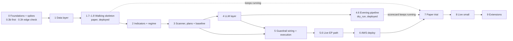

# AuraTrade: Execution Plan

The step-by-step build plan for the system described in the [README](../README.md). Each phase lists its tasks, the files it produces and the **acceptance criteria** that must pass before the next phase starts.

**Size key:** S = a session or two · M = a few sessions · L = a week or more of part-time work.

---

## How to start a build session

1. **Merge the previous task's branch into `main` first.** The tracker box is ticked on that branch, so until it's merged the next session sees the task as still open. If you'd rather not merge yet, say so; the next session then branches from the unmerged branch instead.
2. Open a **new Claude Code chat** in this folder. `CLAUDE.md` loads automatically.
3. Say: **"Continue the build: take the next task from the progress tracker."**
4. Claude names the task, reads the relevant README sections, builds it, verifies it against the acceptance criteria, and ticks the box below.
5. Review the summary, then start a new chat for the next task (or continue if the context is still small).

Tasks marked 👤 need you (accounts, keys, approvals).

## Progress tracker

**Phase 0: Foundations and spikes**
- [x] 0.1 Project tooling (uv, ruff, mypy, pytest, CI, package skeleton)
- [x] 0.2 👤 Accounts and keys + `scripts/check_keys.py` *(all keys verified 2026-10-09; local Postgres via Docker until Neon at 1.2; paper capital $5,000 confirmed)*
- [x] 0.3b Spike: Alpaca orders (paper) — **run first**: it can invalidate the order architecture *(2026-10-15: GO on OTO with adjustments, agenda #1–4 and #11; paper applies neither splits nor dividend stop reductions; see `docs/spikes/alpaca-orders.md`)*
- [x] 0.3a Spike: Alpaca market data *(findings adopted as #109–111; real-time and bar-revision checks done 2026-10-09: two proposals, approved at 0.4 as #6 and #7b)*
- [x] 0.3h 👤 Spike: early edge check (daily bars, tuning period only; a clearly negative result pauses the build) *(≈ 0R before costs, −0.08R after; continue, decision #112)*
- [x] 0.3c Spike: market calendar
- [x] 0.3d Spike: macro data timing *(2026-10-13: ADJUST, evening VIX from CBOE's delayed-quote JSON, final 16:32 ET; approved at 0.4 as #5)*
- [x] 0.3e Spike: fundamentals, earnings, industries *(ADJUST: earnings timing = earlier of 8-K and headline; approved at 0.4 as #7)*
- [x] 0.3f Spike: news
- [x] 0.3g 👤 Spike: Claude batch cost (paid; needs your OK) *(approved 2026-10-09; spent ~$0.26; ~$0.016 per Analyst request, ~$17–22/month; ADJUST for README §9, approved at 0.4 as #8)*
- [x] 0.4 👤 Review spike findings; amend README/decisions *(2026-10-10 to 10-15: decisions #113–128; the agenda is in `docs/spikes/review-agenda.md`)*
- [x] 0.5 Public project site (landing page + S3/CloudFront stack; deployed in 1.8)

**Phase 1: Data layer**
- [x] 1.1 Config and job framework *(runner wired to the `job_runs` store in 1.2 and the calendar in 1.4)*
- [x] 1.2 Database and initial migration *(Neon `dev` branch: you add its URL to `.env` and run `alembic upgrade head`; tests run on Docker Postgres)*
- [x] 1.3 Data clients *(`src/auratrade/data/`: Alpaca bars, IEX quotes, corporate actions, assets and news; CBOE + FRED; EDGAR; Finnhub; the Nasdaq symbol directory. Recorded fixtures, 100% branch coverage, each client checked once live)*
- [x] 1.4 Market calendar *(daily re-sync wired into `ingest` at 1.5; run `python -m auratrade.calendar.sync` once against the Neon `dev` branch)*
- [x] 1.5 Ingest job *(`src/auratrade/ingest/` + `jobs/ingest.py`; live run 2026-10-15 on a scratch database: 2,761 tracked tickers, coverage 100%, industry coverage 99.96%, 140 MB for 2 years of bars, a nightly run 219 s and a no-op when repeated. Build readings recorded as decision #129. Since 1.7 it runs in the `post_market --chain`; `--direct` runs it alone)*
- [x] 1.6 Historical backfill + real-data smoke run of the modules built early *(`src/auratrade/history/` + `scripts/backfill.py`: 13,672 securities and 16.3M bars since 2016, 1.2M headlines, 131,839 EDGAR earnings events; the last 2 years in Neon `dev`, 151 MB. Smoke run in `docs/backtests/smoke.md`: no exceptions or NaN; the 2017 `CORRECTION` miss goes to 2.4. Readings recorded as decision #130)*
- [ ] 1.7 Walking skeleton (rule-only, Alpaca paper, local) + minimal fake broker and automated chaos tests *(built and merged, PR #30; readings are decision #131; the lock check and all 7 automated chaos scenarios pass. Left: the 3 live paper sessions and the stop hand check, which run on AWS within 1.8 (#132))*
- [ ] 1.8 👤 Early AWS deploy of the skeleton *(in progress on `phase-1/aws-deploy`: schedule, watchdog, SSM secrets, image and `AuraTradePaper` stack built and tested offline; the AWS account, Neon `paper` branch, healthchecks.io check and `.env.paper` are ready and checked (2026-10-22); next the budgets, then the deploy with the user's OK, see `docs/next-steps.md`)*

**Phase 2: Indicators and regime**
- [x] 2.1 Indicators *(built out of plan order with the user's approval: pure functions, no config dependency)*
- [x] 2.2 Base detection and base count *(built out of plan order with the user's approval)*
- [x] 2.3 Regime classifier *(built out of plan order with the user's approval)*
- [ ] 2.4 Regime backtest

**Phase 3: Scanner, strategies, plans, baseline**
- [x] 3.1 Trend Template *(built out of plan order with the user's approval)*
- [ ] 3.2a Strategy registry + core scans (VCP, momentum, EP proxy)
- [ ] 3.2b Remaining scans (leader pullback, emerging leader)
- [ ] 3.3 Ranking, cap, verdict cache
- [ ] 3.4 Charts
- [x] 3.5a Position plans engine *(built out of plan order with the user's approval)*
- [ ] 3.5b Guardrails, sizing, triggers, risk multiplier (pure; the 3.8 backtest needs them)
- [ ] 3.6 Simulator and fake broker (`sim/`)
- [ ] 3.7 Watchlist, baseline book, breakout tracker, verdict scorecard
- [ ] 3.8 Baseline backtest (choose defaults) + re-run 2.4 with leadership health

**Phase 4: LLM layer**
- [ ] 4.1 LLM client and batch
- [ ] 4.2 Schemas and prompts
- [ ] 4.3 Context builders and tools
- [ ] 4.4 Jobs and skip logic
- [ ] 4.5 👤 Prompt sanity set and effort decision (paid; needs your OK)
- [ ] 4.6 👤 Deploy the evening pipeline + scorecard in `dry_run`, kept running (paid; needs your OK)

**Phase 5: Guardrails and execution**
- [ ] 5.1 Guardrail wiring (LLM actions → guardrails → `signals`, events, alerts)
- [ ] 5.2 Account constraints
- [ ] 5.3 Orders and signal lifecycle
- [ ] 5.4 Reconciliation and invariants
- [ ] 5.5 Jobs (execute, monitor, EOD, post-market, weekly)
- [ ] 5.6 Live `EpisodicPivot` path (EP candidates, EP review, EP entries)
- [ ] 5.7 Public site data and showcase design (nightly snapshot: equity, regime, closed trades; #134)

**Phase 6: AWS** (the account and a minimal stack already exist from 1.8)
- [ ] 6.1 Complete the CDK stack (all jobs)
- [ ] 6.2 CI/CD
- [ ] 6.3 Data move

**Phase 7: Paper trial** (the later of 3 months or 30 trades)
- [ ] 7.0 👤 Pre-register the go-live statistics (`docs/backtests/power.md`)
- [ ] 7.1 👤 Trial running; weekly reviews
- [ ] 7.2 👤 Go-live criteria met (README §15)

**Phase 8: Live, small**
- [ ] 8.1 👤 Live stack, starting at the 0.5 multiplier

---

## Ground rules (all phases)

- **Branching:** `main` is always deployable. Every task is a feature branch → PR → CI green → merge.
- **Definition of done:** code + tests + type-checked + lint-clean + docs updated if behaviour changed.
- **No secrets in git.** Use `.env` locally (`.env.example` committed) and SSM Parameter Store in AWS.
- **Every job is runnable locally** with `--session YYYY-MM-DD --dry-run` before it is deployed.
- **Test pyramid:**
  - unit tests on pure logic (indicators, regime, plans, guardrails, sizing), using synthetic data
  - integration tests with **recorded HTTP fixtures** (no live API calls in CI)
  - a **real-data smoke run** of the pure modules over the backfilled history (from 1.6), re-run whenever one of them changes
  - **automated chaos tests** of the order layer against the fake broker in `sim/` (from 1.7), in CI
  - manual end-to-end runs against Alpaca paper
- **Coverage is enforced in CI:** at least 95% branch coverage overall, and 100% on `guardrails/` (from 3.5b).
- **Decisions** go in the README decision log; spike findings in `docs/spikes/`; backtest reports in `docs/backtests/`.

---

## What I need from you

| Item | When | Notes |
|---|---|---|
| Alpaca **paper** API keys + secrets: **two paper accounts** | Phase 0 | One for `dev` (local work, Phase 5 end-to-end tests), one for `paper` (the deployed skeleton, then the trial). Sharing one would make each system's reconciliation fight the other's positions (README §12). Set each one's equity to the capital you intend to trade live |
| The capital you intend to trade | Phase 0 | **$5,000, confirmed 2026-10-09.** It sets the position count (§6) and whole-share sizing (README #122). The FINRA pattern-day-trader rule no longer applies (README #123) |
| Anthropic API key | Phase 0 | **Set a monthly spend limit in the Anthropic Console** (e.g. $40) |
| FRED API key | Phase 0 | Free |
| Finnhub API key | Phase 0 | Free tier |
| Neon account | Phase 0 | Free tier; `dev` and `paper` branches |
| Telegram bot token + your chat ID | Phase 0 | Create the bot with @BotFather |
| External dead-man's-switch check (e.g. healthchecks.io, free) | Phase 1 (task 1.8) | Alerts you if the AWS watchdog itself stops pinging (README §5.13) |
| GitHub remote repository | Phase 0 | Private repo |
| AWS account | Phase 1 (task 1.8) | Root MFA, an admin user (IAM Identity Center, or an IAM user signed in with `aws login`), budget alarms |
| Install AWS CLI + GitHub CLI | Phase 0 / 1.8 | Both installed; AWS CLI profile `auratrade` (us-east-1) |
| Domain name (optional) | Task 1.8 | For the public site (0.5). Buying it through Route 53 (about $13/year for a `.com`) creates the hosted zone the stack needs. Without one, the site lives on its `*.cloudfront.net` address |

---

## Phase 0: Foundations and spikes (M)

**Goal:** a working project skeleton, and every external assumption checked against reality before we build on it.

### 0.1 Project tooling (S)

- `uv init`, Python **3.13** pinned; dependency groups (`dev`, `backtest`).
- ruff, mypy (strict on `src/`), pytest, pytest-cov, hypothesis, pre-commit.
- `.gitignore`, `.env.example`, `docker-compose.yml` (Postgres 16).
- GitHub Actions `ci.yml`: lint → type-check → tests.
- `src/auratrade/` package skeleton matching the README layout.

**Accept:** `uv run pytest` passes; CI is green on the first PR.

### 0.2 Accounts and keys (S, mostly you)

Everything in "What I need from you" except AWS. `scripts/check_keys.py` confirms each key works.

### 0.3 Spikes

Each spike is a script in `spikes/` plus a note in `docs/spikes/<name>.md`, ending with a **go / adjust** decision. Run them in tracker order. **Run 0.3b first:** if its answers are bad, the order architecture changes (README §5.7 has the pre-chosen `fill_watcher` fallback), and that affects later tasks more than any other spike.

| # | Spike | Questions to answer |
|---|---|---|
| a | **Alpaca market data** | Do multi-symbol daily bars with `feed=sip` and `adjustment=split` work on the free plan? How deep is the history and what are the rate limits? Do 1-day bars match regular-session OHLC, or include extended hours? Do **real-time IEX quotes and 1-min bars** work for the EOD price check and the **5-min opening-range high**, and how close is the IEX range to the SIP range (compare on 50 symbols)? Are **pre-market IEX quotes** good enough to detect ≥ 10% gaps for EPs? How long does a 2,500-symbol day take? How do we classify ETFs, SPACs and preferreds? **Survivorship:** how many symbols delisted since 2016 still have full bar history (compare with a known delisting list for a sample year)? Can we get **raw (unadjusted) closes** for point-in-time price filters? Is there a corporate-actions feed (splits, mergers, symbol changes)? **How far back do historical IEX 1-min bars go?** The simulator takes opening-range highs and the 15:40 price from IEX where history exists (README §5.12). |
| b | **Alpaca orders (paper)** | Does OTO with a stop-limit entry (day) and a stop leg work when placed at 09:36 with a trigger above the current price? **What time-in-force does the child stop get**, and can it be made GTC or converted after the fill? **Two-tranche flow:** after tranche 2 fills, can the stop be replaced to cover the full quantity, and what happens to the OTO child leg? Does it need to be cancelled and replaced by a standalone stop? **Share reservation:** confirm a full-quantity stop blocks other sells, and test the sell sequence (reduce stop → sell → restore on failure) for OPG trims, intraday partials and EOD exits. How do OPG exits and marketable-limit adds behave, and what is the OPG submission cutoff? Does `client_order_id` dedupe? How does PDT protection treat stops on < $25k accounts? What fields does the account API return? **What happens to resting GTC stops on a split** (cancelled, adjusted, untouched), and **on a cash-dividend ex-date** (lowered by the dividend, per FINRA Rule 5330)? **Stop above the market:** what does Alpaca do with a sell stop placed at or above the current price (rejected, or triggered at once)? This decides the "price through the stop" path (README §5.7). **Partial fills:** can a stop-limit entry fill partly, and what happens to its child stop leg then? **PDT on exits:** on a < $25k account, does PDT protection reject a same-day exit, or a stop that triggers the same day? **Multiple paper accounts:** confirm the `dev` and `paper` accounts are independent. **Fallback check:** if OTO with a stop-limit entry fails, verify the `fill_watcher` path (plain stop-limit entry, attach a GTC stop within a minute of the fill). **Limit-buy parent:** does OTO also work with a plain limit buy as the parent (the entry when the price is already past the trigger but within the limit, README §7.1)? |
| c | **Calendar** | Alpaca vs `pandas_market_calendars` for 2016–2027: every disagreement, and how early closes are represented. |
| d | **Macro** | When do the CBOE VIX/VIX3M files update (is the value ready by 17:15 ET)? How far does FRED lag? |
| e | **Fundamentals, earnings, industries** | How accurate is Finnhub's earnings calendar for 50 names, and are **earnings surprises** (actual vs estimate) on the free tier? What share of the universe has **no known next date** (that sets how often the estimated-date blackout applies)? **Earnings history for backtests:** how far back do Finnhub's free dates go? Do EDGAR 8-K Item 2.02 filings (acceptance time → before-open / after-close) match the true report dates for 50 names across 2016–2025? How reliable is EPS/revenue extraction from EDGAR company facts? Do **SIC codes from EDGAR submissions** cover the universe, and what mapping to ~100 industry groups should we use? What are the rate limits? |
| f | **News** | Is the Alpaca news API available on the free plan? Payload shape and headline volume. |
| g | **Claude** | A batch of 5 Analyst requests to `claude-opus-5-5`: two charts at the planned sizes, compact facts, structured output, shared-prefix caching. Measure tokens (**thinking included**: it bills as output) and cost per candidate at effort `medium` vs `high`, check the cache hit inside the batch (best-effort for concurrent requests), and measure turnaround → recalibrate the cost model (README §9 assumes ~$35–65/month) and set Phase 4's daily cost limit. Also time one real-time Portfolio Manager-sized call at `high` with tools, to confirm the 09:10 deadline is comfortable. |

### 0.3h Early edge check (S, spike-grade; the result goes to you)

The baseline gate in 3.8 is the formal go / no-go, but it comes after months of building. This is a cheap early warning (README §15), run right after 0.3a so it comes **before** the data layer (1.1–1.6) is built: it needs only daily bars.
- A script in `spikes/edge_check/`. It pulls split-adjusted daily bars straight from Alpaca into local Parquet (git-ignored), with no database or job framework. The universe is the current asset list plus whatever delisted symbols 0.3a found history for, filtered on the raw close where 0.3a found one.
- **2017–2022 only:** the holdout stays closed.
- Simple versions of the core setups:
  - Trend Template + a VCP-lite (a tightening base, pivot = base high)
  - a momentum-lite breakout (top 2% movers, consolidation high)
- Entry on the next session's break of the pivot. Stop at the base low, capped at 8%. Exit on a close below the 50 SMA (VCP) or the 10-day (momentum). A crude fixed slippage.
- It **tunes nothing**, and it is not a fill model: nothing outside `spikes/` may import it or its data (the one-simulator rule, CLAUDE.md §6).
- Report expectancy per year and per setup in `docs/spikes/edge-check.md`, with the delisted coverage it had.

**Read the result asymmetrically.** Missing delisted stocks inflate breakout results, so this is an upper bound. A clearly negative result is strong evidence; a positive one is weak, and the formal tests stay in 3.8.

**Accept:** the note is written. If expectancy is clearly negative for both setups, **stop and bring it to the user** before Phase 1.

**Accept (0.3):** all spike notes written; README decisions confirmed or amended; any blocker has a chosen workaround (especially 0.3b for two-tranche stops).

### 0.5 Public project site (S)

Added at the user's request (decision #108). A public page with a link, explaining the project; data panels follow in 5.7.
- `web/`: a static landing page (plain HTML and CSS, no scripts, no third-party assets), a 404 page and a favicon.
- `infra/stacks/public_site.py`: the `AuraTradePublicSite` CDK stack (README §12): private S3 bucket, CloudFront with origin access control, HTTPS only, security headers with a strict content-security policy, an optional custom domain (ACM certificate + Route 53 records for the apex and `www`), and a deployment that never prunes `data/`.
- Offline tests: the synthesized template (private bucket, TLS-only policy, CloudFront-only read, headers, domain on/off), and the pages fitting the content-security policy and carrying the disclaimer.

**Accept:** `cdk synth` succeeds with and without a domain; tests pass. Deployed in 1.8, once the AWS account exists.

---

## Phase 1: Core library and data layer (L)

**Goal:** clean, validated, calendar-aware data in Postgres and Parquet, refreshed by an idempotent, holiday-safe job.

### 1.1 Config and job framework (M)

- `config.py`: pydantic-settings; `TRADING_MODE`; model IDs and effort; `config/risk.yaml` loaded into a typed model and hashed.
- `jobs/base.py`, a job runner that provides:
  - the calendar guard, **with a policy per job type** (morning/intraday: today is a session; evening: today was a session; `analyst_collect`: any day; `weekly_review`: Saturdays; `watchdog`: only expected heartbeats)
  - `job_runs` heartbeat
  - structlog context
  - exception → Telegram alert
  - `--dry-run` and `--session` overrides
  - a Lambda handler shim and a CLI entrypoint
  - **chaining for the evening pipeline** (README §2): a job runs only after its predecessor succeeded for the same session (per `job_runs`). On success it invokes the next job. Without a successful predecessor, it waits and retries for up to 30 minutes past its fallback time, then fails closed and alerts.
  - duration logging, with an alert over 10 minutes (Lambda's limit is 15)
- `notify/telegram.py`; `storage/` (local folder and S3 implementations).

### 1.2 Database (M)

- Initial Alembic migration: `tickers` (with SIC and industry group), `industry_groups`, `market_sessions`, `daily_bars` (int `ticker_id`, compact types, plus the raw close), `corporate_actions`, `macro_series`, `fundamentals`, `earnings_events`, `job_runs`, `system_flags` (incl. the `trading_enabled` kill switch), `mismatches`.
- Neon `dev` branch connected; tests run on Docker Postgres.

### 1.3 Data clients (M)

- `alpaca_data` (bars, IEX quotes, assets, news), `macro` (CBOE delayed-quote JSON and history files + FRED, README §5.1 / #117), `edgar` (company facts, submissions/SIC, 8-K Item 2.02 filings), `finnhub` (earnings, profile fallback).
- httpx + tenacity, client-side rate limiting, typed responses, recorded fixtures.

### 1.4 Market calendar (M)

- Sync `market_sessions` from Alpaca, cross-check with the library, flag disagreements.
- Helpers: `session_for`, `previous_session`, `sessions_between`, `n_sessions_back`, `is_early_close`, `session_minutes`, `days_until_next_open`.

### 1.5 Ingest job (L)

- Universe refresh with filters, applied to **raw** prices. Store each security's **first public trading date** as its listing date (an OTC uplisting isn't an IPO; README §5.1, #126).
- Gap-fill bars, and **re-fetch session T−1's bar** (late volume, #118).
- Corporate actions for the universe → `corporate_actions`. Alpaca's feed filters on **`process_date`**, not the ex-date (a dividend going ex on 10-15 has process date 10-16), and lists announced splits ahead with a process date on or a day before the ex-date (checked 2026-10-15). So query a window padded by a few days and filter on `CorporateAction.effective_date`; looking a few sessions ahead lets the evening before a split's ex-date see it.
- **Validation:**
  - coverage ≥ 90%, otherwise `INCOMPLETE`
  - OHLC sanity
  - the **outlier filter** for bad highs and lows in SIP daily bars (README §5.1, #126; e.g. NVDA 195.95 on 2024-06-10)
  - split detection → re-fetch
  - half-day flag
- **Retention:** prune bars beyond 2 years; archive 90-day-old `daily_watchlist`, `breakout_tracker` and `llm_decisions` output rows to Parquet; report DB size daily, with an alert at 70% of the free tier.
- Macro: the evening VIX/VIX3M from CBOE's delayed-quote JSON (`last_trade_time` ≥ 16:15 on T), then the history file by its last row's date, then FRED (README §5.1, #117); the credit spread as LLM context only.
- Earnings calendar; upcoming timing from the company's 8-K habit when Finnhub leaves it blank (#119).
- `calendar.sync`: batch the inserts (row by row it takes about 8 minutes from the PC to Neon).
- Fundamentals: rolling refresh within free limits, plus a refresh after each report.
- **Industry classification:** SIC → industry group; refreshed weekly.

### 1.6 Historical backfill and real-data smoke run (M)

`scripts/backfill.py`: 2016 → today, **including delisted symbols** the vendor covers, with a point-in-time membership table so backtests can rebuild each session's universe. Split-adjusted bars plus the raw close. **Historical earnings dates and timing** from EDGAR 8-K Item 2.02 filings, timed by the earlier of the 8-K acceptance and the first earnings headline (#119), so the backtests can apply the blackout and cushion rules. **Fundamentals keyed on the EDGAR `filed` date**, never the period end (README §5.1). Parquet partitioned by year; the last 2 years loaded into Postgres.

**Accept (1.1–1.6):**
- Running `ingest` twice is a no-op the second time.
- Tests pass for: a weekend, a Monday holiday, Good Friday, the day after Thanksgiving, a vendor short-count (→ `INCOMPLETE`), a split, and a calendar disagreement.
- Industry coverage ≥ 95% of the universe.
- Postgres size is under the free-tier limit with headroom.
- **Real-data smoke run** (`scripts/smoke_real_data.py`, re-runnable). The modules built ahead of the data layer (2.1 indicators, 2.2 bases, 2.3 regime, 3.1 Trend Template, 3.5a plans on a few sample trades) have only seen synthetic bars and ten fixture tickers. They now run together over the whole backfilled history and point-in-time universe, and write `docs/backtests/smoke.md`:
  - no exceptions; no NaN or infinite values where the inputs were complete
  - one regime row per session, plausible on known stretches (the Feb–Mar 2020 crash, the 2022 bear market). A clear miss goes to 2.4; nothing is tuned here
  - Trend Template pass counts and base-count distributions per session, with outliers listed and explained (bad ticks like B13 must be caught by ingest's outlier filter, not reach the base count)
  - any mismatch between what the modules expect and what ingest stores (columns, raw vs adjusted prices, listing dates) is fixed before 1.7

### 1.7 Walking skeleton (L)

One thin pass through the **whole daily loop**, built from the real modules in minimal form, so the riskiest integration (orders, stops, timing, the job runner) runs on real sessions months before the full system exists. Phase 5 **extends** this code; it isn't throwaway.
- **Scan-lite:** Trend Template rules 1–5 and 8 on the ingested data; pivot = 20-session high; structural stop = the 10-session low, capped at 8%.
- **Rule-only pick:** the top 3 by RS. No LLM.
- **Sizing:** on the worst fill, at a fixed 0.25% risk.
- **Order-layer core:**
  - OTO entry at 09:36 with a **GTC parent** (its stop leg is then GTC); unfilled parents cancelled at the EOD review (README §5.7, #113)
  - the leg-to-standalone swap (cancel the legs, place one GTC stop) before the first sale that cuts the quantity
  - every buy in a held symbol as an OTO with its own leg (#114)
  - reconcile + **stop invariant** in every order-touching job, plus the 09:31 check run
  - the **`stop_guard`** (every 5 minutes in market hours): broker-only check of stop existence, quantity and GTC; it takes the lock and opens the database only to repair, and skips while the lock is held (README §5.7)
  - order jobs safe under Lambda's async retries (idempotent through `client_order_id`)
  - the **single-writer lock** (account-wide advisory lock on a direct connection, released in `finally`, with a server-side idle timeout as a backstop, README §5.7)
  - the **price-through-the-stop** path: sell at once instead of placing a stop above the market, escalating within the run (marketable limit → one re-price → market)
  - partial-fill handling: the filled quantity is the position, and a partly filled buy counts as unprotected (cancel the rest, keep an active leg or place a standalone stop, #115)
  - kill switch (entries only) as the `system_flags` row, with `auratrade kill on|off`; `kill on` cancels resting entry orders at once
- **Fake broker (minimal):** `sim/` gets an in-memory broker implementing the order layer's broker interface (orders, OTO legs, replace, cancel, positions, fills set by the test), with the 0.3b behaviours (README #113–116, #124: legs take the parent's time-in-force and have a fixed quantity; a held leg while the parent is partly filled; the wash-trade rejection of a plain buy; a sell stop above the market rejected; a replace on a closed market left `pending_replace`; stops rejected on a split's ex-date and no split applied to the position) and **fault injection** (a 500 on submit, a deleted stop, a dropped connection, a process killed between two calls). It has no fill model yet: 3.6 extends **this same module**, so there is still only one simulator (README §5.12, decision #63). The order code is tested against it before it ever runs unattended in 1.8.
- **Exits:** the hard stop, plus a single soft rule (close below the 21 EMA at the 15:40 decision price) using the **sell sequence**.
- **`post_market`:** a journal row, the Telegram daily report, and the nightly backup export to storage.
- `TRADING_MODE` stays `dry_run` by default; paper orders need the explicit `paper` flag.
- Runs against the **`dev`** Alpaca paper account.

**Accept:** 3 sessions run locally against Alpaca paper (by hand at the right times is fine), with *(moved to the AWS deploy in 1.8, on the `paper` account, decision #132)*:
- no position ever without a full-quantity GTC stop
- no duplicate orders
- every job correctly run or skipped on the calendar
- a forced concurrent run of an order job waits on the lock instead of interleaving
- a job killed right after reducing a stop is repaired by `stop_guard` within one run (≤ 5 minutes)

**Accept (automated, in CI, against the fake broker and the test Postgres):** each of these ends with **no duplicate orders and no position without a full-quantity GTC stop**:
- a job killed right after it reduced or cancelled a stop, before the sell (the next `stop_guard` run restores it)
- the same order job run twice in a row (a Lambda retry): idempotent through `client_order_id`
- two order jobs at the same time: the second waits on the lock
- an API 500 on submit, and a dropped connection after the broker accepted the order
- a stop deleted at the broker
- the price already through the stop level: sell at once, escalating marketable limit → re-price → market
- a partly filled entry: the filled quantity is protected by the next `stop_guard` run

Phase 5 extends this suite to the full chaos list (5.5); these cases keep running there.

The long unattended record comes from 1.8 rather than from running this machine by hand for weeks.

### 1.8 Early AWS deploy of the skeleton (M, with you)

What was 6.1, plus the core of the CDK stack, moved forward so deployment problems surface early:
- **Account:** root MFA, an admin user, AWS CLI profile `auratrade`, budget alarms at $10 / $25, `cdk bootstrap`.
- **Minimal stack:** ECR image, one Lambda per skeleton job (order jobs with async retries on), EventBridge Scheduler (`America/New_York`), the `stop_guard` schedule, SSM parameters, the `watchdog` with its external dead-man's-switch ping, and a Neon `paper` branch.
- Runs against the **`paper`** Alpaca account, never the `dev` one.
- Deploy the public site stack from 0.5 (`AuraTradePublicSite`), on the custom domain if one was bought.

**Accept:**
- 1.7's live checks (#132): 3 sessions meeting 1.7's criteria, and a job killed right after reducing a stop repaired by `stop_guard` within one run, on the `paper` account. They count toward the 10 below; 1.7 is ticked when they pass.
- 10 unattended sessions on Alpaca paper.
- The watchdog fires when a job is disabled on purpose. The external dead-man's switch alerts when the watchdog is disabled on purpose.
- AWS cost under $5/month. Neon compute hours are within the free allowance, projected to the full schedule (README §12).
- The skeleton keeps running through Phases 2–5, so the operational record builds up while the rest is built.

---

## Phase 2: Indicators and regime (M)

**Goal:** a backtested regime classifier writing one row per session.

### 2.1 Indicators (L)

- SMA, EMA, ATR (14 sessions), **ADR %** (20 sessions), on split-adjusted bars
- 52-week high/low, measured in sessions
- RS rating, **RS line** (price / SPY: new-high, near-high and 50-session-low states)
- **momentum rank** (1-, 3- and 6-month return percentiles)
- **industry-group RS rank**
- **up/down volume ratio** (50 sessions)
- **extension** above the 50-day and 200-day
- distribution days (count **resets after a follow-through day**) and follow-through-day detection (day 4+, flagged weaker after day 7)
- breadth
- half-day volume normalization
- intraday volume pace curve
- **earnings-gap catalyst detection**
- **climax signals:**
  - largest daily gain since the move began
  - exhaustion gap
  - heaviest-volume up day
  - 7-of-8 / 8-of-10 up days
  - ≥ 70% above the 200-day
  - ≥ 25% gain in ≤ 15 sessions

Every function is unit-tested on hand-built series with known answers.

### 2.2 Base detection and base count (M)

- `indicators/bases.py`:
  - detect consolidations (start, end, depth, contractions, pivot)
  - **IBD base counting:** a new base counts only after a ≥ 20% advance; the count resets when a base undercuts the prior base's intraday low; a base-on-base counts as one
- `bases` migration.
- Tested on hand-built price paths and spot-checked on 10 well-known historical leaders.

### 2.3 Regime classifier (M)

- Pillars, with SPY/QQQ combined as **both for +1, either for −1**. Distribution days counted per index, the higher count used; an FTD on either index; quarterly-expiration and index-rebalance sessions flagged.
- The **leadership-health** pillar reads the **ungated breakout tracker** (task 3.7), over the 20 sessions whose 5-session result is complete (T−24 to T−5). It scores 0 with fewer than 10 tracked breakouts in the window; the backtest computes the tracker from history.
- State machine following the README **transition table**, including:
  - a new uptrend via a follow-through day, or the 10-session `no_ftd` fallback
  - `EARLY_UPTREND` → `CORRECTION` only on a rally-low undercut or ≥ 6 distribution days since entering it, never on the score; no timeout
  - upgrade counters count only sessions in the current state; at least 10 sessions in `EARLY_UPTREND` before `CONFIRMED_UPTREND`
  - the 2-session debounce on `CONFIRMED_UPTREND` → `UNDER_PRESSURE`
  - hysteresis, the crisis override, and macro staleness → neutral
  - the **conservatism ladder** (README §5.2) as one function, used by the LLM-view clip and the `premarket_check` downgrade
- Rally-attempt tracking (day count, rally low per index) as a sub-state of `CORRECTION`, using the README §5.2 definitions:
  - **correction low** = the lowest low since entering `CORRECTION`; a new lower low restarts the count
  - **rally low** = that low; on the `no_ftd` path, the lowest low of the 10 qualifying sessions
- The score per session is stored, so the `EARLY_UPTREND` step-up (README §6: after 10 sessions, only on sessions with a score ≥ +1) can read it.
- Unit tests for every transition, including the edge cases:
  - an FTD while the score is still negative: the state is `EARLY_UPTREND` and stays there while the score stays ≤ −1
  - a rally-low undercut on the day of an upgrade
  - a single pillar flickering across a threshold
  - the fallback firing one session before an FTD would have
  - the `no_ftd` path at a score ≥ +3 staying in `EARLY_UPTREND` for its 10 sessions before upgrading
  - a stalled `EARLY_UPTREND` (score stays at +1/+2) staying put for 40+ sessions
  - leadership health ignoring breakouts from the last 5 sessions
  - a `CORRECTION` entered on the score with the index near its high: the correction low is that session's low, and an FTD is possible from day 4
  - a `no_ftd` entry, then an undercut of the 10-session low → `CORRECTION`
  - after 10 sessions in `EARLY_UPTREND`, a session at score 0 keeps the starter limits and a session at +1 steps up
- `market_regime` migration.
- `jobs/regime.py` writes the **computed** regime. The LLM view is added in Phase 4 through the Portfolio Manager.

### 2.4 Regime backtest (M)

`backtest/regime.py` from 2016 (re-run once the baseline backtest exists, so the leadership-health pillar is included):
- a regime timeline over SPY
- time spent in each regime
- switches per year
- SPY forward returns and drawdowns by regime
- each pillar's score distribution, and the total score's
- **false `CORRECTION` spells**: longer than 15 sessions, with SPY never closing 8% or more below its prior 52-week high
  - a known case from the 1.6 smoke run: the regime sat in `CORRECTION` from 2017-04-12 to 2017-10-11 (124 sessions, broken only by a 3-session `no_ftd` fallback in June that a QQQ rally-low undercut on 2017-06-09 ended), a calm market that produced no follow-through day until October (`docs/backtests/smoke.md`, "Reading")
- comparisons: excluding expiration/rebalance distribution days vs not; the `no_ftd` fallback after 10 sessions vs other lengths; the 10-session minimum in `EARLY_UPTREND` vs none; **an immediate downgrade to `CORRECTION` vs one that needs 2 sessions at ≤ −1** (with the index-trend pillar at −1 still immediate)

Thresholds are **tuned on 2016–2022 only** (trading effectively from early 2017, after the warm-up). Only about 4–5 major episodes exist in the data, so prefer IBD's published thresholds unless a change clearly helps on both periods. The report goes to `docs/backtests/regime.md`.

**The holdout stays closed here.** This run has only 4 pillars; leadership health needs the breakout tracker (3.7). 2023–present is opened once, for the final 5-pillar model, in the 3.8 re-run (README §15). Opening it now and again later would mean tuning on it.

**Accept:**
- Q4 2018, Feb–Mar 2020 and 2022 are labelled defensively early in each decline.
- The 2020 recovery is picked up with reasonable lag.
- ≤ ~12 switches a year on the tuning period.
- **Invested in uptrends, not only defensive in declines** (README §5.2):
  - `CONFIRMED_UPTREND` covers most of the strong uptrends of 2017, 2019 and H2 2020–2021 (the target share is set before the run and reported)
  - at most about one false `CORRECTION` spell a year
  - if +2 turns out to be the typical bull-market score, thresholds are revisited before going on
- Provisional thresholds committed to `risk.yaml`. They are final after the 3.8 re-run, which also checks the 2023 recovery and the switch rate on the holdout.

---

## Phase 3: Scanner, strategies, plans and baseline (L)

**Goal:** high-quality daily candidates, deterministic position-plan mechanics, and a rule-only baseline that also tunes the default exit plans.

### 3.1 Trend Template (S)

Vectorized 8-rule screen; one unit test per rule (pass and fail).

### 3.2a Strategy registry and core scans (L)

The three strategies that carry `CONFIRMED_UPTREND`, where most of the risk is taken, are built and verified first.
- `strategies/base.py` interface: `scan()`, `build_llm_context()`, `system_prompt`, `entry_policy`, `exit_policy`, `default_risk`.
- Each scan outputs the code-computed **pivot and structural stop** that the Analyst's levels are checked against (README §8, "Price levels").
- `VcpBreakout` (Minervini): contraction sequence (2–4, up to 6, each shallower), volume dry-up, pivot, distance to pivot. Its own contraction rules: 2.2's `contraction_count` is noisy on volatile names (a fixed 3% zigzag gives 30–50 in some long bases).
- `MomentumBreakout` (Kullamägi): top ~2% momentum rank; a 30–100%+ move in the last 1–3 months; a 10–40-session consolidation with higher lows and a tightening range; riding the rising 10/20-day. **Exempt from the 25%-above-50-day rule** (README §5.3).
- `EpisodicPivot` (Kullamägi): live detection comes in task 5.6. For backtests, a proxy: gap ≥ 10% on ≥ 3× average volume, preferably after an earnings date, with no big rally over the prior 3–6 months. The proxy can't require an earnings beat (no free surprise history); the report notes the difference from the live rule.
- **All scans run every evening.** `risk.yaml` defines which strategies are fundable in each regime.

### 3.2b Remaining scans (M)

- `LeaderPullback` (`UNDER_PRESSURE`) and `EmergingLeader` (`EARLY_UPTREND`), on the same interface.

### 3.3 Ranking, cap and verdict cache (S)

- Quality score: RS, momentum rank, group RS rank, RS-line state, up/down ratio, tightness vs ADR, base count, catalyst. **No earnings surprise in the score**: it has no history, and the backtested pool must equal the live one (README §5.3).
- Exclude stocks more than 25% above their 50-day, except `MomentumBreakout` and `EpisodicPivot`.
- Only strategies fundable in the current regime compete for the top 40.
- Verdict-cache skip rules.

### 3.4 Charts (S)

Daily (1 year, ~800×600, 10/21/50/150/200 MAs, volume, pivot, RS line) and weekly (2 years, ~600×400) → object storage.

### 3.5a Position plans engine (L)

- `plans/`:
  - the plan model and its bounded menus (from `risk.yaml`)
  - **tighten-only versioning**
- **Entry policies:** pivot vs 5-min opening-range-high triggers; single vs two tranches; the **confirmation gate per strategy** (README §7.1: the breakout gate for VCP and emerging leaders, the pullback gate for `LeaderPullback`).
- **Early-behaviour rules:** heavy-volume reversal → exit (a down day = a close below the prior close; volume vs the 50-day average); a light-volume dip below the pivot → hold, no tranche 2; time stops at 10/20 sessions (high < +1R). Each one fires only if it is **in the position's plan** (README §7.2): the heavy-volume reversal in the O'Neil set, time stops on evidence or by Portfolio Manager choice, the light-volume rule always.
- **Default exit sets** (README §7.3): Kullamägi (momentum, EP), Minervini (VCP, pullback), O'Neil (emerging leader), plus the safety rules; every other rule switchable on and off per strategy, so 3.8 can add them one at a time.
- **Regime-downgrade tightening** (README §7.3): one trail step on a downgrade to `UNDER_PRESSURE`; the 10-day trail and the end of an 8-week hold on a downgrade to `CORRECTION`.
- **Rule precedence** (README §7.3) in one place (`plans/resolve.py`): full exits end evaluation; partial sales stack in order on the remaining shares; constraints suppress the rules they name. Unit-tested with days where several rules fire.
- **Exit menu:**
  - partial sales: Kullamägi 3–5 days / O'Neil 20–25% / Minervini 2–3R
  - breakeven after the first partial or at +3R
  - the **round-trip rule** at +10%
  - the **8-week hold** (+20% in ≤ 15 sessions → 40-session hold)
  - trails on a close below the 10-day / 21 EMA / 50 SMA
  - **climax sales** (≥ 2 signals → ½, ≥ 3 → all)
  - selling into a late-stage (4th) base breakout
  - faltering-RS events
- The earnings-cushion table, including the estimated date for held positions with no known next date; hard-stop vs soft-rule levels; `position_events`.
- Migrations: `position_plans`, `position_events`.
- Fully unit-tested, including "a loosening change is rejected" and every rule's trigger and non-trigger cases.

### 3.5b Guardrails, sizing, triggers and risk multiplier (pure) (M)

These are pure functions, and the 3.8 backtest compares several of them on vs off: the heat cap, clusters and the multiplier. So they're built here, not in Phase 5. Phase 5 wires them into the live LLM and order pipeline.
- `guardrails/`: one pure function per README §8 rule, including:
  - **tighten-only** (with the round-trip rule) and the **tranche-2 rules** (incl. the earnings blackout, and the strategy still fundable with no crisis override)
  - **per-strategy stop width** (VCP / emerging 8% from the limit price; pullback 1.5 × ATR, momentum 1 × ADR and EP 1.5 × pre-gap ADR from the trigger) and the **base-count limits** (an unreliable count is sized like a 3rd base: half risk, #126)
  - **no margin:** total exposure, with pending entries at their limit price, ≤ 100% of equity (#123; replaces the PDT allowance)
  - **keep losses small vs gains**, in its precise form: min(default, ½ avg gain), below the strategy's **noise floor** (1 × ATR, or 0.5 × ATR for momentum / EP) → reject
  - the 25%-above-50-day limit and the **earnings cushion**
  - **price levels** (LLM pivot ±3%, stop tighter only; at order time: last price below the trigger → buy-stop-limit; last price past the trigger but at or below the limit → limit buy at the limit; above the limit → skip; an EP's pivot is its opening-range high; max chase measured from the code pivot)
  - the 25%-above-50-day limit with the momentum and EP exemptions
  - the **open-risk (heat) cap**, clipping to the room left and rejecting below half the planned risk, and **correlated clusters**
  - the **effective risk** per regime, including the `EARLY_UPTREND` step-up (after 10 sessions, only on sessions with a score ≥ +1; never if `no_ftd`)
  - the **unknown-earnings-date** blackout
  - the **regime ceiling** on the conservatism ladder
- `evaluate(actions, context)` → approve / clip / reject.
- Tests: unit tests, plus hypothesis adversarial tests:
  - negative or inverted stops, 50% risk, NaN prices
  - unknown symbols, loosening plans, tranche-2 without a gate pass
  - an LLM pivot below the market or 10% off the code pivot
  - heat already at the cap, and heat with room for less than half a trade
  - the clip regression test: with 4 positions open at 1.25% risk, a 5th at 1.25% is clipped to 1% (the room left), not rejected
  - a property test that a momentum / EP stop at 1 × ADR passes the noise floor whenever ATR ≤ 2 × ADR (the regression test for the old 1 × ATR floor, which rejected them all)
  - a VCP chased to pivot × 1.05 whose structural stop is 8% below the pivot is rejected (8% is measured from the limit)
- **100% branch coverage, enforced in CI:** a step that fails the build if `guardrails/` drops below 100% (e.g. `coverage report --include="src/auratrade/guardrails/*" --fail-under=100`).
- `execution/sizing.py`: planned size on the worst fill, in **whole shares** (floored; 0 → skip; under 2 → a single tranche at the trigger, #122); tranche split; tranche-2 re-sizing on the actual price and tranche 1's actual (possibly partial) fill.
- `execution/triggers.py` (pure): pivot vs **5-min opening-range high** from 1-min bars (the opening-range high whenever the range traded above the level, README §7.1), low-of-day stops for momentum and EPs, max-chase checks, the skip when the opening-range high is above pivot × 1.05, the **limit buy at the limit** when the price at 09:36 is already above the trigger but within the limit (skip above it), and the limit price min(trigger × (1 + min(2%, ½ × ADR%)), code pivot × 1.05). Tested with a stock that opens below its pivot and breaks it before 09:36, and with one that breaks its opening-range high at 09:35.
- `journal/risk_multiplier.py`: progressive-exposure state from the journal and equity peak, following the README §8 table exactly:
  - win / loss / scratch definitions
  - the first matching row wins
  - drawdown tiers apply until the drawdown recovers or after 3 wins in the tier, stepping up one tier at a time, and re-apply only on a new equity low
  - "prove it first" restarts only after a manual drawdown-halt reset, never after the automatic daily / weekly halt resets
  - "unproven regime" (live only) and "trading well" (needs ≥ 10 closed trades)

  Unit-tested on every row boundary.
- `journal/numbers.py`: rolling win rate, average gain, average loss, expectancy ("your numbers").

### 3.6 Simulator and fake broker (M)

- `sim/`: **one** fill simulator, built on the in-memory fake broker from 1.7 (the same module, extended; the same broker interface as the order layer).
- It calls the live pure functions (plans, triggers, sizing, guardrails, multiplier from 3.5a–3.5b), never copies of them.
- The fake broker models what 0.3b found (as in 1.7): held legs on partly filled parents, stops above the market, the wash-trade rejection, splits not applied, so replay and chaos tests exercise those paths.
- Sizing in whole shares at the real account size ($5,000), so 0-share skips and single tranches show up in every result (README §15, #122).
- **Fill model** (README §5.12):
  - entries placed at 09:36 on 1-minute bars, as live (incl. pivot triggers, the limit buy when the price is already past the trigger but within the limit, and the skip above the limit)
  - **levels from IEX, fills from SIP:** opening-range highs, the 09:36 last price and the 15:40 decision price come from IEX minute bars (where history exists); fills and volume from SIP minute bars
  - buy-stop-limits fill at max(trigger, the minute bar's open) + liquidity-scaled slippage **only if that is at or below the limit**; otherwise the order rests as a limit and fills at the limit only if a later bar trades at or below it, else it expires unfilled (a **miss**)
  - stops fill at min(stop, open) − slippage, so gaps go through
  - soft-rule exits fill at the decision price − slippage
  - **pessimistic same-bar order:** a bar that reaches both the hard stop and a favourable level (partial target, breakeven or round-trip milestone) takes the stop first
- Used by: the evening baseline, the verdict scorecard, the 3.8 backtest and the Phase 5 replay and chaos tests.
- Tests: hand-built minute-bar days with known fills, including gap-through stops, untriggered orders, **a breakout that jumps past its limit and never comes back (a miss)**, one that comes back to the limit (filled at the limit), and a daily bar that reaches both the stop and +2R (stopped out).

### 3.7 Watchlist, baseline and scorecard (M)

- Migrations: `daily_watchlist`, `baseline_signals`, `breakout_tracker`, `verdict_outcomes`.
- **Baseline book:**
  - same top-40 list, regime gating, sizing, guardrails, entry policies, deterministic confirmation gate, default plans and earnings cushion
  - takes setups in rank order until the limits are full
  - EPs come from the morning candidate list (rule-based). Until task 5.6 builds that list, the baseline runs without EPs.
- **Evening simulation** in its own `simulate` job (README §3), chained after `ingest` and before `regime`: the baseline is simulated after the close from that day's IEX and SIP minute bars (fetched for its symbols only), through `sim/`: 09:36 triggers, opening-range highs, low-of-day stops, the EOD gate and soft rules on the 15:40 decision price. The breakout tracker's new triggers and completed results, and the scorecard, run in the same job, within Lambda's 15 minutes.
- **Breakout tracker:** records every trigger from the full uncapped scan, regardless of regime, and its 5-session result → leadership health (only results that are complete, T−24 to T−5). The pillar from 2.3 needs a result for every breakout in the window (`sessions_ago`, above its trigger 5 sessions later); a missing one is an error. Until then it scores 0.
- **Verdict scorecard:** the plumbing for scoring Analyst verdicts forward through `sim/` (README §5.12). Verdicts arrive in Phase 4; test it here on synthetic verdicts.
  - one unit per setup (ticker, strategy, code pivot), labelled with the verdict in force at its trigger
  - BUY vs SKIP on triggered setups; trigger rates separately
  - triggered only while a verdict is in force (≤ 3 sessions after its latest review), the same window for every verdict
  - session-block bootstrap confidence intervals, with setup and session counts
  - tagged with prompt version and answering model
  - a test that re-reviewing the same setup 5 times doesn't create 5 observations
- **Plan counterfactual and like-for-like replay:** the plumbing to replay a closed trade through `sim/` as decided (→ sim R) and under its strategy's default plan and risk (→ default-plan R), both in `trade_journal` (used from Phase 5). The LLM-vs-baseline comparison uses sim R, never paper fills (README §5.12).

### 3.8 Baseline backtest: choosing defaults from evidence (L)

`backtest/baseline.py` from 2016, per strategy and per regime, through `sim/`, following the **backtest-validity rules** (README §15):
- **Point-in-time universe** (incl. delisted, raw-price filters) from the 1.6 membership table.
- **Historical earnings dates** from 1.6 (EDGAR 8-K), so the blackout and cushion apply as they would live.
- **Tune on 2016–2022** (effectively 2017 on, after the warm-up); **report 2023–present once**, labelled a **confirmation period** (it filters the comparisons, so it isn't a clean test, README §15).
- **Results per calendar year** in every table; no conclusion may rest on a single year.
- **Point-in-time fundamentals** (EDGAR `filed` dates) and a quality score without the surprise.
- Cells with fewer than 30 trades keep the source default.
- **Whole shares at $5,000** (#122): the report shows how many trades were skipped at 0 shares or entered as a single tranche, per strategy and risk level.
- Chooses the provisional values: the climax `fast_gain_min_move_sessions` (15) and the menu partials (Kullamägi ⅓ at session 3, Minervini ⅓ at +2R, O'Neil ¼ at +20%; #125, #128).
- Daily bars drive most rules.
- **Intraday-dependent rules** (every 09:36 entry, pivot triggers included, opening-range-high triggers, low-of-day stops, the 15:40 confirmation gate, heavy-volume reversals) use **1-minute bars fetched only for trigger days** of candidate symbols (IEX for levels where its history exists, SIP for fills and volume, README §5.12), cached in Parquet. This keeps the data volume and rate-limit use small.
- On a sample of about 200 held position-days, compare soft-rule decisions on the 15:40 price vs the close, and report the disagreement rate.

**Baseline gate (go / no-go, README §15) — evaluated first:**
- The pool: triggered top-40 setups, played under default plans after slippage, overall and per strategy. The baseline book (rank-order fill) is reported next to it.
- **Pass:** the session-block bootstrap 90% interval for expectancy excludes zero on the tuning period, and the holdout point estimate is positive.
- A strategy that fails is removed from the fundable lists in `risk.yaml`, with the reason.
- If the pool fails as a whole: **stop**. Write the finding to `docs/backtests/baseline.md` and bring it to the user before Phase 4. Note in the report that the holdout has now been used.

Outputs:
- expectancy, win rate, average gain vs average loss, average R, max drawdown
- **Comparisons** (each against a reference setup; for exits the reference is the strategy's **single-trader exit set**, README §7.3):
  - **entries:** a pivot trigger vs an opening-range-high trigger on gap opens; one tranche vs two
  - **exit sets:** the single-trader set vs the full combination vs a floor (hard stop + trail only), per strategy. This measures what stacking early exits costs, which one-rule-at-a-time changes can't show
  - **rules added to the set one at a time:** the round-trip rule, breakeven, time stops 10/20, the heavy-volume-reversal exit, climax sales, the 8-week hold (each where it isn't already in the set)
  - **safety rules, on vs off:** the earnings cushion and regime-downgrade tightening (kept unless they cut expectancy by more than noise without reducing max drawdown, on both periods)
  - **partial styles:** Kullamägi (3–5 days) vs O'Neil (20–25%) vs Minervini (2–3R) vs none
  - **trails:** 10-day vs 21 EMA vs 50 SMA
  - **base count:** a 3rd stage at half risk and a 4th stage excluded, vs no filter
  - **risk scaling:** the progressive-exposure multiplier on vs off
  - **regime:** the leadership-health pillar on vs off
  - **portfolio:** the 6% open-risk cap and correlation clusters on vs off; the correlation threshold 0.7 vs 0.6 (0.7 may rarely fire between single stocks)
  - **regime defaults:** `UNDER_PRESSURE` VCPs and pullbacks limited to the top quarter by rank vs all; the `EARLY_UPTREND` score-conditional 10-session step vs a flat 0.25%
  - **extension:** `MomentumBreakout` with vs without the 25%-above-50-day rule
  - **EP stop cap:** 1 × vs 1.5 × the pre-gap ADR, with each one's rejection rate
  - **confirmation gates:** the pullback gate vs the breakout gate on `LeaderPullback` (tranche-2 pass rates and expectancy)
- **Diagnostics** (reported, not tuned):
  - how often each guardrail rejects, per strategy, especially the stop-width rules for momentum and EPs (gap-day ranges are often wider than the pre-gap ADR)
  - how often the cluster rule fires
  - how often an entry triggers but misses its limit (the tighter limit of README §7.1), how often the opening-range rule replaces the pivot, and how often the 09:36 limit buy is used
  - the expectancy of the missed entries (had they filled at the limit), so the cost of the tight limit is visible

**Regime re-run (finishes 2.4):** re-run `backtest/regime.py` with the leadership-health pillar from the breakout tracker. **Only now** is the regime holdout (2023–present) opened, once, for the final 5-pillar model. It must pick up the 2023 recovery with reasonable lag and stay at ≤ ~12 switches a year. Final thresholds go to `risk.yaml`.

**"More than noise"** means the session-block bootstrap 90% interval for the difference in expectancy (or max drawdown) excludes zero on the tuning period, and the holdout difference has the same sign.

Each comparison changes **one** dimension against the source-default reference, except the exit-set runs, which compare whole sets. Interactions are checked only for the adopted combination. **All of these comparisons are fixed here, before 3.8 runs.** Adding one after seeing the results would be tuning on the holdout. Adopted defaults go to `risk.yaml`. The report goes to `docs/backtests/baseline.md` and includes:
- the source for each rule tested
- the train and holdout results side by side
- the delisted-coverage gap and the slippage assumptions

**Accept:**
- **The baseline gate passes**, overall and for every strategy left in the fundable lists. If it doesn't, Phase 4 doesn't start until the user has decided what to do.
- Watchlists, pivots and base counts match a visual read on 10 hand-picked sessions; textbook VCPs and momentum breakouts chosen in advance are detected.
- **Defaults:** a non-default option is adopted only if it beats the source default (for exits, the single-trader set) on **both** the tuning and the holdout periods, by more than noise. Each single-trader cell still needs ≥ 30 trades; below that, the cell keeps the set unchanged. Otherwise the source default stays (or a rule is kept for safety, with the reason noted).
- **Risk controls:** regime gating, the multiplier and the heat cap reduce drawdown on both periods. If not, revisit before going on.
- **Survivorship:** if delisted coverage is poor (from 0.3a), the report says how much that likely inflates expectancy, and adopted options that favour long holds get extra scrutiny.
- Default entry policies and exit plans per strategy are chosen from evidence.

---

## Phase 4: LLM layer (L)

**Goal:** the full evening and morning decision pipeline in `dry_run`, with every decision logged and costed, within the token budget.

### 4.1 LLM client and batch (M)

- `llm/client.py`:
  - structured outputs into Pydantic
  - adaptive thinking with explicit effort per role
  - prompt caching on the stable prefix
  - refusal handling with server-side fallbacks
  - retries and timeouts
  - usage → cost, with alerts above $1.00 for an Analyst batch and $0.50 for a real-time call (README §9, #121)
  - payload → storage
  - a `llm_decisions` row for every call, with the prompt version, the requested model and the answering model (`response.model`; a server-side fallback can differ)
- `llm/batch.py`: build requests with an identical cached prefix, submit, poll, collect; `llm_batches` table.

### 4.2 Schemas and prompts (M)

- `AnalystVerdict` (with **output caps**, a **watch note**, pivot/stop validated against the code levels in the request, and `strategy` required to equal the request's), `PortfolioDecision` (regime view limited to the computed label or any label below it on the ladder, never `EARLY_UPTREND`; EP decisions, entries with plans chosen from the menu, tighten-only position actions), `EodDecision` (tranche-2 adds, failed breakouts), `WeeklyLessons`.
- Prompts: Analyst (shared core + one section per strategy, written from the §18 sources), Portfolio Manager, EOD, weekly; `prompt_versions` registry. The `PortfolioDecision` schema includes the EP fields from the start, but the Portfolio Manager's EP review criteria are written in task 5.6, as a new prompt version.
- Every prompt defines the four regime labels explicitly (`EARLY_UPTREND` is post-FTD, not IBD's "rally attempt"). The Analyst prompt treats the previous verdict as context to re-judge, not a default.
- **Untrusted text** (headlines, `get_news` bodies, filing text) goes in delimited data blocks. Every system prompt says to treat it as information, never as instructions (README §9). The 4.5 sanity set includes one headline carrying a planted instruction.

### 4.3 Context builders and tools (M)

- **Compact context:** rounded fact tables (base count, RS line, up/down ratio, momentum rank, ADR, extension), no raw bars, ≤ 5 headlines.
- **Continuity:** the Analyst's previous verdict and watch note for the ticker.
- **Event-driven position context:** full detail only for positions with events, one line for the rest.
- Approved lessons only (≤ 10); "your numbers" summary.
- Portfolio Manager tools: `get_news`, `get_chart`, `get_fundamentals`, `get_position_history`.

### 4.4 Jobs and skip logic (M)

- `analyst_submit` / `analyst_collect` → `setups`; every verdict is queued for the **scorecard** (3.7). `analyst_submit` is chained after `scan` (1.1).
- **Hard deadlines** in the job runner: Portfolio Manager 09:10, EOD 15:50 (12:50). Late answers are discarded and logged, failing closed.
- `premarket_check` (07:30) → macro, news and earnings flags and events.
- `portfolio_manager` gap step (08:40, once IEX pre-market quotes exist) → gap invalidations. EP candidates are added to this step in task 5.6.
- `portfolio_manager`: **skipped when there are no fundable setups, no EP candidates (from 5.6) and no position events**; writes the effective regime; proposed actions are run through the 3.5b guardrails and the results logged (nothing is submitted until Phase 5).
- `weekly_review` → "your numbers", the verdict scorecard, proposed lessons + Telegram.
  - Each lesson cites ≥ 10 trades or ≥ 20 scored setups and expires after 60 sessions.
  - A CLI command approves them (`auratrade lessons approve <id>`).

### 4.5 Prompt sanity set and effort decision (S)

- 20–30 hand-labelled historical setups, checked for format, consistency and reasoning quality. It isn't a performance test.
- Run the set at Analyst effort `medium` vs `high` and choose on quality: 0.3g measured the same cost for both (#121).

**Accept:**
- Evening and morning pipelines run end to end in `dry_run` for 5 consecutive sessions.
- Every call is logged with cost, and the measured average is within the **daily limit set from the 0.3g measurement** (0.3g measured about $0.62 a session for 40 Analyst requests and $0.10 for a Portfolio Manager call; README §9).
- Skip logic is verified on a quiet day; a deliberately slow call is discarded at its deadline.
- Out-of-bounds Analyst levels, and a changed strategy, are stored as `WATCH`.
- Outputs read sensibly.

### 4.6 Keep the evening pipeline running (S, needs your OK: about the measured daily cost × ~21 sessions a month)

Whether the LLM adds value is the core bet, and the scorecard answers it. So it should start collecting as soon as it can, not at the paper trial.
- Deploy the chained `ingest` → `simulate` → `regime` → `scan` → `analyst_submit` / `analyst_collect` (the scorecard runs in `simulate`) to the AWS stack from 1.8, in `dry_run` (no orders), against the `paper` Neon branch.
  - The full `ingest` **replaces** the skeleton's, so one ingest writes each Neon branch. The skeleton keeps its scan-lite and rule-only picks, tagged with their own strategy name, so its rows never mix with the full scan's.
- It keeps running through Phases 5–7. The weekly review reports the scorecard from the first week.
- A prompt change during this period is a new prompt version, and the scorecard reports versions separately.

**Accept:** 5 unattended evenings; scorecard rows accumulate; cost tracked daily against the 0.3g limit; every evening job well inside Lambda's 15 minutes; a deliberately delayed `ingest` makes `regime` wait, not run on stale data.

---

## Phase 5: Guardrails, execution, monitoring and journal (L)

**Goal:** safe, idempotent two-tranche order handling against Alpaca paper, with plans carried out by code and complete reconciliation.

### 5.1 Guardrail wiring (S)

The guardrail functions themselves were built in 3.5b. This task puts them in the live path:
- every Portfolio Manager and EOD action → `evaluate()` → approved actions to `signals`; nothing reaches the order layer any other way
- `guardrail_events` migration + Telegram alerts
- an integration test that an out-of-bounds LLM decision, replayed through the full morning job, produces a rejection and no order

### 5.2 Account constraints (S)

- `execution/account.py` → `AccountConstraints` (equity, buying power, exposure, shorting), from the fields 0.3b found. No PDT fields: the account API has none, and the rule is gone (#123).
- Live opening-range highs from IEX 1-min bars (per the 0.3a findings) fed to the pure `execution/triggers.py` from 3.5b.

### 5.3 Orders and signal lifecycle (M)

- Extends the 1.7 order-layer core (same modules).
- Tranche-1 or single-tranche OTO entry (GTC parent) placed at 09:36; limit prices per README §7.1 (min(trigger × (1 + min(2%, ½ ADR%)), code pivot × 1.05), from `execution/triggers.py`); tranche 2 and adds as marketable-limit **OTOs with their own leg** (#114); the leg-to-standalone swap before the first quantity cut (#113).
- **Sell sequencing** for every 09:31 exit or trim, intraday partial and EOD exit: reduce the stop → sell → restore the stop on rejection or no fill. If the price is already through the stop level, sell at once instead, escalating within the same run: marketable limit → one re-price → market; still unfilled at the close → the next morning's 09:31 check run + alert. No OPG orders (README §5.7, #124).
- **Partial fills** (README §5.7): the filled quantity is the position; a partly filled buy counts as unprotected, so the next order job or `stop_guard` cancels the rest, releases its reservation and protects the filled shares (#115); a partly filled sell restores the stop on what's left and retries.
- Exposure reservation for the full planned position at tranche 1.
- `signals` state machine with a `tranche` field; idempotency key = `client_order_id`.
- **Corporate actions** (README §5.7 table):
  - splits scale plan levels and quantities as a new plan version, and a new stop is placed at 09:20 (Alpaca rejects resting stops at 04:00 on the ex-date); invariant repair checks the corporate-actions feed first; reconciliation compares quantities scaled by the ratio, because paper never applies the split (#116)
  - cash acquisitions exit at the next 09:31 check run (#124)
  - a stop lowered by the broker for a dividend is caught by the invariant and replaced at the plan level
  - other events raise a position event and a `mismatches` row, and block entries in the symbol until resolved
- Migrations: `signals`, `orders`, `positions`; add the foreign key from `position_plans.position_id` (3.5a left it out until `positions` exists).

### 5.4 Reconciliation and invariants (M)

- Broker vs DB for positions, orders and fills.
- All order changes run under the single-writer lock from 1.7.
- **Invariant in every order-touching job** (`execute_open` incl. its 09:31 check run, `execute_entries`, `intraday_monitor`, `eod_review`, `post_market`, `stop_guard`): every open position's **GTC** broker stops together cover its **full quantity**, each at ≥ its plan's hard-stop level, and a partly filled buy counts as unprotected. If not: repair immediately, alert, and block entries. `stop_guard` (from 1.7) runs every 5 minutes between the scheduled jobs.

### 5.5 Jobs (L)

- `execute_open` (09:20: stop replacements and split stops, no sales; 09:31: the check run, then the morning's exits and trims) and `execute_entries` (09:36: triggers and entries).
- `intraday_monitor`: volume pace, **early-behaviour rules**, **intraday hard-stop raises** on milestones (breakeven, round-trip), cancellations, crisis.
- `stop_guard` (extended from 1.7): the 5-minute invariant check, with plan levels used for repairs.
- Rule precedence comes from `plans/resolve.py` (3.5a); the jobs call it, never re-implement it.
- `eod_review`:
  - code: trailing-MA closes, heavy-volume reversals, climax sales, 8-week-hold state, cushion exits, decided on the **15:40 decision price** (the last IEX trade if ≤ 2 minutes old, else a fresh IEX quote midpoint, else none, #120) and executed at once through the sell sequence
  - LLM, only when needed: tranche-2 adds that passed the gate, failed breakouts
- `post_market`: journal (incl. the **sim R** and **default-plan R** replays from 3.7), MAE/MFE, snapshots, risk multiplier, report, nightly backup.
- `weekly_review`: calibration, the LLM-vs-baseline section (on sim R, with paper fills alongside), the plan counterfactual (sim R vs default-plan R), and fallback-model answers reported separately.
- Kill switch and loss halts wired into every **entry** path, with the README §5.13 semantics: they block entries and adds only, and never touch stops or plan exits.
- **Operator CLI** (`src/auratrade/cli.py`, README §5.13): `kill on|off`, `halt status|reset`, `mismatches` / `resolve <id>`, `lessons approve|reject`, and `flatten --confirm` (manual only; sells everything with the sell sequence).
- **`docs/runbook.md`:** for each alert type, what it means and what to do, using the CLI.
- Migrations: `trade_journal`, `account_snapshots`, `lessons`.

**Accept:**
- A full trading day runs locally on the **`dev`** Alpaca paper account (the deployed skeleton keeps the `paper` account):
  - a pivot entry and an opening-range-high entry trigger at 09:36 and later
  - tranche 1 fills and the stop attaches
  - tranche 2 adds after a gate pass and the stop covers the full quantity
  - a soft-rule exit and an earnings-cushion exit fire near the close
- **Simulated sessions** (replayed bars through `sim/`) exercise every early-behaviour, partial, breakeven, round-trip, 8-week-hold and climax rule.
- **Chaos tests** (extending the automated suite from 1.7, in CI): each of these produces **no duplicate orders and no unprotected position**:
  - killing a job mid-run, or running it twice
  - **killing a job right after it reduced or cancelled a stop and before the sell** (`stop_guard` or the Lambda retry restores protection within about 5 minutes)
  - **two runs of order jobs at the same time** (e.g. `stop_guard` during an `eod_review` sell)
  - an API 500 during submission
  - a stop deleted at the broker
  - **a morning exit that doesn't fill at 09:31** (escalated within the run)
  - **a failed sell after the stop was reduced**, including when the price has already fallen through the stop level
  - **a marketable-limit exit at 15:40 that doesn't fill** (the run escalates to a market order before releasing the lock)
  - **a Lambda that dies holding the lock** (the next order job gets the lock after the backstop timeout)
  - **a gap below the plan stop** before a stop raise
  - **a partly filled entry** and **a partly filled sell**
  - **a split on a held position** (stop rejected at 04:00, position not adjusted) and **a dividend that lowers a resting stop**
- `auratrade kill on` cancels resting entries at once. With the kill switch and every halt active, stops and plan exits still fire (tested).

### 5.6 Live `EpisodicPivot` path (M)

EP has more special cases than any other strategy, and its live rule can't be backtested (there's no free surprise history). So its live morning path is built here, after the core loop works end to end, and the core isn't held up waiting for it. The backtest proxy (3.2a) and the strategy's guardrail, trigger and plan rules (3.5a–3.5b) already exist; this task adds the live parts:
- `portfolio_manager` gap step (08:40): **EP candidates** (README §5.5): reported after yesterday's close or before today's open, or major news, gapping ≥ 10%, with charts, the surprise and the latest filed growth numbers → `ep_candidates` migration.
- The Portfolio Manager's EP review criteria, as a new prompt version (4.2), and EP decisions run through the guardrails (5.1).
- EP entries through the order layer (5.3): the opening-range-high trigger, the low-of-day stop with the 1.5 × pre-gap ADR cap, a single tranche (README §5.7).
- The baseline book takes its EPs from the same candidate list (rule: gap ≥ 10%, volume, surprise > 0), as in README §5.12.
- Add 3–5 recorded historical EP mornings to the 4.5 sanity set.

**Accept:** on a replayed earnings morning, an EP candidate is detected at 08:40, reviewed by the Portfolio Manager, and entered at 09:36 on its opening-range high with a low-of-day stop, on the `dev` paper account (or replayed through `sim/` if no live EP comes up); the baseline book receives the same candidate; an EP whose opening range is wider than 1.5 × its pre-gap ADR is rejected and logged.

### 5.7 Public site data and showcase design (M)

A designed showcase site, not just data panels (#134): the results below presented so the site does the project justice, still static and same-origin. The public site (0.5) gets its numbers from one file, so the internet never reaches the trading system (decision #108):
- `post_market` writes `data/snapshot.json` to the site bucket every night, with `Cache-Control: max-age=300`. Its IAM role may only put objects under `data/`.
- The snapshot is a Pydantic model and an **allow-list**: equity curve vs SPY and the baseline book (sim R, README §5.12), the effective regime and pillar scores, **closed** trades (R, holding sessions, exit reason, the Analyst's stated thesis), and the verdict-scorecard summary once it has data.
- Never in it: open positions, pending entries, stop levels, order or account IDs, raw prompts or LLM payloads.
- `web/` renders the panels from the snapshot and falls back to the static page when it is missing (the content-security policy already allows same-origin `connect-src`; scripts must stay same-origin files).

**Accept:** a test proves no open-position, stop or ID field can reach the snapshot; the page renders a recorded snapshot and the missing-snapshot case; a closed trade appears the night after it closes, not before.

---

## Phase 6: AWS deployment (M)

**Goal:** the whole system running unattended in AWS against Alpaca paper. The account, ECR, scheduler and watchdog already exist from 1.8, so this phase completes the stack.

- **6.1 Complete the CDK stack (M):**
  - one Lambda per job (all jobs, replacing the skeleton's)
  - EventBridge Scheduler in `America/New_York` (including the half-day slots, the 09:31 `execute_open` check run, the 5-minute `stop_guard`); evening jobs chained, with their scheduled times as fallbacks; async retries on for order jobs
  - the evening pipeline from 4.6 folded into this stack, without interrupting it
  - SSM parameters
  - S3 with a lifecycle rule
  - CloudWatch log retention of 30 days
  - least-privilege IAM
- **6.2 CI/CD (S):** GitHub Actions on merge to `main` → build → ECR → `cdk deploy`, using OIDC.
- **6.3 Data move (S):** Parquet → S3; Neon `paper` branch migrated and seeded.

**Accept:** 5 consecutive unattended sessions; a holiday or early close handled correctly (real or simulated); the watchdog fires when a job is disabled on purpose; the nightly backup restores into a scratch Neon branch; AWS cost under $5/month.

---

## Phase 7: Paper-trading trial (the later of 3 months or 30 trades)

### 7.0 Pre-register the go-live statistics (S, with you)

Before day 1, write `docs/backtests/power.md` from the 4.6 scorecard data (README §15, "Pre-registered statistics"):
- the measured per-setup R standard deviation, the triggered-setup rate per verdict, and the session-clustering design effect
- the minimum detectable BUY-vs-SKIP effect at the trial's expected sample
- the non-inferiority margin δ (default 0.1R) and the max-drawdown margin for the "not worse" criteria
- the inconclusive-result rule, as fixed in the README

**Accept:** you've approved the note. It isn't changed after the trial starts.

### 7.1–7.2 The trial

- **Start:** reset the `paper` Alpaca account (removing the skeleton's history) and set its equity to the intended live capital. The scorecard history from 4.6 is kept: it doesn't depend on the account.
- **Before day 1:** the 7.0 power note is approved; `docs/runbook.md` is written, and each operator command and the external dead-man's switch has been exercised once (README §15, operations readiness).
- **Expect a slow count:** if the trial starts in a `CORRECTION`, few or no trades happen, and 30 trades can take 6+ months. The verdict scorecard keeps the evaluation moving regardless (README §15).
- **Weekly ritual:** Saturday report + your review:
  - R-multiples and trades with the LLM's reasoning
  - guardrail events
  - LLM vs baseline, overall and on disagreements (on sim R; paper fills alongside)
  - the verdict scorecard (BUY vs SKIP outcomes) and conviction calibration
  - regime timeline, and which regimes have been traded in (regime coverage)
  - the plan counterfactual (sim R vs default-plan R)
  - cost
  - **approve or reject proposed lessons**
- **Prompt changes:** at most one versioned change per week. **Risk config changes:** via `risk.yaml` commits with the reason noted.
- **Incidents:** `docs/incidents.md`.

**Exit:** the go-live criteria in README §15 are met.

---

## Phase 8: Live, small

- Separate `live` stack (Neon `live` branch, live keys, `TRADING_MODE=live` set explicitly).
- **Harden the AWS account first** (#134): MFA on every human user, no long-lived admin access keys (Identity Center or short `aws login` sessions), least-privilege deploy permissions; consider a separate AWS account for `live`.
- Start at the 0.5 progressive-exposure multiplier ("prove it first") with reduced capital; optional Telegram one-tap approval for entries.
- The "unproven regime" multiplier row (README §8) switches on: regimes with fewer than 5 closed trades stay at 0.5.
- Step up to the full envelope after one clean month, **and** only once the BUY-vs-SKIP interval excludes zero if it was inconclusive at go-live (README §15); keep comparing with the baseline.

---

## Phase 9: Extensions (later)

- Telegram commands (`/status`, `/halt`, lesson and entry approvals) via a webhook.
- `FailedBreakoutShort` and Kullamägi's parabolic short for `CORRECTION` (margin with shorting).
- A 60-minute opening-range-high entry option for EPs (a later entry slot at 10:46).
- A two-stage Analyst (cheap triage → full review) if costs rise.
- A hidden-Markov-model regime probability as extra LLM context.
- Pyramiding winners (adding on a first pullback to the 10-week line).
- An IPO-base strategy. (The read-only dashboard became the public site: tasks 0.5 and 5.7.)

---

## Dependency overview

The spike-grade edge check (0.3h) gives an early warning on the core setups before the data layer is built, using only daily bars; the formal gate is still 3.8. The live `EpisodicPivot` path (5.6) comes after the core execution loop works, but before the AWS deploy and the paper trial, so the trial trades every strategy. The pure guardrails, sizing, triggers and risk multiplier (3.5b) come before the simulator and the baseline backtest, because 3.8 compares them on vs off. The baseline gate in 3.8 is a go / no-go point: Phase 4 starts only if the setup pool has positive expectancy. Phase 5 only wires them into the live path. The order layer (5.3–5.4) grows from the skeleton's core (1.7), and the simulator (3.6) is shared by everything that replays or backtests. The evening pipeline (4.6) runs from the end of Phase 4, so the scorecard has months of data before the trial.
