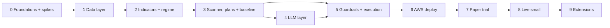

# AuraTrade: Execution Plan

The step-by-step build plan for the system described in the [README](../README.md). Each phase lists its tasks, the files it produces and the **acceptance criteria** that must pass before the next phase starts.

**Size key:** S = a session or two · M = a few sessions · L = a week or more of part-time work.

---

## How to start a build session

1. Open a **new Claude Code chat** in this folder. `CLAUDE.md` loads automatically.
2. Say: **"Continue the build: take the next task from the progress tracker."**
3. Claude names the task, reads the relevant README sections, builds it, verifies it against the acceptance criteria, and ticks the box below.
4. Review the summary, then start a new chat for the next task (or continue if the context is still small).

Tasks marked 👤 need you (accounts, keys, approvals).

## Progress tracker

**Phase 0: Foundations and spikes**
- [ ] 0.1 Project tooling (uv, ruff, mypy, pytest, CI, package skeleton)
- [ ] 0.2 👤 Accounts and keys + `scripts/check_keys.py`
- [ ] 0.3a Spike: Alpaca market data
- [ ] 0.3b Spike: Alpaca orders (paper)
- [ ] 0.3c Spike: market calendar
- [ ] 0.3d Spike: macro data timing
- [ ] 0.3e Spike: fundamentals, earnings, industries
- [ ] 0.3f Spike: news
- [ ] 0.3g 👤 Spike: Claude batch cost (paid; needs your OK)
- [ ] 0.4 👤 Review spike findings; amend README/decisions

**Phase 1: Data layer**
- [ ] 1.1 Config and job framework
- [ ] 1.2 Database and initial migration
- [ ] 1.3 Data clients
- [ ] 1.4 Market calendar
- [ ] 1.5 Ingest job
- [ ] 1.6 Historical backfill

**Phase 2: Indicators and regime**
- [ ] 2.1 Indicators
- [ ] 2.2 Base detection and base count
- [ ] 2.3 Regime classifier
- [ ] 2.4 Regime backtest

**Phase 3: Scanner, strategies, plans, baseline**
- [ ] 3.1 Trend Template
- [ ] 3.2 Strategy registry and scans
- [ ] 3.3 Ranking, cap, verdict cache
- [ ] 3.4 Charts
- [ ] 3.5 Position plans engine
- [ ] 3.6 Watchlist, baseline book, breakout tracker
- [ ] 3.7 Baseline backtest (choose defaults) + re-run 2.4 with leadership health

**Phase 4: LLM layer**
- [ ] 4.1 LLM client and batch
- [ ] 4.2 Schemas and prompts
- [ ] 4.3 Context builders and tools
- [ ] 4.4 Jobs and skip logic
- [ ] 4.5 👤 Prompt sanity set and effort decision (paid; needs your OK)

**Phase 5: Guardrails and execution**
- [ ] 5.1 Guardrails
- [ ] 5.2 Account, sizing, triggers, risk multiplier, numbers
- [ ] 5.3 Orders and signal lifecycle
- [ ] 5.4 Reconciliation and invariants
- [ ] 5.5 Jobs (execute, monitor, EOD, post-market, weekly)

**Phase 6: AWS**
- [ ] 6.1 👤 AWS account setup
- [ ] 6.2 CDK stack
- [ ] 6.3 CI/CD
- [ ] 6.4 Data move

**Phase 7: Paper trial** (the later of 3 months or 30 trades)
- [ ] 7.1 👤 Trial running; weekly reviews
- [ ] 7.2 👤 Go-live criteria met (README §15)

**Phase 8: Live, small**
- [ ] 8.1 👤 Live stack, starting at the 0.5 multiplier

---

## Ground rules (all phases)

- **Branching:** `main` is always deployable. Every task is a feature branch → PR → CI green → merge.
- **Definition of done:** code + tests + type-checked + lint-clean + docs updated if behaviour changed.
- **No secrets in git.** Use `.env` locally (`.env.example` committed) and SSM Parameter Store in AWS.
- **Every job is runnable locally** with `--session YYYY-MM-DD --dry-run` before it is deployed.
- **Test pyramid:**
  - unit tests on pure logic (indicators, regime, plans, guardrails, sizing), using synthetic data
  - integration tests with **recorded HTTP fixtures** (no live API calls in CI)
  - manual end-to-end runs against Alpaca paper
- **Decisions** go in the README decision log; spike findings in `docs/spikes/`; backtest reports in `docs/backtests/`.

---

## What I need from you

| Item | When | Notes |
|---|---|---|
| Alpaca **paper** API key + secret | Phase 0 | Reset the paper equity to the capital you intend to trade live |
| Anthropic API key | Phase 0 | **Set a monthly spend limit in the Anthropic Console** (e.g. $40) |
| FRED API key | Phase 0 | Free |
| Finnhub API key | Phase 0 | Free tier |
| Neon account | Phase 0 | Free tier; `dev` and `paper` branches |
| Telegram bot token + your chat ID | Phase 0 | Create the bot with @BotFather |
| GitHub remote repository | Phase 0 | Private repo |
| AWS account | Phase 6 | Root MFA, an admin user via IAM Identity Center, budget alarms |
| Install AWS CLI + GitHub CLI | Phase 0 / 6 | Not currently installed on this machine |

---

## Phase 0: Foundations and spikes (M)

**Goal:** a working project skeleton, and every external assumption checked against reality before we build on it.

### 0.1 Project tooling (S)

- `uv init`, Python **3.13** pinned; dependency groups (`dev`, `backtest`).
- ruff, mypy (strict on `src/`), pytest, pytest-cov, hypothesis, pre-commit.
- `.gitignore`, `.env.example`, `docker-compose.yml` (Postgres 16).
- GitHub Actions `ci.yml`: lint → type-check → tests.
- `src/auratrade/` package skeleton matching the README layout.

**Accept:** `uv run pytest` passes; CI is green on the first PR.

### 0.2 Accounts and keys (S, mostly you)

Everything in "What I need from you" except AWS. `scripts/check_keys.py` confirms each key works.

### 0.3 Spikes

Each spike is a script in `spikes/` plus a note in `docs/spikes/<name>.md`, ending with a **go / adjust** decision.

| # | Spike | Questions to answer |
|---|---|---|
| a | **Alpaca market data** | Do multi-symbol daily bars with `feed=sip` and `adjustment=all` work on the free plan? How deep is the history and what are the rate limits? Do 1-day bars match regular-session OHLC, or include extended hours? Do **real-time IEX quotes and 1-min bars** work for the EOD price check and the **5-min opening-range high**, and how close is the IEX range to the SIP range (compare on 50 symbols)? Are **pre-market IEX quotes** good enough to detect ≥ 10% gaps for EPs? How long does a 2,500-symbol day take? How do we classify ETFs, SPACs and preferreds? How well are inactive assets covered? |
| b | **Alpaca orders (paper)** | Does OTO with a stop-limit entry (day) and a stop leg work when placed at 09:36 with a trigger above the current price? **What time-in-force does the child stop get**, and can it be made GTC or converted after the fill? **Two-tranche flow:** after tranche 2 fills, can the stop be replaced to cover the full quantity, and what happens to the OTO child leg? Does it need to be cancelled and replaced by a standalone stop? **Share reservation:** confirm a full-quantity stop blocks other sells, and test the sell sequence (reduce stop → sell → restore on failure) for OPG trims, intraday partials and EOD exits. How do OPG exits and marketable-limit adds behave? Does `client_order_id` dedupe? How does PDT protection treat stops on < $25k accounts? What fields does the account API return? |
| c | **Calendar** | Alpaca vs `pandas_market_calendars` for 2016–2027: every disagreement, and how early closes are represented. |
| d | **Macro** | When do the CBOE VIX/VIX3M files update (is the value ready by 17:15 ET)? How far does FRED lag? |
| e | **Fundamentals, earnings, industries** | How accurate is Finnhub's earnings calendar for 50 names, and are **earnings surprises** (actual vs estimate) on the free tier? How reliable is EPS/revenue extraction from EDGAR company facts? Do **SIC codes from EDGAR submissions** cover the universe, and what mapping to ~100 industry groups should we use? What are the rate limits? |
| f | **News** | Is the Alpaca news API available on the free plan? Payload shape and headline volume. |
| g | **Claude** | A batch of 5 Analyst requests to `claude-opus-5-5`: two charts at the planned sizes, compact facts, structured output, shared-prefix caching. Measure tokens and cost per candidate at effort `medium` vs `high`, check the cache hit inside the batch, and measure turnaround → recalibrate the cost model. |

**Accept:** all spike notes written; README decisions confirmed or amended; any blocker has a chosen workaround (especially 0.3b for two-tranche stops).

---

## Phase 1: Core library and data layer (L)

**Goal:** clean, validated, calendar-aware data in Postgres and Parquet, refreshed by an idempotent, holiday-safe job.

### 1.1 Config and job framework (M)

- `config.py`: pydantic-settings; `TRADING_MODE`; model IDs and effort; `config/risk.yaml` loaded into a typed model and hashed.
- `jobs/base.py`, a job runner that provides:
  - the calendar guard, **with a policy per job type** (morning/intraday: today is a session; evening: today was a session; `analyst_collect`: any day; `weekly_review`: Saturdays; `watchdog`: only expected heartbeats)
  - `job_runs` heartbeat
  - structlog context
  - exception → Telegram alert
  - `--dry-run` and `--session` overrides
  - a Lambda handler shim and a CLI entrypoint
- `notify/telegram.py`; `storage/` (local folder and S3 implementations).

### 1.2 Database (M)

- Initial Alembic migration: `tickers` (with SIC and industry group), `industry_groups`, `market_sessions`, `daily_bars` (int `ticker_id`, compact types), `macro_series`, `fundamentals`, `earnings_events`, `job_runs`, `system_flags`.
- Neon `dev` branch connected; tests run on Docker Postgres.

### 1.3 Data clients (M)

- `alpaca_data` (bars, IEX quotes, assets, news), `macro` (CBOE + FRED), `edgar` (company facts, submissions/SIC), `finnhub` (earnings, profile fallback).
- httpx + tenacity, client-side rate limiting, typed responses, recorded fixtures.

### 1.4 Market calendar (M)

- Sync `market_sessions` from Alpaca, cross-check with the library, flag disagreements.
- Helpers: `session_for`, `previous_session`, `sessions_between`, `n_sessions_back`, `is_early_close`, `session_minutes`, `sessions_until_next_open`.

### 1.5 Ingest job (L)

- Universe refresh with filters.
- Gap-fill bars.
- **Validation:**
  - coverage ≥ 90%, otherwise `INCOMPLETE`
  - OHLC sanity
  - split detection → re-fetch
  - half-day flag
- **Retention:** prune bars beyond 2 years; archive 90-day-old `daily_watchlist`, `breakout_tracker` and `llm_decisions` output rows to Parquet; report DB size daily, with an alert at 70% of the free tier.
- Macro.
- Earnings calendar.
- Fundamentals: rolling refresh within free limits, plus a refresh after each report.
- **Industry classification:** SIC → industry group; refreshed weekly.

### 1.6 Historical backfill (S)

`scripts/backfill.py`: 2016 → today. Parquet partitioned by year; the last 2 years loaded into Postgres.

**Accept:**
- Running `ingest` twice is a no-op the second time.
- Tests pass for: a weekend, a Monday holiday, Good Friday, the day after Thanksgiving, a vendor short-count (→ `INCOMPLETE`), a split, and a calendar disagreement.
- Industry coverage ≥ 95% of the universe.
- Postgres size is under the free-tier limit with headroom.

---

## Phase 2: Indicators and regime (M)

**Goal:** a backtested regime classifier writing one row per session.

### 2.1 Indicators (L)

- SMA, EMA, ATR, **ADR %**
- 52-week high/low, measured in sessions
- RS rating, **RS line** (price / SPY: new-high, near-high and 50-session-low states)
- **momentum rank** (1-, 3- and 6-month return percentiles)
- **industry-group RS rank**
- **up/down volume ratio** (50 sessions)
- **extension** above the 50-day and 200-day
- distribution days (count **resets after a follow-through day**) and follow-through-day detection (day 4+, flagged weaker after day 7)
- breadth
- half-day volume normalization
- intraday volume pace curve
- **earnings-gap catalyst detection**
- **climax signals:**
  - largest daily gain since the move began
  - exhaustion gap
  - heaviest-volume up day
  - 7-of-8 / 8-of-10 up days
  - ≥ 70% above the 200-day
  - ≥ 25% gain in ≤ 15 sessions

Every function is unit-tested on hand-built series with known answers.

### 2.2 Base detection and base count (M)

- `indicators/bases.py`:
  - detect consolidations (start, end, depth, contractions, pivot)
  - **IBD base counting:** a new base counts only after a ≥ 20% advance; the count resets when a base undercuts the prior base's intraday low; a base-on-base counts as one
- `bases` migration.
- Tested on hand-built price paths and spot-checked on 10 well-known historical leaders.

### 2.3 Regime classifier (M)

- Pillars, with SPY/QQQ combined as **both for +1, either for −1**.
- The **leadership-health** pillar reads the **ungated breakout tracker** (Phase 3.6). It scores 0 with fewer than 10 tracked breakouts in the window; the backtest computes the tracker from history.
- State machine following the README **transition table** (a new uptrend only via a follow-through day; `RALLY_ATTEMPT` times out after 25 sessions), hysteresis, crisis override, macro staleness → neutral.
- Unit tests for every transition, including the edge cases (an FTD while the score is still negative; a rally-low undercut on the day of an upgrade).
- `market_regime` migration.
- `jobs/regime.py` writes the **computed** regime. The LLM view is added in Phase 4 through the Portfolio Manager.

### 2.4 Regime backtest (M)

`backtest/regime.py` from 2016 (re-run once the baseline backtest exists, so the leadership-health pillar is included):
- a regime timeline over SPY
- time spent in each regime
- switches per year
- SPY forward returns and drawdowns by regime

Thresholds are tuned and the report goes to `docs/backtests/regime.md`.

**Accept:** Q4 2018, Feb–Mar 2020 and 2022 are labelled defensively early in each decline; the 2020 and 2023 recoveries are picked up with reasonable lag; ≤ ~12 switches a year; thresholds committed to `risk.yaml`.

---

## Phase 3: Scanner, strategies, plans and baseline (L)

**Goal:** high-quality daily candidates, deterministic position-plan mechanics, and a rule-only baseline that also tunes the default exit plans.

### 3.1 Trend Template (S)

Vectorized 8-rule screen; one unit test per rule (pass and fail).

### 3.2 Strategy registry and scans (L)

- `strategies/base.py` interface: `scan()`, `build_llm_context()`, `system_prompt`, `entry_policy`, `exit_policy`, `default_risk`.
- `VcpBreakout` (Minervini): contraction sequence (2–4, up to 6, each shallower), volume dry-up, pivot, distance to pivot.
- `MomentumBreakout` (Kullamägi): top ~2% momentum rank; a 30–100%+ move in the last 1–3 months; a 10–40-session consolidation with higher lows and a tightening range; riding the rising 10/20-day.
- `LeaderPullback`, `EmergingLeader`.
- `EpisodicPivot` (Kullamägi): live detection comes in Phase 4. For backtests, a proxy: gap ≥ 10% on ≥ 3× average volume, preferably after an earnings date, with no big rally over the prior 3–6 months.
- **All scans run every evening.** `risk.yaml` defines which strategies are fundable in each regime.

### 3.3 Ranking, cap and verdict cache (S)

- Quality score: RS, momentum rank, group RS rank, RS-line state, up/down ratio, tightness vs ADR, base count, catalyst.
- Exclude stocks more than 25% above their 50-day.
- Only strategies fundable in the current regime compete for the top 40.
- Verdict-cache skip rules.

### 3.4 Charts (S)

Daily (1 year, ~800×600, 10/21/50/150/200 MAs, volume, pivot, RS line) and weekly (2 years, ~600×400) → object storage.

### 3.5 Position plans engine (L)

- `plans/`:
  - the plan model and its bounded menus (from `risk.yaml`)
  - **tighten-only versioning**
- **Entry policies:** pivot vs 5-min opening-range-high triggers; single vs two tranches; the confirmation gate.
- **Early-behaviour rules:** heavy-volume reversal → exit; a light-volume dip below the pivot → hold, no tranche 2; time stops at 10/20 sessions.
- **Exit menu:**
  - partial sales: Kullamägi 3–5 days / O'Neil 20–25% / Minervini 2–3R
  - breakeven after the first partial or at +3R
  - the **round-trip rule** at +10%
  - the **8-week hold** (+20% in ≤ 15 sessions → 40-session hold)
  - trails on a close below the 10-day / 21 EMA / 50 SMA
  - **climax sales** (≥ 2 signals → ½, ≥ 3 → all)
  - selling into a late-stage (4th) base breakout
  - faltering-RS events
- The earnings-cushion table; hard-stop vs soft-rule levels; `position_events`.
- Migrations: `position_plans`, `position_events`.
- Fully unit-tested, including "a loosening change is rejected" and every rule's trigger and non-trigger cases.

### 3.6 Watchlist and baseline (M)

- Migrations: `daily_watchlist`, `baseline_signals`, `breakout_tracker`.
- **Baseline book:**
  - same top-40 list, regime gating, sizing, guardrails, entry policies, deterministic confirmation gate, default plans and earnings cushion
  - takes setups in rank order until the limits are full
  - EPs come from the morning candidate list (rule-based)
- **Evening simulation:** the baseline is simulated after the close from that day's SIP minute bars (fetched for its symbols only): 09:36 triggers, opening-range highs, low-of-day stops, the EOD gate and soft rules.
- **Breakout tracker:** records every trigger from the full uncapped scan, regardless of regime, and its 5-session result → leadership health.

### 3.7 Baseline backtest: choosing defaults from evidence (L)

`backtest/baseline.py` from 2016, per strategy and per regime.
- Daily bars drive most rules.
- **Intraday-dependent rules** (opening-range-high triggers, low-of-day stops, the 15:40 confirmation gate, heavy-volume reversals) use **SIP 1-minute bars fetched only for trigger days** of candidate symbols, cached in Parquet. This keeps the data volume and rate-limit use small.

Outputs:
- expectancy, win rate, average gain vs average loss, average R, max drawdown
- **Comparisons** (each against a reference setup):
  - **entries:** a pivot trigger vs an opening-range-high trigger on gap opens; one tranche vs two
  - **early behaviour:** heavy-volume-reversal exit on vs off; time stops 10/20 vs none
  - **partial styles:** Kullamägi (3–5 days) vs O'Neil (20–25%) vs Minervini (2–3R) vs none
  - **trails:** 10-day vs 21 EMA vs 50 SMA
  - **8-week hold and climax sales:** on vs off
  - **base count:** a 3rd stage at half risk and a 4th stage excluded, vs no filter
  - **risk scaling:** the progressive-exposure multiplier on vs off
  - **regime:** the leadership-health pillar on vs off

The winning defaults go to `risk.yaml`; the report to `docs/backtests/baseline.md`, with the source for each rule tested.

**Accept:**
- Watchlists, pivots and base counts match a visual read on 10 hand-picked sessions; textbook VCPs and momentum breakouts chosen in advance are detected.
- The report exists, and each adopted rule improves expectancy or drawdown (or is kept for safety, with the reason noted). The regime gating and multiplier reduce drawdown. If not, revisit before going on.
- Default entry policies and exit plans per strategy are chosen from evidence.

---

## Phase 4: LLM layer (L)

**Goal:** the full evening and morning decision pipeline in `dry_run`, with every decision logged and costed, within the token budget.

### 4.1 LLM client and batch (M)

- `llm/client.py`:
  - structured outputs into Pydantic
  - adaptive thinking with explicit effort per role
  - prompt caching on the stable prefix
  - refusal handling with server-side fallbacks
  - retries and timeouts
  - usage → cost
  - payload → storage
  - a `llm_decisions` row for every call
- `llm/batch.py`: build requests with an identical cached prefix, submit, poll, collect; `llm_batches` table.

### 4.2 Schemas and prompts (M)

- `AnalystVerdict` (with **output caps** and a **watch note**), `PortfolioDecision` (regime view, EP decisions, entries with plans chosen from the menu, tighten-only position actions), `EodDecision` (tranche-2 adds, failed breakouts), `WeeklyLessons`.
- Prompts: Analyst (shared core + one section per strategy, written from the §18 sources), Portfolio Manager (including EP review criteria), EOD, weekly; `prompt_versions` registry.

### 4.3 Context builders and tools (M)

- **Compact context:** rounded fact tables (base count, RS line, up/down ratio, momentum rank, ADR, extension), no raw bars, ≤ 5 headlines.
- **Continuity:** the Analyst's previous verdict and watch note for the ticker.
- **Event-driven position context:** full detail only for positions with events, one line for the rest.
- Approved lessons only (≤ 10); "your numbers" summary.
- Portfolio Manager tools: `get_news`, `get_chart`, `get_fundamentals`, `get_position_history`.

### 4.4 Jobs and skip logic (M)

- `analyst_submit` / `analyst_collect` → `setups`.
- `premarket_check` (07:30) → macro, news and earnings flags and events.
- `portfolio_manager` gap step (08:40, once IEX pre-market quotes exist) → gap invalidations and **EP candidates** (`ep_candidates` migration).
- `portfolio_manager`: **skipped when there are no fundable setups, no EP candidates and no position events**; writes the effective regime; proposed actions are logged (guardrails arrive in Phase 5).
- `weekly_review` → "your numbers", proposed lessons + Telegram; a CLI command approves them (`auratrade lessons approve <id>`).

### 4.5 Prompt sanity set and effort decision (S)

- 20–30 hand-labelled historical setups, checked for format, consistency and reasoning quality. It isn't a performance test.
- Run the set at Analyst effort `medium` vs `high` and pick the cheaper one when quality is equivalent.

**Accept:** evening and morning pipelines run end to end in `dry_run` for 5 consecutive sessions; every call is logged with cost; the measured average is **≤ ~$1/day**; skip logic is verified on a quiet day; outputs read sensibly.

---

## Phase 5: Guardrails, execution, monitoring and journal (L)

**Goal:** safe, idempotent two-tranche order handling against Alpaca paper, with plans carried out by code and complete reconciliation.

### 5.1 Guardrails (M)

- One pure function per README §8 rule, including **tighten-only** (with the round-trip rule), the **tranche-2 rules**, **per-strategy stop width**, the **base-count limits**, the **progressive-exposure multiplier**, **keep losses small vs gains**, the 25%-above-50-day limit and the **earnings cushion**.
- `evaluate(actions, context)` → approve / clip / reject.
- Tests: unit tests, hypothesis adversarial tests (negative or inverted stops, 50% risk, unknown symbols, loosening plans, tranche-2 without a gate pass, NaN prices), **100% branch coverage**.
- `guardrail_events` + Telegram.

### 5.2 Account, sizing and risk multiplier (S)

- `execution/account.py` → `AccountConstraints` (equity, buying power, PDT, day trades, shorting).
- `execution/sizing.py`: planned size on the worst fill; tranche split; tranche-2 re-sizing on the actual price.
- `execution/triggers.py`: pivot vs **5-min opening-range high** (from IEX 1-min bars, per the 0.3a findings), low-of-day stops for momentum and EPs, max-chase checks.
- `journal/risk_multiplier.py`: progressive-exposure state (start 0.5 → 1.0 → 1.25; 0.5 / 0.25 on losses or drawdown) from the journal and equity peak.
- `journal/numbers.py`: rolling win rate, average gain, average loss, expectancy ("your numbers").

### 5.3 Orders and signal lifecycle (M)

- Tranche-1 or single-tranche OTO entry placed at 09:36; limit prices per README §7.1 (pivot × 1.05, or trigger × (1 + min(2%, ½ ADR%))); tranche-2 marketable-limit add; **full-quantity stop replacement** and **GTC conversion** of child stops (per the 0.3b findings).
- **Sell sequencing** for every OPG trim, intraday partial and EOD exit: reduce the stop → sell → restore the stop on rejection or no fill.
- Exposure reservation for the full planned position at tranche 1.
- `signals` state machine with a `tranche` field; idempotency key = `client_order_id`.
- Migrations: `signals`, `orders`, `positions`.

### 5.4 Reconciliation and invariants (M)

- Broker vs DB for positions, orders and fills.
- **Invariant in every order-touching job** (`execute_open`, `execute_entries`, `intraday_monitor`, `eod_review`, `post_market`): every open position has a **GTC** broker stop covering its **full quantity** at ≥ its plan's hard-stop level. If not: repair immediately, alert, and block entries.

### 5.5 Jobs (L)

- `execute_open` (09:20: OPG exits, stop replacements) and `execute_entries` (09:36: triggers and entries).
- `intraday_monitor`: volume pace, **early-behaviour rules**, **intraday hard-stop raises** on milestones (breakeven, round-trip), cancellations, crisis.
- Rule **precedence** (README §7.3) implemented in one place (`plans/resolve.py`) and unit-tested with days where several rules fire.
- `eod_review`:
  - code: trailing-MA closes, heavy-volume reversals, climax sales, 8-week-hold state, cushion exits, using IEX real-time prices
  - LLM, only when needed: tranche-2 adds that passed the gate, failed breakouts
- `post_market`: journal, MAE/MFE, snapshots, risk multiplier, report.
- `weekly_review`: calibration and the LLM-vs-baseline section.
- Kill switch and loss halts wired into every order path.
- Migrations: `trade_journal`, `account_snapshots`, `lessons`.

**Accept:**
- A full trading day runs locally on Alpaca paper:
  - a pivot entry and an opening-range-high entry trigger at 09:36 and later
  - tranche 1 fills and the stop attaches
  - tranche 2 adds after a gate pass and the stop covers the full quantity
  - a soft-rule exit and an earnings-cushion exit fire near the close
- **Simulated sessions** (replayed bars) exercise every early-behaviour, partial, breakeven, round-trip, 8-week-hold and climax rule.
- **Chaos tests:** killing a job mid-run, running it twice, an API 500 during submission, a stop deleted at the broker, **a rejected OPG exit**, and **a failed sell after the stop was reduced** produce **no duplicate orders and no unprotected position**.
- The kill switch cancels resting entries within one run.

---

## Phase 6: AWS deployment (M)

**Goal:** the whole system running unattended in AWS against Alpaca paper.

- **6.1 AWS account (S, with you):** root MFA, an admin user via Identity Center, AWS CLI, budget alarms at $10 and $25, `cdk bootstrap` in `us-east-1`.
- **6.2 CDK stack (M):**
  - ECR repository and image build
  - one Lambda per job
  - EventBridge Scheduler in `America/New_York` (including the half-day slots)
  - SSM parameters
  - S3 with a lifecycle rule
  - CloudWatch log retention of 30 days
  - least-privilege IAM
  - `watchdog` Lambda
- **6.3 CI/CD (S):** GitHub Actions on merge to `main` → build → ECR → `cdk deploy`, using OIDC.
- **6.4 Data move (S):** Parquet → S3; Neon `paper` branch migrated and seeded.

**Accept:** 5 consecutive unattended sessions; a holiday or early close handled correctly (real or simulated); the watchdog fires when a job is disabled on purpose; AWS cost under $5/month.

---

## Phase 7: Paper-trading trial (the later of 3 months or 30 trades)

- **Weekly ritual:** Saturday report + your review:
  - R-multiples and trades with the LLM's reasoning
  - guardrail events
  - LLM vs baseline
  - conviction calibration
  - regime timeline
  - cost
  - **approve or reject proposed lessons**
- **Prompt changes:** at most one versioned change per week. **Risk config changes:** via `risk.yaml` commits with the reason noted.
- **Incidents:** `docs/incidents.md`.

**Exit:** the go-live criteria in README §15 are met.

---

## Phase 8: Live, small

- Separate `live` stack (Neon `live` branch, live keys, `TRADING_MODE=live` set explicitly).
- Start at the 0.5 progressive-exposure multiplier ("prove it first") with reduced capital; optional Telegram one-tap approval for entries.
- Step up to the full envelope after one clean month; keep comparing with the baseline.

---

## Phase 9: Extensions (later)

- Telegram commands (`/status`, `/halt`, lesson and entry approvals) via a webhook.
- `FailedBreakoutShort` and Kullamägi's parabolic short for `CORRECTION` (margin with shorting).
- A 60-minute opening-range-high entry option for EPs (a later entry slot at 10:46).
- A two-stage Analyst (cheap triage → full review) if costs rise.
- A hidden-Markov-model regime probability as extra LLM context.
- Pyramiding winners (adding on a first pullback to the 10-week line).
- An IPO-base strategy; a read-only dashboard.

---

## Dependency overview

Guardrails (5.1) and sizing and the risk multiplier (5.2) depend only on Phase 3's plan model, so they can be built in parallel with Phase 4.
